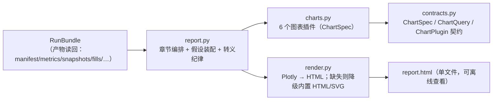

> 事实锚点：2026-10-25
> - 覆盖范围：btf 可视化
> - 事实真源：btf 报告生成
> - 关键计数：6 固定章节 ＋ 1 条件章节（基准对照（多基准），≥2 个基准才渲染）
> - 文档版本：v0.4（btf 2.0.0 基线，2026-10-25）

# 13 可视化架构与设计

> **本文档描述 btf 的报告与可视化现状**——对应实现版本 **btf 2.0.0（v0.4 基线，2026-10-25：策略出仓／多基准／研究批次数据冻结／L5 归一化墙钟门槛）**（沿革：1.0.0 定版 2026-09-29 → 1.1.0 CLI 收编 2026-09-30 → 1.2.0 配股/缩股入链路落版 2026-10-07 → 1.2.1 工具完备版 → 1.2.2 完备收口版 → **1.2.3 公司行动扩维＋收口五轮（V1.2.3 定版，2026-10-09）** → **1.2.4＝定版后 L4 阶段六单并入（R57′~R62′，2026-10-10 发版）**：R57′（`optimize --objective` 基准同源）／`walk-forward` 预热修复（R58′）／`lookback_bars` 声明（R59′）／**文档守卫 4 组＋纪律九**（R60′）／**折算感知 FIFO**（R61′）／**消费侧价格视图 `run.price_view`（默认 qfq）**（R62′）→ **1.3.4＝L2 治理批 HH-1~HH-6（2026-10-14 发版）** → **2.0.0＝2.0 重构基线（2026-10-25：策略出仓＋多基准＋研究批次数据冻结＋归一化墙钟门槛）**；口径以本文档正文为准）。
> 实现：`btf/viz/{contracts,charts,render,report}.py`；产物 `report.html`（自包含）。
> 关联：门禁第 7 项（渲染级结构）见 [09 §14.9](09-测试验证与基准.md)；产物契约见 [08 §13.3](08-可复现性与实验管理.md)。

---

## 19.1 架构（三层解耦）

| 模块 | 职责 | 关键点 |
|---|---|---|
| `contracts.py` | 图表数据契约 | `ChartSpec(chart_type,title,subtitle,series,axes,annotations,export_hint)`、`ChartPlugin` Protocol；`CHART_CONTRACT_VERSION="runresult.v1"` |
| `charts.py` | 图表插件集 | 6 个：`equity`（净值曲线）/`drawdown`（回撤）/`monthly_heatmap`（月度热力图）/`trades_table`（交易明细）/`metrics_table`（指标表）/`weights_area`（权重面积）；`CASH_KEY="@CASH"`、`TOP_HOLDINGS=8` |
| `render.py` | 渲染与降级 | `render_html(spec, *, include_plotlyjs=False)`；Plotly 缺失/失败 → 内置 HTML/SVG，**不抛错** |
| `report.py` | 编排 | `ReportBuilder(bundle, assumptions=None, charts=DEFAULT_CHARTS, title=None).build()`；Jinja2 `autoescape=True` |

## 19.2 数据契约（图表层只认契约）

- 图表**只消费** `RunBundle`（产物读回）与 `ChartSpec`；**不得**自行取数（禁止 import 数据层）。
- 契约保证：同一 `RunBundle` → 同图表结构（渲染级断言的基础）。
- 图表插件注册：新增图表 = 新增 `ChartPlugin` 实现 + 加入 `CHART_PLUGINS`（**不改核心渲染逻辑**）。

## 19.3 图表清单（当前）

| 图 | 数据源 | 说明 |
|---|---|---|
| `equity` | `snapshots.jsonl` | 净值曲线（含基准对比，若配置基准） |
| `drawdown` | 净值序列推导 | 回撤曲线 |
| `monthly_heatmap` | 净值序列 → 月度收益矩阵 | 月度收益热力图 |
| `trades_table` | `trades.jsonl`/`fills.jsonl` | 交易明细（含费用） |
| `metrics_table` | `metrics.json` | 15 项指标表（不可算项显示 `null`） |
| `weights_area` | `snapshots.jsonl` 持仓权重 | 权重演进（现金键 `@CASH`，Top-8 持仓） |

## 19.4 报告结构（HTML 单文件；**v0.4（btf 2.0.0 基线，2026-10-25）**）

**章节（6 固定章 ＋ 1 条件章）**：`summary`（摘要 + 指标卡）→ `performance`（净值/回撤/月度热力）→ `trading`（交易明细/权重）→ **`assumptions`（假设与披露）** → **`reproduce`（复现说明）** → `appendix`（生效配置等）；**条件章**「基准对照（多基准）」在 `report.benchmark` **≥2 个**时插入执行摘要之后（结构与出现条件见 [19.4.1](#1941-基准对照多基准章节mm-6)）。

| 规则 | 说明 |
|---|---|
| **强制章节** | 「假设与披露」「复现说明」**不可关闭**（`_MANDATORY_SECTIONS`）——即使 `report.sections` 只写 `[summary]`，这两章仍会渲染 |
| 默认章节 | 默认全章（含 `reproduce`/`appendix`）——报告是"证据载体"，不是"展示选配" |
| 章节别名 | `report.sections` 支持 11 个别名键（图表名与章节名映射） |
| 披露内容 | 零成本模型 / **零摩擦滑点（显式 `none`）** / **价内滑点成本（✅ F9，2026-10-06）** / 空风控链 / 降级涨跌停 / 事件采样 / 数据质检摘要 / 数据指纹 / 代码与规则版本 / **价格视图（`run.price_view`＋基准日，R62′/N64）** / **主基准与对照基准点名（MM-6：对照只进披露区）** / 装配说明 / **无基准对照** / **复权因子缺失回落** / **退市持仓残值按末价携带（未清算）**（✅ RC-11-A）/ **危机区间覆盖**（✅ RC-13）/ **数据版本门禁通过**（✅ RC-14）/ **配股行权披露（获配/缴款/现金缺口/上市日）＋缩股披露＋清单状态行（未加载显式披露；✅ CL-2 第二段，1.2.0）** / **退市清算口径随取值（carry/writeoff，✅ CL-3，1.2.0）** / **optimize 短区间 override（✅ CL-1，1.2.0）** / **公司行动覆盖段（ETF/LOF 命中/折算/分红计数＋fail-closed 计数；✅ R36′，1.2.3）** / **名义价告警（指标口径声明；✅ R36′）** / **作废横幅（本 run 已作废及原因；✅ Q-8/DOC-12——DOM 级渲染断言＋轻量 MD 渲染 R40′）** |

**公司行动披露渲染（1.2.3，CL-2-H）**：① **覆盖段**在「假设与披露」内**口径可见**（ETF 宇宙恒显命中计数；**纯股票 run 不出现**——R38′ 无非空守卫）；② **作废横幅**取自作废登记表（`回测产物/runs/作废登记-*.md`），文案经 `_md_lite`（先 `html.escape` 再渲染 `**粗体**`/`` `行内代码` ``）——N42/R40′；③ 分红/折算逐事件披露随事件日志（`dividend_events`/`consolidations`）。

**「假设与披露」字段来源纪律（RC-03 / RC-09，2026-10-05）**：该章节的**假设类字段一律读生效配置**（`manifest.config_effective`），**禁止硬编码**。
已修事实：滑点曾写死 `"none（回测基线）"`、撮合写死 `next_open` —— 用户配了 `pct` 报告仍显示 none（**报告失真**）。
渲染约定（人类可读串）：`pct 0.001（单边 10bp）` / `none（显式声明，零摩擦基线）` / `fixed 0.01 元`；
未配 `report.benchmark` 时该章节必须出现「**无基准对照**」（IR / 超额不存在）。
**多基准（MM-6）**：结构、出现条件与过滤语义见 [19.4.1](#1941-基准对照多基准章节mm-6)。
> 该纪律须有**渲染级断言**守卫（[09 §14.9](09-测试验证与基准.md) 第 7 项同款）：配 `pct` 的文本断言"不出现 none"，配 `none` 的断言出现显式声明串。

> **交付状态（2026-10-05）**：**RC-03 已交付**——`services.py::assemble_assumptions` 现从 `manifest.config_effective` 取
> `execution.handler` / `execution.slippage{model,params}`，经 `format_matching()` / `format_slippage()` 渲染；
> 真入口实测（`pct 0.002` ⇒ 报告显示 `pct 0.002（单边 20bp）`、硬编码串消失）。
> **RC-09 已交付**——`_assembly_disclosures` 反向分支 + `bt run` 终端 warn 双披露：无基准 ⇒ 报告含「无基准对照」、
> 终端出现 warn（双向探针：配基准走「基准对比」分支、不出现该标注）。

> **F9 已交付（2026-10-06）**——「撮合与成本假设」表新增 **「滑点成本（价内）」** 行：
> 由 `fills.jsonl::ref_price`（**滑点前基准价**，`Fill.ref_price`）还原 `Σ qty×|price−ref|`，并与**显性费用**给出倍数
> （修正 `fee_ratio` 把价内滑点排除在外的低估；19 号 §65.5 / §67.3-adjacent）。
> 渲染样例（真入口实测）：`≈ 2,048.78 元（= 显性费用 549.91 元的 3.73 倍）`；
> **零摩擦** ⇒ `≈ 0.00 元（零摩擦（滑点模型 none，显式声明）；…）`；**旧产物**（无 `ref_price`）⇒ 明示
> `不可得（产物未记录 ref_price——重跑后可披露）`——**不静默算 0**。守卫：`tests/integration/test_report_assumptions_rc03.py`
> （`TestSlippageCostDisclosureF9`，含**独立复算金额/倍数逐字断言** + 旧产物不可得用例）。

**转义纪律**：Jinja2 `autoescape=True`；**HTML 片段必须显式 `| safe`**（否则标签被转义 → 正文出现 `&lt;div class=`，报告不可读）。
该纪律由 `tools/check_report_render.py`（`bt check` 第 7 项）**渲染级断言**守卫，含**负向对照**（还原错误模板即变红）与
**双向探针**（HTML 片段正常渲染 ∧ 纯文本字段被转义且裸串不存在）。

### 19.4.1 「基准对照（多基准）」章节（MM-6）

**出现条件**：`report.benchmark` 为 **1–3 个代码的数组且 ≥2 个**（`btf.config.loader.benchmark_symbols` 归一，**首个＝主基准**，顺序即语义、不排序不去重）；**单值或单元素数组 ⇒ 不渲染**——既有单基准报告结构零变化。

**位置与过滤**：置于**执行摘要（`summary`）之后**（`sections.insert(1, {"id": "benchmark_comparison", …})`）；**不受 `report.sections` 过滤**——对照基准的相对指标**只存在于本表**，被过滤即等于「算了却不披露」。强制章节（`assumptions`／`reproduce`）仍照常追加。

**数据来源**：`manifest.benchmarks[]`（run 期落盘，即 `report.benchmarks[]`）；报告层**不重算**（铁律 5 禁 `viz → analytics`，且须与落盘同源）。单基准亦落一条（`primary=true`），但表格不渲染。

**表结构**（逐基准一行，共 11 列）：`基准`｜`角色`（`主基准（进 metrics）`／`对照（仅披露）`）｜`基准总收益`｜`超额收益`｜`年化超额`｜`跟踪误差`｜`信息比率`｜`beta`｜`alpha（年化）`｜`上行捕获`｜`下行捕获`；不可算项为 `null`（渲染占位 `—`）。

**与 metrics 的边界**：只有**主基准**的相对指标进 `metrics.json`（键名/口径不变，digest 不受影响）；**对照基准只进** `manifest.benchmarks[]` 与本表（P0-NEW-7：metrics 只许数值）。`noise_baseline`（随机择时对照）**只用主基准**。

**披露**：「假设与披露」点名主基准与对照基准（「只进披露区，不写入 metrics」）；未配基准仍出现「**无基准对照**」（RC-09 软强制）。

**守卫**：`tests/system/test_cli_benchmark_e2e.py::TestCliMultiBenchmark` 断言表成形（`<table><thead>`）＋两代码在场＋无整体转义残留；`report.sections` 过滤路径下该章节仍在。

## 19.5 入口行为契约

| 入口 | 行为 |
|---|---|
| `bt run` | 落盘产物（报告不自动生成；可用 `bt report` 生成） |
| `bt report --run <id> [--out X.html]` | **幂等**再生成（同产物 → 同 HTML）；缺产物 → 报错退出 |
| `btf.api.report(run_id, ...)` | 与 CLI **同源实现**（`btf.app.build_report_file`） |
| Notebook | 直接读 `ReportBuilder` 或读取层自绘（不承诺兼容） |

## 19.6 插件化与降级

- **插件化**：新增图表 = 新增文件 + 注册进 `CHART_PLUGINS`；不改 `report.py`/`render.py`（契约 6 精神）。
- **降级链**：Plotly 可用 → 内联图表；不可用/渲染失败 → 内置 HTML/SVG 静态图（**报告仍可读**）。
- **不依赖网络**：`include_plotlyjs=False` 时不引用 CDN 资源（离线可看；如需 CDN 版本显式开启）。

---

> **下一篇**：[14-工程化专项设计-上.md](14-工程化专项设计-上.md) —— 性能容量、微观结构建模、数据治理与契约。
