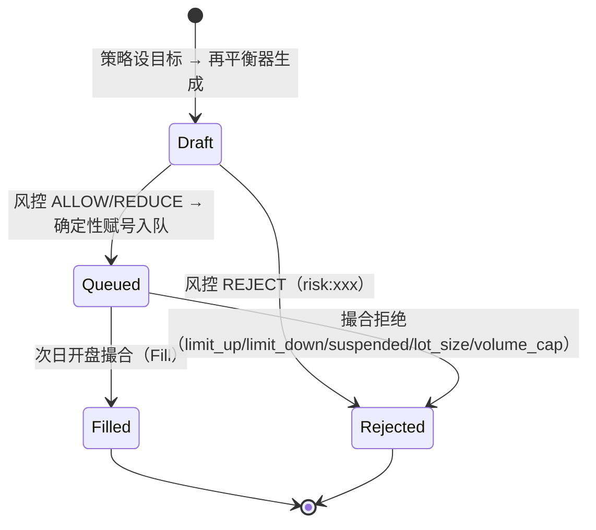
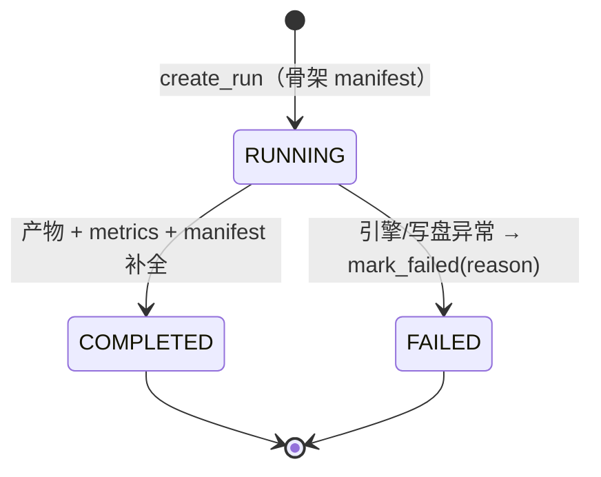
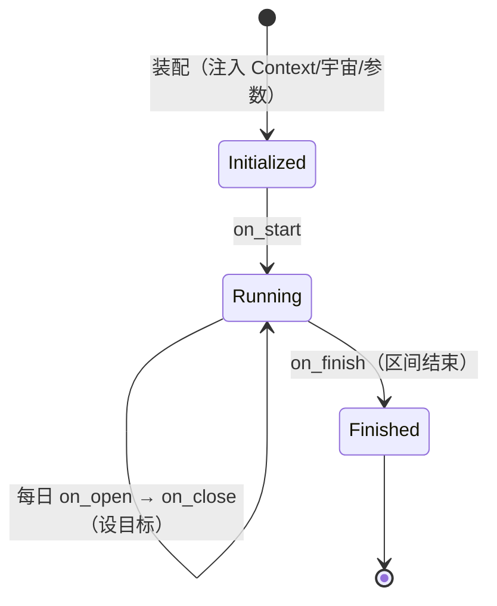
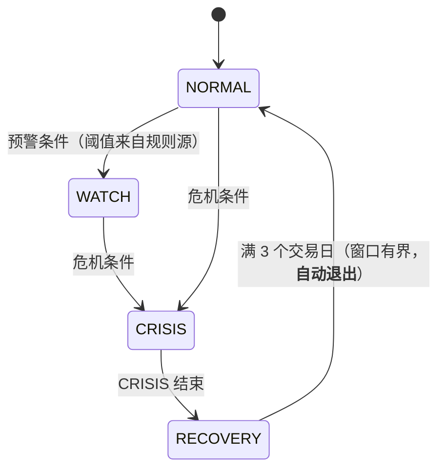

> 事实锚点：2026-10-25
> - 覆盖范围：btf 术语表
> - 事实真源：全文静态
> - 关键计数：—

# 17 术语表与关键状态机

> **本文档是 btf 的术语与状态机权威表**——对应实现版本 **btf 2.0.0 基线**；**文档 v0.4（btf 2.0.0 基线，2026-10-25）**（沿革：1.0.0 定版 2026-09-29 → 1.1.0 CLI 收编 2026-09-30 → 1.2.0 配股/缩股入链路落版 2026-10-07 → 1.2.1 工具完备版 → 1.2.2 完备收口版 → **1.2.3 公司行动扩维＋收口五轮（V1.2.3 定版，2026-10-09）** → **1.2.4＝定版后 L4 阶段六单并入（R57′~R62′，2026-10-10 发版）**：R57′（`optimize --objective` 基准同源）／`walk-forward` 预热修复（R58′）／`lookback_bars` 声明（R59′）／**文档守卫 4 组＋纪律九**（R60′）／**折算感知 FIFO**（R61′）／**消费侧价格视图 `run.price_view`（默认 qfq）**（R62′）→ **1.3.1＝与 mdf 统一版本号（2026-10-11，无功能变更）** → **1.3.4 L2 治理批 HH-1~HH-6（排序口径留痕＋A5/A6 例行对照＋adhoc 收编，2026-10-14）** → **2.0.0 基线（2026-10-25，文档 v0.4 全量更新）**；口径以本文档正文为准）。
> 用法：文档与代码注释中的术语以本文为准；状态机语义变更须同步本文与 [19 §6.3](19-架构审查与重构演进记录.md) 的机器守卫。

---

## 33.1 术语表

### 交易与市场

| 术语 | 定义（btf 口径） |
|---|---|
| **标的（Instrument）** | 可交易/可回测对象；`symbol` 形如 `600519.SH`；含 `asset_class`（stock/etf/index）与 `board` |
| **交易日（TradingDate）** | 唯一日期值对象（`YYYYMMDD` 语义）；一切区间/快照/事件以交易日为粒度 |
| **状态面板（TradingState）** | 每 (标的, 交易日) 的可交易性事实：限价、停牌、ST、退市、触板；**唯一拒单依据** |
| **全日停牌 / 盘中停牌** | `suspend_d` 中 `S` 型且无 `timing` = 全日停牌（当日**不产出行**）；否则为盘中停牌（当日有行） |
| **涨跌停触及** | 收盘价与限价比较，容差 `1e-4`（相对） |
| **T+1** | 买入当日不可卖（`available=0`），次日释放；卖出受 `available` 硬约束 |
| **整手** | 100 股；不足一手 → 拒单（`lot_size`） |
| **名义价记账** | 引擎以**不复权价**记账；除权通过事前/事后事件调整（ADR-6） |
| **复权（hfq/qfq）** | 消费侧序列变换（`close × 复权因子 / 基准因子`）；**不进引擎记账**——**1.2.4 起经「消费侧价格视图」喂策略**（下条；只改策略可见价，撮合/成本/NAV 仍名义价，ADR-6） |
| **复权因子表路由（唯一口径）** | **股票 → `adj_factor`；ETF / LOF → `fund_adj`**（份额折算 / 不定期折算的唯一来源，`adj_factor` 只含股票）；路由经 `factor_table_of` **复用** `daily_table_of` 判定；因子缺失**不得**静默回落 `1.0`（warn + `degraded_notes()` 披露），见 [05 §9.4](05-数据架构与数据集体系.md)｜**RC-04 已交付 2026-10-05** |
| **VPP（成交量参与率上限）** | `handler_params.volume_participation`：单笔成交 ≤ 当日成交量 × VPP；**缺省 0.05**（RC-02 已交付）。超出部分**缩量**至上限，不足一手 → `volume_cap` 拒单；显式 `null` 或空 `{}` = 不启用 |
| **公司行动（CorporateAction）** | 除权除息事件；按 `ex_date`（份额/成本）与 `pay_date`（现金）两时点处理；**1.2.0 扩维**：配股四字段（`rights_ratio/rights_price/rights_ex_date/rights_listing_date`）＋ 缩股（`consolidation_ratio`）｜**1.2.3 扩维（ADR-20/DOC-9；已交付 2026-10-08→10-09——R32′/R35′/R34′/R36′/R54′；§103 验收通过，随 V1.2.3 定版）**：**基金分红**（源 `fund_div`；`ex_date` 份额不变 ＋ `pay_date` 现金到账 `qty × div_cash`；主口径 `pay_date`——实测 39/39 笔非空，回退链 `pay_date→earpay_date→ex_date` 且**回退必须披露**、非交易日顺延；`div_cash` **即每份金额、禁止除以 `base_unit`**——510880 11/11 笔零误差；按 `(ts_code, ex_date)` 去重、只消费 `div_proc='实施'`）＋ **基金份额折算**（复用股票 `consolidation_ratio` 语义：`shares ÷= R`、`avg_cost ×= R`，成本总额守恒；**R 双证据**＝`pre_close(t)÷close(t−1)` 与 `fund_adj` 跳变互校，容差 **0.5%** 不符 **fail-closed**——**★ 互校方向（DOC-13，N37）：`fund_adj` 跳变 ＝ R 的倒数，互校式为 `|R × (f_t÷f_{t−1}) − 1| < 0.5%`；禁止直接比较 R 与因子比值（直接比较将得 75%~800% 偏差 ⇒ 全盘 fail-closed）**；**支持非整数比**——实测 512200=2.7937、515580=0.51003；**禁用 `fund_share` 判折算**，仅作辅助披露） |
| **配股行权（Q-4(a) 默认全额行权）** ✅ 1.2.0 | 除权日 `M = floor(N × ratio)`：份额＋`available` 同增、现金缴款 `M×配股价`（不足 ⇒ 外部增资补足＋`cash_shortfall` 审计）、`avg_cost` 加权（禁送转式摊薄）；获配上市日前卖出 ⇒ 警告（不建模锁定期） |
| **正推校验 / 放大因子守卫** ✅ 1.2.0（N16） | 清单校验 `chg_pred = X(1+r)/(X+r·Pr)` vs 实测 `chg`（容差 0.5%）；`amp = chg(1+r)/|1+r−chg| > 5` ⇒ 禁用病态反推 |
| **实际发行比例（r_effective）/ 认购率** ✅ 1.2.0（N19） | `配股数量/配股前总股本`；与名义比例之差＝认购率不足（可观测物理量）；挂起条目据此披露股本级正推误差（**仅披露不建模**） |
| **缩股（consolidation）** ✅ 1.2.0 | `qty` 按 `consolidation_ratio` 减少、无现金流、成本总额守恒；**默认只披露不建模**（N17/§80.6；开关 `BTFTOOL_CORP_ACTIONS_CONSOLIDATIONS`）；**无效比率口径（R54′/N59 裁决 (a)，1.2.3）**：`≤0` 或不可转换 ⇒ 视为无效值 ⇒ **不建模（份额不变）＋WARN**，**禁走保底清零**（清零持仓＝不可逆资产破坏） |
| **消费侧价格视图（`run.price_view`）** ✅ 1.2.4（R62′/N64） | 喂给策略的 bar（`ctx.bar()`/`ctx.history()`）走 **qfq 后复权**：`qfq(t)=price(t)·f(t)/f(ref)`，`ref＝run.period.start`（**PIT 合规**；**禁 hfq**——依赖全序列因子 ⇒ 前视）；**默认 `adjusted`**，`nominal` 为对照档。**ADR-6 记账口径不变**（撮合/成本/费用/NAV/快照＝名义价）；指数无复权语义；因子缺失回退 1.0＋`degraded_notes()` 披露 |
| **折算感知 FIFO（`pair_fills_to_trades(consolidations=…)`）** ✅ 1.2.4（R61′） | `trades` 与逐笔口径 `win_rate_trades` 的**开平配对**在**折算时点**对队列内该标的每个 lot 做**市值守恒变换**（**剩余 ×R**（碎份向下取整；`≤0` 走 R21′ 保底＝留 1 份、成本价不变）**且 成本价 ÷R**，多次累积）；**只对 ex_date 之前建立的 lot 生效**（同日/之后买入不受影响）；`_lot_pnl` 用调整后成本价、费用摊销分母＝调整后原始量。来源同源：落盘＝`result.consolidations`／复核＝`events.jsonl` 已应用 `corporate_action` |
| **文档披露守卫（T-A~T-D）** ✅ 1.2.4（R60′） | `tests/integration/test_doc_claim_guards.py` 四组机器守卫（随 pytest 常跑）：**T-A 计数**（六份现状文档必须同含「tag 快照」口径＋工作区值 == 实测 collect）· **T-B 口径**（warm-up 数字 == `QidianStrategy.lookback_bars()`＝**1020**；现状档严格／19 号留痕档宽松）· **T-C 矛盾扫描**（自 19 号提取已验收单号 ⇒ 其余文档不得再写「待 Rxx′」）· **T-D 时变量格式**（digest 条目须含「扫描时刻」＋日期）。失败信息含「文档路径＋行号＋声明值＋实测值」（§110.2）；配套 **20 号纪律九** |
| **比率归一化（`ratio_or_default`）** ✅ 1.2.3（R54′） | 外部读入比率字段的**唯一归一化入口**（`btf/domain/action.py`）：`None` ⇒ default（静默）／**不可转 float/NaN/±∞** ⇒ default ＋ **WARN**（**禁崩**）／**≤0** ⇒ 无效值**不建模** ＋ WARN（**禁清零**）；**五处收敛**（`corp_action_probe` 确证＋代理 · `events_log._dec_action` · `action_order_key` · `portfolio`）；domain 层**零副作用**（告警经 `warn` 回调注入——铁律 3 白名单） |
| **退市清算口径（carry/writeoff）** ✅ 1.2.0（CL-3） | `carry`（默认）＝残值按末次可用收盘携带（现状零回归）；`writeoff` ＝按 0 核销压力档（仅末日快照清零＋NAV 下调，防前视） |
| **短区间门禁** ✅ 1.2.0（CL-1） | `optimize` 样本 < 250 交易日（`MIN_OPTIMIZE_TRADING_DAYS`）默认阻断（exit 3、不产出排序）；`--allow-short` 放行并把 override 记入产物 |
| **数据冻结清单（freeze）** ✅ 1.2.0（CL-4） | `bt dataset freeze` → `_freeze/<anchor_date>.json`（表清单＋`content_hash`；**只读/幂等/冲突显式**）；研究侧 `freeze_batch.py --batch <id> --apply` → `index.json`（`config`／`freeze_file`／`expected_hash`／`period` ＋ `btf_version`／`generated_at`／`apply`）。出处：CL-4／MM-7｜[08](08-可复现性与实验管理.md) |
| **长区间路径混沌** ✅ 1.2.0（N20） | 5,040 日消融 run 对 ≤0.3% 扰动终值放大约 33 倍且符号可反转 ⇒ 单点终值不作结论依据；判定用「首次分歧日＋当日分解」（`divergence` 字段） |
| **PIT（Point-in-Time）** | 只用决策时点**已知**的信息：指数成分用月末快照复算、财务按公告日匹配、宇宙按当日取 |

### 回测与引擎

| 术语 | 定义 |
|---|---|
| **事件循环 / 日循环** | 引擎逐交易日执行的 **10 步**（[06 §10.2](06-核心流程与关键时序.md)） |
| **目标仓位（Target）** | 策略表达的目标权重/数量；**策略不下单**（信号-执行分离） |
| **再平衡器（Rebalancer）** | 把「当前 vs 目标」转为订单；`full` / `threshold` |
| **撮合（Execution）** | 判定可成交性并生成成交或拒单；成本/滑点在此时计算 |
| **退市持仓残值（残值携带）** ✅ RC-11-A | 退市标的**仍留在库内**（防幸存者偏差），退市后无 bar ⇒ 市值沿用**末次已知收盘价**，`total_value` 冻结在最后收盘价，**不清算**。该语义保持不动（黄金集 `g6` 逐位一致），但**必须披露**（标的 / 末次交易日 / 残值口径）；**无退市持仓时不得出现**该披露（双向探针） |
| **explicit 缺失代码分类** ✅ RC-11-A | explicit 宇宙中不在 `stock_basic` 在册池的**股票段**代码：曾收录 ⇒ **退市**；`list_date > as_of` ⇒ **未上市**；均无 ⇒ **未登记**（含拼写错）。`warning` + 装配披露、**不阻断**；**基金段**（沪 `5xxxxx`/深 `15x-18x`）属 ETF 身份推断**正常路径**（不告警） |
| **危机区间窗（crisis window）** ✅ RC-13 | 外置常量表（`btf/analytics/windows.py`：2015 股灾/2018 熊/2020 疫情/2022 调整/2024 初冲击，**月级闭区间**）+ `analysis.crisis_windows` 可覆盖；回测区间重叠 ⇒ 装配披露「跨危机/平静期不可直接对比」；**只披露、不改数**。纪律项"基准跑前定死"属 20 号 |
| **数据版本门禁** ✅ RC-14 | `data.dataset.{version,expected_hash,anchor_date}`：声明哈希 ⇒ 装配期实算 `content_hash`（档位=`data.fingerprint_mode`）**严格相等**比对，不一致即 `ConfigError`；声明水位 ⇒ 实算水位 ≥ 声明；内存 Feed 声明 ⇒ 拒（无法校验）；**未声明零成本**；通过记装配披露 |
| **撮合序号（seq）** | 成交的确定性序号（对账/回放用） |
| **确定性订单号** | `O%08d`（按日循环顺序赋号）——重跑可逐位对照 |
| **风控链（Risk Chain）** | 预交易规则链；三态裁决 `ALLOW`/`REDUCE`/`REJECT`，归因到**首个**否决规则 |
| **允许空链（allow_empty_chain）** | 显式声明"裸奔调试"；缺省**不声明** → 空链即拒绝运行（fail-closed） |
| **快照（Snapshot / SessionEnd）** | 每日收盘后的持仓/现金/NAV 记录（净值曲线来源） |
| **事件流（events.jsonl）** | 7 类事件的 JSONL 日志；可采样但**必须披露** |
| **基准守卫** | `report.benchmark` 形制非法或指数序列零行 → 装配期硬失败 |
| **极短区间告警** | 区间 < 20 交易日（`SHORT_PERIOD_TRADING_DAYS`）→ 告警（不阻断）；`optimize` 另有**短区间门禁**（250 交易日，见上） |
| **基准软强制** ✅ RC-09 | 未配 `report.benchmark` **不阻断**，但终端 + 报告两处必须标注「无基准对照」（IR/超额不存在） |
| **试验数 N**（RC-06 已交付） | 网格组合总数 + 用户声明的历史累计试验数（`--n-trials`）；**N 越大，同样夏普越不可信**——阈值应 ≤ 0.05/N；终端与 `--out` JSON 均可见 |
| **PSR / DSR**（RC-06 已交付） | Probabilistic / Deflated Sharpe Ratio：在给定试验数 `N`、样本期数 `n_periods`、偏度/峰度下，夏普显著性的概率与"去膨胀"后的显著性（`btf/analytics/inference.py`；**PSR 只看单策略，DSR 才校正"挑选"**） |
| **L4 推断层** | 结论是否成立的**推断**能力（过拟合 / 多重检验 / 样本外 / 成本敏感性）；**可见化侧已齐**：RC-06（N/PSR/DSR）、RC-07（邻域退化率）、RC-12（成本敏感性参数位）、**RC-15（Walk-Forward）/ RC-16（置换·Bootstrap·随机择时）已交付**；**"判定是否成立"仍在框架外**（[15 §27.2/§27.3](15-工程化专项设计-下.md)） |
| **Walk-Forward（滚动验证）** ✅ RC-15 | `bt validate walk-forward`：训练/测试窗**只用交易日历**切分（rolling/anchored + purge/embargo）；每折走标准装配与执行，窗口入该折 manifest；`folds` 全量 + `summary`（含 **min/max**）——不得只报最优 |
| **置换检验 / Bootstrap CI** ✅ RC-16 | `bt validate mc`：① 置换检验（sign/夏普 · order/回撤；**双侧 p 值** = P(\|null\|≥\|obs\|)）② bootstrap 置信区间（夏普/几何年化 p05/p50/p95 + **是否跨 0**）；种子取 `seed.master` 单源，同种子重跑逐位一致 |
| **噪声尺子（随机择时对照）** ✅ RC-16 | 同**持有天数**随机择时分布（池=基准日收益）+ 观测值分位（0.5 附近即"与随机择时无异"）；**需基准**，无则 `null`（不伪造）；见"随机策略对照"三件套之③ |
| **记账机 vs 裁判** | btf 能证明"**账算得对**"，**不能**证明"策略有效"；未经框架外 L4 推断的结论只能称「零摩擦假设下的记账结果」 |
| **step_timings** | 分步耗时（`--verbose` 输出）：装配·前置/质检/组件 ‖ 运行·指纹/引擎/落盘 |

### 数据与工程

| 术语 | 定义 |
|---|---|
| **主库 / 市场数据目录** | 只读 Parquet 数据源（`BTF_DATA_DIR`）；**btf 不写** |
| **布局（Layout）** | `BY_YEAR`（`表/YYYY.parquet`）/ `SINGLE`（`表/表.parquet`）/ `METADATA`（`metadata/表.parquet`） |
| **登记表（tables_meta）** | **20 表**的元数据（布局、日期列、主键、起点、量纲）；未登记即读取失败（RC-04 新增 `fund_adj`，18 → 19，已交付 2026-10-05；R32′ 新增 `fund_div`，19 → 20，已交付 2026-10-08；`fund_share` **不注册**：仅披露、禁判折算） |
| **YearTableStore** | **唯一 IO 入口**：年表缓存（有界 FIFO）+ 按日索引 + 线程安全 |
| **谓词下推** | `filters=[("ts_code","in",…)]` 让子集宇宙免扫全市场年表 |
| **惰性截面** | 逐日截面只构造必要字段（不物化全部 Bar） |
| **内存 Feed（MemoryFeed）** | 测试专用数据源（脱盘）；其数据指纹标注 `sha256:in-memory:Nsym` |
| **混合表 Feed（mixed）** | 按代码段在股票/ETF/指数字典间自动路由；**要求显式标的** |
| **覆盖度（coverage）** | 区间与表起点的匹配判定；不满足 → 硬门或显式降级并披露 |
| **数据不变量（CC-1..CC-5）** | OHLC 一致性 / 涨跌幅边界 / 日历一致性 / 复权因子一致性 / 量价互斥 |
| **数据指纹（data_version）** | 内容寻址 `sha256`（逐表行数/日期范围/抽样哈希）；三档 `meta`（缺省）/`fast`/`full` |
| **锚点（anchor_date）** | 数据水位（各表最大日期）**裁剪到区间末** |
| **产物（Run 产物）** | `manifest/metrics/snapshots/trades/fills/rejections/events/data_quality_report/report.html` |
| **摘要（digest）** | `metrics_digest`（对账基准）；`bt verify` 校验"重算 vs 落盘 vs 记录" |
| **门禁（check.py）** | **10 项**常跑检查（lint/契约/冒烟/依赖预算/导入/domain 白名单/渲染/数据质检/IO 单一入口/**插件边界基线**） |
| **契约（Contract）** | ① 插件/领域契约 `CONTRACT_VERSION="1.0"`；② 数据契约 `runresult.v1` 等；③ 架构契约（import-linter 10 条） |
| **插件边界基线** | 核心文件哈希快照 + 注册点唯一性；刷新**必须留痕**（`--reason` + 历史文件）；**策略实现不属核心**——LL 批已落地（2026-10-24）：基线由 **83 条删至 79 条**（删 4 条已登记策略） |
| **仓外策略包（`cc_strategies`）** | btf **仓外**的策略实现包（`赤潮/研究/cc_strategies/`）；`btf/strategy/` **仅接口层 5 个文件**（`__init__.py`／`base.py`／`context.py`／`rebalance.py`／`rules.py`），**不含策略实现**；装载前做**同名包冲突检测**。出处：LL 批（2026-10-24）｜[18](18-分步编码计划.md) T-12 |
| **策略装载路径（`run.strategy_paths`）**（LL-2 已交付，2026-10-24） | 配置项：列出仓外策略包的**父目录**（不是包目录本身）；`run.strategy` 以点路径（`module:Class`）声明策略；runtime 在装载前**幂等注入 `sys.path`，只加不删**，并做**同名包冲突检测** |

### 性能与基准

| 术语 | 定义（btf 口径） |
|---|---|
| **标定系数 k** | L5 性能门槛的机器态修正系数：`k = max(cpu/cpu_ref, io/io_ref)`，**只许放大、上限 3.0**；参考值 `CPU_REF=0.2070s`／`IO_REF=0.0537s`（本机空载采样，**换机须重取**）。出处：`tests/benchmark/_perf.py`｜19 号 §140 |
| **归一化墙钟** | 性能门槛的判定量：`normalized = raw ÷ k ≤ budget`（预算 20/60/1800 未动）；**min-of-2**（最多两次，任一次达标即通过）；判定顺序为**先判达标、再判 `[ENV]`／`[PERF]`**——`normalized ≤ budget` 即通过（不论 k 多大）；未达标且 `k > 3.0` 报 `[ENV]`（不据此判代码回归）；未达标且 `k ≤ 3.0` 报 `[PERF]`。出处：`tests/benchmark/_perf.py`（MM-8）｜[16 §32.3](16-架构评审与验收标准.md) |
| **主基准／对照基准** | `report.benchmark` 为 1–3 个代码的数组时，**首个＝主基准**（其相对指标亦进 `metrics.json`），其余＝**对照基准**（只在 `report.benchmarks` 披露与报告「基准对照」章节呈现，不进 `metrics.json`）；顺序即语义（不排序、不去重），装配期**逐个**校验形制与区间覆盖。出处：MM-6｜[08](08-可复现性与实验管理.md) |

### 规则（赤潮侧）

| 术语 | 定义 |
|---|---|
| **规则源（single-source）** | 赤潮 `rules/single-source.md`（v7.7）——规则的唯一真源 |
| **规则镜像（mirror_json）** | 由规则源导出的 JSON；btf 经 RulesProvider 加载，**禁止手抄数值** |
| **四方机检** | 源 ↔ 镜像 ↔ 消费绑定 ↔ btf 缓存 数值一致 + 状态机语义锚点 |
| **L0-LIQ 状态机** | 流动性闸门：`NORMAL`/`WATCH`/`CRISIS`/`RECOVERY` + `POSITION_CAPS`（仓位上限） |
| **L2 硬筛子** | v7.7 基本面筛选（PE/PB/ROE/股息率等，PIT 匹配） |

---

## 33.2 关键状态机

### Order 状态机

**规则**：入队后同一订单不会部分成交（`volume_cap` 不足一手 → 拒单）；每笔成交落 `fills.jsonl`，每次拒单落 `rejections.jsonl`（含 `RejectCode` 与 message）。

### BacktestRun 状态机

**规则**：`status=RUNNING` 且长时间无更新 ⇒ 视为未完成（工具按状态读取，不误当结果）；失败**不自动重试**。

### Strategy 生命周期状态机

**规则**：策略只表达目标；不得直接 I/O；异常由引擎捕获并标记 run 失败。

### L0-LIQ 状态机（与规则源对齐）

**语义要点（易错点，历史缺陷所在）**：

- `RECOVERY` 是**有界窗口**：CRISIS 结束后 **3 个交易日**自动回 `NORMAL`；**不存在"RECOVERY 自我维持"**（一旦进入便不退出是缺陷，已成机器守卫：窗口结构 + 自我维持回归守卫）。
- 状态判定**必须序列推进**验证（逐日推进、当日输出回灌次日输入）；用手工构造的历史序列做等值测试**不构成**正确性证据。
- 仓位上限 `POSITION_CAPS`：`CRISIS=0` / `RECOVERY=10%` / `NORMAL=50%`（其余为研究口径，以规则源为准）。

---

## 33.3 错误处理与一致性契约

### 异常类型（装配期/运行期）

| 异常 | 触发 | 处理 |
|---|---|---|
| `ConfigError` | Schema 校验失败、死键、覆盖度越界、基准守卫失败、空风控链、指纹档位非法 | 拒绝运行（exit 1/非零），信息含具体字段与建议 |
| `DataQualityError` | 数据不变量校验 `strict=true` 且发现异常 | 拒绝运行；缺省模式为告警 + 记入产物 + 披露 |
| `ContractVersionError` | 插件 `contract_version` 与当前契约不匹配 | 注册期拒载 |
| `RegistryError` | 未注册的名字 / 重名注册 | 报错并列出可选项 |
| `FeedError` | 混合表 Feed 被要求全市场截面 / 非法参数 | 拒绝（避免语义含糊的结果） |
| `IndexSeriesError` | 指数序列不可用（零行/缺失） | 拒绝运行（不允许"有基准配置但静默无量"） |
| `ReportError` | 视图契约不被满足 / 假设章节被关 | 拒绝生成（强制章节不可关） |
| `RuntimeError` | 未 `load_config` 就 `build()` / 未 `build()` 就 `run()` | 立即失败（装配顺序硬约束） |

### 一致性契约（必须成立）

1. **终端 == 落盘**：不可算指标在终端与 `metrics.json` 均为 `null`。
2. **披露 == 事实**：报告中"降级/采样/空链/零成本"等披露必须与实际运行状态一致（由装配说明驱动，不手写）。
3. **指纹 == 数据**：同数据同档位同输入 → 同指纹；数据重写 → 指纹必变（变异性检查）。
4. **重跑 == 首跑**：同四版本 + 同规则版本 → `metrics_digest` 逐位相同。
5. **对账可证伪**：`bt verify` 在产物被篡改时必须报不一致（能抓缺陷，不是恒绿）。
6. **假设 == 生效配置**（RC-03）：报告「假设与披露」的滑点 / 撮合等假设字段**一律读 `config_effective`**，
   硬编码值（如写死 `none`）属**披露与事实不符**类缺陷，由渲染级断言守卫。
7. **改了默认必须有差异 / 不该变的必须一致**（RC 验收总闸）：改默认值 ⇒ A/B 双跑**必须出现结果差异**；
   改股票路径（如 RC-04）⇒ 双跑**必须逐位一致**。

---

## 33.4 标注与用语规范

| 标注 | 含义 | 使用要求 |
|---|---|---|
| ✅ / ⏳ / ◐ / ❌ | 已闭环 / 待外部动作 / 部分 / 未做 | 不得模糊（禁用"基本完成""大致支持"） |
| **实测** | 本机跑出的数字 | 必须给命令与摘要，不得只写结论 |
| **未复现** | 报告过但未能复现的问题 | 只能写"未复现 + 已硬化"，**不得**写"已修复" |
| **能力边界** | 属性限制（如纯日线） | 如实登记，不自称差距亦不销案 |

---

## 附：文档体系声明

- 本套文档（01–17）描述 **btf 2.0.0 基线（文档 v0.4，2026-10-25；1.2.0 配股/缩股入链路落版于 2026-10-07、1.1.0 CLI 收编于 2026-09-30、1.0.0 定版于 2026-09-29）的当前设计与架构**，不含历史沿革；历史决策过程与逐批执行留痕见
  [18-分步编码计划.md](18-分步编码计划.md)（编码时间线）与 [19-架构审查与重构演进记录.md](19-架构审查与重构演进记录.md)（审查/裁决/台账）。
- **2026-10-05 审查派单**：修正项 RC-01..RC-14 的**编码计划与批次/WBS 见 18 §九**；验收锚点见 [09 §14.10](09-测试验证与基准.md)；
  L4 推断层缺位的定性见 [15 §27.2](15-工程化专项设计-下.md)。本文档已同步该批次的术语与一致性契约（第 6/7 条）。
- 术语与状态机以本文为准；**发现文档与代码不一致时，以代码 + 门禁为准并回改本文**（文档即真相，[16 §32.1 判据 8](16-架构评审与验收标准.md)）。
