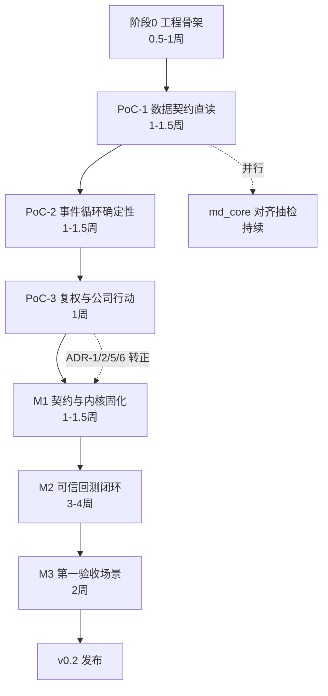
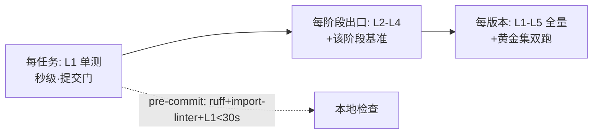
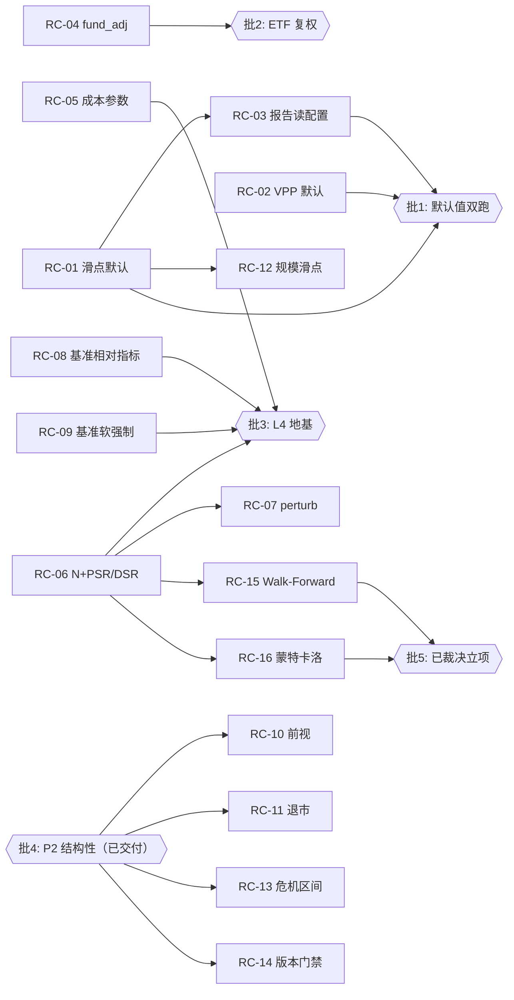

# 18 分步编码计划与执行时间线（代码实施蓝图 → v0.2 … → **V1.2.3 定版** → **定版后 L4 阶段六单**，逐批留痕）

> **本文档有三重身份**：① **计划**（§一–§七：编码纪律、工程骨架、阶段/WBS、测试节奏、风险检查点、集成约定）；
> ② **执行时间线**（**§八**：v0.2 → **V1.2.3 定版** → **定版后 L4 阶段六单** 逐批/逐步的「新增 / 修改 / 删除 / 订正」＋门禁实测＋留痕位置——
> **§八·A 总览表**（v0.2→定版后 L4 阶段 全史一表，**#1…#59**）／**§八·B 删除与订正总表**／**§八·C 收口现状**／**§八·D 回执统一索引**）；
> ③ **审查派单的编码计划＋执行台账**（**§九**：2026-10-05 派单 **RC-01..RC-16**（14 项＋追认立项 2 项）的批次 / WBS /
> 验收锚点 / 门禁 ＋ **全部交付回执**（编号 §九·A…§九·AS）＋ 当前态同步与遗留台账）。
> **当前实现版本：btf 1.3.4（L2 治理批 HH-1~HH-6，2026-10-14；1.3.2 三轮架构审查修正批 → 1.3.3 R66′ overrides 生效 → 1.3.4，沿革详段见本号 :15/:20）**——沿革：0.5.16 → **1.0.0 定版 2026-09-29** →
> 1.1.0 CLI 收编 2026-09-30 → 1.2.0 配股/缩股入链路落版 2026-10-07 → 1.2.1 工具完备 → 1.2.2 完备收口 →
> **1.2.3 公司行动扩维＋收口五轮十九单**（§103 **G-EXIT-1~5 全满足**；老大裁定定版）→
> **1.2.4＝定版后 L4 阶段六单并入**（R57′ `optimize` 基准同源／R58′ `walk-forward` 预热 N60／R59′ `lookback_bars` 声明 N61／
> R60′ 文档守卫＋纪律九 N62／R61′ 折算感知 FIFO N63／R62′ 消费侧价格视图 N64；**四项缺陷修复＋一项口径变更**——§120 R63′ 发版派单）→
> **1.3.1＝与 mdf 统一版本号**（2026-10-11，无功能变更；19 号重命名引用同步随附，mdf 18 号 §13 派单 EE-V13-2 依据）；

> **1.3.2 / 1.3.3（R64′~R66′）**（2026-10-12）：1.3.2＝三轮架构审查修正批
> （F-01 rf 日化统一几何〔口径变更单列〕＋D-01 RunResult 契约＋B-01/B-02 记账披露＋D-02 切分；
> F6′ 阴性对照：159934 `metrics_digest` 与 1.3.1 时代逐位一致）；1.3.3＝R66′ P-NEW-1 修复
> （rules.overrides 生效语义：构造期浅合并＋aliases 归一＋fail-closed＋守卫 7 条；G2 同法逐位一致；
> v77 规则轴网格补跑，报告 §十一.5）。验收：报告 §十二（R64′/EE-D11-1/R65′ 全过）、18-审查记录 §17（cb 自报）。
> **1.3.4（L2 治理批 HH-1~HH-6）**（2026-10-14；19 号 §128）：排序口径定序留痕（零逻辑变更，digest 阴性对照）＋ A5/A6 负控制固化（`--a56` 对照入口；连带修成本口径显式 preRC 与 `--ee1` 陈旧引用）＋ `bt adhoc` 收编（十四命令族）＋ A1「偶然产物」加注 22 处（标注式）＋第一代背离实现并入归档（9 文件 sha256 校验）。收尾回执见本 18 号 §对应批次。
> 文件名级细节以 `代码/btf/CHANGELOG.md` 各版本段落为准；
> 审查/裁决/问题台账见 [19-架构审查与重构演进记录.md](19-架构审查与重构演进记录.md)（**19 号唯一写入主体＝审查方**；本号归执行方）。
> **推荐读法**：**§八·A 总览表**（一表看全史）→ **§八·D 回执统一索引**（一表看全部单据/证据/边界）→
> §八·B（删除与订正）→ §八·C（收口现状）→ 需要细节时按 **§九·X…§九·AS** 逐轮回执；
> 读 2026-10-05 派单与 WBS 请跳 §九·A–§九·I（遗留与待批见 §九·P）。

> **格式约定（全文档统一；2026-10-09 V1.2.3 定版重建，2026-10-10 v1.2.4 发版复校）**：
> 1. **总览表行**（§八·A）：`| # | 时间 | 版本 | 批次 / 主题 | 质量门（测试 · bt check · 契约） | 变更性质（新增/修改/删除/订正） | 留痕 |`
>    —— **时间正序**、一批一行、编号连续（#1…**#59**）；
> 2. **回执段**（§九）：标题 `### 九·<编号> <轮次/主题>（<依据 19 号节号>；<日期>）`；正文固定四段——
>    **① 依据与边界**（19 号节号／纪律：不 bump、不 tag、不提交、不写 19 号）→ **② 交付与改动面**（文件级清单）→
>    **③ 证据与门禁**（**独立退出码**／实测数字）→ **④ 完成度与遗留**（缺陷闭合/新增/登记）；
> 3. **统一索引表**（§八·D）：`| 轮次 | 日期 | 依据 | 单据 | 缺陷（N） | 证据 / 门禁 | 版本 · 提交 · 边界 |`；
> 4. 全文档**按时间正序**；历史轮次的"当时版本号/当时计数"照实保留（**不得**改写成今日值——历史与现状分离）。

> 依据：[README.md](README.md) v0.3 冻结版全部 17 文件（五轮评审闭环）。
> 性质：**执行计划**——任务分解到"单人半天~2 天、可独立验证"粒度；每任务标注产出、验收锚点（引用架构文档章节）、依赖。
> 计划版本：v1.0（2026-09-26，随 v0.3 冻结生成）
> 总量预估：约 **8-11 周**（单人 [假设]，与 11 §16.2 "MVP 8-10 周量级"对齐，含 20% 缓冲）

---

## 一、计划总则（编码纪律，来自架构文档的硬约束）

| # | 纪律 | 来源 |
|---|---|---|
| 1 | **契约先行**：每阶段先冻结该阶段涉及的 S1 协议签名（typed Protocol），实现不得先于契约 | 03 §7.5 |
| 2 | **依赖铁律**：`外围→编排→引擎/分析→领域`单向；domain 零第三方依赖（import 白名单：typing/dataclasses/enum/datetime）；import-linter 本地检查随第一次提交生效 | 03 §7.3 |
| 3 | **测试节奏**：L1 单测随任务提交（秒级）；L2-L4 在每阶段出口全跑；黄金集**只增不改** | 09 §14.1/14.4 |
| 4 | **依赖预算**：新直接依赖 ≤8（plotly/jsonschema/jinja2/pytest/import-linter/hypothesis/pytest-benchmark + 缓冲1） | 07 §12.11 |
| 5 | **不写代码先写公式对照**：记账/复权/费用实现必须逐行对照 04 §8.2.6 公式块（H4/N5/C1 三轮教训：记账口径是最高危错误域） | 16 §32.7 复核点 |
| 6 | **ADR 转正**：PoC 完成后 ADR-1/2/5/6 由草案转已接受；实现偏离架构 = 先改 ADR 再改代码 | 12 |
| 7 | 只读主库；产物写独立目录；UTF-8 显式；路径经配置不硬编码 | 01 §C3、ADR-4 |
| 8 | 插件发现 = 配置声明制（entry-points 留 v1.0）；扩展 = 新文件+注册，核心包 diff 为零 | 04 §8.5 |
| 9 | **环境唯一性（2026-10-06 老大硬令）**：执行 / 测试**一律**用 `D:\量化策略\代码\_venv\Scripts\python.exe`（**绝对路径** `-m` 调用）；**只允许引用或使用 `D:\量化策略` 工作区内 venv**，**不得**新建 venv、**不得**使用工作区外环境（系统版 / Store 版 / 其他盘）；**跨环境数值结论不可互认**；违规环境**立即归档（移动，不删除）** | 19 §65.4 F4 / §65.8 / §67.7 **H-1** |

## 二、代码工程骨架（阶段 0 交付物，先行确定）

**位置**：`D:\量化策略\代码\btf\`（06 §11.3 部署拓扑）；复用现有 venv（Python 3.13.15）。

```
代码/btf/
├── pyproject.toml            # 包元数据 + 工具链配置（ruff/import-linter/pytest）
├── requirements.txt          # 锁版本（现有 28 条 + 新增 ≤8）
├── btf/
│   ├── __init__.py           # api Facade（btf.run/dataset/report——M2 起）
│   ├── domain/               # D 领域层（零依赖）
│   ├── data/                 # L0：feed 协议 / tushare_parquet 适配 / 合成层（state/adjust/universe/derived）
│   ├── engine/               # L2：事件循环 / SimClock
│   ├── execution/            # L2：handler / cost / slippage
│   ├── risk/                 # L2：规则链
│   ├── portfolio/            # L2：Portfolio/Rebalancer
│   ├── strategy/             # L1：StrategyBase/Context
│   ├── analytics/            # L3：Analyzer
│   ├── experiment/           # L3：RunStore/manifest
│   ├── config/               # C：分层配置+Schema
│   ├── registry/             # R：配置声明制发现
│   ├── viz/                  # L5：ChartSpec/报告
│   └── cli/                  # L5：bt 命令族
├── schemas/                  # JSON Schema（backtest.v1 等）
├── tests/                    # L1-L4（unit/integration/system/regression/golden/）
├── benchmarks/               # L5 基准（B1-B5 结果归档）
├── examples/                 # rotation.py 单文件示例策略（M2）
└── tools/                    # build-golden / md_core 对齐抽检等开发脚本
```

---

## 三、阶段总览与依赖图



**关键路径**：S0 → P1 → P2 → P3 → M1 → M2 → M3。PoC 三项**顺序执行**（11 §21.1，评审确认不动）；阶段内任务尽量并行（如测试与实现交替）。

---

## 四、任务分解（WBS）

### 阶段 0：工程骨架（0.5-1 周）

| # | 任务 | 产出 | 验收 | 依赖 | 预估 |
|---|---|---|---|---|---|
| 0.1 | 包骨架与空模块 | 目录树 + `__init__.py` 全套 | import btf 成功 | — | 0.5d |
| 0.2 | 工具链配置 | pyproject.toml：ruff / import-linter（分层规则按 03 §7.3 六铁律）/ pytest | `bt check`（本地检查脚本）跑通：lint 0 错、分层规则生效（故意制造反向 import 被拦截） | 0.1 | 0.5d |
| 0.3 | 依赖清单与锁定 | requirements.txt 增量（jsonschema/pytest/import-linter 先装 3 个；其余按需） | 现有 venv 安装无冲突；依赖预算计数器（工具脚本）就位 | 0.2 | 0.5d |
| 0.4 | 路径与编码基线 | `btf/config/paths.py`：全部路径经环境变量 `BTF_*` 派生（ADR-4 反例教训：禁止硬编码盘符） | 中文路径冒烟测试（含 `D:\量化策略` fixture）通过 | 0.1 | 0.5d |

**出口**：`bt check` 全绿 + 中文路径冒烟通过。

### PoC-1：数据契约直读（1-1.5 周）——回答"直读路径是否成立"

> 验证点清单见 11 §21.1 PoC-1（含 17 表、B1 <10s、状态面板抽查、指纹耗时、md_core 对齐抽检）。

| # | 任务 | 产出 | 验收（架构锚点） | 依赖 | 预估 |
|---|---|---|---|---|---|
| 1.1 | domain 最小值对象 | `TradingDate`（frozen, order）、`Instrument`、`Bar`、`TradingState`、`AssetClass`（04 §8.2.1-8.2.3 签名照抄） | 值对象单测：不可变/全等/TradingDate↔YYYYMMDD 互转；**domain import 白名单检查首次生效** | 0.1 | 1d |
| 1.2 | Parquet 布局读取器 | `data/parquet_reader.py`：by_year/single 双布局 + 谓词下推（列裁剪+日期过滤） | 单测：两种布局各抽 2 表读取正确；`glob(*.parquet)` 陷阱用例（拿到年份列表→报错） | 1.1 | 1d |
| 1.3 | 表元数据登记 | `data/tables_meta.py`：17 表（表名/布局/日期列/起点/单位换算标记，05 §9.4 字典数字化） | 元数据与 05 字典一致（起点：daily 1990-12-19、etf_limit **2019-06-26**、moneyflow **2008-01-02**…） | 1.2 | 0.5d |
| 1.4 | 单位换算契约 | 读取层换算：vol 手→股、amount 千元→元、市值万元→元（T-01/T-10/T-13） | 换算单测逐表；**换算后量纲断言**（vol≥0、amount/vol≈价格量级合理性） | 1.2 | 0.5d |
| 1.5 | TushareParquetFeed 原型 | `DataFeed` 协议 + `read_range` 截面迭代 + `read_code` 单标的（04 §8.3.1 前四方法） | 截面迭代日期升序、停牌股当日缺席；MemoryFeed 占位（PoC-2 用） | 1.3/1.4 | 1.5d |
| 1.6 | 状态面板合成 | `data/state.py`：stk_limit+suspend_d+namechange+stock_basic+dividend 五表 → TradingState（04 §8.2.3） | **10 个手工案例抽查**（11 §21.1）：ST 区间边界、停牌口径（在表即停）、涨跌停价、退市标记 | 1.5 | 1.5d |
| 1.7 | DataVersion 指纹 | `data/version.py`：行数+日期范围+列级抽样哈希（05 §20.3 算法） | 同参数重复调用一致；耗时实测（全库 vs 抽样两档，[待验证] 项落定） | 1.3 | 1d |
| 1.8 | B1 基准 | `benchmarks/b1_load.py` + pytest-benchmark | **10 年全市场日线载入 <10s**（不达标→查谓词下推/列裁剪，回来修订 ADR-2 证据） | 1.5 | 0.5d |
| 1.9 | md_core 对齐抽检 | `tools/align_mdcore.py`：单位/日期/停牌/复权因子/资金流五维抽样比对（09 §14.6 精简版；md_core 为真源） | 50 标的×5 日期截面抽检：逐值相等或登记口径差异理由 | 1.5/1.6 | 1d |

**出口（PoC-1 退出标准，11 §21.1）**：9 任务验收全过或明确降级路径 → **ADR-2（直读路径）转正**；B1 基线归档 benchmarks/。

### PoC-2：事件循环确定性（1-1.5 周）——回答"内核语义是否自洽"

| # | 任务 | 产出 | 验收（架构锚点） | 依赖 | 预估 |
|---|---|---|---|---|---|
| 2.1 | 事件类型与订单域 | `domain/events.py`（七类事件，04 §8.4）+ Order/Fill/Fee/OrderType（04 §8.2.5） | 冻结 dataclass；事件 JSONL 序列化往返单测 | P1 | 1d |
| 2.2 | MemoryFeed + SimClock | 测试专用内存 Feed（手写小数据集）+ 模拟时钟 | 3 个手写场景数据集（T+1 冻结/涨跌停/停牌各一） | 2.1 | 1d |
| 2.3 | Position/Portfolio 记账 | `portfolio/`：名义记账公式**逐行对照 04 §8.2.6 实现四式**（买入/卖出/现金/重估）+ available_qty（T+1） | **守恒式单测**：每 Fill 后 Δcash+ΔMV(名义)+fee=0；af=2 案例数值=评审实证脚本输出（1000≠0 不复现） | 2.1 | 1.5d |
| 2.4 | ExecutionHandler（NextOpen） | `execution/handler.py`：T-1 订单 T 开盘撮合 + 拒单规则（SUSPENDED/LIMIT_UP/LIMIT_DOWN/T_PLUS_1/LOT_SIZE/INSUFFICIENT_CASH，04 §8.3.3） | 拒单六 code 各一单测；涨跌停浮点容差 1e-4（09 §14.2） | 2.2/2.3 | 1.5d |
| 2.5 | 引擎主循环 | `engine/loop.py`：十步骤时序（06 §10.1：①公司行动→②撮合→③更新→④on_open→⑤重估→⑥on_close→⑦再平衡→⑧风控→⑨入队→⑩快照） | 时序单测：步骤顺序断言（事件日志顺序）；**前视封堵**：ctx.history 未来日期访问触发运行时断言 | 2.4 | 2d |
| 2.6 | 事件溯源日志 | events.jsonl 落盘（含采样开关与 50 万上限预算，08 §13.6） | 事件量级单测；回放器骨架（逐行读） | 2.5 | 1d |
| 2.7 | 双跑确定性测试 | `tests/regression/test_determinism.py`：同配置跑两遍 events.jsonl 逐行哈希比对 | **双跑 diff=0**（黄金集确定性纪律的第一条落地） | 2.6 | 0.5d |
| 2.8 | B2 基准 | 沪深300 轮动 10 年月调仓（MemoryFeed→真实 Feed） | **<15s**（不达标→profile 引擎热点，禁止无证据优化） | 2.5 | 0.5d |

**出口**：PoC-2 全验证点过（含 T+1 冻结三场景、B2 达标）→ **ADR-5（事件模型）转正**。

### PoC-3：复权与公司行动正确性（1 周）——回答"最高频错误域是否可控"

| # | 任务 | 产出 | 验收（架构锚点） | 依赖 | 预估 |
|---|---|---|---|---|---|
| 3.1 | AdjustService | `data/adjust.py`：hfq/qfq 换算（**研究层专用**，04 §8.2.4） | 5 只多次送转个股 hfq 序列连续性（数据层断言，G9） | P2 | 1d |
| 3.2 | CorporateAction 事件 | `domain/action.py` + 引擎接入：ex_date（送转调 qty/avg_cost；派息摊 avg_cost）+ pay_date（按 **qty_at_ex** 入现金）两时点（04 §8.2.6 公式块含 C1/E5 修正） | **G1 五案例=独立手算**：送转/派息/混合/老数据 ex≠pay/pay_date 缺失回退 | P2 | 2d |
| 3.3 | 连续性断言 | 守恒扩展：送转单日 Δ=0；派息跨窗口合并 Δ=0（**含窗口内卖出 60 股按 qty_at_ex=100 到账**，C1 案例） | 黄金集断言三态全测（老数据/两日重合/窗口内卖出） | 3.2 | 1d |
| 3.4 | 实现注意两条落地 | ①送转日 available_qty ×(1+stk_div)；②qty_at_ex 跨窗口 **pending 登记**（清仓后仍发放） | 单测两案例（终审实现注意①②，09 §14.2） | 3.2 | 1d |
| 3.5 | 数学等价断言 | 事件链累积收益率 ≡ hfq 序列收益率（5 只全历史，G9 引擎侧） | 等价断言浮点容差内全过 | 3.2/3.1 | 1d |

**出口**：PoC-3 全过 → **ADR-6（名义记账+事件再除权）与 ADR-1（总体架构）转正**；进入 M1。

### M1：契约与内核固化（1-1.5 周）——"契约先行"的全面落地

| # | 任务 | 产出 | 验收 | 依赖 | 预估 |
|---|---|---|---|---|---|
| 4.1 | S1 协议全集定稿 | 04 号全部 Protocol 落代码：DataFeed 全方法/Strategy/RiskManager/Rebalancer/Analyzer/Optimizer/RulesProvider/BTFRuntime（§8.3 全节）+ `contract_version` 字段与协商逻辑 | 协议签名与 04 文档逐条 diff 评审（人工）；版本协商单测（主版本不符→拒载） | P3 | 2d |
| 4.2 | registry 配置声明制 | `registry/`：名字表+配置发现+组装（**不做** entry-points，04 §8.5） | 未知插件名→显式报错；六类扩展点注册冒烟 | 4.1 | 1d |
| 4.3 | config 分层体系 | `config/`：默认→环境变量→用户 YAML→CLI 参数合并 + JSON Schema 校验（06 §11.5 示例即验收样例）+ 敏感项脱敏 | Schema 校验错误信息可读；rules 段字面量拒绝（无 override 声明→启动失败，H2）；`bt config-check` 命令 | 4.2 | 2d |
| 4.4 | 架构守护自动化 | import-linter 规则全量生效 + domain 白名单 + 插件目录外修改检查脚本 | 故意违例（domain import pandas / viz import engine）三例全被拦截 | 0.2 | 1d |

**出口（M1，11 §16.3）**：PoC-1/2/3 通过 + 白名单检查通过 + 四 ADR 转正。

### M2：可信回测闭环（3-4 周）——v0.2 主体

| # | 任务 | 产出 | 验收 | 依赖 | 预估 |
|---|---|---|---|---|---|
| 5.1 | CostModel/SlippageModel | `execution/cost.py`：FeeSchedule **三段过户费**（2015-08 前仅沪需 MarketRule 时间分段/之后双向两档）+ 印花税 2023-08-28 两段 + 佣金最低 5 元；滑点固定/百分比 | 分段各测（09 §14.2：费率分段断言）；G7 数值 | M1 | 1.5d |
| 5.2 | RiskManager 规则链 | `risk/`：max_weight/cash_check/tradability 三规则 + 有序链编排 | 规则链单测（REDUCE/REJECT 语义）；空链→放行+警告 | M1 | 1d |
| 5.3 | Rebalancer + Strategy 层 | FullRebalancer（差额+整手化+**卖先买后排序**，04 §8.3.5）+ StrategyBase/Context（on_open/on_close） | 同日卖买资金链断言（G7 扩展，S2）；ctx API 边界（无 I/O） | M1 | 2d |
| 5.4 | Analyzer 15 指标 | `analytics/`：年化/波动/Sharpe/最大回撤/Calmar/胜率/盈亏比/换手/费用占比等 + **NAV 四式**（04 §8.2.6 N5-1：total_value/daily_return/cumulative/drawdown） | 指标纯函数单测；**加法禁区回归**：realized_pnl+分红现金≠总收益用例（N5） | 5.3 | 2d |
| 5.5 | RunStore/manifest | `experiment/`：run 目录产物（snapshots/trades/fills/rejections/events/metrics/manifest 四版本+rules_version）+ 原子写 | manifest 先骨架后补全（崩溃可审计）；R1 复现：同 manifest 重跑 metrics_digest 一致 | M1 | 2d |
| 5.6 | 黄金数据集构建器 | `tools/build_golden.py`：从主库截取 G1-G10 案例数据 + **独立参考计算器**（~200 行显式循环，不 import btf）生成断言 JSON | 断言文件只增不改纪律生效；G1 第一断言=名义入账四式 | 5.4/5.5 | 2.5d |
| 5.7 | L3 对账测试 | 参考计算器 vs 引擎端到端对账（容差 1e-10） | 对账全绿（09 §14.3） | 5.6 | 1d |
| 5.8 | HTML 报告 | `viz/`：ChartSpec/ChartQuery 契约 + 6 图（资金曲线/回撤/月度热力/交易表/指标卡/权重面积）+ Jinja2 单文件自包含 + **假设与披露强制章节**（费率分段/规则版本/降级事件） | 报告可再生成幂等；缺假设章节=测试失败 | 5.5 | 2.5d |
| 5.9 | CLI 命令族 | `cli/`：`bt run/report/verify/test/dataset/config-check`（注册表式，延续 main.py 范式） | 六命令冒烟；--dry-run 语义 | 4.3/5.8 | 1.5d |
| 5.10 | L1-L4 全量 + B3 基线 | 测试收口 + 全市场扫描基准 | L1-L4 全绿；**B3<60s**；示例策略 rotation.py 首回测 <30 分钟（DXP 验收） | 全部 | 1.5d |

**出口（M2，11 §16.3）**：黄金集 G1-G10 全绿 + 对账通过 + B2/B3 达标。

### M3：第一验收场景（2 周）——回答"为什么现在建这个系统"

| # | 任务 | 产出 | 验收（09 §14.7 场景 A/B 断言） | 依赖 | 预估 |
|---|---|---|---|---|---|
| 6.1 | rules_loader | `strategy/rules.py`：MirrorJsonRulesProvider + 镜像导出脚本（md_core 镜像区→JSON）+ `check_rule_mirror.py` 扩四方纳管 | 规则参数字面量 Schema 拒绝；override 留痕进 manifest；四方机检 PASS | M2 | 2d |
| 6.2 | v7.7 规则策略适配 | L2 硬筛子（PE/PB/ROE_WAA/股息率 **PIT 匹配**）+ L0-LIQ 状态机（含微盘 DerivedIndexProvider 接入）策略类 | A1：选股与 md_core screening 同日一致；A2：LIQ 状态序列断言；A4：规则升级 diff 受控 | 6.1 | 3d |
| 6.3 | 奇点战法复跑适配 | QIDIAN_POOL 全量（**读 qidian.py 常量，不复制清单**）+ 周线 W-FRI 自聚合 + 指数双重确认策略类；ETF BoardRule 子类 t_plus（511180/511380=T+0） | B1：信号一致率 100%；B2：23 只名单验证；B3：ETF 撮合含 T+0 断言 | M2 | 3d |
| 6.4 | 验收报告与发布 | 场景 A/B 验收报告（含区间声明：奇点复跑 ≥2019-06-26 或回退披露，E3）+ v0.2 CHANGELOG | 两报告产出 → **M3 出口 → v0.2 发布** | 6.2/6.3 | 1d |

**出口（M3）**：v7.7 回归 + 奇点复跑双验收通过 → **v0.2 发布**（MVP 完成）。

---

## 五、测试与验收节奏（随代码推进）



- 黄金集从 **5.6 起只增不改**（此前允许重构）；每次 domain/execution/portfolio/engine 提交必跑 L4（09 §14.4 纪律）。
- 基准 B1-B5 各自随阶段归档（B1→1.8、B2→2.8、B3→5.10、B4→v0.5 优化器、B5→5.8）；回退 >2x 触发架构评审。

## 六、风险与检查点

| 检查点 | 时点 | 风险信号 | 应对（架构预案） |
|---|---|---|---|
| CP1 | PoC-1 出口 | B1 >10s 或状态面板合成成本失控 | 谓词下推/列裁剪复查；[开放问题] Q3 提前决断（物化 Parquet 派生表） |
| CP2 | PoC-2 出口 | 双跑 diff≠0（非确定性） | 排查 dict 迭代序/浮点归约序；修不好=事件设计缺陷，回 ADR-5 |
| CP3 | PoC-3 出口 | 事件链≡hfq 等价断言失败 | 公式对照 04 §8.2.6 逐行审查（最高危错误域，冷却复审固定点） |
| CP4 | M2 中期 | 黄金集断言反复返工 | 冻结 G1-G10 范围，新增案例进 G11+（只增不改） |
| CP5 | M3 | v7.7 选股与 md_core 不一致 | 先跑 S4 对齐测试定位（口径漂移 vs 引擎 bug），md_core 为真源 |
| 持续 | 全程 | 依赖蔓延/过度设计 | 依赖预算计数器；16 §32.1 D 组 Checklist 每阶段自查 |

## 七、与现有工程的集成约定

1. **btf 独立成包**（`代码/btf/`），不修改现有 `main.py`/`config.py`/`fetch/` 任何文件；CLI `bt` 独立入口（v0.2 发布后评估是否并入 main.py 命令族）。
2. **主库只读**：全部数据访问经 `btf.data`；写入主库目录=启动失败级违例（沿用 alt 库 assert_writable 语义）。
3. **产物目录**：`D:\量化策略\回测产物\runs\`（06 §11.3）；黄金/示例数据集 `代码/btf/btf_datasets/`。
4. **调读现有资产**：qidian.py 常量（import 读取，不复制）、md_core 镜像 JSON（rules_loader）、trade_cal（日历真源）——全部只读。
5. **定时任务**：v0.2 后如需每日信号验证回测，经 WorkBuddy automations 调 `bt run`（E1 修正后口径）。

---

## 八、执行状态跟踪

| 阶段 | 状态 | 完成日期 | 备注 |
|---|---|---|---|
| 阶段 0 工程骨架 | ✅ 完成 | 2026-09-26 | `bt check` 5/5 全绿（ruff/import-linter 六契约 kept/冒烟 10 测试/依赖预算 8/8/包导入）；违例拦截实证（domain→pandas/engine 探针被 2 契约精确拦截后删除）；修复 4 个真实陷阱（GBK 控制台编码、anchor 类型、tomllib 解析、importlinter Windows 入口） |
| PoC-1 数据契约直读 | ✅ 完成 | 2026-09-26 | 任务 1.1-1.8 全交付；B1 实测 9.74s < 10s（CP1 过），成本分解留档 `tools/profile_b1_breakdown.py`；`_LazyCrossSection` 懒截面 + `StateSynthesizer` 五表合成 + md_core 对齐抽检（`tools/align_mdcore.py`，语义差异登记备查）；物化段 22s 证据落 B2 预算分解 |
| PoC-2 事件循环确定性 | ✅ 完成 | 2026-09-26 | 任务 2.1-2.8 全交付；双跑 diff=0（真实 Feed 全链路 + T+1 冻结/涨跌停/停牌三拒单场景）；B2 实测 **12.99s < 15s**（三次复测 12.7-13.4s 稳定；初测 17.48s，四刀优化留痕 `benchmarks/README.md`：摘要计数化/LazyStates 惰性装载/__len__ 快速路径/stk_limit 子集过滤缓存）；122 测试全绿 + `bt check` 5/5（收口补账：ruff 全量清欠 137→0、config 归位稳定核层、engine.loop 装配豁免三条 import——依据 06 §2 装配时序，六契约全 KEPT）；**ADR-5 已转正**（12 号文档登记） |
| PoC-3 复权与公司行动 | ✅ 完成 | 2026-09-26 | 任务 3.1-3.5 全交付；G1 五案例双层断言（单元层 avg_cost 手算锚点 + 集成层守恒式三态：老数据 ex≠pay/两日重合/窗口内卖出）+ 实现注意①②（T+1 冻结同步扩张/pay 跨窗登记）；混合行动公式修正为先派息后送转（A 股除权价同构）；G9 等价断言 5 只全过（600276/000001/000002/600811/600867，2008-2025=三表覆盖交集窗口，事件链≡hfq 容差 1% 内）；同日多行动 pending_divs 以行动编号索引（600811 19960730 案例）；159 测试全绿 + bt check 5/5 + B2 复测 13.62s < 15s；真实数据三 bug 修复留痕：dividend 跨年归档漏读（feed 改 read_full + ex_date 过滤；600276 漏 20080411 → G9 偏差 17%）、同行动重复实施行 1,228/59,510 业务键归一去重（000001 双重送转 → 偏高 29%）、早期年文件 schema 异构 `_concat_unified`；**ADR-6 与 ADR-1 已转正**（12 号文档登记） |
| M1 契约与内核固化 | ✅ 完成 | 2026-09-26 | 前置 4.0 + 任务 4.1-4.4 全交付。4.0：PyYAML 入预算第 2 槽、matplotlib 预占槽位回收、ADR-11 登记。4.1：`CONTRACT_VERSION="1.0"` + 主版本协商（不符拒载 ContractVersionError）；DataFeed 补 universe/history（含与 04 §8.3.1 的三处已实证偏差 docstring 留痕：corporate_actions 全市场区间口径/universe 静态身份与 trading_states 动态标记职责切分/history 全字段返回）；Risk/Analyzer/RulesProvider/BTFRuntime 协议落地；现有实现全量补 `contract_version`。4.2：registry 六+1 扩展点（RISK_RULE 留 M2 实现）名字表 + 版本协商 + 未知名显式报错。4.3：L1-L4 四层合并（默认→BTF_* 环境变量类型推断→YAML→CLI）+ JSON Schema（`schemas/backtest.v1.json`，06 §11.5 样例即验收）+ 脱敏 + `bt config-check`（正例/H2 红线反例/敏感项脱敏三验收全过）。4.4：domain 白名单脚本（含标准库白名单外拦截）+ 插件边界检查（register() 注册点唯一性 + 核心 44 文件 SHA256 基线 `.plugin_baseline.json`）+ 三例故意违例拦截测试。收口：220 测试全绿（l1-l4）+ `bt check` **6/6**（扩第六项 domain 白名单）；真实数据冒烟：universe(2020-01-01)=3760 只（板块分布 main 2899/gem 791/star 70）、history(000001.SZ) 升序契约正确——留痕教训：stock_basic 物理无 market 列，请求列前先 `peek_columns` 求交集（列缺失直传 pyarrow → ArrowInvalid）；测试基线纪律修复：守护测试改保存/恢复基线原件（不再 `--update` 静默吸收核心改动）；ruff 收口清欠 11→0（含 `__all__` 排序/ClassVar/match 元字符）。分层规则拆三层（cli\|viz → runtime → registry）消同层互引。**ADR-2 已转正**（M1 出口证据：B1 9.74s + DataFeed 全协议真实数据冒烟）。出口标准全满足：PoC-1/2/3 通过 + 白名单检查通过 + 四 ADR（1/2/5/6）转正 |
| M2 可信回测闭环 | ✅ 完成 | 2026-09-27 | 5.2：`risk/rules.py` 三内置规则（max_weight/cash_check/tradability）三态 + 链序"首个非 ALLOW 生效" + `on_batch_start` 批次钩子 + 引擎⑧步接线（否决→Rejection(RISK_REJECTED)，drafts 标的先 mark_all 盯市），29 单测。5.3：再平衡差额法（未列出=清仓、整手向下取整）+ G7 扩展 S2 同日卖买资金链（卖先买后，失效则买单 insufficient_cash）+ 幂等 + ctx API 边界白名单，9 测试。5.4：`analytics/metrics.py`——NAV 四式纯函数（含 `audit_nav_four` 快照字段双轨对账）+ 15 项核心指标（final_nav/total_return/年化/波动/Sharpe/最大回撤/Calmar/胜率/盈亏比/n_fills/总费用/总成交/年化换手/费用占比/交易日数）注册 ANALYZER 扩展点 + 降级 NaN（04 §8.5 扩展点 8）+ **加法禁区 N5 回归**（派息场景 realized_pnl+分红现金=200≠总收益 0），50 单测。5.5：`experiment/manifest.py` 四版本（data/code/config/env 运行时实采 E2）+ rules_version/rules_overrides + 脱敏 + `config_hash`/`metrics_digest`；`experiment/store.py` LocalRunStore——run 目录七产物（snapshots/trades/fills/rejections/events/metrics/manifest）+ **原子写**（tmp + os.replace）+ 骨架先写（RUNNING）/结束补全（COMPLETED + digest）/崩溃 FAILED 终态 + 幂等（撞名加 -2 后缀，历史不可变）；`analytics/trades.py` FIFO 开平配对（04 §8.2.5 Trade，费用按数量摊、总额守恒）产出 trades；domain 补 `Trade` 类型；registry RUN_STORE 注册 `local_jsonl`；runtime `run()` 接线落盘、`load_run()`/`load_manifest()` 交付（M1 留白断言升级为真实往返）。45 单测 + 6 集成，**R1 复现**：同 config 两次落盘 `metrics_digest` 一致、落盘产物重算 digest 一致、篡改指标即变。**载体留痕**：08 §13.3 契约写 Parquet，实以**零依赖 JSONL** 落盘（pyarrow 属数据层既有隐式依赖，未入 8/8 依赖预算）——目录/文件名契约不变，Parquet 归预算重评后接入；**5.6 黄金集（独立参考计算器 + G1-G10 共 16 案例，只增不改）· 5.7 L3 对账（容差 1e-10 零漂移）· 5.8 HTML 报告（六图 + 假设与披露强制）· 5.9 CLI 六命令（verify R1 双项比对）· 5.10 L1-L4 全绿 + B3（十年 32.9s < 60s，已于 v0.5 CP1 关闭）；收口 490 测试绿 / bt check 6/6** |
| M3 第一验收场景 | ✅ 完成 | 2026-09-27 | 6.1：`strategy/rules.py` MirrorJsonRulesProvider（指纹 `v7.7@sha256:` / 取参 / aliases 文档键桥接 / units 单位显式 / 未登记显式报错 / overrides 留痕）+ `tools/export_rules_mirror.py`（幂等载荷 + 内容敏感指纹）+ `tools/check_rules_four_way.py`（源↔镜像↔消费绑定↔btf 缓存**四方机检 PASS**）+ registry `RULES_PROVIDER` 注册 `mirror_json` + runtime 装配（path 缺失→ConfigError；override 进 manifest）——H2 红线落地。6.2：`data/fundamentals.py::screen_l2`（L2 硬筛 PE/PB/ROE_WAA/股息率，**真 PIT**：ROE 按 `ann_date ≤ 回测日` 且只取年报 `end_date` 尾 1231；与 md_core 建库视角口径差异显式留痕）+ `data/liq.py`（L0-LIQ 状态机 NORMAL/WATCH/CRISIS + **RECOVERY 序列判定** + 仓位上限）+ `strategy/v77.py` 策略类 + `tools/align_v77.py` 对账 CLI。**A1/A2 实证**（20260923 与 md_core 对账）：选股名单 **901 = 901 完全一致**、LIQ 状态 **NORMAL = NORMAL**；PIT 无前视机检通过。测试：20 单测（6.1）+ 14 单测 + 7 集成（6.2）。**留痕**：md_core 顶层不导出 `screen_stocks_v75`/`get_l0_liq_state`（实际在 `md_core/screening.py`、`md_core/market_state.py`）→ 集成测试与 `tools/align_v77.py` 均改为子模块导入并显式传镜像参数（原 CLI 调用为坏链，已修）；ruff 4 处未清欠（中断残留）已清 → `bt check` 复归 **6/6**。6.3：`strategy/qidian.py` 奇点信号层——真源 `代码/strategies/qidian.py` **运行时加载**（重依赖以桩模块屏蔽；`BTF_QIDIAN_REF` 可覆盖，路径入 `config/paths` 单一真源）+ **纯 Python 复刻**（零 numpy/pandas：W-FRI 周线自聚合 / 标准 KDJ(N=9, M1=M2=3，K/D 初值 50) / CCI(20) / 阈值与**买入优先** / ETF×指数**双重确认**）+ `pool_groups()` 按真源**注释分组**解析名单（14 推荐 / **23 双回测一致优秀** / 4 行业 / 2 可转债；btf 源码零清单副本——机检拦截）+ `QidianStrategy`（周五收盘决策、逐周截断无前视）；`domain.infer_instrument/infer_etf_subclass`（ETF 子类名称优先 + 代码段兜底）取代 M1「默认 main/lot100」占位，runtime 宇宙解析对 ETF 接地。**验收实证**：B1 与真源实现（`indicators.calc_kdj_standard` + 真源 `aggregate_to_weekly`/`calc_cci`/`check_signal_detail`）同真实数据逐项一致——**42 对 ETF/指数、84 条序列零差异**（周线聚合/KDJ/CCI/信号，容差 1e-9）；B2 **23/23 只**数据可用（缺数据空集）；B3 撮合 T+0——511180/511380 同日往返成交，股票型 ETF 510300 仍拒 `t_plus_1`。测试：32 单测 + 8 回归。**留痕**：部分指数源端仅 close 无 OHLC（H30315.CSI 等）→ 对账样本按 OHLC 齐全过滤；`PROJECT_ROOT` 实为 `代码/btf`（docstring 旧述偏一层的既有问题），真源路径以 `PROJECT_ROOT.parent/strategies` 派生。6.4：`回测产物/场景A验收报告-20260927.md`（A1 选股 901=901 / A2 状态 NORMAL=NORMAL / A3 override 为空逐项等于镜像 + 四方机检 / A4 单参数升级 diff 受控）+ `回测产物/场景B验收报告-20260927.md`（B1 84 条真实周线序列零差异 / B2 23 只分组机检 + 数据可用 23/23 / B3 511180/511380 同日往返 T+0，含 **E3 区间声明与回退披露**：引擎截面与 `ctx.history` 暂仅 `daily` 通路 → 引擎级全区间净值复跑归 v0.3；信号对账区间 2024-01-01~2026-09-23）+ `代码/btf/CHANGELOG.md`（v0.2.0；版本号 pyproject 与包内同步 → `btf 0.2.0`，smoke 断言同步）。**M3 出口达成**：场景 A A1–A4 全通过 + 场景 B B1/B2/B3 通过 → **v0.2 发布（MVP 完成）**；全量 **588 测试**绿 + `bt check` **6/6** + 插件边界（核心 53 文件基线）通过。 |

| v0.3 数据层装配与场景 B 复跑 | ✅ 完成 | 2026-09-27 | V3-1 混合表 Feed（股票 `daily` + ETF `fund_daily` + 指数 `index_daily`，代码段路由 + 多表逐日归并截面）+ V3-2 ETF 限价通道（`etf_limit` 起点 2019-06-26，更早 BoardRule 回退并披露）+ V3-3 引擎级全区间净值复跑（2019-06-26→2026-09-23：1761 日 / 4493 成交 / +28.05% / Sharpe 0.532，R1 双项复核一致）→ **E3 回退披露解除**；见 `回测产物/场景B引擎级净值复跑-20260927.md` |
| v0.5 功能补全与性能达标 | ✅ 完成 | 2026-09-27 | **V5-1~V5-7 全项交付 → v0.5.0 发布**（详见 §四 v0.5 表与下文完备性核验）：VPP 撮合量上限（VOLUME_CAP 新拒单码）+ 黄金集 **16 案例全建**（pending 清零）+ 优化器 grid_search（`bt optimize` + **B4 外推 667s < 1800s**）+ 指数成分宇宙（index_weight 严格 PIT，hs300 逐月一致）+ ThresholdRebalancer（threshold=0 与差额法逐单一致）+ api Facade（与 CLI 等价）；顺带：**标的谓词下推**（B4 场景 6x）+ **B3 十年 129.3s→32.9s**（A2 关闭）+ B2 测试策略 PIT 订正（上月末快照）；全量 **705 测试**绿 · `bt check` **6/6** · 六契约 KEPT · 插件基线 55 文件 |
| v0.5.1 19 号审查修正第一批 | ✅ 完成 | 2026-09-27 | **R0 安全网 + R1 P0 止血 + 高优先 P1/P3**（依 `19-架构审查与重构演进记录.md` 执行，逐项留痕见其附录 D）：**LIQ 预计算十年 760s→3.74s（203x，2430 日等值零差异）** + `data/core.YearTableStore` 表级资源层 + **基准对比层**（`report.benchmark` 死键转活，11 项相对指标）+ **区间覆盖度守卫**（2008 前涨跌停静默失效 → 装配期拒绝/披露）+ 风控 fail-closed（Q1-B：显式空链声明 + 强制披露）+ 策略版本协商（EX-2）+ 三扩展点接线（EX-1）+ **V77 首次真实全区间端到端**（904 日 / +10.08%）+ 性能门槛常跑化（`tests/perf/BASELINE.md`）；顺带实证修复「rules_provider 装配晚于策略加载 → 注入恒不生效」；全量 **732 测试**绿 · `bt check` **6/6** · 插件基线 59 文件；未执行项（R2 完整/R4/R5）见附录 D.3 |

### 任务级完成度（WBS 逐条核验，2026-09-27）

> 口径：**✅ 完成**（验收通过）｜**🔶 部分完成 / 回退披露**｜**⚠️ 未达标**（留痕）｜**⬜ 未开始**。逐条对应本文件 §四 任务分解（WBS）表格原文。

#### 阶段 0 工程骨架（4/4 ✅）

| # | 任务 | 状态 | 验收证据 |
|---|---|---|---|
| 0.1 | 包骨架与空模块 | ✅ | `btf/` 13 架构模块骨架；`import btf` 成功 |
| 0.2 | 工具链配置 | ✅ | `pyproject.toml`（ruff / import-linter 六铁律 / pytest 分层）；`bt check` 跑通 + 故意反向 import 被拦截实证 |
| 0.3 | 依赖清单与锁定 | ✅ | `requirements.txt`（锁版本）+ `tools/deps_budget.py`（预算 8/8） |
| 0.4 | 路径与编码基线 | ✅ | `config/paths.py` 全 `BTF_*` 派生、零硬编码盘符；中文路径冒烟通过 |

#### PoC-1 数据契约直读（9/9 ✅）

| # | 任务 | 状态 | 验收证据 |
|---|---|---|---|
| 1.1 | domain 最小值对象 | ✅ | `TradingDate`/`Instrument`/`Bar`/`TradingState`/`AssetClass`；domain 白名单检查首次生效 |
| 1.2 | Parquet 布局读取器 | ✅ | by_year/single 双布局 + 列裁剪与日期谓词下推；`glob(*.parquet)` 陷阱用例 |
| 1.3 | 表元数据登记 | ✅ | `tables_meta.py` 17 表（起点与 05 字典一致：daily 19901219 / etf_limit 20190626 / moneyflow 20080102） |
| 1.4 | 单位换算契约 | ✅ | vol 手→股、amount 千元→元、市值万元→元；量纲断言 |
| 1.5 | TushareParquetFeed 原型 | ✅ | DataFeed 前四方法 + `_LazyCrossSection` 懒截面 + MemoryFeed |
| 1.6 | 状态面板合成 | ✅ | `state.py` 五表合成 TradingState；10 个手工案例抽查 |
| 1.7 | DataVersion 指纹 | ✅ | 行数 + 日期范围 + 列级抽样哈希；同参重复调用一致 |
| 1.8 | B1 基准 | ✅ | **9.74s < 10s**；成本分解留档 `tools/profile_b1_breakdown.py` |
| 1.9 | md_core 对齐抽检 | ✅ | `tools/align_mdcore.py` 五维抽样（单位/日期/停牌/复权/资金流）；语义差异登记备查 |

#### PoC-2 事件循环确定性（8/8 ✅）

| # | 任务 | 状态 | 验收证据 |
|---|---|---|---|
| 2.1 | 事件类型与订单域 | ✅ | `domain/events.py` 七类 + Order/Fill/Fee/OrderType；JSONL 序列化往返单测 |
| 2.2 | MemoryFeed + SimClock | ✅ | 三场景数据集（T+1 冻结 / 涨跌停 / 停牌各一） |
| 2.3 | Position/Portfolio 记账 | ✅ | 记账四式逐行对照 04 §8.2.6；守恒式 Δcash+ΔMV(名义)+fee=0 |
| 2.4 | ExecutionHandler（NextOpen） | ✅ | 拒单六 code 各一单测；涨跌停浮点容差 1e-4 |
| 2.5 | 引擎主循环 | ✅ | 十步骤时序单测；**前视封堵**运行时断言 |
| 2.6 | 事件溯源日志 | ✅ | events.jsonl（采样开关 + 50 万上限预算）+ 回放器骨架 |
| 2.7 | 双跑确定性测试 | ✅ | events.jsonl 逐行哈希比对 **diff=0** |
| 2.8 | B2 基准 | ✅ | **12.99s < 15s**（`benchmarks/README.md` 四刀优化留痕） |

#### PoC-3 复权与公司行动（5/5 ✅）

| # | 任务 | 状态 | 验收证据 |
|---|---|---|---|
| 3.1 | AdjustService | ✅ | hfq/qfq 消费侧换算（研究层专用，不入引擎记账——ADR-6） |
| 3.2 | CorporateAction 事件 | ✅ | ex/pay 两时点 + `qty_at_ex`；G1 五案例 = 独立手算 |
| 3.3 | 连续性断言 | ✅ | 送转单日 Δ=0；派息跨窗口合并 Δ=0（含窗口内卖出按 qty_at_ex 到账） |
| 3.4 | 实现注意两条 | ✅ | ①送转日 `available_qty` 同步扩张 ②`qty_at_ex` 跨窗 pending 登记 |
| 3.5 | 数学等价断言 | ✅ | 事件链收益 ≡ hfq 收益（5 只 / 2008–2025，容差 1%） |

#### M1 契约与内核固化（5/5 ✅）

| # | 任务 | 状态 | 验收证据 |
|---|---|---|---|
| 4.0 | 前置（预算 / ADR） | ✅ | PyYAML 入第 2 槽；matplotlib 预占槽位回收（ADR-11） |
| 4.1 | S1 协议全集定稿 | ✅ | 04 §8.3 全节落地 + `CONTRACT_VERSION="1.0"` + 主版本协商（不符拒载） |
| 4.2 | registry 配置声明制 | ✅ | 扩展点名字表 + 未知名显式报错 + 两处版本协商 |
| 4.3 | config 分层体系 | ✅ | L1–L4 合并 + JSON Schema + 脱敏 + `bt config-check`；rules 字面量（H2）拦截 |
| 4.4 | 架构守护自动化 | ✅ | domain 白名单 + 插件边界（注册点唯一 + SHA256 基线）+ 三例违例拦截 |

#### M2 可信回测闭环（10/10 ✅；验收缺口 A1/A2 已于 v0.5 关闭）

| # | 任务 | 状态 | 验收证据 |
|---|---|---|---|
| 5.1 | CostModel / SlippageModel | ✅ | 分段费率（印花税两段 + 过户费三段含沪市面额口径）+ 最低佣金 5 元；滑点 fixed/pct |
| 5.2 | RiskManager 规则链 | ✅ | 三内置规则三态 + 链序「首个非 ALLOW 生效」+ 引擎⑧步接线（RISK_REJECTED） |
| 5.3 | Rebalancer + Strategy 层 | ✅ | 差额法 + 整手化 + 卖先买后；G7 资金链（S2）断言 + ctx API 边界 |
| 5.4 | Analyzer 15 指标 | ✅ | NAV 四式 + `audit_nav_four` 双轨对账 + 15 指标注册 ANALYZER + 加法禁区 N5 回归 |
| 5.5 | RunStore / manifest | ✅ | 七产物 + 原子写 + 骨架/补全/FAILED 终态 + R1 复现（digest 一致） |
| 5.6 | 黄金数据集构建器 | ✅ | 构建器 + **独立参考计算器** + 只增不改纪律；**G1–G10 共 16 案例全建**（G1 除权除息 3 / G2 涨跌停 2 / G3 停牌 / G4 T+1 与 T+0 ETF 2 / G5 ST / G6 退市 / G7 手数费用分段 2 / G8 日历 / G9 复权链 / **G10 VPP 2**——v0.5 V5-6 落地后补建）；参考计算器扩展：**拒单链**（suspended→limit_up/limit_down→lot_size→t_plus_1→volume_cap→insufficient_cash，顺序镜像引擎）+ 显式订单 + 估值基准镜像 `_last_close` + T+N 属性；`--list` **pending 清零** |
| 5.7 | L3 对账测试 | ✅ | 引擎 vs 参考计算器 **容差 1e-10 零漂移**（G1 三案例，28 项） |
| 5.8 | HTML 报告 | ✅ | 六图 + Jinja2 单文件自包含 + 假设章节强制 + 再生成幂等；B5 < 5s |
| 5.9 | CLI 命令族 | ✅ | 六命令注册表式 + `--dry-run` 语义 + `verify` R1 双项复核 |
| 5.10 | L1-L4 全量 + B3 基线 | ✅ | L1–L4 全绿 ✅、DXP 示例 860s < 1800s ✅；**B3 十年尺度达标：32.9s < 60s**（129.3s → 3.9x，CP1 四刀：from_ymd memo / 截面 `closes()` 轻量视图 / stk_limit 按日切片索引 + 小集双路混合 / snapshot 单遍融合；成交·拒单逐位一致）——A2 关闭 |

#### M3 第一验收场景（4/4 ✅；E3 回退披露已于 v0.3 解除）

| # | 任务 | 状态 | 验收证据 |
|---|---|---|---|
| 6.1 | rules_loader | ✅ | MirrorJsonRulesProvider（指纹 / 取参 / aliases / units / overrides 留痕）+ 镜像导出 + **四方机检 PASS** |
| 6.2 | v7.7 规则策略适配 | ✅ | `screen_l2`（真 PIT）+ `liq`（L0-LIQ + RECOVERY）+ `v77` 策略；A1 **901=901**、A2 **NORMAL=NORMAL**、A3/A4 通过 |
| 6.3 | 奇点战法复跑适配 | ✅ | 信号层 + 撮合层（B1 84 序列零差异 / B2 23/23 / B3 T+0）**+ 引擎级全区间净值复跑**（2019-06-26→2026-09-23：**1761 日 / 4493 成交 / +28.05% / Sharpe 0.532 / maxDD −12.98%**，R1 双项复核一致，138s）——由 V3-1 混合表 Feed + V3-2 ETF 限价通道交付，**E3 回退披露解除**；见 `回测产物/场景B引擎级净值复跑-20260927.md` |
| 6.4 | 验收报告与发布 | ✅ | 场景 A/B 验收报告（含场景 B 净值复跑补充报告）+ M3 收口报告 + `CHANGELOG.md`（v0.2.0 / `btf 0.2.0`） |

**合计 45 条 WBS：✅ 45 · ⚠️ 0 · ⬜ 0**（5.6 G2–G9 与 5.10 B3 于 2026-09-27 收口）。

### v0.2 交付物与完备性核验（2026-09-27）

**状态：7 个里程碑（阶段 0 / PoC-1 / PoC-2 / PoC-3 / M1 / M2 / M3）全部交付并登记 → v0.2 发布（MVP 完成）。**
质量门：全量 **588 测试**绿 · `bt check` **6/6** · 插件边界（注册点唯一 + 核心 **53 文件** SHA256 基线）· ruff 全清。

#### v0.2 交付物清单

```
代码/btf/（btf 0.2.0 → **0.5.0**，v0.5 新增以 ▸ 标注）
├── pyproject.toml · requirements.txt · CHANGELOG.md
├── btf/                      # 15 架构模块
│   ├── domain/               # TradingDate/Instrument/Bar/TradingState/Order/Fill/Fee/Trade/
│   │                         #   Rejection/CorporateAction + 事件七类 + rule_for/infer_instrument
│   ├── data/                 # parquet_reader(标的谓词下推) · tables_meta(17 表) · state(按日切片索引) ·
│   │                         #   version · adjust · feed(closes() 轻量视图) · memory ·
│   │                         #   fundamentals(screen_l2) · liq(L0-LIQ) ▸ index_universe(V5-4)
│   ├── strategy/             # base · context · rebalance · rules(MirrorJson) · v77 · qidian
│   │                         #   ▸ monthly(MonthlyEqualWeight)
│   ├── engine/               # loop（十步时序）· events_log（事件溯源）
│   ├── execution/            # handler(NextOpen + ▸ VPP volume_participation) · cost(分段费率) · slippage
│   ├── risk/                 # manager（有序规则链）· rules（max_weight/cash_check/tradability）
│   ├── portfolio/            # portfolio（记账四式 + snapshot 单遍融合）· rebalancer(差额法 + ▸ threshold)
│   ├── analytics/            # metrics(NAV 四式 + 15 指标) · trades(FIFO 配对) · protocols
│   ├── experiment/           # manifest(四版本) · store(LocalRunStore 七产物 + 原子写)
│   ├── viz/                  # contracts · charts(六图) · render(Plotly + 降级回退) · report(自包含)
│   ├── registry/             # catalog（扩展点名字表 + 版本协商；▸ OPTIMIZER/REBALANCER 扩容）
│   ├── config/               # paths(单一真源) · loader(L1-L4 合并) · validation(Schema) · mask
│   ├── ▸ optimize/           # grid_search（进程池网格；V5-3）
│   ├── ▸ api.py              # Facade：btf.run/report/dataset（V5-7；__init__ 惰性暴露）
│   └── cli/                  # main（七命令族：config-check/run/report/verify/test/dataset/▸optimize）
├── schemas/backtest.v1.json
├── benchmarks/ · examples/(rotation.py + config) · btf/btf_datasets/golden_v1/(**16 案例**)
├── tools/                    # check · check_domain_whitelist · check_plugin_boundary · deps_budget ·
│                             #   build_golden · golden_refcalc · align_mdcore · align_v77 ·
│                             #   export_rules_mirror · check_rules_four_way · profile_b1*
└── tests/                    # **705** 项（unit / integration / regression / system / benchmark）
```

#### 基准结果（B1–B5 与 DXP；B3/B4 为 v0.5 终态，历史过程见 A2/V5-3）

| 基准 | 阈值 | 实测 | 状态 |
|---|---|---|---|
| B1 全市场日线载入（10 年） | < 10s | **9.74s** | ✅ |
| B2 沪深300 轮动月调仓（10 年） | < 15s | **14.55s**（CP1 后实测；全量并发负载下单次曾报 15.76s——负载波动，单跑通过） | ✅ |
| B3 全市场截面扫描（10 年） | < 60s | **32.9s**（2431 日 × 3788 标的 / 360,410 成交 / 50,998 拒单，余量 1.82x；`test_b3_full_decade_scan` 常跑硬门槛；历史 17.5s(2y)/129.3s(10y)/MemoryError → CP1 关闭，见 A2） | ✅ |
| B4 优化器（1000 组 × B2 场景，8 进程） | < 30 min | **外推 667s**（12 组合 × 8 进程 8.0s 实测，余量 2.70x；V5-3 交付 + 标的谓词下推 6x） | ✅ |
| B5 报告生成 | < 5s | 通过 | ✅ |
| DXP 示例首回测（rotation，728 日） | < 30 min | **860s** | ✅ |

#### 验收报告索引

| 报告 | 内容 |
|---|---|
| `回测产物/场景A验收报告-20260927.md` | v7.7 规则引擎回归 A1–A4（含口径留痕） |
| `回测产物/场景B验收报告-20260927.md` | 奇点战法复跑 B1–B3 + **E3 区间声明与回退披露**（历史） |
| `回测产物/场景B引擎级净值复跑-20260927.md` | **补充报告（2026-09-27）**：引擎级全区间净值复跑（V3-1/V3-2 交付后）→ E3 回退披露解除、缺口关闭 |
| `回测产物/M1收口报告-20260926.md` · `M2收口报告-20260927.md` · `M3收口报告-20260927.md` | 各里程碑出口核验与留痕 |

#### 未完成项登记（2026-09-27 完备性核验——不静默）

**A. 计划出口标准内的未达标 / 回退项**

> **三项（A1/A2/A3）已于 2026-09-27 全部关闭**——下表为关闭留痕（过程证据），非待办。

| # | 项 | 实际 | 归属 |
|---|---|---|---|
| A1 | ~~黄金集 G2–G10~~ —— **2026-09-27 全部关闭（含 G10）** | G2–G9（11 案例）：参考计算器扩展拒单链/显式订单/估值镜像后与引擎逐项对账（拒单、成交、NAV、指标）全绿；顺带修复构建器 **NaN 误报漂移**（零成交案例指标含 NaN，JSON 往返后 `nan != nan`）与参考计算器 **费用合计取整口径**（按未取整分量之和取整，镜像引擎；原逐项取整差 1 分）。G10（2 案例）：V5-6 VPP 落地后补建（部分成交 + volume_cap 拒单）→ **16 案例全建、`--list` pending 清零** | **已关闭** |
| A2 | ~~B3 全市场扫描十年尺度 < 60s~~ —— **2026-09-27 已关闭（32.9s < 60s，余量 1.82x）** | **CP1 四刀**（129.3s → 32.9s，3.9x）：① `TradingDate.from_ymd` 进程级 memo（适配层逐 bar 调用 68 万次/年）；② 列式截面 `closes()` 轻量视图（引擎 mark 步骤免 ~8M Bar/十年全量物化——「快照字段物化削减」）；③ `stk_limit` **按日切片索引**（年表排序一次 + `{ymd: (lo,hi)}` 区间 + (年,日) 缓存；旧实现按每日变化标的集过滤全年 → ~100 万行 dict/查询，占 40% 耗时——「状态面板索引化」；**小标的集仍走 (年,集合) 缓存双路混合**——首版单路曾致 B2 15.25s>15s 回归，混合后 14.55s）；④ `Portfolio.snapshot` 单遍融合（三次持仓遍历 → 一次）。**语义不变量**：B2 2272 成交 / B3 1 年 26,648 成交 / B3 十年 360,410 成交·2431 日·50,998 拒单与优化前逐位一致；黄金集 L3 对账（1e-10）全绿；skip 已解除，`test_b3_full_decade_scan` 转为**常跑硬门槛** | **已关闭** |
| A3 | ~~场景 B 引擎级全区间净值复跑~~ —— **2026-09-27 已完成，缺口关闭** | V3-1 混合表 Feed（代码段路由 + 多表逐日归并截面）+ V3-2 ETF 限价通道（`etf_limit` 起点 2019-06-26；更早由 BoardRule ±10% 计算回退并计数披露）→ 全区间 **1761 日 / 4493 成交 / +28.05%**，R1 双项复核一致；降级披露 1 条（159666.SZ 配对指数无 OHLC） | **已关闭** |

**B. 计划明示归后续版本、尚未实现的功能**

> **四项（B1~B4）已于 2026-09-27 全部交付**——下表为交付留痕，非待办。

| # | 项 | 实际 | 归属 |
|---|---|---|---|
| B1 | ~~优化器 `grid_search`~~ | **已交付（V5-3）**：`registry.available(OPTIMIZER) == ["grid_search"]` + `bt optimize` + B4 基准达标 | **已关闭** |
| B2 | ~~指数成分宇宙~~ | **已交付（V5-4）**：`run.universe.source=index` + `index=hs300`（别名→000300.SH）；hs300 逐月复算一致 | **已关闭** |
| B3 | ~~跟踪误差最小化变体~~ | **已交付（V5-5）**：`ThresholdRebalancer`（registry `threshold`）；threshold=0 与差额法逐单一致 | **已关闭** |
| B4 | ~~流动性边界 VPP（G10）~~ | **已交付（V5-6 + V5-1 G10）**：`volume_participation` 撮合量上限 + VOLUME_CAP 拒单码 + 黄金集 16 案例全建 | **已关闭** |

**C. 代码注释 / 文档字符串与计划文本不一致（2026-09-27 已订正）**

初判 3 处，全量扫描后实际订正 **11 处**（全部为注释 / 描述字符串，无逻辑变更）：

| 位置 | 原表述 | 订正为 |
|---|---|---|
| `registry/catalog.py` | 「未实现扩展点（**M2/M3 交付**）: optimizer grid_search（**M2**）」+ `OPTIMIZER: {},  # M2：grid_search` | v0.5（计划 §基准 B4） |
| `analytics/protocols.py` | 「实现归 **M2**：… GridSearch → 优化器（进程池）」 | 15 指标**已交付**；GridSearch 归 v0.5 |
| `runtime.py`（docstring） | 「M1 明确留白：… 引擎接线归 **M2** / mirror_json 归 **M3** / 指数成分归 **M3**」 | 留白已兑现（M2 5.2 / M3 6.1 已交付）；指数成分归 v0.5 |
| `runtime.py`（报错文案） | 「`run.universe.source: …` 归 **M3**」 | 归 **v0.5**（`test_runtime_vertical` 同步改名 `..._deferred_v05` 并改 `match`） |
| `cli/__init__.py` | 命令族列了 **`optimize`**（实际不存在） | 六命令实名（config-check/run/report/verify/test/dataset）；`optimize` 归 v0.5 |
| `portfolio/rebalancer.py` | 「threshold rebalancer 归 **M3+**」 | 归 v0.5 |
| `config/loader.py` | 「`bt run --set` 映射归 **M2**」 | 已交付 |
| `btf/__init__.py` | 「api Facade（btf.run/dataset/report）**自 M2 起在此暴露**」（实际不存在） | 入口 = CLI + `BTFRuntime` 门面；Facade 未实现，归 v0.5 评估 |
| `schemas/backtest.v1.json` | `source` 描述「…归 **M3**（index_weight）」 | 归 v0.5 |
| `requirements.txt` | viz 依赖仍**注释占位**（plotly 6.x / jinja2 3.1.x） | 启用为 `plotly==7.1.0` / `jinja2==3.1.6`（M2 5.8 已实装） |
| `tests/regression/__init__.py` | 「黄金集 **G1-G10**」（G2–G10 未建） | G1 已建 + G2–G10 归 v0.5 |

> 订正后复验：`bt check` **6/6** · 插件基线刷新（核心 53 文件）· 受影响测试全绿（`test_runtime_vertical` / `test_config` / `test_cli_config_check` / `test_registry` / `test_cli_commands`）· ruff 全清。

### v0.5 交付物与完备性核验（2026-09-27）

**状态：v0.5 任务 V5-1~V5-7 全部交付（B 组四项同步关闭）→ v0.5.0 发布，18 号计划版本轴闭合。**
质量门：全量 **705 测试**绿（含 B1–B4 基准常跑）· `bt check` **6/6**（六契约 KEPT）· 插件边界（注册点唯一 + 核心 **55 文件** SHA256 基线）· ruff 全清 · 黄金集 **16 案例** `--list` pending 清零。

#### v0.5 任务级完成度（7/7 ✅；与「任务列表」v0.5 表同源）

| # | 任务 | 状态 | 验收证据 |
|---|---|---|---|
| V5-1 | 黄金集 G2–G10 构建（九组） | ✅ | G2–G9 11 案例 + **G10 双案例**（部分成交 / volume_cap 拒单）→ **16 案例全建、`--list` pending 清零**；L3 引擎 vs 参考计算器逐笔一致 |
| V5-2 | B3 十年尺度达标（CP1 性能专项） | ✅ | **32.9s < 60s**（129.3s → 3.9x，四刀优化；成交·拒单与优化前逐位一致）——详见 §八 A2 |
| V5-3 | 优化器 `grid_search` + `bt optimize` | ✅ | registry `OPTIMIZER=["grid_search"]`；**网格一致性**（进程池 vs 单跑逐位一致）+ CLI 冒烟；**B4 外推 667s < 1800s（余量 2.70x）** |
| V5-4 | 指数成分宇宙（PIT 复算） | ✅ | `universe.source=index` + 别名表 + 月度映射注入策略；**hs300 逐月宇宙与 index_weight 直读复算一致**（128 快照 × 300 成分）+ PIT 边界断言 |
| V5-5 | ThresholdRebalancer | ✅ | 带内不动/带外到目标/目标外全清；**threshold=0 与差额法逐单一致**（对账锚点） |
| V5-6 | 流动性边界 VPP | ✅ | `volume_participation` 撮合量上限 + **VOLUME_CAP 拒单码** + 部分成交余量取消（`vpp_stats` 披露）；22 单测 |
| V5-7 | api Facade | ✅ | `btf.run/report/dataset` 惰性暴露（import 零成本）；**与 CLI 等价**：同配置 digest 一致 + 同 run 报告**字节一致** |

**顺带交付（性能与正确性）**：
- **标的谓词下推**：`iter_day_slices(symbols=…)`——B2/B4 子集宇宙场景免扫全市场年表（12 组合×8 进程 47.9s→8.0s，6x；B3 全市场语义不变，成交数逐位一致）；
- **B3 十年 129.3s→32.9s**（CP1 四刀，见 A2；`test_b3_full_decade_scan` 解除 skip 转常跑硬门槛）；
- **B2 测试策略 PIT 订正**：Hs300TopN 决策快照「当月」→「上月末」（消除前视，与 V5-4 同口径）；
- **`btf/_version.py` 版本单一真源**（manifest 不经包根取版本——import-linter 假链治理）+ `btf.api`（入口层）/`btf.optimize`（编排层）入 layers 契约；
- **拒单码六→八**（+VOLUME_CAP / RISK_REJECTED 登记）、CLI 六→七命令（+optimize）。

**留痕（过程问题与修复）**：① B4 首测外推 66min 超标 → 根因每 worker 重复扫全市场年表 → 谓词下推解决；② 首版按日切片单路使 B2 15.25s>15s（小标的集逐日同集模式回归）→ 双路混合（小集走 (年,集合) 缓存）→ 14.55s；③ `__init__` 惰性 api + 包根取版本构成 import-linter 跨层假链 → `_version` 真源 + 动态加载。

> **版本轴**：阶段 0 / PoC-1~3 / M1 / M2 / M3 → **v0.2（MVP）** ✅ 2026-09-27；**v0.3**（数据层混合表 + 场景 B 全区间复跑，E3 解除）✅ 2026-09-27；**v0.5**（本节，V5-1~V5-7 + CP1）✅ 2026-09-27（v0.5.0）；**v0.5.2**（19 号第二轮审查待执行清单 X-1~X-12，RECOVERY 语义收口 + 风控默认 fail-closed）✅ 2026-09-28；**v0.5.3**（19 号第三轮审查：P0-NEW-4 `source=all` 宇宙起点冻结修复 + Y-2/Y-4 + X-11 兜底）✅ 2026-09-28；**v0.5.4**（19 号第四·五轮：P0-NEW-7 带基准 CLI run 崩溃修复 + 披露闭环 P1-NEW-5/6 + CLI 真入口铁律）✅ 2026-09-28；**v0.5.5**（19 号第六轮 + 裁决二 Z-1~Z-5：报告转义修复 + 渲染级断言与常跑机检 + 基准双重 IO 消除 + B2 软/硬双门槛）✅ 2026-09-28；**v0.5.6**（19 号第七轮 + 裁决三 AA-1~AA-3：伪防线转真断言与变异性自检 + 计算链验证定性注 + 基线刷新留痕机制）✅ 2026-09-28；**v0.5.7**（19 号轮次八 + 裁决四 BB-1~BB-4：数据指纹**重路实算**去空洞 + 展示层/告警/策略可加载性 + 报告强制复现章节）✅ 2026-09-28；**v0.5.8**（批 8 = CC-1..CC-6 数据不变量校验 + 附录 D.3 结转 18 项 + 担保-1 风控 e2e 3→9 + 新契约 7–10 + R4 第一刀 `btf.app`）✅ 2026-09-28；
**v0.5.9–0.5.16**（批 9 → 批 11：CC-2 ST 接线 → **R4 四批（拆包/编排下沉/`feed→state` 反转/EX-4 IO 单一入口）** → 关闭项清零 → EE-1/EE-2 → EE-3 修正）✅ 2026-09-29；
**v1.0.0 定版**（审查通过；8 项判据全满足 + 定版日冷备 + 文档 01–17 收口 / 18 全时间线重建）✅ **2026-09-29**。
18 号计划内全部任务**无剩余**；后续仅远期项（期货/期权、Web 仪表盘、贝叶斯优化等，见 [11 §16.2](11-演进路线风险与PoC.md)）。

### 任务列表（更新版：v0.3 / v0.5 可执行清单）

> 由上文「未完成项登记」A/B 组转写为**可执行任务**（编号 = 版本前缀 + 序号）；排序即建议执行顺序，依赖未满足前不启动；单人工作日预估。

#### v0.3 —— 数据层接通 ✅ **已完成（2026-09-27；v0.3 出口达成）**

| # | 任务 | 状态 | 验收证据 |
|---|---|---|---|
| V3-1 | Feed 混合表装配 | ✅ | `data/feed.py::MixedDailyFeed` + `tables_meta.daily_table_of` 路由（股票 / ETF·LOF / 指数三类，含 `000001.SH` 沪市指数 vs `000001.SZ` 深市股票的双维歧义处理）+ 多表逐日归并截面 `_MergedCrossSection`（仍为懒切片，不破 B1/B2 性能纪律）+ engine `cross_section` 参数（runtime 依 `requires_explicit_symbols` 传入交易宇宙）+ registry `DATA_FEED` 注册 `mixed` + `preload()` 批量预载（每表 1 次区间读，替代 88 标的 × 8 年的 ≈700 次读）——13 单测 |
| V3-2 | ETF 状态面板降级与披露 | ✅ | `StateSynthesizer` 接入 `etf_limit`（起点 2019-06-26）；更早区间由 BoardRule ±10% 依 `pre_close` 计算回退并登记 `fallback_limit_dates` → `degraded_notes()` 供报告披露；测试覆盖「起点前回退」与「起点后零回退」 |
| V3-3 | 场景 B 引擎级全区间净值复跑 + 净值级报告 | ✅ | `tools/run_qidian_rerun.py`：2019-06-26→2026-09-23 **1761 日 / 4493 成交 / +28.05% / Sharpe 0.532 / maxDD −12.98% / 138s**；R1 双项复核一致；报告 `回测产物/场景B引擎级净值复跑-20260927.md` |

#### v0.5 —— 功能补全与性能达标 ✅ **已完成（2026-09-27；v0.5 出口达成）**

| # | 任务 | 状态 | 验收证据 |
|---|---|---|---|
| V5-1 | ~~黄金集 G2–G10（九组）构建~~ —— **全部完成**（G2–G9 2026-09-27 上午；**G10 于 V5-6 落地后补建**：`g10_vpp_partial_fill`（601599.SH 20191108 vol=30000×5%=1500 股 → 10 万委托部分成交，余量当日取消）+ `g10_vpp_volume_cap_rejected`（600265.SH 20191126 vol=151×5%=7<100 → volume_cap 拒单）——**16 案例全建，`--list` pending 空** | ✅ | G10 断言可复现（L3 引擎 vs 参计算器逐笔一致）；无 pending |
| V5-2 | ~~B3 十年尺度达标（CP1 性能专项）~~ —— **2026-09-27 已提前完成**（from_ymd memo + 截面 `closes()` 轻量视图 + stk_limit 按日切片索引（小集双路混合）+ snapshot 单遍融合 → **32.9s < 60s**） | ✅ | 10 年全市场截面扫描 < 60s 且常驻内存可承载（`test_b3_full_decade_scan` 常跑门槛：2431 日 / 32.9s / 余量 1.82x） |
| V5-3 | **优化器 `grid_search`**（进程池）+ registry `OPTIMIZER` 名字表 + `bt optimize` 命令 | ✅ | `btf/optimize/grid.py`（笛卡尔积网格保序 + ProcessPoolExecutor + objective 排名 NaN 末位 + workers=0 内联调试路径）+ registry `grid_search` + CLI `bt optimize --grid/--objective/--workers/--out`；**网格一致性**（同组合进程池 vs 单跑指标逐位一致）+ CLI 冒烟 + **B4 基准**（12 组合×8 进程 8.0s → 外推 1000 组 **667s < 1800s，余量 2.70x**，09 §14.5） |
| V5-4 | **指数成分宇宙**：`run.universe.source=index`（`index_weight` 月末快照机器复算，PIT 口径） | ✅ | `btf/data/index_universe.py::IndexUniverseProvider`（快照日<查询日的严格 PIT；别名 hs300/zz500/sz50/zz1000/cyb；无前向填充）+ runtime 接线（月度映射注入策略签名 `index_universe`）+ `btf/strategy/monthly.py::MonthlyEqualWeight`；**hs300 逐月宇宙与 index_weight 直读复算一致**（128 快照 × 每月 300 成分） |
| V5-5 | **threshold rebalancer**（跟踪误差最小化变体） | ✅ | `ThresholdRebalancer(FullRebalancer)`：`_target_qty` 覆写（带内不动/带外到目标/目标外全清）；registry `threshold` + `rebalancer_params` 配置；**threshold=0 与差额法逐单一致** + 带宽触发断言 |
| V5-6 | **流动性边界 VPP**（G10：冲击成本模型） | ✅ | `NextOpenHandler(volume_participation=rate)`：成交=min(委托, vol×rate)，买整手化（cap<一手→**新拒单码 VOLUME_CAP**），部分成交余量当日取消（vpp_stats 披露）；现金检查按受限数量；runtime `handler_params` 配置；refcalc 镜像 + G10 双案例 + 22 单测 |
| V5-7 | **api Facade**（`btf.run/dataset/report` 顶层函数）评估与落地 | ✅ | `btf/api.py` + `__init__` 惰性 `__getattr__`（import btf 零成本，子进程验证）；**与 CLI 等价**：同配置 digest 一致 + 同 run 报告**字节一致** + dataset 同构 |

**顺带交付（B4 性能前置）**：`iter_day_slices(symbols=…)` **标的谓词下推**（B2/B4 子集宇宙场景免扫全市场年表，12 组合×8 进程 47.9s→8.0s，6x；B3 全市场语义不变）+ runtime 截面限制统一（全宇宙 source=all 不变）；`btf/_version.py` 版本单一真源（manifest 不经包根取版本——import-linter 假链治理）。

**出口建议（已达成）**：~~v0.5 出口 = V5-1 / V5-2 达标（黄金集 G1–G10 全绿 + B3 < 60s），其余为功能补全~~ → **全项达成（V5-1~V5-7 全 ✅）**。

---

### 八·A 执行时间线（v0.2 → **V1.2.3 定版** → **定版后 L4 阶段六单** → **1.2.4 发版**，逐批详录 · 时间正序）

> **本节的读法**：每一批给出「**新增 / 修改 / 删除 / 订正**」四类变更 + 门禁实测 + 留痕位置。
> 完整逐项证据在 [19-架构审查与重构演进记录.md](19-架构审查与重构演进记录.md)（历次审查与执行记录）；本节是**编码过程的时间线索引**。
> 文件名级细节以各版本 CHANGELOG 段落为准（`代码/btf/CHANGELOG.md`）。
> **1.1.0 起（2026-09-30 之后）**的批次详录并入 **§九**（RC 批次 §九·A–§九·I；治理批次 §九·J–§九·O；
> CL 批次 §九·V–§九·W；**CL-2 线 §九·X–§九·AL**——**按时间正序**）；下方总览表保留全部索引行（**#23–#52**）。

#### 时间线总览（一表）

| # | 时间 | 版本 | 批次 / 主题 | 质量门（测试 · `bt check` · 契约） | 变更性质（新增 / 修改 / 删除 / 订正） | 留痕 |
|---|---|---|---|---|---|---|
| 1 | 09-26 | — | 阶段 0：工程骨架 + 架构文档冻结 | 冒烟 10/10 · `check.py` **5/5** | 新增（骨架 13 模块 / 门禁 / 契约 6 条） | 本文 §二 · §阶段 0 |
| 2 | 09-26 → 09-27 | — | PoC-1/2/3 + M1 契约与内核固化 | 黄金集雏形 | 新增（直读层 / 事件内核 / 复权） | 本文 §三 / §四 |
| 3 | 09-27 | 0.2.0 | **v0.2 MVP**：可信回测闭环 | **705** | 新增（引擎 / 产物 / 报告 / CLI）；订正（完备性核验） | 本文「v0.2 交付」 |
| 4 | 09-27 | 0.3.0 | **v0.3**：数据层混合表接通 | 13 单测 + 场景 B 复跑 | 新增（`mixed` feed / 路由 / 回退披露 / 复跑工具） | 本文「v0.3 交付」 |
| 5 | 09-27 | 0.5.0 | **v0.5.0**：功能补全 + 十年尺度达标 | **732** · 6/6 | 新增（grid / threshold / index 宇宙 / api / VPP / G2–G10）；修改（B3 三项优化）；订正（版本单源） | 本文「v0.5.0 交付」 |
| 6 | 09-27 | 0.5.1 | 19 号第一批（R0 安全网 + R1 P0 止血 + P1/P3） | 732 · 6/6 | 新增（LIQ 预计算 / `YearTableStore` / 基准层 / 覆盖度守卫 / perf）；**删除（`completeness` 死键及其 3 处消费点）**；订正（装配顺序 / 版本双源） | 19 号 §1–§18 · CHANGELOG 0.5.1 |
| 7 | 09-28 | 0.5.2 | 第二轮清单 X-1..X-12（12/12 关闭） | **748** · 6/6 | **删除（RECOVERY 自我维持子句 / 伪造输入测试 / 阈值自造副本）**；修改（检查口径改正）；订正（CHANGELOG 三处措辞） | 19 号 §19 · 本文 v0.5.2 |
| 8 | 09-28 | 0.5.3 | 第三轮发现项 | **755** · 6/6 | 新增（`universe_span` 并集 / 风控 e2e 3 例）；修改（十年可见标的 2808 → 5655）；订正（"语义不变"注释） | 19 号 §21 · 本文 v0.5.3 |
| 9 | 09-28 | 0.5.4 | 第四·五轮发现项 | **765** · 6/6 | 修改（基准崩溃 / 披露闭环 / 装配守卫 / 并集精确）；**删除（`metrics` 中的字符串元信息）** | 19 号 §25 · 本文 v0.5.4 |
| 10 | 09-28 | 0.5.5 | 裁决二派单 Z-1..Z-5 | **768** · **7/7** | 修改（报告 `| safe` / 渲染级断言 / 双重 IO / 门槛双档）；新增（渲染机检）；订正（`index_series` 注释） | 19 号 §29 · 本文 v0.5.5 |
| 11 | 09-28 | 0.5.6 | 裁决三派单 AA-1..AA-3 | **771** · 7/7 | 修改（机检第 6 项**伪防线 → 真断言**）；新增（`--self-test` + 基线留痕机制）；订正（v77 测试定性注） | 19 号 §32 · 本文 v0.5.6 |
| 12 | 09-28 | 0.5.7 | 轮次八（§33）+ 裁决四派单 BB-1..BB-4 | **790** · 7/7 | 新增（数据指纹实算 / `meta` 档 / `--resolve-strategy` / 极短区间告警 / 强制章节）；**删除（指纹 `build()` 接线、`DEFAULTS` 缺项）**；订正（插件基线补 `viz`） | 19 号 §40 · 本文 v0.5.7 |
| 13 | 09-28 | 0.5.8 | 批 8（CC-1..CC-6）+ 附录 D.3 结转批 + 新契约 7–10 + R4 第一刀 | **820** · **8/8** · **10/10** | 新增（数据不变量校验 / `btf.app` / `BoundedDict` / `--verbose` / 契约 7–10）；**删除（`engine.loop` 死代码、质检首版接线位置）**；修改（18 项 IO / 缓存）；订正（domain 白名单工具漏项） | 19 号 §41 · 本文 v0.5.8 |
| 14 | 09-29 | 0.5.9 | 批 9（裁决七派单 DD-1..DD-3，修 **P2-NEW-8**） | **824** · 8/8 · 10/10 | 修改（**CC-2 ST 上限接线**：`st_pairs` / `st_source` / `calendar_days` 公开 + runtime 传参）；新增（ST fixture 三处 + 产物字段）；订正（注释"偏保守"→"会漏检"） | 19 号 §45 · 本文 v0.5.9 |
| 15 | 09-29 | 0.5.10 | **R4 第一刀**：`btf.runtime` 拆包 + 重复编排收敛 | **825** · 8/8 · 10/10 | 修改（`ConfigResolver` / `UniverseResolver` / `ComponentAssembler` 下沉，门面只留委托）；收敛（`compute_run_metrics` 单源；日期 helper **3→1**）；修复（**ST 5% 只适用主板**：假阳性 **4,393 → 1,024**）；守卫补强（`CORE` 纳入 `btf/runtime`） | 19 号 §46 · 本文 v0.5.10 |
| 16 | 09-29 | 0.5.11 | **R4 第二刀**：`RunOrchestrator` 下沉 + `ComponentAssembler` 类化 | **825** · 8/8 · 10/10 | 修改（`run()` 落盘编排整体搬出，门面变一行委托）⇒ **拆分四件套齐备**；观察登记（B2/B3/B4 机器态漂移 + **OBS-4**：B4 余量 1.03x） | 19 号 §47 · 本文 v0.5.11 |
| 17 | 09-29 | 0.5.12 | **R4 余项 ①**：`feed → state` 例外边**反转**（契约新 8 零豁免） | **832** · 8/8 · 10/10 | 修改（状态面板**构造期注入** `state_provider=` / `attach_state_provider()`，装配根自动注入；**未注入即显式报错**）；**删除（pyproject 新 8 豁免行）**；新增（注入回归 **7 例**）；测试站点显式注入 5 文件 | 19 号 §48 · 本文 v0.5.12 |
| 18 | 09-29 | 0.5.13 | **R4 余项 ② / EX-4 完全体**：IO 单一入口（R4 收官） | **843** · **9/9** · 10/10 | 修改（`data` 域 **7 模块 20 处直连 IO** → `core`；契约新 9 强化为"仅 `core` 可 import `parquet_reader`"）；新增（`tools/check_io_boundary.py` = `bt check` 第 9 项（AST + `--self-test` + 变异测试）；`test_core_io_surface.py` **11 例**语义等值）；**删除（`version._table_files` 自建布局解析、非登记布局兜底）** | 19 号 §49 · 本文 v0.5.13 |
| 19 | 09-29 | 0.5.14 | **关闭项清零**：Z-6/X-1 + Y-3 + 冷备机制 + 托管准备 + 稳健性首轮 | **855** · 9/9 · 10/10 | 修改（`liq` 状态机**单步递推两段窗口**（确认期归 CRISIS）+ `raw/phase/phase_days` 双披露；`v77` 改 `prev=` 递推；四方机检增 Z-6 语义锚点）；新增（`tools/cold_backup.py` + 7 例含变异；`tools/run_v77_robustness.py`；`btf/.gitignore`）；注册（`btf-code-audit` 技能）；规则源（`赤潮/rules/` 两文件写明确认期归属） | 19 号 §50 · 本文 v0.5.14 |
| 20 | 09-29 | 0.5.15 | 批 10 = **EE-1..EE-2**（裁决八派单） | **869** · 9/9 · 10/10 | 修复（`quality.py` **CC-2 六条子口径标定**：ST 时点化 / 退市整理期 / 档位容差 / 前日无行情 / `*.BJ` 段 / IPO 锚点）⇒ **全市场十年 findings 2,005 → 0**；新增（**13 例双向单测** + 机检 **⑦ 双向对照**）；变异测试（时点 / 首日分支打残 → 必红）；修一处自引入缺陷（老股误入 IPO fallback） | 19 号 §53 · 本文 v0.5.15 |
| 21 | 09-29 | 0.5.16 | 批 11 = **轮次十一处置**（EE-3 + P3-NEW-6） | **876** · 9/9 · 10/10 | 修复（**`_bench_series` 日期规范化 `_ymd()`**——P1-NEW-9 基准端点被截；**端点留痕** + 未对齐告警；**`_PCT_EPS` 浮点松弛**——P3-NEW-6）；新增（端点回归 **6 例含变异** + 档位上界 1 例；`--ee1` 复现入口）；重跑（EE-1 双路径逐位一致 + 矩阵 10 格端点全 `aligned`）；订正（§50.5 / §53.1 / 时间线 #39 / §28.4 #9 / §53.2.4 / CHANGELOG 0.5.15 / 市场研究报告 **v2**）；登记（**OBS-6/7/8** + **NOTE-4**） | 19 号 §55 · 本文 v0.5.16 |
| **22** | **09-29** | **1.0.0** | **定版**：审查通过 → 8 项判据全满足 | **876** · **9/9** · **10/10** | 版本（`_version.py` → `1.0.0`）；**执行定版日跨版本源码冷备**（213 文件 / 1996 KB / sha256 自校验）；文档（**01–17 按 1.0.0 现状收口**；18 号全时间线重建）；余（**私有托管 push = 老大动作**） | 19 号 §57 · 本文 v1.0.0 定版 |
| 23 | 09-30 | **1.1.0** | **CLI 正面收编**（依《CLI 审查报告-回测平台-20260930》＋老大令） | **890** · **9/9** · 10/10 | 新增（`bt check`（九项门禁**单一真源转发**）· `bt --version` · `cold-backup` · `runs` · `show` · `dataset` 增 `verify/refcalc` 动作 ⇒ 命令族 **7 → 11**；5 探针归档 `tools/probes/`）；订正（01–17＋README：计数 **876 → 890**、版本行 **1.1.0**）；冷备 `备份/20260930-1509-btf-1.1.0-cold`（213 文件 / 2031 KB / sha256 一致） | 19 号 §59 · CHANGELOG [1.1.0] |
| 24 | 10-05 | **1.1.0**（未 bump） | **RC-01..RC-16 交付**（批 1–5；派单 14 项＋追认立项 2 项） | **1046** · 9/9 · 10/10 | 修改（**默认成本非零**（RC-01/02：`pct 0.001`＋VPP 0.05）· 报告读生效配置（RC-03）· ETF 复权路由 `fund_adj`（折算跳变 **78.8% → 10.0%**）· 前视封堵（RC-10）· 退市披露（RC-11-A）· 版本门禁（RC-14））；新增（`cost_model_params` · `analytics/inference`（N＋PSR/DSR）· `--perturb` · `sqrt_impact` · `analytics/windows.py` · `optimize/walkforward` · `analytics/bootstrap` · **`bt validate`** ⇒ 命令族 **11 → 12**） | 19 号 §61–§62 · 本文 §九·A–§九·I |
| 25 | 10-06 | **1.1.0**（未 bump） | **治理批次**：GG-1..GG-6（裁决落地）＋ §66 订正 F1/F2/F3/F7 ＋ F8/F9 ＋ H-1..H-3 / N4 加固 | **1049**（1046 → 1049，F9＋3） · **10/10** · 10/10 | 修改（工具**双锚**（`COST_PROFILES` / `EE1_REFS`）· `check.py` **九项 → 十项** · `CORE` 补 `btf/app`·`btf/optimize`（基线刷新 2 次 → **81 条目**、留痕 **18 行**）· **F9 价内滑点披露**（`Fill.ref_price` 全链路，核心 6 文件））；订正（文档 **01–21 两轮「当前态口径」同步**；20 号三段成本口径；26101 / l2 报告修订） | 19 号 §63–§67（独立复核 §65 / §67.9 / §67.10）· 本文 §九·J–§九·O |
| 26 | 10-06 | **1.1.0**（未 bump） | **§66.10 收口批**（老大放行「允许执行所有编码工作」）：N4① 修复 ＋ 20/21 配置类同步 ＋ RC-13 归位 ＋ B1–B4 回填 ＋ **F10 修复** | **1049**（1026 非 L5 全绿 ＋ L5 23 项**逐文件隔离**全绿） · **10/10** · 10/10 | 修改（`check.py` **--basetemp 项目内**（N4 根因修复）· `windows.py` 声明销项 · `cli/main.py` **F10**：`--help` 裸 `%` → `%%`（基线刷新 2 次 → 留痕 **20 行**））；回填（14 / 09 / BASELINE / README：B1 **8.71** · B2 **14.37** · B3 **36.0** · B4 **1350** · LIQ **3.89**） | 本文 §九·Q |
| 27 | 10-06 | **1.1.0**（未 bump） | **N5 处置批**（19 号 §67.12；**N5-② 老大批准执行**）：`bt test` basetemp 项目内 ＋ 09 §14.1 纪律/判据 ＋ 21 号同步 | **1049**（N5 双跑对照：不带 basetemp **1026 全过 / exit=1**；带＝**exit 0**） · **10/10** · 10/10 | 修改（`cli/main.py` `_cmd_test`：**项目内唯一子目录** ＋ **分小批回收**（守卫拦截不改退出码）；`09 §14.1`：**全量回归一律 `--basetemp`** ＋ 判据 ＋ **目录每轮新起**；`21 号` §4.9/§3.4；基线刷新 1 次 → 留痕 **21 行**） | 本文 §九·R |
| 28 | 10-06 | **1.1.0**（未 bump） | **N6/N7 处置批**（19 号 §69.3/§69.4；老大令）：**`BTFTOOL_` 改名** ＋ **分根** ＋ **09 判据勘误（A/B/C）** ＋ 21 号命名警示 | **1049**（N7 A/B：新名 **exit 0** / 旧名 **exit 1**） · **10/10** · 10/10 | 修改（`check.py`：2 变量改名 ＋ basetemp→`…/pytest_tmp/check`；`cli/main.py`：`…/pytest_tmp/bt_test` ＋ `BTFTOOL_TEST_PYTEST_BASETEMP`；`09 §14.1`：判据 **A/B/C**；`21 号` §3.4/§4.9/§5；基线刷新 1 次 → 留痕 **22 行**） | 本文 §九·S |
| 29 | 10-06 | **1.1.0**（未 bump） | **N8 处置批**（19 号 §70.3；老大令）：自引用用例**显式隔离嵌套 basetemp** ＋ 存量泄露清理 | **1049**（单点 exit 0 · `bt test --layer l1` exit 0、项目 `bt_test/` **零新增**） · **10/10** · 10/10 | 修改（`tests/unit/test_cli_commands.py`：`monkeypatch.setenv(BTFTOOL_TEST_PYTEST_BASETEMP, tmp_path)` ＋ **输出断言守卫**；清理 2 枚泄露（179×2 项）＋ 1 枚 SENTINEL）——**纯 tests，无基线刷新**（仍 81 条目 / 留痕 22 行） | 本文 §九·T |
| 30 | 10-06 | **1.1.0**（未 bump） | **N9/N10 处置批**（19 号 §71；老大令）：09 §14.1 **判据 D** ＋ 21 §4.9 `[note]` 条 ＋ `n8_probe` 残件清理/登记 ＋ §九·T **N8-bis 勘误** | **1049**（沿用；纯文档/卫生） · **10/10**（沿用） · 10/10 | 文档（`09 §14.1` / `21 §4.9` / 本号 §九·T 勘误 ＋ §九·U）；卫生（`_scratch/pytest_tmp/n8_probe/` 清理，递归 2 项）——**无 core 改动 ⇒ 无基线刷新**（81 条目 / 留痕 22 行） | 本文 §九·U |
| 31 | 10-06 | **1.1.0**（未 bump） | **CL-1**（19 号 §72.2；开工令）：`optimize` 短区间门禁——`MIN_OPTIMIZE_TRADING_DAYS = 250` ＋ 默认阻断（**退出码 3**）＋ `--allow-short` 放行并把 override 记入产物 | **1066**（四单合计 +17；文件 86） · **10/10** · 10/10 | 修改（`runtime/_runtime.py` · `runtime/__init__.py` · `cli/main.py`）；测试（`tests/unit/test_grid_search.py` +4）；文档（21 号 §0.1/§2.2/§4.7/§5.1） | 本文 §九·V |
| 32 | 10-06 | **1.1.0**（未 bump） | **CL-2 R1**（19 号 §72.3；开工令）：配股/缩股**数据可得性探针 ⇒ 判定「不可得」** ⇒ 按闸门**停 R2/R3**、**降级披露** | （同 31 行计数） · 10/10 · 10/10 | 探针（本地 115 表 · `dividend` 14 字段 · tushare **40 接口名**）——`cl_probe{,2,3}.log`；文档（20 号 **纪律四** 降级保留条） | 本文 §九·V / 19 号 §72.3 |
| 33 | 10-06 | **1.1.0**（未 bump） | **CL-3**（19 号 §72.4；Q-1(a)/Q-2(b) 已裁）：退市清算闭环——**R0** 核实（`is_delisted`＝`delist_date`；末段停牌解释）＋ `--delisted-settlement carry\|writeoff` ＋ 披露随口径 ＋ 防前视 | （同 31 行计数） · 10/10 · 10/10 | 修改（`engine/loop.py` · `runtime/_runtime.py` · `runtime/run_orchestrator.py` · `schemas/backtest.v1.json` · `cli/main.py`）；测试（RC-11-A 文件 +5）；文档（21 号 §4.2/§2.2 · 20 号 纪律四） | 本文 §九·V |
| 34 | 10-06 | **1.1.0**（未 bump） | **CL-4**（19 号 §72.5 S-2 已裁）：数据不可变快照——`bt dataset freeze`（清单＋哈希；只读/幂等/冲突显式；BB-1 同源）＋ S-2 风险登记 | （同 31 行计数） · 10/10 · 10/10 | 修改（`config/paths.py` · `runtime/_runtime.py` · `app/services.py`（＋`__init__`）· `cli/main.py`）；测试（`tests/unit/test_dataset_freeze_cl4.py` +6 · `tests/integration/test_dataset_freeze_l4_cl4.py` +2）；文档（21 号 §4.8/§2.2 · **08 §13.5** · 20 号 纪律四）；**基线刷新**（**两次**：8 核心文件 → 23 行；CL-1 补强 1 文件 → **24 行**；AA-3 留痕） | 本文 §九·V / 19 号 §72.5 |
| 35 | 10-06 | **1.1.0**（未 bump） | **收尾批**（19 号 §75；老大令「一次修完」）：**N11**（`ConfigError.__reduce__`，P2）＋ **N12/N13**（§九·V 计数/定性订正）＋ **N14**（grid docstring 边界登记）＋ **N15**（examples README `PYTHONPATH`） | **非 L5 1047 / L5 23 / 总 1070**（文件 87） · **10/10** · 10/10 | 修改（`config/validation.py` · `optimize/grid.py`（docstring）· `examples/README.md`）；测试（`tests/unit/test_config_error_pickle_n11.py` **+4**）；文档（本号 §九·V ①/② 订正 ＋ §九·W）；**基线刷新**（2 文件 → **25 行**，AA-3） | 本文 §九·W / 19 号 §75 |
| 36 | 10-07 | **1.2.0**（**bump**） | **CL-2 第二段**（19 号 §79；Q-4(a) 已裁）：配股/缩股入链路——R1′ 本地探针＋离线清单 · R2′ akshare 关联＋双向校验（86/90/2683）· R3′ `CorporateAction` 扩维 · R4′ **除权日原子入账**（§79.2/§79.3）· R5′ 审计可观测 · R6′ 缩股代理（24 佐证）· R7′ **真实数据 A/B**（命中 +3.47% / 未命中逐位一致）；**N13-②** 二次订正；**版本 1.1.0 → 1.2.0** ＋ CHANGELOG | **非 L5 1058 / L5 23 / 总 1081**（文件 89） · **10/10** · 10/10 | 新增（`btf/data/corp_action_probe.py`＋产物清单）；修改（`domain/action.py` · `portfolio/portfolio.py` · `engine/loop.py` · `engine/events_log.py` · `data/feed.py` · `runtime/run_orchestrator.py` · `config/paths.py`）；测试（`tests/unit/test_corp_action_cl2b.py` +8 · `tests/integration/test_rights_cl2b.py` +3 · `test_dividend_lag_guard` 语义更新）；文档（CHANGELOG `[1.2.0]` · 01–17/20/21/README **21 处**版本口径）；**基线刷新**（两次：8 文件含 1 新模块 → entries **82**/history 26 行；补强 1 文件 → **27 行**） | 本文 §九·X / 19 号 §79 |
| 37 | 10-07 | **1.2.0**（未 bump） | **R7′ 全量重跑**（19 号 §79.4；遗留项执行）：7 个命中 run **口径对齐（preRC）重跑 ×2 路（清单 ON/OFF）** ＋ 首次分歧定位 ＋ **v77 三档口径**（含 0.3% 压力档）＋ 缩股建模开关 | **非 L5 全量全绿** · **10/10** · 10/10 | 修改（`data/corp_action_probe.py`（`consolidations_modeled()` 开关）· `runtime/run_orchestrator.py`（披露随开关））；测试（`test_corp_action_cl2b.py` **+1** 开关用例）；产物（`回测产物/r7p-rerun-20261007/{on-pre,off-pre}/`）；证据（`r7p_*.log/json` 共 12 份）；**基线刷新**（2 文件 → history **28 行**） | 本文 §九·Y / 19 号 §79.4 R7′ |
| 38 | 10-07 | **1.2.0**（未 bump；**不提交/不 tag**——§81.1 即刻禁令） | **CL-2-C**（19 号 §80/§81；Q-5=(a) ＝ v1.2 发布前置）：**R8′** 正推校验＋放大因子守卫（rights **86→165**，挂起 11 带两列）· **R9′** 缩股默认 off＋门槛（佐证 1%／≤0.95／同标的单次 ⇒ **0 存活**）· **R10′** 重跑对账（7/7 首个事件 `M×(P−Pr)` **逐位**＋n_fills 差；v77 三档 **5/5 回参照**）· **R11′** G7 分解测试＋G8 same_total＋G10 CHANGELOG | **非 L5 全绿 1064/1087** · **10/10** · 10/10 | 修改（`corp_action_probe.py`（`_validate_right_math`/常量/门槛/默认 off）＋**清单重生成**）；测试 **+5**（R8′ 数学核心 3＋G7×2）；N18 三处订正（§九·X/§九·Y）；CHANGELOG CL-2-C 块＋表述订正；基线 1 文件 → history **29 行** | 本文 §九·Z / 19 号 §81 |
| 39 | 10-07 | **1.2.0**（未 bump；提交待令） | **CL-2-D 收官**（19 号 §82）：**R13′** 挂起条目股本级披露（`r_effective`/认购率/`forward_err_eff`；N19 复算 10/10 ≤0.0739%、000516 三值逐位、300176 真噪声保持挂起）＋ 对账产物 **`divergence` 字段**（G4 补录闭环，7/7 `nav_matches_decomp`）· **R14′** N20 登记（20 号**纪律五**新增＋纪律四订正＋CHANGELOG） | **非 L5 全绿 1064/1087** · **10/10** · 10/10 · **v77 三档 True** | 修改（`corp_action_probe.py` 股本三要素＋三字段＋`_int_of` 重构）＋清单重生成；`r7p_divergence.{py,json}`；测试扩断言；20 号两处；CHANGELOG；基线 2 次 → history **31 行** | 本文 §九·AA / 19 号 §82 |
| 40 | 10-07 | **1.2.0** | **发版 v1.2.0**（老大令「发版本 v1.2」；§82.5③④ 放行条件已满足）：① 文档全量同步（01–17/20/21/README：版本戳统一订正为「配股/缩股入链路落版」＋新能力补齐——04 公司行动扩维/05 清单与冻结路径/06 门禁与日循环/07 发布线/08 清单哈希与冻结/09 测试覆盖三行/10 审计扩容/11 版本路线 1.2.0 行/12 **ADR-15..19**/13 披露清单/14 数据契约/15 混沌与门禁/16 验收记录与计数/17 术语九条）；② 18 号本行＋§八·C；③ 定版冷备；④ **首次 git 提交＋tag `v1.2.0`**（§82.7：bump/提交由执行方做） | **非 L5 全绿 1064/1087** · **10/10** · 10/10 · v77 三档 True（§九·AA 已验） | 文档（01–17/20/21/README/18）；代码自 1.1.0 起全部批次（RC/治理/CL/N/CL-2 系）随本提交入库；CHANGELOG `[1.2.0]` | 本文 §八·A/§八·C / 19 号 §82 |
| 41 | 10-07 | **1.2.0**（修订叠加，不 bump/不 tag——§85.7） | **CL-2-E 收官二**（19 号 §83–§85）：**R16′** CHANGELOG 三处订正（N21）· **R18′** 缩股股本级确证（全区间 1990–2026：股本减少 460/因子去重 50 ⇒ **确证 1 条 000887.SZ 20070330 比例 0.32665 入建模**；股改期标注；512 条不变＋`proxy_captured`）· **R19′** `pex` 三级取值＋`pex_source`（**175 L1＋1 L2**）＋A+H 守卫＋`pex_override` 字段 · **R20′** 完备定义落地（20 号＋CHANGELOG） | **非 L5 全绿 1069/1092** · **10/10** · **B⁽⁴⁾-3：r3 vs r2 7/7 逐位一致** · v77 三档 True | 修改（`corp_action_probe.py` 确证扫描＋pex 选择／`action.py` pex_override／`events_log.py` codec／`portfolio.py` 无 bar 采纳／`run_orchestrator.py` 披露行）＋清单重生成＋确证报告归档；测试 **+5**；CHANGELOG N21 订正＋CL-2-E 块；20 号纪律四更新＋完备定义；基线 2 次 → history **33 行** | 本文 §九·AB / 19 号 §83–§85 |
| 42 | 10-07 | **1.2.1**（bump；提交 `35490ff`＋`4e586df`；**tag `v1.2.1` 已打**——§88.2 授权） | **CL-2-F 工具完备版**（19 号 §86/§87；Q-7=(a)）：**R21′** 缩股保底分支修复（N22）· **R22′ 修订版** 逐事件披露按 `source` 分措辞（N24）· 开关语义＝**代理缩股建模开关** | **G11–G16 全绿**（§88.1 独立验收；非 L5 1074/1097 · 10/10 · C3 7/7 逐位 · v77 三档 True） | 修改 8 文件；测试 +5；基线 → 34 行；产物 `on-prer4` | 本文 §九·AC / 19 号 §86–§88 |
| 43 | 10-07 | **1.2.2**（bump；提交 `5b987d7`；**tag `v1.2.2` 已打**——§89.5① 放行） | **CL-2-G 完备收口版**（19 号 §88.5；开工令 17:56）：**R12′** 校验改用实际发行比例 `r_eff`（**救回 10 条：165→175／挂起 11→1**，`000516` 入建模 ⇒ **G5 闭合 3/3**；§88.5.1 表 **10/10 逐位**；A+H 守卫 `denominator_guard` 可见；既有 165 **零降级**；份额与入账零改动）· **N23** 对账产物 **7/7＋divergence**（首分歧 20091020 分解 263.70 逐位；`n_fills` r4→r5 +643／原→r5 +490） | **非 L5 全绿 1074/1097** · **10/10** · **§89 D1–D6 独立验收全过** · **D4 三档 True** | 修改 4 文件（probe 判定＋测试＋`_version.py`＋CHANGELOG）＋清单重生成（175/1）＋`on-prer5`（7 run）＋`r7p_divergence_r5.json`；基线 1 文件 → history **35 行**；验收后订正 N26/N27＋登记 N28（docs-only 提交） | 本文 §九·AD / 19 号 §88–§89 |
| 44 | 10-07 | **1.2.2**（==文档批次==，未 bump） | **CL-2-H 第一阶段（文档）**（19 号 §90–§94；L4 首测暴露 N29–N36）：**DOC-7~DOC-12 六单**——ADR-20（12 号）／05 §9.4 **21 表**（fund_div＋fund_share）／17 号 CorporateAction **1.3.0**／04 品种维度＋`win_rate` 分母／21 号 `bt data scan-consolidation`＋20 号披露 6 字段；**编码冻结遵守**（第二阶段序列待《解冻令》） | **G-DOC-1~8 自检全过**（九要素／零改动 diff／21 表无残留／1.3.0 一致／锚点复现：R 值与 N33 污染周逐位）· **`btf/` 零改动** | 修改 **6 份 .md**（12/05/17/04/20/21）＋本文 §九·AE；未 bump；docs-only 提交 | 本文 §九·AE / 19 号 §90–§94 |
| 45 | 10-07 | **1.2.2**（==文档批次==，未 bump） | **CL-2-H 第一阶段·增量**（19 号 §95：Q-8 裁定＋《文档补充开工令》）：**ADR-20 状态「草案·已裁决」**（§95.4 DOC-7）· **披露 6 → 7 项**（新增 **`作废横幅`**，§95.3-A4／G-DOC-6 升级版）· 「19 表」字面**清零**（01/03/04/09/11/12/14/17 同步收敛）· 18 号同步 §95（作废清单/重跑纪律/声明） | **G-DOC 复检全过**（7 项字段／零残留／引号「」／`btf/` 零改动） | 修改 **8 份 .md**（12/20/04/14/11/09＋01/03 等同步）＋本文 §九·AE⑥；未 bump；docs-only 提交 | 本文 §九·AE⑥ / 19 号 §95 |
| 46 | 10-07 | **1.2.2**（==编码轮==；**未 bump/未 tag/未提交**——§96.4 硬要求 3） | **CL-2-H 第二阶段（编码）**（19 号 §96《编码解冻令》；一轮完成）：**DOC-13**（ADR-20 互校方向 N37／17 号同步／21 号锚点 0.50032 N39）· **R32′** FUND_DIV＋ETF 分红入账（去重/回退/顺延）· **R35′** 折算入账（双证据；510310 市值连续 0.0001%）· **R34′** `bt data scan-consolidation`（8 只 9 事件逐位；进 CI）· **R36′** 覆盖段 7 项＋名义价告警＋**作废横幅**＋ETF 免印花税（并入 R23′/R24′）· **R26′** `win_rate` 在场日口径＋`win_rate_trades` 可选指标 | **bt check 10/10** · **非 L5 1087 全绿**（+13）· v77 三档值锚 **5/5 True**（digest 仅 `win_rate` 一键差异——22 空仓日，**提请裁决**）· 三例＋43 池重跑与差异表——**§97.8 独立验收通过**（五单落地、实跑取证；N29~N37/N39 闭合；digest 差异裁定＝**授权口径变更**（仅 `win_rate`）⇒ N43 另单重冻结） | 修改/新增 **16 文件**（data×3／engine／portfolio／runtime／execution／analytics／viz／cli／app／tools×2＋测试×3）＋ golden **g4 重基线 1 例**（--force 留痕）＋本文 §九·AF；**未提交**（提交权归审查方） | 本文 §九·AF / 19 号 §96–§97 |
| 47 | 10-08 | **1.2.2**（==编码收口轮==；**未 bump/未 tag/未提交**——§97.9-③） | **CL-2-H 收口缺陷修复轮**（19 号 §97.9 派单；§97.8 验收通过后）：**R37′** v77 三档 digest **按新口径重冻结**（新基线工具＋09 号 §14.4.1 登记＋旧值留痕）· **R38′** 覆盖段**无非空守卫**（N40：纯股票 run 不再恒显）· **R39′** 因子判定 `is not None`＋零值脏行用例（N41）· **R40′** 作废横幅轻量 MD 渲染（N42；DOM 级）· **R41′** 21 号 §4.13 去 ⏳＋**13 命令**＋全目录 ⏳/计数同步（N44） | **bt check 10/10** · 非 L5 **1093 全绿**（+6 新用例）· v77 三档 digest 逐位 **3/3 True**＋锚 5/5 · 差异表 **v2：v1 vs v2 逐位一致 True** · DOM 级横幅 4/4＋新三例 `<div>` = False | 修改 **3 源文件**（data／runtime／viz）＋新增 **2 工具**（`check_v77_digest.py`／`v77_digest_baseline.json`）＋测试＋**docs 同步 12 份**（21/20/12/09/01/03/04/05/11/14/16/17）＋本文 §九·AG；基线 AA-3 刷新 3 文件；**未提交**（提交权归审查方）——**§98 第二轮验收：五单实质全部落地**（三档 3/3、bt check 10/10、pytest 1116 全绿、DOM 双向对照）；**唯一不通过项＝R37′ 工具默认入口（N45，P1）⇒ §九·AH** | 本文 §九·AG / 19 号 §97–§98 |
| 48 | 10-08 | **1.2.2**（==收口第二轮==；**未 bump/未 tag/未提交**——§98.5 纪律沿用） | **CL-2-H 收口第二轮缺陷修复**（19 号 §98.5 派单；N45~N50）：**R42′** digest 工具默认路径修（合法指标入口＋`--smoke` 进 CI＋独立退出码；N45 P1）· **R43′** 折算候选 × 除息日**交叉**（语义优先于幅度；N46）· **R44′** `fund_div` 缺失/0 条**禁静默**披露（N47）· **R45′** 碎份口径披露＋同日顺序＝先折算后分红（ADR-20 ⑩/⑪；N48/N49）· **R46′** 差异表/对外引用**强制标区间口径**（N50） | **bt check 10/10** · 非 L5 **1100 全绿**（+7）· 默认路径三档 digest **3/3**＋锚 5/5 · 实数据 8 只 **9/9** 事件复现 · 差异表 v3 **v2 vs v3 逐位一致 True** | 修改 **3 源文件**（data／portfolio／runtime）＋测试 2（smoke＋单测）＋tools（`check_v77_digest.py` 重写）＋docs（12 号 ADR-20 ⑩/⑪＋18 号 §九·AG 区间标注）；基线 AA-3 刷新 3 文件 → history 39 行；**未提交**（提交权归审查方）——**§99 第三轮验收：实质全部落地**（N45 闭合；N46 **全库量化闭合度 100%**；N48/N49/N50 落地；**N47 部分未达 ⇒ N52**） | 本文 §九·AH / 19 号 §98–§99 |
| 49 | 10-08 | **1.2.2**（==收口第三轮==；**未 bump/未 tag/未提交**——§99.7 纪律沿用） | **CL-2-H 收口第三轮缺陷修复**（19 号 §99.7；N51~N54）：**R47′** scan 去 `trade_cal` 硬依赖（`need_calendar=False`＋降级告警/**退出码 2**；N51 P2）· **R48′** `fund_div` **目录缺失**禁静默（`peek_columns` 异常 ⇒ R44′ 告警分支；N52 P2）· **R49′** feed 排序**显式第三键**＋同日顺序端到端（`qty_at_ex`＝折算后；N53）· **R50′** 20/21 号「跨区间口径禁混用」＋三例 run 归档 `回测产物/runs/`（N54） | **bt check 10/10** · 非 L5 **1106 全绿**（+6）· **CLI A/B/C 独立退出码**（EXIT=2/2/0、无 Traceback）· 实数据 8 只 **9/9** · **v3 vs v4 逐位一致 True** | 修改 **4 源文件**（`data/etf_corp_actions`／`data/feed`／`app/services`／`cli/main`）＋测试 2（集成＋单测）＋docs（20/21 号）＋**12 run 归档**；基线 AA-3 刷新 4 文件 → history 40 行；**未提交**——**§100 第四轮验收：实质全部落地、N51~N54 闭合**；新增 **N55/N56（P2）/N57（P3）⇒ §九·AJ** | 本文 §九·AI / 19 号 §99–§100 |
| 50 | 10-08 | **1.2.2**（==收口第四轮==；**未 bump/未 tag/未提交**——§100.9 纪律沿用） | **CL-2-H 收口第四轮缺陷修复**（19 号 §100.9；N55~N57）：**R51′** 交叉 **fail-safe**（表缺失 ⇒ `cross_disabled` 进 degraded／**退出码 2**；「有行全滤」三元计数披露；N55 P2）· **R52′** `run_qidian_rerun --end` 缺省改**固定锚 20260923**＋`period_end_source` stdout/manifest/report 三处同载＋20 号纪律六三档建议（N56 P2）· **R53′** 排序键**限 ETF 作用域**＋`or 1.0`→**`is not None`**（5 处；N57 P3） | **bt check 10/10** · 非 L5 **1111 全绿**（+5）· **CLI E1/E2/E3 独立退出码**（0/2/0、无 Traceback）· R52′ 缺省/显式对照（pinned_default/explicit）· **v4 vs v5 逐位一致 True** | 修改 **6 源文件**（`data/etf_corp_actions`／`data/corp_action_probe`／`portfolio`／`engine/events_log`／`app/services`）＋工具 1（`run_qidian_rerun.py`）＋测试 2＋docs（20/21/12 号）＋run 归档；基线 AA-3 刷新 5 文件 → history 41 行；**未提交**——**§101 第五轮验收：三单全部落地、N55~N57 闭合**；新增 **N58/N59（P3；R53′ 引入／待裁）⇒ §九·AK** | 本文 §九·AJ / 19 号 §100–§101 |
| 51 | 10-08 | **1.2.2**（==收口第五轮==；**未 bump/未 tag/未提交**——§101.9 纪律沿用） | **CL-2-H 收口第五轮修复**（19 号 §101.9/§102.8；**同族合并**）：**R54′**（＝N58＋N59 一单）统一比率归一化 helper `ratio_or_default`（`None`⇒default／**不可转**⇒default＋WARN **禁崩**／**≤0 ⇒ 不建模＋WARN 禁清零**——N59 裁决 (a)）＋**五处收敛**（probe×2／events_log／order_key／portfolio）＋**domain 合规**（warn 回调注入，域层零副作用）＋49 例单测 · **R56′** 10-08 档 `20261008_215125_9e0075` **登记作废**（C-1）＋20 号纪律六改「已作废」 | **bt check 10/10**（含 domain 白名单）· 非 L5 **1160 全绿**（+48；**V-4 勘正**）· **6 形×6 检查点矩阵 EXIT=0** · v77 三档 **3/3**＋锚 5/5 · **v7 vs v8 逐位一致 True** · `check_domain_whitelist` EXIT=0 | 修改 **5 源文件**（`domain/action`／`data/corp_action_probe`／`engine/events_log`／`data/etf_corp_actions`／`portfolio`）＋测试 1 文件（49 例）＋docs（12 号 ⑫＋20 号）＋作废登记 1；基线 AA-3 刷新 5 文件（＋文档级复留痕）→ history **43 行**；**未提交** | 本文 §九·AK / 19 号 §101–§102 |
| **52** | **10-09** | **1.2.3**（**bump；提交 `f519447`＋tag `v1.2.3`**——老大裁定「**审查通过，定版 V1.2.3**」） | **V1.2.3 定版**（19 号 **§103**：第六轮独立验收通过、**G-EXIT-1~5 全满足**、无新增派单）：**bump `1.2.2` → `1.2.3`** ＋ CHANGELOG `[1.2.3]`（新增/修改/修复/纪律四节）＋ v77 基线元数据同步；**文档全量收口**——01–17/20/21 按 1.2.3 现状（沿革行／版本戳／计数 **1183**／ADR-20「生效·已定版」／配股 **175/1**／冷备行）；**18 号全量时间线重建**（§八·A 补 #52、**§八·D 回执统一索引**新增、§九 回执按时间正序重排＋**§九·AL**）；**定版日冷备** `备份/20261009-0715-btf-1.2.3-cold` | **bt check 10/10** · 非 L5 **1160** 全绿（EXIT=0；全量 1183＝§103.3 审查方复跑；**collect 口径 2026-10-09**）· v77 三档 **3/3**＋锚 5/5 · `bt --version` → **btf 1.2.3** · 冷备 **sha256 自校验通过** · 提交后工作区干净（仅 `.workbuddy/` 未跟踪） | 版本（`_version.py`／CHANGELOG／基线元数据）；文档 01–17·20–21＋README×2＋本号（**57 文件 / +4192 −251**）；**提交 `f519447`＋tag `v1.2.3`**（提交由执行方做——老大授权） | 本文 §八·A/§八·D/§九·AL · 19 号 §103 |
| 53 | 10-09 | 1.2.3（==发版后文档补丁==；**未 bump/未 tag/未提交**——§107.1） | **R57′**（19 号 §104.7／§107.5；**V-1~V-6 合并**）：CHANGELOG digest 链改**可核验清单**（43 池 9／510310 12／510880 10／159934 9；总 run **96**）· 20 号作废计数 **5/35** ＋ **纪律七**（订单对账恒等式＋末日信号 M1 语义；实例 31=8+22+1）＋ **纪律八**（optimize 两限制；`n_fills` 强制交叉核验）· 作废登记**重编五节**（V-3）· 计数 **1160/23**（collect 口径 2026-10-09，**14 处**） | **B1~B5 全过**：`.py` 零改动 · 版本仍 **1.2.3** · collect 实跑 **1160/1183**（不带 `-q`）· probe **9/12/10/9** 逐位 · V-6 为**纪律条目** | 文档 8 份（CHANGELOG／20／16／README／01／07／09／11 ＋本号）＋登记文件 1；**未提交**（§107.1） | 本文 §八·A/§八·D/§九·AM · 19 号 §104.7·§107.5–§107.6 |
| **54** | **10-09** | 1.2.3（==L4 阶段首发==；**未 bump/未 tag/未提交**——§107.1） | **R58′（P1，N60）**：`walk-forward` **warm-up ＋ 指标隔离**（19 号 §107.3 规格逐条）——`optimize/walkforward`（`DEFAULT_WARMUP_BARS=252`／`declared_lookback()`／`_fold_period(warm_start)`／`_metrics_of(test_start)` 硬隔离／逐折 `warmup_bars`·`exec_range`·`metric_range` 披露）＋ `app/services` 透传＋ **CLI `--warmup N\|auto`**（缺省 **auto**；`0`＝旧行为对照；非法 ⇒ EXIT=2）＋ 新用例 **7 例** | **A1~A7 全过**：fold1 **3 笔/+6.3542%/Sharpe 1.5133** ≥ 基准 · 六折 OOS fill **1 → 13** · **A3 对照表**逐折列全 · `--warmup 0` 复现 §106.4 原状（合计 1）· **bt check 10/10** · 非 L5 **1167/1190**（+7，EXIT=0）· 43 池/三例 digest **逐位一致** | 3 源文件（`optimize/walkforward`／`app/services`／`cli/main`）＋测试 2（新用例＋夹具）＋基线 AA-3 刷新 3 文件（history **45 行**）；**未提交**（§107.1） | 本文 §八·A/§八·D/§九·AN · 19 号 §106.5·§107.3–§107.4 |
| **55** | **10-09** | 1.2.3（==L4 阶段第二单==；**未 bump/未 tag/未提交**——§107.1） | **R59′（P2，四项合并；19 号 §108.10）**：① **N61** `QidianStrategy` 声明 `lookback_bars`（＝`weeks_lookback×5+20`，实测 **1020**；wf 复跑 `warmup_source=auto:strategy`）＋**逐折截断披露**（766/892/1018/1020×3；**精确化登记**：§108.3 预告「前两折」→ 实测**前 3 折**）② **V-4 双口径**标注（六文档 **11 处**：1160＝tag 快照／1167＝工作区）③ CHANGELOG **时变量＋扫描时刻**（2026-10-09 21:23；10/14/11/11；总 run **115**）④ 16 号 **L4 表述更新**（已启动＋② 混合结论＋禁语） | `bt run` **逐位不变**（510880-window `…_4efced` 尾缀＋total/sharpe/n_fills 同；43 池 `20261009_212841_2a2a89` **`a7ec8d27…`**）· collect **1167/1190** · **bt check 10/10** · wf 复跑 EXIT=0（149s）· 非 L5 pytest EXIT=0 | 1 源文件（`strategy/qidian.py`）＋文档 7 份（CHANGELOG／16／README／01／07／09／11）＋本号；基线刷新 1 文件 → history **46 行**；**未提交**（§107.1） | 本文 §八·A/§八·D/§九·AO · 19 号 §108 |
| **56** | **10-09** | 1.2.3（==L4 阶段第三单==；**未 bump/未 tag/未提交**——§109.9 待老大裁） | **R60′（P3，文档＋测试混合单；老大 22:0x 裁定「升级为混合单」）**：① **N62**：16 号卡口 7 同句矛盾消除（「252／待 R59′」→ **「1020／N61 已闭合」**）② 20 号立 **纪律九 · 披露数字同批复核**（触发／机器守卫／时变量例外／三次复发反例）③ 新增 `tests/integration/test_doc_claim_guards.py` **四组守卫**（T-A 计数／T-B 口径／T-C 矛盾扫描／T-D 时变量格式）④ **C3 同批勘正**：工作区计数 **1167 → 1171**（**11 处**——R60′ 自身 +4 例所致，**T-A 首跑即抓出**）＋ 11/20/18 号「L4 0 次」现状行 → **已启动** | **C1~C5 全过**：T-A~T-D **4/4 绿**；**C1 反向验证**：T-B／T-A 改坏 ⇒ **EXIT=1**、还原 ⇒ EXIT=0（**首轮抓出守假冒放行漏洞并修正**）；**C3** 现状档 ★待判 **0**；**C4** `bt check` **10/10**＋全量 **1194**（非 L5 **1171** ＋ L5 23）F=0；**C5** 43 池 `…_2a2a89` **`a7ec8d27…`** 逐位 | 文档 7 份（16／20／README／01／07／09／11）共 **18 处**＋18 号 2 处；测试 **+1 文件 +4 例**；**未改业务代码**；**未提交**（待老大） | 本文 §八·A/§八·D/§九·AP · 19 号 §109.5·§110 |
| **57** | **10-10** | 1.2.3（==L4 阶段第四单==；**未 bump/未 tag/未提交**——§114.7 第三次提请） | **R61′（P1，本批主单）＋R60′ 文档侧收尾（19 号 §113–§114）**：① **N63-a**：折算时点对队列内每 lot **剩余数量 ×R**（碎份向下取整；`≤0` 走 R21′ 保底）② **N63-b**：**成本价 ÷R** ＋ `_lot_pnl` 用调整后成本价、费用摊销分母＝调整后原始量 ③ `pair_fills_to_trades` 新参 `consolidations`（`normalize_consolidations` 统一入口；**fill 之前**应用＋收尾补应用）④ 调用点同源：orchestrator 落盘／`verify_run` 复核（`consolidations_from_events`）／grid／walkforward／v77 工具 ⑤ **13 例**新用例（**5 反例全覆盖**）＋ 文档同步（04／09／17／12 ⑬＋计数 13 处） | **D1~D5 全过**：510580 Σ未平仓 **168,109→27,100**、`win_rate_trades` **0.6667**、Trade#2 pnl **+76,540→−11,982**；510310 未平仓 **257,781→0**；159922/510880/159934 **逐位不变**（trades 全量行＋digest）；**主指标逐位不变**（三例）；`bt check` **10/10**；全量 **1207**（非 L5 1184＋23）F=0；ruff 全清；基线刷新 7 文件 | 源文件 **7**（`analytics/trades|metrics|run_metrics`＋`runtime/_runtime|run_orchestrator`＋`optimize/grid|walkforward`）＋工具 1＋测试 1（13 例）＋文档 5 份；**未改 `portfolio.py`**；新增 run 6（已归档）；**未提交** | 本文 §八·A/§八·D/§九·AQ · 19 号 §113–§114 |
| **58** | **10-10** | 1.2.3（==L4 阶段第五单==；**未 bump/未 tag/未提交**——§118.6 第五次提请） | **R62′（P2，N64：消费侧价格视图；老大裁定选 A ＋ 审查方口径修正 qfq）**：① `run.price_view`（schema；**默认 `adjusted`**）② 引擎消费侧视图（`_AdjustedDataSource` 包装 `ctx.bar()`＋`_history_loader` 走 `qfq(ref=period.start)`——**PIT 合规、禁 hfq**；**指数豁免**；因子缺失回退 1.0＋披露）③ 只动 ctx 两个入口——**ADR-6 记账侧零改动** ④ 覆盖段「指标口径」措辞随视图（禁静默）⑤ `adjust` 服务**类级共享因子行缓存**（自查性能收敛）⑥ **12 例**新用例（E1 PIT 硬门槛＋E3 记账侧名义价＋E7 五反例全覆盖） | **E1~E7**：E1 ✅（截断不变；非 hfq）· E2 ✅（510580 带宽 **300.05%→47.29%**，159922 194.61%→46.44%）· E3 ✅（定价无关策略两视图**逐位一致**＋真实数据 **76 笔 `ref_price` 全＝名义 open**）· E4 ⚠️（159934 ✓；**159922 有变化——E4 前提更正**：其覆盖段载明命中折算 1 次＋因子 ×2.6387，应按 E5 同族）· E5 ✅（对照表）· E6 ✅（bt check **10/10**；全量 **1219**（非 L5 1196＋23）F=0）· E7 ✅（5 反例全过）· **v77 三档 digest 逐位不变** | 源文件 **4**（`engine/loop`／`runtime/_runtime`／`runtime/run_orchestrator`／`data/adjust`）＋schema 1＋测试 1（12 例）＋文档 9 份；**未改 portfolio/撮合/费用/NAV**；新增 run 10（两轮×5，已归档）；基线刷新 4 文件；**未提交** | 本文 §八·A/§八·D/§九·AR · 19 号 §117.4·§118 |

---

#### v0.2 交付：MVP 可信回测闭环（2026-09-26 → 09-27）

**新增**（13 个架构模块就位）：

- `domain`（值对象/事件/订单/持仓/公司行动/`BoundedDict` 雏形）；`config`（四层合并 + JSON Schema + `paths` 环境变量派生）；
- `registry`（10 注册点 + 契约协商）；`data`（`tables_meta` 登记 + `parquet_reader` 三布局 + `TushareParquetFeed` + `state` 六源状态面板 + `adjust`）；
- `engine`（**10 步日循环** + `events_log`）；`execution`（`next_open` + `tiered_v1` 成本 + 滑点三态）；`risk`（三内置规则 + 规则链）；`portfolio`（持仓/T+1/再平衡 `full`）；
- `analytics`（15 指标纯函数）；`experiment`（`local_jsonl` RunStore + `RunManifest`）；`viz`（报告 + 图表插件）；`cli`（命令面）；`runtime`（装配根）；
- 门禁与工具：`tools/check.py`（5 项）、`deps_budget.py`、冒烟测试（中文路径）、pytest 五层标记。

**删除**：无（骨架期无存量代码）。

**订正**：以「v0.2 交付物与完备性核验」清单形式逐条核验（见本文前半部分），修的是**声明与实现的不一致**（文档/注释层面）。

**门禁**：全量测试 **705**；`bt check` 5 项。

#### v0.3 交付：数据层混合表接通（2026-09-27）

**新增**：`MixedDailyFeed`（股票/ETF/指数三类按代码段路由 + 多表懒切片归并截面 + `preload()`）；`etf_limit` 接入状态面板 + **起点前回退**（`fallback_limit_dates` → `degraded_notes()` 披露）；`tools/run_qidian_rerun.py`（场景 B 引擎级全区间复跑）。

**修改**：`runtime` 依 `requires_explicit_symbols` 传入交易宇宙；`registry` 注册 `mixed`。

**删除**：无。

**订正**：ETF 限价回退口径显式化（"回退 vs 缺失"两种情形的披露路径分离）。

**验收**：13 单测；场景 B 复跑 **1761 日 / 4493 成交 / +28.05% / Sharpe 0.532 / maxDD −12.98%**（138s）。

#### v0.5.0 交付：功能补全 + 十年尺度达标（2026-09-27）

**新增**：`grid_search`（进程池 + 保序 + NaN 末位 + `workers=0` 内联）；`ThresholdRebalancer`；`IndexUniverseProvider`（`index_weight` 月末快照 PIT）；`btf.api`（Facade，与 CLI 字节等价）；`NextOpenHandler(volume_participation)`（VPP + **新拒单码 `volume_cap`**）；黄金集 **G2–G10**（16 案例全建）。

**修改**（B3 十年达标三项）：`from_ymd` memo、截面 `closes()` 轻量视图、`stk_limit` 按日切片索引（小集双路混合）+ `snapshot` 单遍融合 → **32.9s < 60s**；**`iter_day_slices(symbols=…)` 标的谓词下推**（B2/B4 子集宇宙免扫全市场：47.9s → 8.0s）。

**删除**：无（v0.5 期内无功能回退；`pyproject` 的版本双源改为 `dynamic` 读 `btf/_version.py`）。

**订正**：版本单一真源（manifest 不经包根取版本，避免 import-linter 假链）。

**验收**：**732 测试** · `bt check` **6/6** · 六契约 KEPT · B3 **32.9s** · B4 外推 **667s**。

#### v0.5.1 交付：19 号第一批（R0 安全网 + R1 P0 止血 + 高优 P1/P3）（2026-09-27）

**新增**（关键能力）：

- **LIQ 序列预计算**（P0-1）：`data/liq.precompute_liq_series`（Arrow `index_in`+`take` 对齐 / `group_by` 计数 / 逐年并行 / 免排序装载 / `index_daily` 谓词下推）→ **十年 760s → 3.74s（203x）**，2430 日与 `state_of` **逐字段零差异**；
- **表级资源层**（Q2=A）：`data/core.YearTableStore`（年装载/按日索引/`read_year_where` 谓词下推/有界缓存/**装载计数**）+ `data/index_series.load_index_closes`；
- **基准对比层**（P1-10）：`analytics/benchmark.relative_metrics`（11 项相对指标）+ runtime 接线 → `report.benchmark` **死键转活**；
- **区间覆盖度守卫**（P1-11）：`data/coverage.check_coverage`（区间早于 `stk_limit` 起点或起止倒置 → 装配期 `ConfigError`）；
- **缺口披露对称**（P2-9）：`stock_limit_missing_dates` → `degraded_notes()`；
- **V77 真实全区间端到端**（R1-2，首次）：`tests/system/test_v77_full_range.py`；
- **性能门槛常跑化**（R0-2/R5-5）：`tests/perf/` + `tests/perf/BASELINE.md`（B1–B5 档案）。

**修改**：

- 风控三规则新增 `strict` 参数（缺数据拒单 vs 降级放行）+ `risk.allow_empty_chain` 声明通道（**该版落地为 B 方案**：默认层写 `true`）；
- 策略版本协商（P1-2/EX-2）：`runtime._load_strategy` 经 `negotiate` 校验 `contract_version`（未声明/主版本不符拒载）；
- 扩展点接线（P1-1/EX-1）：RUN_STORE / RULES_PROVIDER 经 registry 取用；ANALYZER 经 `compute_all(analyzer_names, resolver)` 注入；
- 性能：`closes(wanted)`（PF-3）、`snapshot` 真单遍（PF-8）、`TushareAdjustService` 经 `symbol_range`（P1-9：N 标的 N 次 36 年全表 → 单次装载）；
- schema：补 `analysis` 段 + `risk.allow_empty_chain` + `data.allow_degraded_limit`；样例配置同步。

**删除**：`data.completeness.missing_bars_action|max` **死键删除**（声明而不消费）。

**订正**：**装配顺序修复**（`rules_provider` 必须先于策略加载——原顺序下 `rules`/`liq_series` 注入恒不生效）；注释/措辞订正（P3-1/P3-2/P3-6/P3-7）；版本双源不一致修复（`pyproject` → `dynamic`）。

**门禁（当时的自述）**：732 测试 · `bt check` 6/6 · 六契约 KEPT。
> ⚠ **后续独立验收的订正**（2026-09-28，见 19 号 §17）：① 实测**并非全绿**（3 处失败：样例配置死键 ×2 + smoke 子进程隔离）；② 「fail-closed」措辞与行为不符（默认 `allow_empty_chain=True` = 默认放行）；③ 死键仅删 schema/DEFAULTS，**3 处消费点残留**；④ v77「+10.08%」的数字是在 RECOVERY 状态机卡死的世界里跑出的，**不可采信**。上述四点分别在 **v0.5.2 / v0.5.3 / v0.5.7** 逐条收口。

#### v0.5.2 交付：19 号第二轮审查待执行清单 X-1~X-12（2026-09-28，12/12 全部关闭）

> 依据：`19-架构审查与重构演进记录.md` §17（第二轮**独立验收**）+ §18.1 老大裁决 + §18.2 待执行清单；完整执行留痕见该文 **§19**。

**状态：X-1~X-12 全部执行并验收 → btf 0.5.2。** 质量门：全量 **748 测试**绿 · `bt check` **6/6** · 规则机检（数值四方 + 状态机语义锚点）**PASS** · 插件基线刷新（核心 7 文件）· ruff 全清。

| # | 项 | 落地与验收证据 |
|---|---|---|
| **X-1** | L0-LIQ `RECOVERY` 自维持（**P0-NEW-1**） | `data/liq._finalize` 删自我维持子句 `or RECOVERY in prev_statuses[:1]` → 十年 RECOVERY **27.1% → 1.7%**（19 段 × 最长 **3 日**，原最长 182 日）；v77 区间平均仓位上限 **33.90% → 48.24%**（与 §17.3.3 修正值逐位吻合） |
| **X-2** | 序列推进测试（替换等值测试） | `TestRecoverySequence`：真实推进 12 日 = `CRISIS → RECOVERY×3 → NORMAL×8`；60 日平静期零 RECOVERY |
| **X-3** | v77 系统测试补状态分布断言 | 904 日：NORMAL 95.4% / RECOVERY 2.1%（<5%）/ 连续 ≤3 日 / 平均仓位上限 48.24%（>45%） |
| **X-4** | 四方机检补状态机语义锚点 | `run_state_machine_checks`：源「3 日恢复」× md_core「连续 3 日 status」× btf 窗口结构 + **自我维持回归守卫**（`_code_only` 去注释/docstring 免误报）；合成 fixture 回归 6 项（含反向检出） |
| **X-5/X-6** | `data.completeness` 死键残留清零 | 样例 YAML / `cli/main.py` 打印 / `test_config.py` env 三处；`test_example_rotation` 转绿 |
| **X-7** | Q1 改 A（**默认 fail-closed**） | 默认层不再声明 `allow_empty_chain` → 空链装配期 `ConfigError`；三规则 `strict` 默认 **`True`**；失败面 17 处逐处显式声明调试意图 + `TestRiskFailClosedDefault` 4 项 |
| **X-8** | CHANGELOG 三处措辞订正 | `fail-closed` / `732 绿` / 死键"删除" —— 均以引用块标注日期与 §17 出处 |
| **X-9** | `YearTableStore` 并发安全 | `threading.Lock`（**IO 在锁外**保留并行）+ 装载双检（并发重复只计一次）；预计算 3.6s<5s 不变；`liq.py` 失实注释订正 |
| **X-10** | perf 阈值改用镜像真值 | 真值 −5.0/−3.0/−6.0/−4.0/800/300/10.0/5.0（原自造副本 −3.0/−1.5/100/30/20.0/10.0）+ `test_thresholds_match_mirror` 防漂移 |
| **X-11** | smoke 子进程隔离硬化 | `-p no:cacheprovider` + 剥离 `PYTEST_CURRENT_TEST`（父子共用 `.pytest_cache` 为最可能污染源）；**原失败未复现**（全量/混跑/单跑均绿），不作"已修复"断言 |
| **X-12** | 测试铁律 | 「**序列依赖逻辑必须做序列推进测试**」写入 19 号 §6.3（新 11）+ 首例 + 机检 + 分布锚点三处留痕 |

**连带发现并修复（清单外真实缺陷）**：

- **配置宇宙未被 `ctx.universe()` 尊重 → 静默零成交**：引擎 `universe_loader` 原恒取 `feed.universe(date)`，与截面 `cross_section`（= `instruments`）**不同源** → 子集宇宙（`source=explicit|index`）下策略选出的标的不在截面 → 再平衡**零订单**（样例实测 728 日 / **0 成交** / 0 拒单）。改为以 `instruments` 为宇宙（无显式则回落 feed）→ 修复后 **201 成交 / 35 拒单**。
- **`examples/rotation.py` 缺 `contract_version`**（此前被死键拦在 config-check，X-5 后才暴露）→ 补 S1 声明。
- **`test_runtime_version_matches` 写死 `"0.5.1"`**（每次发版必假绿）→ 改为对 `btf._version` 单一真源取齐 + 语义化版本形制断言。

**未执行（19 号附录 D.3 结转，本轮未动）**：P1-3（`state._closes_on` / `feed.universe` 缓存）· P1-4/IO-7（optimize 子进程共享数据源）· P1-8/IO-3（`corporate_actions` 区间化）· P2-1~P2-8 / R4（`btf.app` 装配收敛与去重）· R5（`--verbose` 进度与分步耗时）· IO-9/IO-10（`memory_map` / `atomic_write` fsync）· 新契约 7–10（import-linter 追加 4 条）。

#### v0.5.3 交付：19 号第三轮审查发现项（2026-09-28 夜间）

> 依据：`19-架构审查与重构演进记录.md` §20（第三轮独立验收）+ §20.7；执行留痕见该文 **§21**。
> 第三轮对 v0.5.2 的判定：**X-1~X-12 十二项全部真修且独立复验属实**（RECOVERY 十年 27.1%→**1.7%**，
> 最长连续 182 日→**3 日**，v77 平均仓位上限 33.90%→**48.24%**，与审查方修正值**差值 0.00pp**）。

**状态：P0-NEW-4 已修 + Y-2 / Y-4 / X-11 兜底已落地（Y-1 评估后不采纳、留裁决；Y-3 平台侧非代码项）→ btf 0.5.3。**
质量门（实测摘要）：`pytest -q` **755 passed**（+7）· `bt check` **6/6** · 规则机检（数值四方 + 状态机语义锚点）**PASS** · ruff 全清 · 插件基线刷新（核心 `data/feed` / `runtime` / `cli/main`）。

| # | 项 | 落地与实测证据 |
|---|---|---|
| **P0-NEW-4** | `source=all` 宇宙在起点冻结（十年 48.3% 标的不可见） | 新增 `TushareParquetFeed.universe_span(start, end)`（期间并集闭式，**一次** stock_basic 读；与 `universe` 共用 `_stock_basic_instruments`，差异只在在市谓词）+ `MixedDailyFeed` 委托 + runtime `_resolve_all_universe`（回退起止快照并集）+ **装配期强制披露**跨期新增；「语义不变」注释订正（该注释与事实相反，曾劝退追查）。实测：十年 2,808 → **5,655**（+2,847 = 期末 52.4%）；v77 区间 5,067 → **5,690**（+623）；期间新 IPO 锚点 **688001.SH** 由全程不可见 → 可见 |
| **Y-2** | 真实风控链端到端用例（13 处逃生开关致覆盖偏薄） | 新增 `tests/integration/test_risk_chain_e2e.py`（3 项，**不使用逃生开关**）：max_weight 5% 使成交显著小于宽松链（1.0）；预算不足一手 → 零成交且 `risk_rejected` 进结果拒单（message 含规则名）；生产形态三规则链正常放行 |
| **Y-4** | 铁律：禁"全绿"验收用语 | 19 号 §6.3 立**新 12**（须附可复现实测输出摘要）；CHANGELOG 0.5.3 起改用「N/N passed + 实测摘要」写法 |
| **X-11 兜底** | 第三轮环境归因（批量删 329 临时文件被守卫拦截） | `bt test` 子进程加 `--basetemp`（显式 basetemp 下 pytest 不做历史临时目录 GC）+ 自建目录自行回收 |
| **Y-1** | RECOVERY 入闸侧「连续 3 日无危机+无 WATCH」 | **评估后不采纳**（留痕待裁决）：落实后序列变为 `CRISIS→NORMAL×3→RECOVERY×3→NORMAL`，与 §17.3.3 已验收序列 `RECOVERY×3→NORMAL` 冲突，且危机后立刻回到 5 成仓位上限与"逐步恢复"本义相反；现状量级已极小（1.7%） |

**基准对比可信度（P0-NEW-4 修复后 v77 实测）**：904 日 / **447 成交** / **+23.62%**；基准 000300.SH +16.19% → 超额 **+7.44%** / IR 0.0548〔⚠ 偶然产物｜生成机制 = L2 消融 A1 臂（现行实现 current × 代码序）；无先验、不可迁移；详 L2 复算报告〕
（对照：v0.5.1 状态机卡死下 408 成交 / +10.08%，§17.3.4 已判不可采信）。

#### v0.5.4 交付：19 号第四·五轮审查发现项（2026-09-28 深夜）

> 依据：`19-架构审查与重构演进记录.md` §22（第四轮独立验收）/ §23（可用性判定）/ §24（第五轮扩展性实测）
> + §22.7 / §23.3 / §24.7 待裁决；执行留痕见该文 **§25**。

**状态：P0-NEW-7 / P1-NEW-5 / P1-NEW-6 / P2-NEW-3·4 全修 + §24.7 三条落地 → btf 0.5.4。**
质量门（实测摘要）：`pytest -q` **765 passed**（+10）· `bt check` **6/6** · 规则机检（数值四方 + 状态机语义锚点）**PASS** · ruff 全清。

| # | 项 | 落地与实测证据 |
|---|---|---|
| **P0-NEW-7** | **配置 `report.benchmark` 后 CLI run 必崩（跑完白烧）** | ① 根因：`relative_metrics` 的 `benchmark_symbol`（字符串）混入数值指标集 → `save_metrics` 的 `float()` 在跑完 51s 后崩；**修**：元信息剥离（挂 `runtime.benchmark_symbol`），数值项留 metrics；② **第二层守卫**：`save_metrics` 数值守卫（非数值键指名报错）；③ **衍生修复**：`verify_run` 补算基准项（原复核只算基础 15 项 → 配基准的 run 摘要**必然不符**的假告警）+ 复核路径 `self.config is None` 崩溃。实测（真入口四步）：`bt run`（落盘不崩）→ metrics 纯数值 → `bt report` 含基准披露 → `bt verify` **退出码 0** |
| **P1-NEW-5** | 口径披露未闭环（`assembly_notes` 零消费者） | `RunManifest.assembly_notes`（随产物落盘，缺键向后兼容）+ `viz/report` 新增「**口径与装配披露**」区（装配笔记 + 宇宙口径 + 基准口径）——与 `degraded_notes` 对称 |
| **P1-NEW-6** | 基准无装配期守卫（校验晚于执行） | Schema 加形制 `^[0-9]{6}\.(SH|SZ|BJ)$`；`runtime._guard_benchmark` 装配期探测 `index_daily` 区间覆盖（零行即 `ConfigError`）。实测：`000300` → config-check 退出 1；`999999.SH` → 装配期拒 |
| **P2-NEW-3** | `universe_span` 回退漏「期间上市且退市」标的（十年 13 只 / 0.23%） | `MemoryFeed.universe_span`（精确并集）；回退分支**显式披露**回退口径与量级 |
| **P2-NEW-4** | `MixedDailyFeed.universe_span` 委托无 `getattr` 保护 | 加兜底（delegate 无该方法 → 起止快照并集，不再 `AttributeError`） |
| **§24.7-3** | 立「CLI 真入口」铁律（治第五种逃逸：测试用 `persist=False`） | 19 号 §6.3 **新 13**；首例 `tests/system/test_cli_benchmark_e2e.py`（run→report→verify 真入口四步） |
| **§24.7-2** | 外部策略接入未文档化 | `examples/README.md` 补接入教程（策略放哪 / `PYTHONPATH` / 参数契约 / 自动注入钩子） |
| **§22.6** | Y-1 重定性 | 由「btf 待执行清单」转为**规则源澄清项**（`rules/single-source.md` 明确入闸确认期状态归属），btf 侧不再列为代码待办 |
| **§22.4** | 并集抗噪留痕 | 「十年仅差 57s（3%）+ 20160104 多命中 43 只」写入 `universe_span` docstring |

#### v0.5.5 交付：19 号第六轮审查（§26）+ 裁决二派单 Z-1~Z-5（2026-09-28 傍晚）

> 依据：`19-架构审查与重构演进记录.md` §26（第六轮独立验收）+ §27（裁决二 + Z-1..Z-6）；执行留痕见该文 **§29**。
> 注：**Z-6**（Y-1 规则源澄清）按裁决归属赤潮（文档侧），本批未动。

**状态：Z-1~Z-5 全部关闭 → btf 0.5.5。** 质量门（实测摘要）：
`pytest -q` **768 passed**（+3）· **`bt check` 7/7**（新增第 7 项「报告渲染级结构」）· 规则机检 PASS · ruff 全清。

| # | 项 | 落地与实测证据 |
|---|---|---|
| **Z-1** | **P1-NEW-7 HTML 报告正文整体被转义（六图全灭，自诞生起即坏、五轮全漏）** | `viz/report.py` 模板 `{{ section.html }}` → **`| safe`**（`{{ css }}` 同处理 + 转义纪律注释）。真实产物重生成实测：**`<div>=31 / <script>=8 / <table>=6`，转义残留 = 0**（对照修复前 `<div>=0 / <script>=0 / 转义=31/8`，与审查数字逐项一致） |
| **Z-2** | 报告断言**升级为渲染级**（铁律新 14） | 三处：`test_viz_report.py::test_render_level_structure`（卡片/表格/脚本 + `&lt;div class=` 反向断言 + `<section` ≥6）、`test_cli_benchmark_e2e.py`（**真入口**报告渲染级断言）；**旧文本断言全保留**防退化 |
| **Z-3** | **P2-NEW-5 基准取数双重 IO** | `runtime._table_store()`（共享 `YearTableStore(max_entries=16)`）传 `probe_index_coverage` / `load_index_closes` 两处；回归用例断言 run 期**零新装载**（卸载计数前后相等）；`index_series` 注释订正（第 12 处「声明 vs 事实」） |
| **Z-4** | **B2 门槛余量 6.5% → 负载机假失败** | 软目标 15s（超限仅告警）+ **硬门槛 20s**（隔离基线 1.42x，余量 43%）；依据写入 `tests/perf/BASELINE.md` §四「门槛余量纪律」；真正回归守卫 = B3 十年 < 60s（余量 1.82x） |
| **Z-5** | 铁律新 14 的**机检留痕** | 新增 **`tools/check_report_render.py`** 并入 **`bt check` 7/7**；**负向对照实证**：还原旧模板 → 机检判失败（exit 1），还原后 exit 0 —— 证明机检真能抓住本类缺陷 |
| **连带** | `relative_metrics` **n=2 除零**（抛 ZeroDivisionError 而非 `BenchmarkError`） | 守卫 `< 2` → **`< 3`**（样本方差需 n−1 ≥ 2）+ 边界用例 |

#### v0.5.6 交付：19 号第七轮审查（§30）+ 裁决三派单 AA-1~AA-3（2026-09-28 傍晚二批）

> 依据：`19-架构审查与重构演进记录.md` §30（第七轮独立验收）/ §31（裁决三 + AA-1..AA-4）；执行留痕见该文 **§32**。
> 注：**AA-4**（铁律新 15 登记）由赤潮完成；**Z-6**（Y-1 规则源澄清）归赤潮。

**状态：AA-1~AA-3 全部关闭 → btf 0.5.6。** 质量门（实测摘要）：
`pytest -q` **771 passed**（+3）· `bt check` **7/7** · 渲染机检 `--self-test` **A/B 两处突变均变红** · 规则机检 PASS · ruff 全清。

| # | 项 | 落地与实测证据 |
|---|---|---|
| **AA-1** | **P2-NEW-6：报告机检第 6 项恒真（伪防线，第七种逃逸模式）** | fixture **注入 HTML 探针**（`title="… <script>alert(1)</script>"`），第 6 项判据升级为双向（裸串不存在 ∧ 必须被转义）→ **真断言**；机检新增 **`--self-test`** 变异性自检：突变 A（去 `\| safe`）→ 前 5 项红；突变 B（title 误加 `\| safe`）→ **第 6 项红**（`<script=9`、探针裸奔=True）；还原后 PASS |
| **AA-2** | **P3-NEW-1：v77 测试缺"非系统级"定性注** | 文件头 + 两处用例 docstring 显式标注「**计算链验证，非系统级 e2e**」（指明 `persist=False` 覆盖不到落盘/报告/复核，正是藏住 P0-NEW-7 的路径），并指向 `test_cli_benchmark_e2e.py`；执行路径不变 |
| **AA-3** | **P3-NEW-2：基线刷新无留痕**（非 git 下"核心 diff 为零"事后不可证） | `check_plugin_boundary.py` 新增 `--reason` + 变更文件**旧→新哈希**追加 `tools/.plugin_baseline_history.jsonl` + 打印 CHANGELOG 建议行 + 无变更路径提示；**批 5 那次刷新已 retro 补记**（4 个核心文件）；常驻测试 `test_baseline_ledger.py`（3 项，含"变更路径真写记录"） |

#### v0.5.7 交付：19 号轮次八（§33）+ 裁决四派单 BB-1~BB-4（含裁决六-3「重路」）（2026-09-28 深夜）

> 依据：`19-架构审查与重构演进记录.md` §33（四项能力验收）/ §34.3（BB-1..BB-4）/ **§39.4（重路释义与实施要点）**；执行留痕见该文 **§40**。
> 注：**BB-5**（铁律新 16 登记）由赤潮完成（§6.3 / §34.2）。

**状态：BB-1~BB-4 全部关闭 → btf 0.5.7。** 质量门（实测摘要）：
`pytest -q` **789 passed**（+18）· `bt check` **7/7** · 规则机检 PASS · ruff 全清 · 插件基线**两次留痕刷新**（含补入 `btf/viz`）。

| # | 项 | 落地与实测证据 |
|---|---|---|
| **BB-1** | **`data_version` 空洞（P2-NEW-7）→ 重路实算** | 落盘路径调 `data/version.compute()`：`content_hash = sha256:d43ed09d10a2bb07`（≠ `unknown`）／`tables` 6 表／`anchor_date = 20240630`（数据水位，裁剪到区间末）／`tables_detail`；报告「数据指纹」栏**渲染级可见**；**fail-closed**（失败即抛，不回落占位）；内存 Feed 显式标注 `sha256:in-memory:Nsym`；新增 `years` 区间年过滤 + **`meta` 缺省档**（Parquet 元数据，毫秒级）+ 进程内 memo；变异性检查（键列/full 数值级/meta 重写三档均可被证伪） |
| **BB-2** | 终端 `nan` vs 落盘 `null`（P3-NEW-3） | `cli._fmt_metric` 统一 `null`；真入口实测（1 交易日）终端 `annualized_return: null` == `metrics.json`，全文无 `nan` |
| **BB-3** | `config-check` 策略可加载性（P3-NEW-5） | 新增 `--resolve-strategy`（import + 属性存在 + `StrategyBase` 子类；**默认关**、向后兼容）；拼错 → exit 1 精确定位；模块缺失 → 提示 `PYTHONPATH` |
| **BB-4** | 极短区间告警（OBS-1） | 阈值单源 `SHORT_PERIOD_TRADING_DAYS=20`；3 交易日 → `[warn] …优化 --objective 排序` 且 **exit 0**；25 交易日（合成源）→ 无告警 |
| **连带 D-4** | **默认报告静默丢「复现说明」章节**（`DEFAULTS.report.sections` 缺 `reproduce`/`appendix` + 过滤只强制 `assumptions`）→ 真实产物仅 4 章，**指纹无处可见** | `_MANDATORY_SECTIONS=(assumptions, reproduce)` + DEFAULTS 默认**全章**；`sections=[summary]` 时仍保留复现说明且指纹可见；默认 6 章 |
| **连带 D-5** | fast/full 档位语义未文档化（fast 只指纹键列） | `data.fingerprint_mode`（`meta/fast/full`，schema `enum`）+ 落 `mode` 字段；三档差异**钉成断言** |
| **连带 D-6** | 附录默认缺席 | 并入 DEFAULTS 全章 |
| **连带 D-7** | **BB-1 首版接线错误：指纹算在 `build()`** → 网格每组合各付 7.2s → **B4 8.0s→43.8s、外推 664s→3647s**（超预算） | 指纹移到**落盘路径** + 缺省 `meta` 档 + memo；**实测 B4 43.8s → 11.1–11.6s**（外推 926–965s，余量 1.9x）；单组合 inline 2.92s；不变量用例常驻守卫 |
| **连带 D-8** | 墙钟门槛普遍窄余量（B1 8% / LIQ 5.0s vs 实测 3.6–5.3s）→ 并发假失败 | 统一软/硬口径：**B1 软 10s/硬 14s**、**LIQ 软 5s/硬 8s**（B2 已于 Z-4 为软 15s/硬 20s）；依据入 `tests/perf/BASELINE.md` §四/§六；回归守卫交机器无关断言（LIQ 语义等值 + `loads ≤ 40` + 分布锚点）；**LIQ 3.7→4.9s 归因**：锁开销仅 2–4%（非 X-9，属机器态） |
| **连带 D-9** | 插件基线 CORE **遗漏 `btf/viz`**（报告层改动不可证） | `CORE` 补入 `btf/viz`（5 文件）；本轮刷新两次留痕（6 + 5 文件，含旧→新哈希与依据） |

#### v0.5.8 交付：批 8（CC-1..CC-6）+ 附录 D.3 结转批 + 担保-1 + 新契约 7–10 + R4 第一刀（2026-09-28 深夜）

> 依据：`19-架构审查与重构演进记录.md` **§39.2**（裁决六-1 立批 CC）/ **§38.7.1**（一区 #7 技术债结转批、#8 风控 e2e）/ 附录 D.3；执行留痕见该文 **§41**。

**状态：代码侧结转清零 → btf 0.5.8。** 质量门（实测摘要）：`pytest -q` **820 passed**（+30）· `bt check` **8/8** · import-linter **10/10 KEPT** · 规则机检 + 数据质检机检 PASS · ruff 全清 · 插件基线刷新（核心 16 文件，含新包 `btf/app`）。

| 组 | 内容 | 落地与实测证据 |
|---|---|---|
| **CC-1..CC-6** | **数据不变量校验**（新建能力，P1） | `btf/data/quality.py`：OHLC 一致性／涨跌幅边界（板块+ST+新股+复牌豁免）／日历一致（含全日停牌口径）／复权因子（正性+事件行+单调性）／量价互斥（有价无量+限价越界）；**区间化 + 谓词下推**（20 标的十年 **45.6s→2.0s PASS**）；装配期门（`data.quality.strict`）+ 产物 `data_quality_report.json` + 强制章节披露；**`bt check` 第 8/8 项含负向对照（5/5 注入缺陷必检）**；**口径经 4 轮真实主库标定**，残余（退市整理期 22 行 / 退市股因子断层 5 行）**保留为发现**；测试 22 项 |
| **D.3 结转** | **IO/缓存/区间化 18 项** | IO-5 `_closes_on` 年索引 · IO-6 `universe` 缓存 · PF-5 ST 事件时间线+二分 · PF-4 淘汰年触发 · PF-9 `BoundedDict`×5 · **IO-3 dividend 回看 5 年（33,451 条超集等价 + 滞后守卫）** · **IO-7 → B4 11.1s→7.0s（外推 581s，余量 3.10x）** · IO-9 `memory_map`（仅主库） · IO-10 fsync · PF-7 事件日志延迟编码 · P2-1b manifest 主版本校验 · P3-1 死代码 · PF-10 registry 惰性装载 · R5-4 `--verbose` |
| **担保-1** | **风控 e2e 3 → 9** | 真实链、零逃生开关：现金约束拒单（`weight=1.2` 触发）／ST·停牌·退市三态注入／`reject_st` 正反对照／规则顺序归因／未登记规则名装配期失败 |
| **新契约 7–10** | import-linter **6 → 10 条** | 新 7 `data.core` 纯度 · 新 8 data 域互不依赖 · 新 9 上层不直连 `parquet_reader` · 新 10 cli/api 只经门面 → **10 kept, 0 broken**（新 8 保留 1 处已知例外 `feed→state`，R4 收敛时移除） |
| **R4 第一刀** | **`btf.app` 应用服务层** | 5 组重复收敛为单源（环境过滤／类型推断／run 主链路／报告装配／dataset 编排）；layers 契约新增 `btf.app`；`api.py` 的"与 CLI 字节等价"改由**同一实现**保证 |

**连带发现（清单外）**：① **B4 "加载为主"归因偏高**（实测 build 0.39s / run 1.67s ⇒ 加载仅 ≈19%，已留痕校正）；② 数据质检首版**接线位置错**（置于 instruments 解析前 → 空标集静默退化，由集成测试抓出）；③ **domain 白名单工具漏 `typing`**（与 pyproject 契约注释不符，第 13 处"声明 vs 实现"）。

**未执行（明确登记）**：**R4 剩余**（`BTFRuntime` 拆分、`compute_all` 三处链、日期 helper 三份、EX-4 完全体——动核心装配根，**须独立批次**）
⇒ ✅ **已于 v0.5.10–0.5.13 四批全部完成**（本文 v0.5.10/0.5.11/0.5.12/0.5.13 交付段；19 号 §46–§49）。
非代码项 Z-6（赤潮）/ Y-3（平台侧）⇒ ✅ 已于 v0.5.14 关闭；多区间稳健性（业务）⇒ ◐ 首轮已做（转恒演进项）；v1.0 托管与冷备 ⇒ **冷备已执行（1.0.0 定版日）**，push 待老大。

---

#### v0.5.9 交付：批 9（裁决七派单 DD-1..DD-3，修 P2-NEW-8 —— CC-2 的 ST 上限接线）（2026-09-29）

> 依据：`19-架构审查与重构演进记录.md` §43.3（轮次九验收发现 P2-NEW-8）+ **§44.1 派单** + §44.2 设计要点（四道边界）；执行留痕见该文 **§45**。
> 性质：**修正批**（不新增能力；把"已交付但有暗角"的数据不变量校验补成"真在跑"）。

**状态：DD-1..DD-3 全部关闭 → btf 0.5.9。** 质量门（实测摘要）：`pytest -q` **824 passed**（+4）· `bt check` **8/8** · 契约 **10/10 KEPT** · 机检（5/5 + ST 分支双向）PASS · ruff 全清。

| # | 项 | 落地与实测证据 |
|---|---|---|
| **DD-1** | **接线 `st_symbols`**（核心） | `StateSynthesizer.st_pairs(start,end,symbols,*,cal)`（复用 PF-5 事件时间线+二分）+ `st_source()`（`namechange`/`unavailable`）+ `quality.calendar_days()` 公开；`runtime._run_data_quality` 取用并传入 `run_checks(st_symbols=…)`。**四边界**：日历同源（`cal` 与 `run_checks` 同函数）· 抽样一致（子集对齐）· 取不到即披露+告警（`strict` 下可硬失败）· 性能实测 `st_pairs` **0.014s（1 年）/0.020s（10 年）**，装配期只算一次 |
| **DD-2** | **补 fixture**（铁律新 15） | 单测 `test_cc2_st_branch_is_triggerable`（**+8% 双向**：传 ST 检出 / 不传不检出）；集成真入口 `TestCC2STBranch` ×3（装配期真检出、`st_source="namechange"` ∧ `st_pairs_count>0`、产物携带字段）；机检负向对照 **⑥ ST 分支**（+8% 双向）。**变异测试闭环**：打残 `st_pairs` → 机检 **exit 1**（"ST 分支未检出（伪防线）"）+ **2 个测试失败** |
| **DD-3** | **订正注释语义** | `run_checks` docstring 与 CC-2 分支注释：原"`None` → 按板块上限（**偏保守**…）"改为如实"**会漏检 ST 越界（false negative）**，调用方**必须**传入真实 ST 集合" |
| **产物** | `st_source` / `st_pairs_count` | `data_quality_report.json` 新增可核字段（铁律新 16：非占位） |

**诚实登记**：`strict=true` 且 ST 名单不可用时选择「告警 + 披露」而非额外抛异常（"取不到名单"≠"数据有异常"）；披露已满足新 16（19 号 §45.6）。

#### v0.5.10 交付：R4 剩余（第一刀）—— `BTFRuntime` 拆分 + 重复编排收敛（2026-09-29）

> 依据：19 号 §41.5 / §44.4（R4 剩余）；执行留痕见该文 **§46**。
> **处置原则**：动核心装配根 ⇒ **增量子批**（每子批可独立验收/回退）。

**状态：本子批 3 项完成 → btf 0.5.10。** 质量门：`pytest -q` **825 passed**（+1）· `bt check` **8/8** · 契约 **10/10 KEPT** · 数据质检机检 PASS · ruff 全清。

| # | 项 | 落地与实测证据 |
|---|---|---|
| **R4-1** | **`BTFRuntime` 拆分** | `btf.runtime` 单文件（870 行）→ **包**：`config_resolver.ConfigResolver`（四层合并+Schema）、`universe_resolver.UniverseResolver`（explicit/all 期间并集/index 月末 PIT，只依赖 feed+披露收集器）、`component_assembler.ComponentAssembler`（基准守卫/表集/CC 门/数据指纹；`DataQualityError` 随之下沉并再导出）；`_runtime.py` 只留**门面状态 + 一行委托**。**对外 API 零改动**（`BTFRuntime`/`make_store`/`fee_segments`/`DataQualityError`/`SHORT_PERIOD_TRADING_DAYS`）；方法体**逐字搬移**（脚本）+ 825 测试验证等价 |
| **R4-2** | **`compute_all` 三处链收敛** | 新增 `btf/analytics/run_metrics.py::compute_run_metrics`（统一 `snapshots/fills/config/analyzer_names/resolver/extras`），三处（run 落盘 / verify 复核 / grid 组合）全部改用；网格不传 `extras` ⇒ **与既有结果逐位一致** |
| **R4-3** | **日期 helper 收敛 3 → 1** | `domain/types.py` 增 `parse_trading_date()` / `ymd_of()` 单一真源；`runtime._ymd`、`experiment.store._ymd`、`data.state._ymd_to_date` 全部改调真源（脏日期仍按缺值） |
| **连带修复** | **ST 5% 只适用主板** | 创业板/科创板 ST 仍 20%、北交所仍 30%；接线后 v77 十年区间曾报 **4,393 行假阳性**（样例 300089.SZ@20230103）→ 修正 `quality._st_limit` 后 **1,024 行**（消除 3,369）；新增反向对照 `test_cc2_st_limit_is_board_aware` |
| **守卫补强** | 插件边界 `CORE` 纳入 `btf/runtime` | 拆包后若仍按 `CORE_FILES=["btf/runtime.py"]` 跟踪，五个新文件不进快照 ⇒ 装配根"未改核心"不可证；现整体跟踪（核心 71 文件） |

**OBS-3（登记待办）**：残留 1,024 行疑为**退市整理期**与 ST 摘帽边界未标定；默认告警+披露（不阻断），标定前不建议对真实长区间启用 `strict`。

**未执行（结转下一子批，含理由）**：① **RunOrchestrator**（`run()` 落盘编排，宜与 ComponentAssembler 一并改为持有显式依赖的类）→ ✅ **已于 v0.5.11 完成（§47）**；② **`feed→state` 例外边反转**（牵动 DataFeed 协议与 registry 工厂签名，单独立批）→ ✅ **已于 v0.5.12 完成（§48）**；③ **EX-4 完全体**（需给 `core` 增通用访问器 + 多模块迁移 + 性能复验，非一次可安全完成）→ ⏳ **R4 剩余唯一项**。

#### v0.5.11 交付：R4 剩余（第二刀）—— `RunOrchestrator` 下沉 + `ComponentAssembler` 类化（2026-09-29）

> 依据：19 号 §46.4 余项 #1；执行留痕见该文 **§47**。

**状态：R4 拆分四件套齐备 → btf 0.5.11。** 质量门：`pytest -q` **825 passed**（全绿）· `bt check` 8/8 · 契约 **10/10 KEPT** · ruff 全清 · 基线刷新留痕（3 文件）。

| # | 项 | 落地 |
|---|---|---|
| **R4-4** | **`RunOrchestrator` 下沉** | `btf/runtime/run_orchestrator.py`：落盘编排整体搬出（create_run 骨架 → 数据指纹〔**仅落盘路径**〕→ CC-6 质检产物 → 引擎 → 产物落盘 → 指标 + manifest 补全；**异常 → mark_failed 后抛出**）；`BTFRuntime.run` = 一行委托；`DATA_QUALITY` 常量随编排落位 |
| **R4-5** | **`ComponentAssembler` 类化** | 模块函数 → 持有显式依赖 `rt` 的类（4 方法 + `DataQualityError` 下沉再导出） |

**四件套**：`ConfigResolver` ✅ · `UniverseResolver` ✅ · `ComponentAssembler` ✅ · `RunOrchestrator` ✅（`btf/runtime` 包 6 文件；门面只留状态与委托；对外 API 零改动）。

**性能观察（未改门槛）**：B1 8.75s / B2 16.1–17.7s / B3 42.1s / **B4 外推 1753s（余量 1.03x）** / LIQ 4.83s — 全在硬门槛内；B2/B3/B4 一致偏高而本批改动均在热循环之外 ⇒ 判为**机器态漂移**（已登记 `BASELINE.md` §六·A）；**OBS-4**：B4 余量待复测。

**未执行（结转）**：① `feed→state` 例外边反转（协议层变更）→ ✅ **已于 v0.5.12 完成（§48 / 本文 v0.5.12 交付）**；② EX-4 完全体（多模块迁移 + 性能复验）→ ✅ **已于 v0.5.13 完成（§49 / 本文 v0.5.13 交付）**。

#### v0.5.12 交付：R4 剩余（第三刀 / 余项 ①）—— `feed→state` 例外边**反转**，契约新 8 零豁免（2026-09-29）

> 依据：19 号 §47.4 余项 ①；执行留痕见该文 **§48**。

**状态：依赖反转完成 → btf 0.5.12。** 质量门：`pytest` **832**（+7）· `bt check` **8/8** · 契约 **10/10 KEPT（新 8 零豁免）** · ruff 全清 · 基线刷新留痕（2 文件）。

| # | 项 | 落地 |
|---|---|---|
| **R4-6** | **`feed → state` 例外边反转**（DIP） | `TushareParquetFeed(root, *, state_provider=None)` / `MixedDailyFeed(root, *, state_provider=None)` + `attach_state_provider()`（幂等、透传同一对象）；**`BTFRuntime.build` 自动注入** `StateSynthesizer(feed.root)`；**未注入而取状态 → `RuntimeError`（可执行指引，不静默降级）** |
| **R4-7** | **契约新 8 零豁免** | `pyproject.toml` 删除 `"btf.data.feed -> btf.data.state"` ⇒ `10 kept, 0 broken` |
| **R4-8** | 注入回归用例 | `tests/unit/test_state_injection.py` **7 例**：未注入必抛（`states`/`trading_states`）+ 文案可执行 + 幂等覆盖 + 混合表同对象透传 + 真合成器端到端可用 |

**测试站点显式注入（5 文件）**：B2/B3 基准、`test_determinism`、奇点复跑（4 处）、`test_action_equivalence`（G9）——**B3 的 `universe()` 夹具保持免注入**（反证"仅状态路径需要"）。

**未执行（R4 剩余仅 1 项）**：**EX-4 完全体**（"只有 `data.core` 触 IO"）→ ✅ **已于 v0.5.13 完成（§49 / 本文 v0.5.13 交付）**。

#### v0.5.13 交付：**EX-4 完全体** —— IO 单一入口 / R4 收官（2026-09-29）

> 依据：19 号 **§9.2**（EX-4 原始条文）+ **§47.4 余项 ②**（"给 `core` 增通用访问器 + 多模块迁移 + 性能复验"）；执行留痕见该文 **§49**。

**状态：IO 单一入口达成 → btf 0.5.13；R4 剩余清零。** 质量门：`pytest` **843**（+11）· `bt check` **9/9** · 契约 **10/10**（新 9：source=整个 `btf`，**1 条豁免**）· ruff 全清 · 基线刷新留痕（9 文件）。

| 组 | 内容 | 落地与实测证据 |
|---|---|---|
| **IO 收拢** | `data` 域 **7 模块 20 处直连 IO** → 全部经 `core.YearTableStore` | `version`（footer/read_schema/read_table + 自建布局解析 → `file_metas`/`file_stems`/`schema_names`/`read_file`）· `state`（**7 处**）· `quality`（**5 处**）· `feed`（**6 处**）· `index_universe`（1）· `liq`（3）· `fundamentals`（2） |
| **API 提升** | `parquet_reader` **+5 公共 API**（`table_files`/`file_stems`/`read_file`/`schema_names`/`file_metas` + `FileMeta`）；`core` **+9 出口** | **零新增缓存**（委托方法不缓存 ⇒ IO 次数不变）；`FileMeta.stats` 保留**原始值** ⇒ `meta` 档指纹与 BB-1 **逐字节一致** |
| **守卫（双层）** | 契约 **新 9 强化**（`source_modules=["btf"]`，豁免仅 `core → parquet_reader`）+ 新增 **`bt check` 第 9 项** | `tools/check_io_boundary.py`：AST 扫描 80 文件 → `[ok] 仅 core + parquet_reader 可触磁盘`；`--self-test`（3 违例必检出 + 4 合规不误报）+ **变异测试**（打残 `state.py` → `exit 1`） |
| **语义等值** | `tests/unit/test_core_io_surface.py` **11 例** | `read_range`/`read_full`/`read_codes`/`iter_day_slices`/`peek_columns` **逐行等价** + 缺失语义（`None`/`[]`）+ 元数据档同源 + **读路径严格性回归**（列表容忍 ≠ 读容忍） |
| **连带** | D-14 非登记布局兜底移除（fail-closed 保留）· D-15 机检改 AST 判定（行正则会误报注释）· D-16 `version` 自建布局解析删除（布局单源） | 见 19 号 §49.7 |

**R4 收官**：第一刀（0.5.10 拆包/收敛）→ 第二刀（0.5.11 `RunOrchestrator`+`ComponentAssembler`）→ 余项 ①（0.5.12 `feed→state` 反转）→ 余项 ②（**0.5.13 EX-4 完全体**）。**`btf` 侧无待办代码批次**。

#### v0.5.14 交付：**关闭项清零** —— Z-6/X-1 + Y-3 + 冷备 + 托管准备 + 多区间稳健性首轮（2026-09-29）

> 依据：19 号 §26.5 / §22.6（Z-6、X-1）· §20.7-5（Y-3）· §37.4.2 / §38.3⑥ / §39.3（冷备）· §23.2 / §38.7.3（稳健性）；
> 执行留痕见该文 **§50**。**老大令：完成所有关闭项。**

**状态：关闭项清零 → btf 0.5.14；未关闭项 = 0（余 2 项为定版日动作）。** 质量门：`pytest` **855**（+12）· 四方机检 **PASS**（含 Z-6 语义锚点）· ruff 全清 · 冷备自校验通过 · 稳健性 **10 格 / 0 失败**。

| # | 项 | 落地与实测证据 |
|---|---|---|
| **Z-6 / X-1** | **入闸确认期**（规则源澄清 + btf 对齐；**策略语义变更**） | 规则源写明「确认期归属 = CRISIS（0 成）、须连续 3 日非 CRISIS 且非 WATCH」；`liq.py` 改**单步递推**（`phase`/`phase_days`）⇒ 序列 `CRISIS → CRISIS×2 → RECOVERY×3 → NORMAL`、**上限单调**（0→1→5 成）；`LiqState` 双披露（`raw` vs `status`）；904 日实测确认期 **15 日**、平均上限 **47.28%**；**四层守卫**（语义锚点 / 结构断言 / 单测三态 / fixture 变异样本）；历史缺陷两例（WATCH 打断、久远危机误触发）由递推写法**结构性消除** |
| **Y-3** | **`btf-code-audit` 技能注册**（四轮未推进） | 注册到 `赤潮/.agents/skills/btf-code-audit/`（平台位）+ `D:\量化策略\.codebuddy\skills\`（本工作区）；frontmatter `name/group/description` **YAML 解析通过** |
| **冷备** | **跨版本源码冷备**（裁决六-2 定时机） | 新增 `tools/cold_backup.py`：`btf-src/` + `MANIFEST.json`（逐文件 sha256）+ `SHA256SUMS.txt` + 还原说明；`--verify` 复算；**fail-closed**（拒覆盖 / 自校验失败即非零）；测试 **7 例含变异测试**（篡改→哈希不符、缺失→报缺、退出码 0/1）；已实跑 v0.5.14 冷备并自校验通过 |
| **托管** | **v1.0 私有 GitHub**（裁决五-1 定时） | 准备就绪：`btf/.gitignore`（数据/产物/缓存/草稿不入库；**插件基线留痕入库**）+ **定版日三步清单**（§50.6）；**执行按裁决留定版日** |
| **稳健性** | **多区间 × 多基准 × 多参数**（业务） | `tools/run_v77_robustness.py` → **5 区间 × top_k{10,5} = 10 格 / 0 失败**；全区间 **+73.54%**（HS300 +33.46%）**超额 +40.08pp、IR 0.094**；P1 −26.43pp / P2 **−17.72pp** / P3 **+35.11pp（IR 1.508）** / P4 −3.71pp ⇒ **区间依赖 + 参数不稳健**；报告 `文档/市场研究/v7.7-多区间稳健性验证-20260929.md` |

**未关闭项终局**：**0 项**；余 **2 项定版日动作**（私有托管 push、定版冷备——按裁决五-1/六-2 定时，非"未完成"）。

#### v0.5.15 交付：**批 10 = EE-1..EE-2**（裁决八派单）—— Z-6 新旧对照 + OBS-3 口径标定（2026-09-29）

> 依据：19 号 **§52.3**（裁决八派单）；承 §51.5 问题二 / 问题三；执行留痕见该文 **§53**。

**状态：EE-2 交付（1.0 前应完成项）→ btf 0.5.15。** 质量门：`pytest` **869**（+14）· `bt check` **9/9** · 契约 **10/10** · 质检机检 **PASS（①–⑦）** · 四方机检 PASS · ruff 全清。

| # | 项 | 落地与实测证据 |
|---|---|---|
| **EE-2** | **OBS-3：ST 摘帽 / 退市整理期口径标定**（执行方，**1.0 前应完成**，不新增门槛数） | `quality.py` 六条子口径（ST 时点化 2026-07-06 / 整理期 15 交易日 + 首日不限 / 价格档位容差 / 前日无行情不判 / `*.BJ` 段明示豁免 + 降级说明 / IPO 锚点 fallback）；**全市场十年 CC-2 findings 0**（5819 标的 / 1080 万行；标定前 2,005）；披露 `extra.clauses`（6 条 + 计数 + 生效日期）；**13 例双向单测**（`test_data_quality_ee2.py`）+ 机检**第 ⑦ 项**（整理期双向）+ **变异测试双红**（时点分支 / 首日豁免）；修一处自引入缺陷（老股误入 IPO fallback） |
| **EE-1** | **Z-6 新旧对照**（业务侧；执行方提供产物） | 同区间（2023-01-01~2026-09-23 / 000300.SH / top_k=10）真入口重跑：收益 **+23.38%**（旧 +23.62%）· 夏普 0.6446（旧 0.650）· 回撤 −12.96%（旧 −12.77%）· 成交 **441**（旧 447）· **超额 +4.30% / IR −0.0365**（旧 +7.44% / 0.0548）⇒ 策略指标微降、**旧结论在统一算法下不再成立**；9 处口径标注已落 |〔⚠ 偶然产物｜生成机制 = L2 消融 A1 臂（现行实现 current × 代码序）；无先验、不可迁移；详 L2 复算报告〕

**边界**：EE-1 的**结论采纳**归业务侧（不卡 btf 1.0）；EE-2 的**数据源侧待办**已登记（`*.BJ` 段层级/交易方式字段补齐后可收窄豁免）。

#### v0.5.16 交付：**批 11 = 轮次十一处置** —— EE-3（P1-NEW-9 基准端点缺陷修正）+ P3-NEW-6（2026-09-29）

> 依据：19 号 **§54 轮次十一**（EE-1 ❌ → **P1-NEW-9**；EE-2 ✅ → **P3-NEW-6** + 观察 5 项 + **NOTE-4**）；
> 执行留痕见该文 **§55**。

**状态：EE-1 证据已修正并可复现 → btf 0.5.16。** 质量门：`pytest` **876**（+7）· `bt check` **9/9** · 契约 **10/10** · ruff 全清 · 基线刷新留痕（1 文件）。

| # | 项 | 落地与实测证据 |
|---|---|---|
| **EE-3** | **P1-NEW-9：基准端点被静默截断**（EE-1 三格误报 + §50.5 矩阵 10 格基准列偏低） | 根因：`_bench_series` **日期比较未规范化**（紧凑 `20260923` vs 连字符 `2026-09-23` 字典序）⇒ end 年整年被过滤、基准终点截到 `2025-12-31`。修复：`_ymd()` 规范化 + **端点留痕**（`strat_*/bench_*/aligned`）+ 未对齐告警 + 回归 **6 例含变异测试**。验证：`run_id 20260929_203022_562fd0` ⇒ **基准 +16.19% / 超额 +7.19% / IR 0.0504**，与赤潮**双路径逐位一致**；矩阵 10 格端点全 `aligned=True`（ALL 超额 **+43.33%** / IR **0.112**） |〔⚠ 偶然产物｜生成机制 = L2 消融 A1 臂（现行实现 current × 代码序）；无先验、不可迁移；详 L2 复算报告〕
| **P3-NEW-6** | 档位容差"细不可证伪" → **可区分** | 实现侧 `_PCT_EPS=1e-9` 浮点松弛（恰在上界 ⇒ 未越界）；单测改「1.80→1.90（+5.556%）**不报**」⇒ 无容差必报、有则不报；**两路变异必红**（`_TICK=0` / `_PCT_EPS=0`） |
| **登记** | **OBS-6/7/8 + NOTE-4** | strict 边界（只标定 CC-2）/ 数据侧真实 findings（496+12+10+6 行）/ 缺口日 31,145 行 / 产物版本一致性（先定版再重跑） |
| **订正** | 19 号 §50.5 · §53.1 · 时间线 #39 · §28.4 #9 · §53.2.4 · CHANGELOG 0.5.15 · 市场研究报告 **v2** | 见 §55.2 清单 |

**余**：老大 **2 项定版日动作**（私有托管 push + 定版冷备）——**定版冷备已于 v1.0.0 定版日执行**（见下段），余 **1 项**（push）；**OBS-7/8 归数据治理议题**（本批只登记）。

#### v1.0.0 交付：**定版**（2026-09-29）

> 依据：**老大令「审查通过，定版 V1.0」**；验收尺子见 [16](16-架构评审与验收标准.md)（8 项判据），审查与裁决链见 19 号（§51–§55）。

| # | 项 | 落地与实测证据 |
|---|---|---|
| **V1-1** | **版本定版** | `btf/_version.py` → **`1.0.0`**（单一真源）；`import btf` → `1.0.0`；CHANGELOG `[1.0.0]` |
| **V1-2** | **定版日跨版本源码冷备**（判据 6 落地） | `python tools/cold_backup.py --reason "btf 1.0.0 定版…"` → `备份/20260929-2153-btf-1.0.0-cold`（**213 文件 / 1996 KB**），**逐文件 sha256 自校验通过**；`--verify` 可复验 |
| **V1-3** | **8 项判据全满足** | 数据溯源（实算指纹）· 结构不变量（CC-1..CC-5 + 机检）· 门禁常跑（**9 项**）· 契约机器守卫（**10 条**）· 渲染级断言 · **可回退（冷备已执行）** · 质量担保（托管就绪，push 待老大） · **文档即真相（01–17 按 1.0.0 收口）** |
| **V1-4** | **文档收口（本轮）** | **01–17**：版本行 → `1.0.0`；计数（876 / 9/9 / 10 契约）与基准（B1 8.86s · B2 16.95s · B3 43.3s · B4 1670s · LIQ 4.90s）同步；**删除已关闭项与过时表述**（R4 剩余 / EX-4 / 一区卡口 / 0.X 托管口径）——只留最新；**18**：时间线总览表重建（1–22 行）+ 批次段按时间正序重排 + 标题与表列统一；**19**：新增 **§57**（定版执行记录） |
| **V1-5** | **门禁（定版态实测）** | `pytest` **876**（exit 0，100%）· `bt check` **9/9** · `lint-imports` **10 kept, 0 broken** · ruff 全清 · 质检机检 PASS · 四方机检 PASS · IO 机检 + `--self-test` PASS |
| **V1-6** | **余项（不阻塞定版）** | 私有托管 push（老大动作）；数据抽样对账（需第二数据源）；数据治理 OBS-7/8；稳健性继续迭代（业务恒演进） |

**⇒ btf 工具侧条件全部满足，2026-09-29 定版 1.0.0。**

### 八·B 删除与订正总表（跨批汇总，逐条可追溯）

> 口径：**"删除"= 代码/配置/字段被移除**；**"订正"= 声明与实现不符被改齐**（含注释、文档、CHANGELOG 措辞）。
> 二者都是"清理负资产"，与"新增能力"同等重要——**本节是这套工程的自证材料**（避免"只看到加、看不到减"）。

| # | 版本 | 类型 | 内容 | 触发 | 留痕 |
|---|---|---|---|---|---|
| 1 | v0.5.1 | 删除 | `data.completeness.missing_bars_action|max` 死键（schema/DEFAULTS） | 声明而不消费 | 19 §17.4.3 / CHANGELOG |
| 2 | v0.5.1 | 订正 | 装配顺序（`rules_provider` 先于策略加载）——原顺序下注入恒不生效 | 端到端首次跑通暴露 | CHANGELOG 0.5.1 |
| 3 | v0.5.1 | 订正 | 版本双源不一致（`pyproject` → `dynamic` 读 `_version`） | P3-4 | 同上 |
| 4 | v0.5.2 | **删除** | `liq._finalize` 的 **RECOVERY 自我维持子句** `or RECOVERY in prev_statuses[:1]` | 十年分布异常（27.1%） | 19 §19 / §40（X-1） |
| 5 | v0.5.2 | **删除** | RECOVERY 的"**伪造输入**"测试（手工构 `prev_statuses`）→ 换序列推进测试 | 该输入真实推进下不可能出现 | X-2 |
| 6 | v0.5.2 | **删除** | perf 阈值的**自造副本**（−3.0/100/20.0…）→ 改镜像真值（−5.0/800/10.0…） | 同字段不同值致代表性失真 | X-10 |
| 7 | v0.5.2 | 删除 | `completeness` **残留 3 处消费点**（样例 YAML / CLI 打印 / 测试 env） | 残留未被 v0.5.1 清完 | X-5/X-6 |
| 8 | v0.5.2 | 订正 | CHANGELOG 三处措辞（fail-closed / 732 绿 / 死键"删除"） | 独立验收判"措辞与事实不符" | X-8 |
| 9 | v0.5.3 | 订正 | `universe_span` 的"语义不变"注释（与事实相反，曾劝退追查） | 十年 48.3% 标的不可见 | P0-NEW-4 |
| 10 | v0.5.3 | 订正 | 立铁律「禁"全绿"验收用语」（须附实测摘要） | 假绿曾多次逃逸 | 19 §6.3 新 12 |
| 11 | v0.5.4 | 删除 | `metrics` 中混入的**字符串元信息**（`benchmark_symbol` 挂到 runtime 属性） | 配基准的 run 跑完即崩 | P0-NEW-7 |
| 12 | v0.5.4 | 订正 | 立铁律「系统级结论必须经**真入口**」（禁 `persist=False` 冒充系统级） | 第五种逃逸模式 | 19 §6.3 新 13 |
| 13 | v0.5.5 | **修改（含删除旧模板写法）** | 报告模板 `{{ section.html }}` 缺 `| safe`（正文整体被转义、六图全灭） | 报告自诞生起即坏、五轮未检出 | Z-1 |
| 14 | v0.5.5 | 订正 | `index_series` 注释（双重 IO 描述不实） | 第 12 处"声明 vs 事实" | Z-3 |
| 15 | v0.5.5 | 修改 | B2 门槛余量 6.5% → **软 15s / 硬 20s**（治负载假失败） | 假失败 | Z-4 |
| 16 | v0.5.6 | **修改（删除伪防线）** | 报告机检第 6 项**恒真判据** → 注入 HTML 探针的双向**真断言** + `--self-test` | 第七种逃逸模式（伪防线） | AA-1 |
| 17 | v0.5.6 | 订正 | v77 测试补"**非系统级（计算链验证）**"定性注 | 覆盖边界被误读 | AA-2 |
| 18 | v0.5.6 | 新增（治流程） | 基线刷新**留痕机制**（`--reason` + 历史 JSONL）；批 5 那次刷新 **retro 补记** | 非 git 下不可事后举证 | AA-3 |
| 19 | v0.5.7 | 删除 | 数据指纹的 **`build()` 接线**（每组合各付 7.2s → B4 超预算）→ 移到落盘路径 | 性能回归 D-7 | 19 §40.5 |
| 20 | v0.5.7 | 删除 | `DEFAULTS.report.sections` 的**缺项**（不含 `reproduce`/`appendix`）→ 强制章节 + 默认全章 | 指纹/摘要无处可见（D-4） | 同上 |
| 21 | v0.5.7 | 订正 | 插件边界 `CORE` **补入 `btf/viz`**（原遗漏致报告层改动不可证） | D-9 | 同上 |
| 22 | v0.5.7 | 修改 | 墙钟门槛统一**软/硬双档**（B1 软10/硬14、LIQ 软5/硬8） | 并发假失败（D-8） | 同上 |
| 23 | v0.5.8 | **删除** | `engine.loop` **死代码**（`| {o.symbol for o in pending}`，此刻 `pending=[]`） | 死代码审计（P3-1） | 19 §41.2 |
| 24 | v0.5.8 | 删除 | 数据质检**首版接线位置**（instruments 解析前 → 空标集静默退化） | 集成测试抓出（D-11） | 同上 |
| 25 | v0.5.8 | 订正 | `check_domain_whitelist` **漏 `typing`** + `collections` 放宽（工具与契约注释不符） | 第 13 处"声明 vs 事实"（D-12） | 同上 |
| 26 | v0.5.8 | 修改 | `data/adjust.py` 经 `symbol_range`、`quality` 直读 dividend（**去掉 feed 依赖**） | 避免新增 data 域内耦合（契约新 8 方向） | 同上 |
| 27 | v0.5.9 | 订正 | CC-2 注释「ST 上限偏保守」→「**会漏检**」（实际后果与描述不符） | 批 9 独立验收（P2-NEW-8） | 19 §45 |
| 28 | v0.5.10 | 修改（口径修复） | **ST 5% 只适用主板**（原对全板块套用 5% ⇒ 十年假阳性 4,393 → 1,024，v77 十年 3,369） | 审查发现（板块口径混用） | 19 §46 |
| 29 | v0.5.10 | 删除 | 日期 helper 三份 → **单源**（`domain.types.parse_trading_date`/`ymd_of`） | 重复实现漂移风险 | 同上 |
| 30 | v0.5.11 | 修改 | `BTFRuntime.run` 的落盘编排**整体搬出**（→ `RunOrchestrator`），门面只留一行委托 | 单文件 870 行、职责混杂（R4） | 19 §47 |
| 31 | v0.5.12 | **删除** | `pyproject.toml` 契约新 8 的**豁免行** `"btf.data.feed -> btf.data.state"`（依赖反转后无豁免） | R4 余项①（新 8 唯一豁免边） | 19 §48 |
| 32 | v0.5.13 | **删除** | `version._table_files` **自建布局解析**（glob + stem + 三布局分支）→ 经 `core.file_stems`（布局单源 `tables_meta`） | EX-4 完全体（IO 单一入口） | 19 §49 |
| 33 | v0.5.13 | 删除 | `quality._calendar_days` 的**非登记布局兜底**（`root/trade_cal/…`，无测试/无部署依据）；缺失仍 fail-closed | D-14（本轮连带发现） | 同上 |
| 34 | v0.5.14 | 修改 | `liq` 状态机：**删去时序依赖写法**，改单步递推两段窗口（确认期归属 CRISIS）+ `raw/phase/phase_days` 双披露 | Z-6/X-1（规则源澄清） | 19 §50 |
| 35 | v0.5.15 | 修改（修自引入缺陷） | IPO 锚点分支曾把**老股**也送入 fallback（整体豁免 7 天）→ 改为**老股绝不豁免**（含回归守卫） | EE-2 自查 + 独立验收 | 19 §53 |
| 36 | v0.5.16 | **订正（结论性错误）** | EE-1「基准 +19.09% / 超额 +4.30% / IR −0.0365」三格**不成立** → 更正为 **+16.19% / +7.19% / 0.0504**；§50.5 矩阵 10 格基准列、时间线 #39、§28.4 #9、CHANGELOG 0.5.15、市场研究报告（v1 → **v2**）同步 | 赤潮轮次十一独立复算（**P1-NEW-9**：工具日期格式缺陷致端点截断） | 19 §54 / §55 |〔⚠ 偶然产物｜生成机制 = L2 消融 A1 臂（现行实现 current × 代码序）；无先验、不可迁移；详 L2 复算报告〕
| 37 | v0.5.16 | 修改（可证伪化） | 档位容差比较侧加 `_PCT_EPS` 浮点松弛；单测由**弱断言**（+5.00%，不可区分）改为**可区分**用例（+5.556% 恰在上界 ⇒ 不报） | P3-NEW-6（细不可证伪） | 同上 |
| 38 | **v1.0.0** | 订正（文档收口） | 01–17 的版本行/计数/基准/托管口径全部同步 1.0.0；**删除已关闭项与历史快照式表述**（R4 剩余 / EX-4 / 一区卡口 / 0.X 发布口径）；18 号批次段**按时间正序重排 + 标题表列统一** | 老大令：审查通过，定版 V1.0 | 19 §57 |
| 39 | 1.2.0 | 修改（口径） | 配股校验判据：名义误差 → **实际发行比例 `r_eff` 误差**（守卫内；既有 165 零降级，救回 10 ⇒ **175**、挂起 **11 → 1**——R12′） | 名义比例失真（认购率不足）⇒ G5 未闭 | 19 §88.5 |
| 40 | 1.2.1 | 订正 | 逐事件披露**按 `source` 分措辞**（`proxy`/`confirmed` 不再混写——N24）；`pex` 三级取值＋`pex_source`（Q-6 落地） | 披露与来源不符 / Q-6 缺观测 | 19 §86 / §85 |
| 41 | 1.2.1 | 修改 | 缩股**保底分支**语义（成本不放大／`qty_after`／`forced_min_qty` 标记——N22） | 极小比例缩股致成本数额放大 | 19 §87 |
| 42 | **1.2.3** | **删除** | 比率判定**两式并存**（`float(x or 1.0)`／`is not None`）→ 统一收敛 `ratio_or_default`（**禁静默／禁崩／禁清零**——R54′） | **N58**（`float("")` 崩溃）＋**N59**（`0.0` 保底清零） | 19 §101–§103 |
| 43 | **1.2.3** | **删除** | 覆盖段"**恒现**"行为（纯股票 run 不再输出"命中分红 0 笔…"——R38′） | 披露恒现违反 19 号 §93/§95 纪律（N40） | 19 §97.9 |
| 44 | **1.2.3** | 修改（口径） | `win_rate` 分母：全样本 → **在场日口径**（＋逐笔 `win_rate_trades`；Sharpe/波动仍含空仓日且**标注不混**） | 平盘空仓日拉低胜率（N31/DOC-11） | 19 §94.4 · 09 §14.4.1 |
| 45 | **1.2.3** | 修改（口径） | `run_qidian_rerun --end` 缺省：`date.today()` → **固定锚 `PINNED_END=20260923`**（`period_end_source` 三处同载——R52′） | 区间探针产物混入交付档（N56 ⇒ 裁定 C-1 作废） | 19 §100 / §101.6 |
| 46 | **1.2.3** | 修改（作用域） | `action_order_key`：**限 ETF/LOF 作用域**（股票侧第三键恒 1，不扩权——R53′） | 纪律性扩权质疑（实害 0，N57 登记） | 19 §100.5 |
| 47 | **1.2.3** | 订正（文档） | 21 号 §4.13 `bt data`「⏳ 未交付」→ 已交付；命令计数 **12 → 13**；全目录 ⏳/计数同步（R41′/N44）；20 号「10-08 档」→ 已作废 | 文档滞后于交付（N44） | 19 §97.9 / §103.2 |
| 48 | **1.2.3** | 订正（版本口径） | 「版本迈向 1.3.0 待另裁」→ **V1.2.3 定版（2026-10-09）**；01–17/20/21 沿革行、计数（**1183**）、ADR-20 状态、配股计数（**175/1**）全量收口 | 老大裁定「审查通过，定版 V1.2.3」（§103） | 19 §103 · 本文 §九·AL |
| 49 | **v1.3.4** | 订正（文档·II-1） | 21 号「2026-10-11 复核实测」行版本号**复原为史实值 1.3.4 → 1.3.1**（＋「现版本见本手册头部」指引，防随批再漂）；§3.2 示例 `bt --version` 输出**对齐现值 1.3.3 → 1.3.4** | §128.4 Q-1（版本戳随批发版漂移两跳；git 三快照实证） | 19 §129 · 全扫清单 `_scratch/ii1_stamp_report.txt` |
| 50 | **v1.3.4** | 订正（CHANGELOG 归位·II-2） | `lookback_bars` 条目 **`[未发布]` → `[1.3.3]`·修改（Changed）**（条目文字逐字零改动；diff＝纯移动 6 行对 6 行） | §128.4 Q-2（条目滞留：`4f246ab` ∈ v1.3.3 实证） | 19 §129 · `git tag --contains 4f246ab` |
| 51 | **v1.3.4** | 订正（注释·II-3） | `run_l2_ablation.py` `--ee1` 前言注释旧名 `rob.EE1_REF` → **`rob.EE1_REFS["preRC"]`**（与 HH-2 注记同口径；注释级、零行为；`--ee1` 六锚复跑逐位一致） | §128.4 Q-3（代码已修、注释未同步） | 19 §129 |

---

### 八·C 时间线收口（当前状态）

| 维度 | 当前值（**2026-10-10 收口态 · V1.2.3 定版 ＋ 定版后 L4 阶段六单**） |
|---|---|
| 版本 | **btf 1.2.3**（`btf/_version.py` 单一真源；**V1.2.3 定版 2026-10-09**——CL-2-H 公司行动扩维＋收口五轮十九单；CHANGELOG `[1.2.3]`；**提交 `f519447`＋tag `v1.2.3`**（57 文件 / +4192 −251）——老大裁定「审查通过，定版 V1.2.3」／19 号 §103）；**1.2.4 发版（2026-10-10；R63′／19 号 §119–§120）**——bump＋CHANGELOG `[1.2.4]`（**口径变更单列**）＋发版日冷备＋单次提交＋**annotated tag `v1.2.4`** 均已完成 |
| 测试 | **1219**（非 L5 **1196** ＝**V1.2.4 tag 快照＝工作区 2026-10-10**；V1.2.3 tag 快照＝**1183**（非 L5 1160 ＋ L5 23）；**collect 口径**（R57′/V-4 勘正——原记 1159/24 属计数错误）；五层 l1..l5 + 冒烟；`pytest -q` **exit 0**、F=0；每轮唯一 basetemp） |
| 门禁 | `python tools/check.py` → **10/10**（含第 10 项「插件边界基线」；**R54′ 起第 6 项 domain 白名单亦为回归对象**）；import-linter **10 契约 KEPT**（`0 broken`）；规则四方机检 + 数据质检机检（含负向对照 5/5 + 双向 ⑦）PASS；IO 单一入口机检（含 `--self-test`）PASS；渲染级结构机检 PASS；ruff 全清 |
| 成本口径 | **三段并行陈述**（v77 同区间 / 000300.SH）：零摩擦 **+7.19% / IR 0.0504** ｜ 交付默认（0.1% 滑点 + 5% VPP）**+6.07% / 0.0305** ｜ 压力（0.3%）**+4.28% / IR −0.0013**——**禁跨口径比较**（20 号纪律二 / 19 号 §63.3）；**跨区间同样禁混**（纪律六；三档并存定性见 20 号） |〔⚠ 偶然产物｜生成机制 = L2 消融 A1 臂（现行实现 current × 代码序）；无先验、不可迁移；详 L2 复算报告〕
| 插件边界基线 | **83 条目**（`CORE` 含 `btf/app`·`btf/optimize`；`registry` 另议）；留痕 `.plugin_baseline_history.jsonl` **50 行**（GG-6 → §66 → F9 → §66.10 ×2 → N5 → N6/N7 → … → **CL-2-H 收口五轮**） |
| 基准（**隔离单跑**） | **RC 后复跑已回填（2026-10-06）**：B1 **8.71s** · B2 **14.37s** · B3 **36.0s** · B4 **1350s** · LIQ **3.89s** · CC **PASS**（[14 §22.1](14-工程化专项设计-上.md) / [09 §14.8](09-测试验证与基准.md) / `tests/perf/BASELINE.md` §六·C）；CL-2-H 期间未改性能路径（沿用） |
| 代码侧结转 | **RC-01..RC-16（10-05）→ 治理/订正（10-06）→ CL-1..CL-4（10-06）→ 收尾批（10-06）→ CL-2 第二段（10-07/1.2.0）→ CL-2-C/D/E/F/G（1.2.1/1.2.2）→ CL-2-H 编码＋收口五轮（10-07~10-09/1.2.3）→ L4 阶段六单 R57′~R62′（10-09~10-10）全部交付并独立验收**；**代码侧结转 = 清零**（§103：N40~N59 逐项闭合；§115：**未清 P1/P2 = 0**；§113.5/§118 逐单验收） |
| 非执行方项 | **私有托管 push（老大，就绪）** · 数据抽样对账（需第二数据源） · 数据治理（OBS-7/8；`fund_div` 陈旧属数据源前提——登记） · 多区间稳健性（业务恒演进） · **L4 真实策略全链路执行：已启动（2026-10-09，§106/§108.9）**——判据 ①③④⑤ 有产出，**② 已产出混合结论**（六折 OOS：Sharpe mean 0.62／median 1.04／min **−1.83**／max 1.51；年化 mean 11.9%；**5 正 1 负**；warm-up 口径随 R59′ 更新） · 登记不派单 3 项（N57 纪律残留实害 0／`fund_div` 陈旧／C-2 CI 不升级） |
| 冷备 | **V1.2.3**：`备份/20261009-0715-btf-1.2.3-cold`（**252 文件 / 3446 KB / 逐文件 sha256 自校验通过**）；**V1.2.4 发版冷备**：`备份/20261010-2210-btf-1.2.4-cold`（**257 文件 / 3538 KB / 逐文件 sha256 自校验通过**）；1.0.0／1.1.0／1.2.0 定版冷备保留 |
| 文档 | **01–17＋20/21** 已按 **btf 1.2.4** 现状收口（**2026-10-10 v1.2.4 发版再收口**：沿革行 1.2.4／计数（**1219＝非 L5 1196 ＋ L5 23；V1.2.4 tag 快照＝工作区**；V1.2.3 快照 1183/1160 历史）／命令族 **13**／ADR-20「生效·已定版」＋ADR-19 裁定（**前三层全通**）／`run.price_view` 默认 qfq／折算感知 FIFO／纪律九；**文档守卫 4 组**常跑防滞后）；**18** = 本文（计划 + **全量时间线**，统一格式、时间正序，§八·A #1–**#58** ＋ §八·D 回执统一索引 ＋ §九 回执正序）；**19** = 审查/裁决/台账/执行记录（§1–§103；**唯一写入主体＝审查方**） |

### 八·D 回执统一索引（**所有编码/修改/订正轮次，一表全览 · 时间正序**）

> **用途**：§九 回执段的**统一格式索引**——每轮一行（轮次 → 日期 → 依据 → 单据 → 缺陷 → 证据/门禁 → 版本·提交·边界）。
> 细节点入对应 §九 段；**历史行的版本号/计数为当时值**（与 §八·C 今日态区分）。
> 列义：**单据** = 该轮的派单编号（RC-x／CL-x／R…′／DOC-x／N-x）；**边界** = 是否 bump/tag/提交（§96.4 后提交权归审查方，§103 后老大授权本次定版提交）。

| 轮次 | 日期 | 依据（19 号） | 单据 | 缺陷（N） | 证据 / 门禁（当时值） | 版本 · 提交 · 边界 |
|---|---|---|---|---|---|---|
| §九·I | 10-05 | §60 | 轮次十四 B 域文档审查处置 | — | 15 文件 +567/−46；A 域零改动 | 1.1.0 · 未提交 |
| §九·J | 10-06 | §62.4/§62.4-bis（H-2 令） | P1-NEW-12/13 台账补录 | P1-NEW-12/13 | 原样转入（可追溯） | 1.1.0 · — |
| §九·K | 10-06 | §66 | F1/F2/F3/F7 一致性订正 | F1–F7 | 01–18/21 同步 | 1.1.0 |
| §九·L | 10-06 | §62–§66 | 01–18/21「当前态口径」同步 | — | 两轮同步（九→十项 · 1046→1049 · 命令族 12） | 1.1.0 |
| §九·M / §九·N | 10-06 | §66（老大已批／授权 F9） | F8 落地 ＋ N3 处置 ＋ N4 排查；F9 价内滑点披露 | N3/N4/F8/F9 | 1046 → **1049**（F9 +3） | 1.1.0 |
| §九·O / §九·Q | 10-06 | §67.7 ／ 老大放行 | 移交 H-1..H-3＋N4① 加固；§66.10 收口批（RC-13／B1–B4／F10） | N4①/F10 | basetemp 项目内；10/10 | 1.1.0 · 未 bump |
| §九·R / §九·S / §九·T / §九·U | 10-06 | §67.12 ／ §69 ／ §70.3 ／ §71 | N5（basetemp）→ N6/N7（`BTFTOOL_` 改名＋分根）→ N8（嵌套隔离）→ N9/N10（判据 D） | N5–N10 | 双跑 exit 0；A/B 对照；纯文档 | 1.1.0 |
| §九·V / §九·W | 10-06 | §72（开工令）／ §75（一次修完） | CL-1..CL-4 前三层加固；收尾批 N11–N15 | N11–N15 | 非 L5 1047 / L5 23 / 总 1070；10/10 | 1.1.0 · 未 bump |
| §九·X | 10-07 | §79（Q-4(a) 裁决） | CL-2 第二段 R1′–R7′ ＋ N13-②；**bump 1.2.0** | N13 | 非 L5 1058 / L5 23 / 总 1081；10/10 | **1.2.0（bump）** · 首次提交＋tag `v1.2.0`（§82.5④） |
| §九·Y | 10-07 | §79.4 R7′ | R7′ 全量重跑（清单 ON/OFF 双路＋三档） | — | 12 份证据；10/10；三档口径 | 1.2.0 · 未 bump |
| §九·Z | 10-07 | §80/§81（Q-5=(a)） | CL-2-C（R8′–R11′） | N16–N18 | 非 L5 1064/1087；正推 86→165 | 1.2.0 · 未 bump（§81.1 禁令） |
| §九·AA / §九·AB | 10-07 | §82 ／ §83–§85 | CL-2-D（R13′/R14′）＋ CL-2-E（R16′/R18′/R19′/R20′） | N19–N21 | 7/7 `divergence`；B⁽⁴⁾-3 7/7；v77 三档 True | 1.2.0（修订叠加） |
| §九·AC | 10-07 | §86/§87（Q-7） | CL-2-F（R21′/R22′）；**bump 1.2.1** | N22/N24 | G11–G16 全绿 | **1.2.1（bump＋tag）** |
| §九·AD | 10-07 | §88（§88.5 唯一依据） | CL-2-G（R12′/N23）；**bump 1.2.2** | N23/N25 | D1–D6 全过（**165→175／11→1**） | **1.2.2（bump＋tag）** |
| §九·AE | 10-07 | §90–§95（两步走／冻结令／Q-8） | CL-2-H 第一阶段：DOC-7~DOC-12＋增量（21 表／披露 7 项） | N29–N39（登记） | G-DOC-1~8 全过；`btf/` 零改动 | 1.2.2 · docs-only 提交 |
| §九·AF | 10-07 夜 | §96《编码解冻令》 | CL-2-H 编码：DOC-13／R32′／R35′／R34′／R36′／R26′ | N29–N39 闭合 | 10/10；非 L5 1087；**§97.8 验收通过** | 1.2.2 · 未提交 |
| §九·AG | 10-08 | §97.9 | R37′–R41′（收口一轮） | N40–N44 | 三档 3/3；DOM 4/4；非 L5 1093 | 1.2.2 · 未提交 |
| §九·AH | 10-08 | §98.5 | R42′–R46′（收口二轮） | N45–N50 | 三档 3/3；scan 9/9；非 L5 1100 | 1.2.2 · 未提交 |
| §九·AI | 10-08 | §99.7 | R47′–R50′（收口三轮） | N51–N54 | **CLI EXIT 2/2/0**；非 L5 1106 | 1.2.2 · 未提交 |
| §九·AJ | 10-08 | §100.9 | R51′–R53′（收口四轮） | N55–N57 | **E1/E2/E3 EXIT 0/2/0**；非 L5 1111 | 1.2.2 · 未提交 |
| §九·AK | 10-08 | §101.9／§102.8（**同族合并**） | R54′（N58＋N59 一单）＋ R56′ 作废登记 | N58/N59 闭合 | **矩阵 EXIT=0**；非 L5 1159（**勘正 1160**——V-4）；10/10 | 1.2.2 · 未提交 |
| **§九·AL** | **10-09** | **§103**（老大裁定「审查通过，定版 V1.2.3」） | **V1.2.3 定版**：bump ＋ CHANGELOG ＋ 文档 01–17/20/21 收口 ＋ **18 号全量时间线重建** ＋ 定版日冷备 | **无新缺陷**（§103.5 零新缺陷） | 10/10；非 L5 **1160**（EXIT=0；全量 1183＝§103.3 审查方复跑）；三档 **3/3**；冷备 sha256 自校验 | **1.2.3 · 提交 `f519447`＋tag `v1.2.3`** |
| **§九·AM** | **10-09** | **§104.7／§107.5–§107.6** | **R57′**（V-1~V-6 合并；纯文档/登记补丁） | V-1~V-6（**全 P3**） | **B1~B5 全过**：`.py` 零改动；collect **1160/1183**；probe **9/12/10/9**；V-6 纪律条目 | 1.2.3（**未 bump**） · 未提交（§107.1） |
| **§九·AN** | **10-09** | **§106.5／§107.3–§107.4** | **R58′**（P1，N60）：wf warm-up＋指标隔离 | **N60 闭合**（P1） | **A1~A7 全过**：六折 fill **1→13**；fold1 ≥ 基准；**A3 对照表**；bt check **10/10**；非 L5 **1167/1190**；digest 逐位 | 1.2.3（**未 bump**） · 未提交（§107.1） |
| **§九·AO** | **10-09** | **§108**（R58′/R57′ 验收通过；N61／勘误 #20·#21／越界登记） | **R59′**（四项：N61 声明／V-4 双口径／V-1 时变／16 号 L4 过期） | **N61 闭合**（P2）＋ W-2／W-3 留痕 | `bt run` digest **逐位**；collect **1167/1190**；**bt check 10/10**；wf `auto:strategy`／**1020** | 1.2.3（**未 bump**） · 未提交（§107.1） |
| **§九·AP** | **10-09** | **§109.4–§109.5／§110**（N62＋元缺陷；老大裁定升级混合单） | **R60′**（文档 2 项＋测试 1 文件 4 组） | **N62 闭合**（P3）＋ **纪律九**立 | T-A~T-D **4/4**；**反向验证 2/2**（改坏⇒红）；C3 现状档待判 **0**；bt check **10/10**；全量 **1194** | 1.2.3（**未 bump**） · 未提交（待老大） |
| **§九·AQ** | **10-10** | **§113–§114**（N63-a/N63-b 源码级确认；老大「全量派单·一轮修正」） | **R61′**（P1 主单：折算感知 FIFO）＋ **R60′ 文档侧收尾** | **N63 闭合**（P1） | 510580 **27,100／0.667／Trade#2 −11,982**；510310 **0**；三例＋阴性对照**逐位不变**；**主指标逐位不变**；5 反例全过；bt check **10/10**；全量 **1207**（＋13）；ruff／import-linter 全绿 | 1.2.3（**未 bump**） · 未提交（§114.7 第三次提请） |
| **§九·AS** | **10-10** | **§119–§120**（R62′ E1~E7 全过＋L4 工具完整性五判据全通；老大 21:1x 令「发版 v1.2.4」，R63′ 交 cb 执行） | **R63′ 发版**：bump `1.2.4`／CHANGELOG `[1.2.4]`（口径变更单列）／冷备／单次提交／**annotated tag `v1.2.4`**／18 号回执 | —（发版单） | `bt check` **10/10**；全量 **1219**（非 L5 **1196**）**F=0**；ruff 全清；lint **10 kept**；真入口 manifest **`btf==1.2.4`**（NOTE-4 防复发） | **1.2.4（bump＋tag `v1.2.4`）** · 已提交 |
| **§九·AR** | **10-10** | **§117.4／§118**（N64：指标侧名义价失真＝「漂移/误导」；老大裁定选 A ＋ 口径修正 qfq） | **R62′**（P2 主单：消费侧价格视图） | **N64 闭合**（P2；E4 前提更正 1 处待裁） | **E1 PIT ✓**（截断不变）；**E2 ✓** 带宽 300.05%→**47.29%**；**E3 ✓** 记账逐位＋76 笔 `ref_price`＝名义；E4 ⚠️（159934 ✓／159922 应变更）；E5 对照表；**E6 ✓**（10/10；**1219**＝非 L5 1196＋23，＋12）；E7 5 反例；**v77 digest 逐位不变** | 1.2.3（**未 bump**） · 未提交（§118.6 第五次提请） |

#### 阶段 0 交付物清单（历史快照，2026-09-26）

```
代码/btf/
├── pyproject.toml        # ruff（中文项目规则）/import-linter 六铁律契约/pytest 分层标记
├── requirements.txt      # 锁版本（jsonschema 4.26.0 等 5+1 项；viz 3 项 M2 启用）
├── btf/                  # 13 个架构模块（docstring 锚定 03 §7.2 分层职责）
│   ├── config/paths.py   # 路径单一真源：环境变量派生（BTF_* 四变量），零硬编码盘符
│   └── ...
├── tests/test_smoke.py   # 10 项冒烟（中文路径 UTF-8 往返/环境覆盖/盘符机检）
├── tools/check.py        # bt check 五项检查（单人场景的"CI"）
└── tools/deps_budget.py  # 依赖预算计数器（8/8 满额）
```

> 使用约定：每完成一阶段更新本表并登记 ADR 转正；任务级偏差（顺序调整/新任务）直接修订本文件并在 README 变更表登记——**计划与架构同纪律：变更留痕**。

---

## 九、RC 批次编码计划（2026-10-05 审查派单 · RC-01..RC-16；含 2026-10-06 治理/订正批次台账）

> **依据**：`文档/数据与工程/审查结果与修正指引-20261005.md`（**派单依据**；事实与证据见同目录 `btf回测陷阱对照审查-20261005.md`）。
> **性质**：执行计划——任务分解到"单人半天 ~ 2 天、可独立验证"粒度；每项标注**产出 / 验收锚点（引用架构文档章节）/ 依赖 / 预估**。
> **角色**：执行方 CodeBuddy · 验收方 赤潮（每批**独立复跑**，不采信执行方声明）· 裁决方 老大（批次顺序与是否立项）。
> **计划版本**：**v1.2（2026-10-05；随派单生成 + 老大裁决七项并入 + **19 §60 轮次十四文档审查** DOC-1..5 / OBS-10 处置台账并入 §九·I）**；
> **v1.3（2026-10-06：RC 批 1–5 全交付收口 + 治理/订正批次回执（§九·J–§九·O）+ 「当前态同步＋遗留与待批」台账（§九·P））**。
> ｜**总量预估**：P0 **5d** + P1 **5d** + P2 **7d** + 批 5（RC-15/16）**3.5d** ≈ **20.5 人日 + 20% 缓冲**。
> **两个修改域必须同步**：A 域 `代码/btf/`（行为）· B 域 `代码/代码架构/回测工具架构/`（文档）——
> **凡改 A 域行为，必须同时改 B 域对应章节**（否则必然产生"文档-实现漂移"，本项目已多次踩）。

### 九·A 修正项总表（14 项，与派单 §2 一致）

| 编号 | 修正项 | 域 | 优先级 | 影响面 | 依赖 | 预估 | 状态 |
|---|---|---|---|---|---|---|---|
| **RC-01** | 滑点默认 `none` → `pct 0.001` | 代码 + 配置 | **P0** | 所有回测结果 | — | 1.0d | ✅ **已交付（2026-10-05；A/B 双跑差异已实测）** |
| **RC-02** | 成交量占比上限 VPP 默认 `0.05` | 代码 + 配置 | **P0** | 所有回测结果 | — | 1.0d | ✅ **已交付（2026-10-05；A/B 差异 3.51pp 已实测）** |
| **RC-03** | 报告侧滑点硬编码 → 读生效配置 | 代码（报告） | **P0** | 报告可信度 | RC-01 | 1.0d | ✅ **已交付（2026-10-05；真入口渲染级断言通过）** |
| **RC-04** | ETF 复权：`fund_adj` 登记 + 路由 + 告警 | 代码 + 表注册 | **P0** | 奇点战法 / 所有 ETF 回测 | — | 2.0d | ✅ **已交付（2026-10-05；折算跳变 78.8%→10.0% 已实测）** |
| **RC-05** | 成本模型参数可配（`cost_model_params`） | 代码 + schema | P1 | 成本敏感性分析 | — | 0.5d | ✅ **已交付（2026-10-05；`--set`/`--grid` 双向实测）** |
| **RC-06** | `bt optimize` 输出试验数 N + PSR / DSR | 代码（新模块） | P1 | 推断层地基 | — | 2.0d | ✅ **已交付（2026-10-05；锚点 PSR 0.9994 / DSR 0.5964）** |
| **RC-07** | `bt optimize --perturb` 参数邻域扫描 | 代码 | P1 | 过拟合检测 | RC-06 | 1.5d | ✅ **已交付（2026-10-05；尖峰 100% / 平坦 10% 双向对照）** |
| **RC-08** | 网格选优计算基准相对指标（传 `extras`） | 代码 | P1 | 选优口径 | — | 0.5d | ✅ **已交付（2026-10-05；带基准网格 IR=16.52 入产物）** |
| **RC-09** | 基准软强制：不配则显式披露 | 代码 | P1 | 防无基准裸奔 | — | 0.5d | ✅ **已交付（2026-10-05；终端 warn + 报告双披露）** |
| RC-10 | `on_open` 前视封堵 + 双时间戳断言 | 代码 | P2 | 前视防护 | — | 1.0d | ✅ **已交付（2026-10-05；相位感知封堵 + 引擎级断言；ctx 公共 API 零增长）** |
| RC-11 | explicit 宇宙退市校验 + 退市持仓处置 | 代码 | P2 | 幸存者偏差 | — | 1.5d | ✅ **已交付（2026-10-05，方案 A：只加披露、零断言破坏；黄金集逐位一致）** |
| RC-12 | 规模相关滑点（含市场冲击项） | 代码 | P2 | 大单/小票成本 | RC-01 | 1.5d | ✅ **已交付（2026-10-05；`sqrt_impact` 注册 + 默认关闭；Q/V=5% ⇒ 4.47bp）** |
| RC-13 | 危机区间清单外置 + 基准跑前定死 | 代码 + 纪律 | P2 | 窗口挑选 | — | 1.0d | ✅ **代码已交付（2026-10-05；`analytics/windows.py` 5 窗 + 配置覆盖 + 装配披露）**· 纪律项（20 号）待专门派单 |
| RC-14 | 数据快照版本门禁（`dataset.version` 复活） | 代码 + schema | P2 | 可复现 | — | 2.0d | ✅ **已交付（2026-10-05；`data.dataset.*` 可达 + 装配门禁 fail-closed）** |
| **RC-15** | **Walk-Forward 滚动窗口验证** | 代码（新能力） | P2 **已裁决立项** | 样本外推断 | RC-06 | 2.0d | ✅ **已交付（2026-10-05；`bt validate walk-forward`，真主库 2 折实测）** |
| **RC-16** | **蒙特卡洛稳健性**（bootstrap / 成交序列扰动） | 代码（新能力） | P2 **已裁决立项** | 稳健性分布 | RC-06 | 1.5d | ✅ **已交付（2026-10-05；`bt validate mc`，三项分布 + 产物逐位不变）** |

**依赖图**：



### 九·B 批次划分与交付顺序（5 批）

| 批 | 内容 | 交付判据（缺一即不收） | 预估 | 状态 |
|---|---|---|---|---|
| **批 1** | **RC-01 + RC-02**（默认值同批）+ **RC-03** | ① A/B 双跑**必须出现差异**（改了没差异 = 没生效）；② 显式 `none`/`null` 语义未被吞；③ 报告显示实际滑点 | 3.0d | ✅ **全交付（2026-10-05）**：RC-01 差异 0.90pp · RC-02 差异 3.51pp · RC-03 真入口渲染级断言通过 |
| **批 2** | **RC-04** | ① 股票路径**逐位一致**；② ETF 折算日跳变被抹平；③ `fund_adj` 无覆盖**必 warn + 披露** | 2.0d | ✅ **全交付（2026-10-05）**：78.8%→10.0% · 股票路径恒等式通过 · 缺覆盖 warn+披露通过 |
| **批 3** | **RC-05 → RC-09**（P1） | ① 零信号 432 组网格：PSR 显著 / **DSR 不显著**；② `--perturb` 双向对照；③ 终端出现 `N=` | 5.0d | ✅ **全交付（2026-10-05）**：RC-05/06 先期交付；RC-07/08/09 本次交付（门禁实测见 §九·D） |
| **批 4** | **RC-10 → RC-14**（P2 结构性加固） | 派单原文"P0/P1 落地后再立"；**RC-11 已裁决为方案 A**（只加披露，零断言破坏，见 §九·C） | 7.0d | ✅ **全交付（2026-10-05）**：RC-10/11-A/12/13/14 五项（门禁实测见 §九·D；黄金集逐位一致） |
| **批 5** | **RC-15（Walk-Forward）+ RC-16（蒙特卡洛）** | **老大 2026-10-05 已裁决立项**；排在批 3（RC-06）之后 | 3.5d | ✅ **全交付（2026-10-05）**：`bt validate walk-forward\|mc`（门禁实测见 §九·D） |

> **建议顺序（已执行）**：批 1 → 批 2 → 批 3 →（本次）批 4 → 批 5。批 1/2 影响**所有既有结论的方向**（派单 §3）先做；
> 批 3 补 L4 推断能力（派单 §4）；批 4 结构加固**已随本轮交付**（RC-13 纪律项/20 号除外）；**批 5 依赖 RC-06 的 `inference` 模块**，为下一步。
> **总量**：P0 5d + P1 5d + P2 7d + 批 5 3.5d ≈ **20.5 人日 + 20% 缓冲**。

### 九·C 任务分解（WBS，逐 RC）

#### RC-01 · 滑点默认值 `pct 0.001`（P0，1.0d）

| # | 任务 | 产出 | 验收锚点 | 依赖 | 预估 |
|---|---|---|---|---|---|
| 1.1 | `config/loader.py::DEFAULTS["execution"]["slippage"]` → `{"model":"pct","params":{"pct":0.001}}` | 默认层单点改动 | `DEFAULTS['execution']['slippage'] == {'model':'pct','params':{'pct':0.001}}` | — | 0.2d |
| 1.2 | `runtime/_runtime.py:269-272` 兜底默认 `none` → `pct`；`model=="none"` **且非用户显式声明**时 `warn` | 装配期告警（与 `cost_model=="zero"` 对称） | 空 execution 装配 ⇒ `rt.slippage` 是 `PctSlippage(pct=0.001)`；显式 `none` **不告警且可用** | 1.1 | 0.3d |
| 1.3 | 样例同步：`examples/config_sample.yaml:16`、`examples/config_rotation.yaml:26` | 两份示例配置 | `bt config-check` 通过且滑点为 `pct 0.001` | 1.1 | 0.1d |
| 1.4 | **回归处置**：`tests/unit/test_config.py` / `tests/regression/test_determinism.py` / 黄金集 `golden_v1` 全量复跑；红了**改入参为显式 `slippage: none`** 并**新增**"默认 = pct 0.001"用例 | 不删测、不改断言数值 | 全量失败数不增加 + 双跑 diff = 0 | 1.1/1.2 | 0.4d |

**风险**：守恒式测试与双跑确定性测试**可能**依赖零摩擦默认（派单明示）。**禁止**删测试 / 改断言数值。

> **✅ RC-01 交付留痕（2026-10-05；执行方 CodeBuddy）**
>
> **改动**：`config/loader.py:35`（默认 → `{"model":"pct","params":{"pct":0.001}}` + 留痕注释）· `runtime/_runtime.py:269+`（兜底默认 `pct` + **显式 `none` 装配期 warn** + **深合并 / 残留剥离**）·
> `examples/config_sample.yaml` / `config_rotation.yaml`（同步 `pct 0.001`）· `tests/integration/test_runtime_vertical.py`（fixture 显式 `none` 保留原断言 + 新增 `TestSlippageDefaultRc01` **3 条**用例）。
>
> **验收（命令 → 摘要）**：
> - `python -c "from btf.config.loader import DEFAULTS; print(DEFAULTS['execution']['slippage'])"` → `{'model': 'pct', 'params': {'pct': 0.001}}` ✅
> - 空 `execution` 装配 → `rt.slippage` = `PctSlippage(pct=0.001)`（新用例断言）✅；显式 `model: none` → `NoSlippage` + warn「零摩擦基线」（新用例断言）✅
> - **深合并残留防护**（RC-01 引入的必答题）：默认层带 `params.pct` ⇒ 用户显式换模型时 deep_merge 会残留该键（`NoSlippage(pct=…)` → `TypeError`）。
>   已在装配期**剥离非 pct 模型的 `pct` 键**（用户自带键保留）；新用例 `test_switching_model_drops_pct_params` 覆盖 ✅
> - **A/B 双跑对照**（真入口 `bt run`，000001.SZ / 2015-01-05→09 / 5 日）：
>   A（默认）成交价 **15.86585** = 15.85×1.001、`total_return = -4.4309%`；
>   B（显式 `none`）成交价 **15.85**、`total_return = -3.4342%` ⇒ **差异 ≈ 0.90pp，改了确实生效** ✅
> - 回归：`pytest -m l1` **379 通过** · `-m l2` **139 通过**（处置 1 例：`test_runtime_vertical::test_end_to_end` 断言 10.1 被 10.1101 打红 ⇒ **改测试入参为显式 `none`，未改断言数值**）· `-m l3` **84 通过** · `-m l4` **79 通过**（黄金集未受影响）· `ruff check` **All checks passed** · `bt config-check` 两示例 **slippage=pct** ✅
>
> **B 域收口**：按 ADR-14，01–17 中 RC-01 的 ⏳ 标记**在批 1 全部交付（含 RC-02/03）后统一摘除**，避免文档停留在中间态。

#### RC-02 · VPP 默认 0.05（P0，1.0d）

| # | 任务 | 产出 | 验收锚点 | 依赖 | 预估 |
|---|---|---|---|---|---|
| 2.1 | `DEFAULTS["execution"]` 增 `"handler_params": {"volume_participation": 0.05}` | 默认层单点改动 | 空 execution 装配 ⇒ `rt.handler._vpp == 0.05` | — | 0.2d |
| 2.2 | 确认 `_runtime.py:275-278` 的 `**(exec_cfg.get("handler_params") or {})` 能吃到该默认；显式 `{}`/`null` 保持不启用 | 显式语义优先 | 显式 `null` → 全额成交（原语义不变） | 2.1 | 0.2d |
| 2.3 | **回归处置（派单点名）**：`tests/unit/test_vpp_execution.py::TestVppDisabled::test_no_vpp_fills_full_qty` **会红**——**保留**该用例但入参改显式 `volume_participation=None`；**新增**"默认装配 = 0.05"用例 | 2 条用例并存 | 两条均绿；语义分别为"显式 None 不启用"与"默认 0.05" | 2.1 | 0.4d |
| 2.4 | 构造"当日全市场成交 1000 股 / 买入 100,000 股"用例 | 缩量成交证据 | **只成交 50 股**（1000×5%），不再全额成交 | 2.3 | 0.2d |

> **✅ RC-02 交付留痕（2026-10-05；执行方 CodeBuddy）**
>
> **改动**：`config/loader.py`（`DEFAULTS["execution"]["handler_params"] = {"volume_participation": 0.05}` + 留痕注释）·
> **`config/loader.deep_merge` 新增「空 dict = 显式清空」规则**（见下"实现说明"）· `schemas/backtest.v1.json`（`handler_params` 描述更新为缺省 0.05）·
> `tests/unit/test_vpp_execution.py`（`TestVppDisabled` 入参改**显式** `None`；新增 `TestVppDefaultRc02` **3 条**）·
> `tests/unit/test_config.py`（deep_merge 空 dict **2 条**）· `tests/integration/test_runtime_vertical.py`（新增 `TestVppDefaultRc02` **3 条**；fixture 显式关 VPP）·
> `tests/integration/test_risk_chain_e2e.py`（`_config` 显式关 VPP）
>
> **实现说明（派单未预见，属 RC-02 必答题）**：
> 派单要求"显式 `handler_params: {}` 保持不启用"，但**深合并只覆盖键、不删键** ⇒ `{}` 曾等价于"没写"（默认 0.05 残留），**该要求当时不可实现**。
> 处置：`deep_merge` 规则改为 **overlay 为空 dict ⇒ 整体替换（清空）**；并加单测（`{a: {}} → a == {}`、非 dict base 亦整替）。
> 影响面：四层合并一致生效；语义更符合直觉（`{}` = 我不要参数）。**属通用合并语义扩展，特此报告供复核。**
>
> **⚠ 验收锚点口径偏差（须报告）**：派单写"成交 1000 股 / 买入 100,000 股 → **只成交 50 股**"——
> 实测**买入侧不成立**：买入受**整手约束**（cap=50 < 一手 100 ⇒ `VOLUME_CAP` **拒单**），
> "只成交 50 股"仅在**卖出侧**成立（零股了结允许）。已按两侧各一条用例覆盖（买入 → 拒单；卖出 → 恰 50 股）。
>
> **验收（命令 → 摘要）**：
> - `DEFAULTS["execution"]["handler_params"]` → `{'volume_participation': 0.05}` ✅
> - 空 `execution` 装配 → `rt.handler._vpp == 0.05`；显式 `{}` → `None`；显式 `null` → `None`（**3 条**集成用例）✅
> - **A/B 双跑对照**（真入口 `bt run`；000001.SZ / 5 日 / initial_cash=1e9；两侧 `slippage: none` ⇒ 差异**纯来自 VPP**）：
>   A（默认）成交 **10,832,100 股**、`total_return = -0.8384%`；
>   B（`handler_params: {}`）成交 **56,179,700 股**、`total_return = -4.3481%`
>   ⇒ **差异 3.51pp**（VPP 缩量到当日量 5%，整手化）——「无限量成交」假设的影响被实测坐实 ✅
> - 回归处置：`test_runtime_vertical::test_end_to_end` 成交 90,000 → **50,000**（1e6×5%）打红 ⇒ **fixture 显式关 VPP**（未改断言数值）；
>   `test_risk_chain_e2e::test_cash_check_rejects_when_insufficient`（weight=1.2 原"零成交"变"按受限量成交 50,000 股"）⇒ **`_config` 显式关 VPP**（未改断言数值）✅
> - 门禁：`pytest -m l1` / `-m l2` / `-m l3` / `-m l4` **全绿** · `ruff check` **All checks passed** ✅

#### RC-03 · 报告侧滑点读生效配置（P0，1.0d，依赖 RC-01）

| # | 任务 | 产出 | 验收锚点 | 依赖 | 预估 |
|---|---|---|---|---|---|
| 3.1 | `app/services.py::assemble_assumptions` 取 `config_effective`（滑点 / 撮合同源） | 假设装配改读配置 | 配 `pct 0.002` → 报告显示 `pct 0.002`（**不出现 none**）；配 `none` → `none（显式声明，零摩擦基线）` | RC-01 | 0.4d |
| 3.2 | 新增格式化函数（放 `viz/report.py` 附近，与 `Assumptions` 同源）：`(model, params)` → 可读串 | 单一格式化真源 | 三种模型各有可读串；`matching` 字段同样不写死 | 3.1 | 0.3d |
| 3.3 | **渲染级断言**（[13 §19.4](13-可视化架构与设计.md)）：配 `pct` 断言"不出现 none" + 配 `none` 断言显式声明串 | 可被证伪的断言 | 反向破坏（改回硬编码）必须变红 | 3.2 | 0.3d |

> **✅ RC-03 交付留痕（2026-10-05；执行方 CodeBuddy）**
>
> **改动**：`viz/report.py` 新增 **`format_matching()` / `format_slippage()`**（纯函数，与 `Assumptions` 同源；`__all__` 导出）·
> `app/services.py::assemble_assumptions` 改为读 **`manifest.config_effective`**（`execution.handler` / `execution.slippage{model,params}`）·
> `tools/run_qidian_rerun.py` 改用 `assemble_assumptions`（`dataclasses.replace` 覆盖工具特有 notes）——**清掉同族硬编码**·
> 新增 `tests/integration/test_report_assumptions_rc03.py`（**8 条**：渲染级 5 + 结构级 2 + 格式化分支 1）
>
> **渲染约定**（写入 [13 §19.4](13-可视化架构与设计.md)）：`pct 0.002（单边 20bp）` / `none（显式声明，零摩擦基线）` / `fixed 0.02 元`；未知模型 → 原名 + JSON 参数（**未知实现也必须如实显示**）。
>
> **验收（真入口 `bt run` → `bt report` → HTML 渲染级断言）**：
> | 配置 | `pct 0.002（单边 20bp）` | `none（显式声明，零摩擦基线）` | 旧硬编码 `none（回测基线）` |
> |---|---|---|---|
> | `slippage: {model: pct, params: {pct: 0.002}}` | **True** | False | **False** |
> | `slippage: {model: none}` | False | **True** | **False** |
>
> ⇒ 报告假设字段**如实反映生效配置**；旧硬编码串在两份真产物中**均已消失** ✅
> 结构级反证：`config_effective.execution.handler = "my_open"` ⇒ `matching == "my_open"`（**不得写死 `next_open`**）✅
>
> **门禁**：`pytest -m l1` / `-m l2` / `-m l3` / `-m l4` **全绿**（含真入口 CLI e2e）· `ruff check` **All checks passed** ✅
>
> **同批闭环**：RC-01 / RC-02 / RC-03 三项 P0 全部交付 ⇒ **批 1 完成**；B 域 ⏳ 标记收口待执行（见 §九·B 批 1 状态）。

#### RC-04 · ETF 复权 `fund_adj`（P0，2.0d）

| # | 任务 | 产出 | 验收锚点 | 依赖 | 预估 |
|---|---|---|---|---|---|
| 4.1 | `tables_meta.py` 新增 `FUND_ADJ`（`Layout.BY_YEAR`、`date_col=trade_date`、`pk=(ts_code,trade_date)`、起点 **19991022**（实测，见 [05 §9.4](05-数据架构与数据集体系.md)））并加入 `TABLES`（**18 → 19 表**） | 表登记 | `"fund_adj" in TABLES` = True | — | 0.4d |
| 4.2 | `adjust.py` 新增**复权因子表路由**：ETF/LOF → `fund_adj`，股票 → `adj_factor`；判定**复用 `daily_table_of` 的同一套代码段**（禁第二套判定 = 双真源） | 路由单源 | 股票结果**逐位一致**（`tests/integration/test_action_equivalence.py` hfq 恒等式先跑通） | 4.1 | 0.6d |
| 4.3 | `adjust.py:100-104` 的 `return 1.0` 由"仅计数"升级为**计数 + `warn`**，`n_missing_fallback` 进报告披露区（同 `state.py:519-537` 的 `degraded_notes` 机制） | 静默 → 告警 + 披露 | 查无覆盖 ETF ⇒ **必须 warn + 披露**，不得静默 | 4.2 | 0.4d |
| 4.4 | 装配期守卫：`fund_adj` 加入 `coverage.DEGRADED_TABLES`（现为 `("etf_limit","adj_factor")`）；ETF 在宇宙且区间跨越 `fund_adj` 起点前 ⇒ 降级登记 + 披露 | 覆盖度守卫 | 早于 1999-10-22 的 ETF 区间触发降级披露 | 4.1 | 0.3d |
| 4.5 | 用例：取一只发生过份额折算的 ETF，对比 `fund_daily` 未复权价与 `fund_adj` 复权价 | 折算日跳变被抹平 | 折算日跳变消失；股票侧零变化 | 4.2 | 0.3d |

> **✅ RC-04 交付留痕（2026-10-05；执行方 CodeBuddy）**
>
> **改动（4 个源文件）**：`data/tables_meta.py`（新增 `FUND_ADJ` 登记 + **`factor_table_of()` 路由**（复用 `daily_table_of`）；**18 → 19 表**；起点 **19991022**）·
> `data/adjust.py`（`_load` 按 `factor_table_of` 选表；缺失 **`logger.warning`** + `missing_factor_symbols` 集合 + **新增 `degraded_notes()`** 披露通道，形制同 `StateSynthesizer`）·
> `data/coverage.py`（新增 **`check_etf_adjust_coverage()` 条件降级** + `ETF_FACTOR_TABLE`；**`fund_adj` 不入 `DEGRADED_TABLES`**——见下）·
> `runtime/_runtime.py`（instruments 解析后：**宇宙含 ETF** 时检查 `fund_adj` 起点 → warn + `coverage.degraded` 追加 + `assembly_notes` 披露，不阻断）
>
> **实现说明（派单未预见，须复核）**：派单说"把 `fund_adj` 加进 `DEGRADED_TABLES`"。
> **无条件加入会造成误报**：`fund_adj` 起点 1999-10-22，任何 1999 年前的**纯股票**回测都会登记"降级"（该表与股票结论无关）。
> 故改为**同机制的按宇宙条件降级**（`check_etf_adjust_coverage`，仅 ETF 宇宙触发），并加单测断言 `"fund_adj" not in DEGRADED_TABLES`。
>
> **验收（命令 → 摘要）**：
> - `"fund_adj" in TABLES` → **True**，`len(TABLES)` → **19** ✓
> - 路由：`600519.SH → adj_factor` · `510300.SH → fund_adj` · `399006.SZ → adj_factor`（指数行为不变）✓
> - **折算跳变抹平（真实主库锚点）**：510230.SH（2020 年份额折算）未复权最大日收益 **+78.8%**（20200817）→ hfq 后 **10.0%** ✓
>   可证伪性：若路由错误（ETF 读 `adj_factor` 无行 ⇒ 因子恒 1.0），hfq ≡ 未复权 ⇒ 断言 `hfq_max < 0.15` **必红**
> - **股票路径逐位一致**：`test_action_equivalence.py`（hfq 恒等式）+ `test_adjust.py`（5 只股票全历史连续性）+ `adj_factor` 表取值逐位对照 ✓
> - **缺覆盖不静默**：空 root 构造 ⇒ `1.0` 回落 + `logger.warning`「复权因子缺失」+ `degraded_notes()` 含标的与查表名；**同标的只告警一次** ✓
> - 回归处置 1 例：`test_reader_feed::test_tables_registered` 断言 `len(TABLES) == 18` → **规范变更**（RC-04 明确 18→19）⇒ 断言值更新为 19 并注明"非弱化"（新语义由单测覆盖）
> - 门禁：`pytest -m l1/l2/l3/l4` **全绿** · **`bt check` 9/9**（含数据质检 5/5 负向对照 + IO 边界自检）· `ruff` **All checks passed** ✅

#### RC-05 · `cost_model_params`（P1，0.5d）

| # | 任务 | 产出 | 验收锚点 | 依赖 | 预估 |
|---|---|---|---|---|---|
| 5.1 | schema `execution` 增 `"cost_model_params": {"type":"object"}`（否则 `additionalProperties:false` 拒新键） | schema 新键 | `config-check` 接受该键 | — | 0.2d |
| 5.2 | `_runtime.py:267` → `registry.create(COST_MODEL, name, exec_cfg.get("cost_model_params"))`（`AShareTieredFeeModel` 为 frozen dataclass，字段可直接注入） | 参数注入通路 | `--set execution__cost_model_params__commission_rate=0.0005` 生效；`--grid execution.cost_model_params.commission_rate=…` 可扫 | 5.1 | 0.3d |

> **✅ RC-05 交付留痕（2026-10-05；执行方 CodeBuddy）**
>
> **改动**：`schemas/backtest.v1.json`（`execution` 新增 `cost_model_params`（object）+ 描述含三类模型的可用字段）；
> `runtime/_runtime.py`（`registry.create(COST_MODEL, name, cost_params)`；**`zero` 模型传参 ⇒ 显式忽略 + warn**，避免 TypeError 与静默）；
> 新增 `tests/integration/test_cost_model_params_rc05.py`（**6 条**：注入 / 默认不变 / flat_rate 变体 / **费用翻倍可观测** / zero 忽略告警 / schema 仍拒未知键）。
>
> **验收（真入口）**：
> - `bt run --set execution__cost_model_params__commission_rate=0.0005` ⇒ `manifest.config_effective.execution.cost_model_params = {'commission_rate': 0.0005}` ✅
> - `bt optimize --grid execution.cost_model_params.commission_rate=0.00025,0.0005,0.001 --objective total_return` ⇒ **可扫且方向正确**：
>   `rank1 -0.0434 (0.00025)` · `rank2 -0.0436 (0.0005)` · `rank3 -0.0441 (0.001)`（佣金↑ ⇒ 收益↓）✅
>   ⇒「**把成本翻倍跑一遍**」不再需要写插件代码（成本敏感性分析的前提已具备）
> - 门禁：`pytest -m l1/l2/l3/l4` **全绿** · **`bt check` 9/9**（import-linter **10 kept, 0 broken**）· `ruff` **All checks passed** ✅

#### RC-06 · `bt optimize` 输出 N + PSR/DSR（P1，2.0d，**L4 地基**）

| # | 任务 | 产出 | 验收锚点 | 依赖 | 预估 |
|---|---|---|---|---|---|
| 6.1 | 新建 `btf/analytics/inference.py`（纯函数，numpy/序列入参）：`sharpe_stderr`（含偏度/峰度修正，Lo 2002 或简化版）· `probabilistic_sharpe(sr, sr0, T, skew, kurt)` · `deflated_sharpe(sr_obs, sr0, T, skew, kurt, N)` | 新模块（独立可单测） | 单测：已知算例数值对齐 + 边界（T 小、N=1） | — | 0.8d |
| 6.2 | `optimize/grid.py` 结果 JSON 增 `n_combos` / `param_dim` / `n_trading_days` / `n_trials_declared`；`--out` 增 `psr` / `dsr` | 产物字段 | 网格 JSON 含上述字段 | 6.1 | 0.5d |
| 6.3 | 终端显式打印 `N=<n_combos> 未校正 —— 阈值应 ≤ 0.05/N` | 可见性 | 终端出现 `N=` 与未校正提示 | 6.2 | 0.2d |
| 6.4 | **结论锚点（派单指定）**：**零信号随机收益 × 432 组网格** → 挑出最佳策略 **PSR 判显著、DSR 判不显著** | 可复现统计锚点 | 该用例固定进 [09 §14.10](09-测试验证与基准.md) | 6.1/6.2 | 0.5d |

> **纪律**：不得改变既有排序结果与 `rank` 语义（`--top` 行为必须逐位一致）；`SharpeStderr` 作为**可选指标**加入 `metrics`，**不进**默认 15 项（防破坏既有指标集与 digest 口径）。

> **✅ RC-06 交付留痕（2026-10-05；执行方 CodeBuddy）**
>
> **改动**：**新建 `btf/analytics/inference.py`**（纯函数，仅标准库：`sharpe_stderr` / `probabilistic_sharpe` /
> `deflated_sharpe` / `expected_max_sharpe` / `sharpe_moments` + 便捷式 `psr_from_returns` / `dsr_from_returns`；
> 正态 CDF 用 `math.erf`、分位用 Acklam 近似——**不引入 scipy**）·
> `optimize/grid.py`（`_run_single` 增 `returns_stats`（期数/单期夏普/偏度/峰度）；`run()` 增 `n_trials_declared` 参数与产物字段
> `param_dim` / `n_trading_days` / `n_trials` / 每组合 `psr`/`dsr` / `adjustment_note`）·
> `cli/main.py`（`--n-trials` 选项；终端打印 `N=… 未校正 —— 阈值应 ≤ 0.05/N` + `psr`/`dsr` 列）·
> `analytics/metrics.py`（**`SharpeStderr` 可选指标**：入 `METRICS` 但**不入默认集**；`compute_all` 默认改用 `METRIC_NAMES`）
> · 新增 `tests/unit/test_inference_rc06.py`（**16 条**）+ `tests/unit/test_grid_search.py`（新增 `TestInferenceFieldsRc06` **4 条** + CLI 提示用例）
>
> **验收（派单两条）**：
> - **结论锚点**（可证伪）：零信号随机收益 × **432 组**（T=500，固定种子）⇒ 挑出的"最佳"策略
>   **PSR = 0.9994（显著）/ DSR = 0.5964（不显著）** ✅ ——「试得越多越不可信」被数字化
> - **终端可见**（真入口）：`bt optimize --n-trials 100` ⇒ `[warn] N=102 未校正 —— 阈值应 ≤ 0.05/N = 0.0004902`，
>   表头含 `psr` / `dsr` 列（样例：`rank1 value -0.0241 psr 0.088 dsr 0.000`）✅
> - **口径不变的守护**：`rank` 仍 = objective 降序（新增用例断言）；默认指标集仍 **15 项**（`compute_all` 改用 `METRIC_NAMES`，可选指标须显式声明）
> - 门禁：`pytest -m l1` / `-m "l2 or l3 or l4"` **全绿** · **`bt check` 9/9** · `ruff` **All checks passed** ✅

#### RC-07 · `--perturb` 邻域扫描（P1，1.5d，依赖 RC-06）

| # | 任务 | 产出 | 验收锚点 | 依赖 | 预估 |
|---|---|---|---|---|---|
| 7.1 | `grid.py` 增 `--perturb 0.1,0.2`：对 top1 组合的数值型参数生成 `p×(1±δ)`（复用 `deep_set` + 进程池） | CLI 新选项 | `bt optimize --grid … --perturb 0.1,0.2` 可跑 | RC-06 | 0.6d |
| 7.2 | 输出邻域**极差 / 标准差 / 相对退化率** | 敏感性指标 | 结果 JSON 含三项 | 7.1 | 0.4d |
| 7.3 | 退化 > 50% ⇒ 终端 warn「参数敏感，疑似过拟合」 | 可见性 | **双向对照**：尖峰网格必报敏感；平坦网格必报不敏感 | 7.2 | 0.5d |

#### RC-08 · 网格选优传 `extras`（P1，0.5d）

| # | 任务 | 产出 | 验收锚点 | 依赖 | 预估 |
|---|---|---|---|---|---|
| 8.1 | `grid.py:80` 的 `compute_run_metrics(...)` 传入 `extras`（与 `bt run` 同口径） | 每组合出 IR / 超额 | 配 `report.benchmark` ⇒ 网格 JSON 含 `information_ratio` | — | 0.3d |
| 8.2 | `--objective` 允许 `information_ratio` / `annualized_excess` | 选优口径可选 | 未配基准时保持现状**不报错** | 8.1 | 0.2d |

#### RC-09 · 基准软强制（P1，0.5d）

| # | 任务 | 产出 | 验收锚点 | 依赖 | 预估 |
|---|---|---|---|---|---|
| 9.1 | 终端 `bt run` 输出一行 warn「本次无基准对照，IR/超额等指标不存在」 | 终端披露 | 不配 benchmark 跑一次 ⇒ warn 出现 | — | 0.2d |
| 9.2 | 报告「假设与披露」标注「无基准对照」（参照 `viz/report.py:100-128` 现有强制披露机制） | 报告披露 | 报告渲染级断言命中该标注 | 9.1 | 0.3d |

> **不阻断**是刻意的（保持灵活）；仅"显式披露"是硬要求（[04 §8.6](04-领域模型与核心接口.md)）。

> ✅ **批 3 交付留痕（2026-10-05）**：RC-07/08/09 三项已交付并独立实测——
> ① **RC-07**：`--perturb` 支持 δ 列表（整数参数就近取整、非数值跳过）；产物 `perturbation.{range,std,relative_degradation,sensitive}`；
> 尖峰网格退化 **100%**（敏感）/ 平坦 **10%**（不敏感）、CLI 打印「疑似过拟合」（`tests/unit/test_grid_search.py::TestPerturbRc07`）。
> ② **RC-08**：`_run_single` 传 `extras=rt._benchmark_metrics`；带基准网格 JSON 含 `information_ratio=16.52` / `annualized_excess=8.27`
> （L5 `test_cli_benchmark_e2e.py` 新增用例）；未配基准不报错、字段不新增。
> ③ **RC-09**：`bt run` 终端 warn + `_assembly_disclosures` 报告披露（双向探针，`TestBenchmarkSoftMandateRc09`）。

#### 批 4 · RC-10..RC-14（P2，**已交付 2026-10-05**）

| 编号 | 改法要点（派单 §5 摘录） | 预估 | 卡点 |
|---|---|---|---|
| RC-10 | 字段级前视约束（`context.py:128` 补拦 `end == current`）+ 引擎级「`signal_time < execution_time`」双时间戳断言 | 1.0d | 改日循环核心，需隔离批次 |
| RC-11 | `universe_resolver.py:66-82` 的 `infer_instrument` 静默兜底 → 校验 + warn；退市持仓 NAV 冻结（`portfolio.py:229`）至少强制披露 | 1.5d | **黄金集 `g6_delist_last_day.json` 已固化该行为，改前须老大裁决** |
| RC-12 | 新增规模相关滑点模型（协议签名 `cost.py:57-61` 已预留全部入参），形式 `η·σ·sqrt(Q/V)` | 1.5d | 依赖 RC-01 的滑点接入；参数为**研究口径**，需标定来源 |
| RC-13 | 危机区间清单外置为常量/配置（2015 股灾 / 2018 熊 / 2020 疫情 / 2024 初冲击）；**基准必须在跑前定死**写进使用纪律 | 1.0d | 含**纪律项**（属 20 号使用指引域；按 ADR-14，20 号在代码交付后再改） |
| RC-14 | 复活 `data.dataset.version` 版本门禁：声明版本 → 运行前校验哈希一致；修 `anchor_date`/`expected_hash` 在 schema 下的可达性 | 2.0d | 与现有指纹机制的关系需先定口径（[08 §13.5](08-可复现性与实验管理.md)） |

> ✅ **批 4 交付留痕（2026-10-05）**：RC-10/11-A/12/13/14 五项已交付并独立实测——
> ① **RC-10**：**相位感知**前视封堵（`on_open` 阶段 `ctx.bar()` 拒访 ∧ `history(end==当日)` 拒；`on_close` 保持既有契约而**非**一刀切）+
> 引擎级「`signal_time < execution_time`」断言（`loop.py` ②段，fail-closed）；`ctx` 公共 API **零增长**（`_set_phase` 私有——白名单守卫
> `TestCtxApiBoundary` 仍绿）。
> ② **RC-11-A（方案 A）**：宇宙侧 退市/未上市/未登记 分类（`is_fund_code` 分流基金段）+ 持仓侧残值披露（标的/末次交易日/未清算）；
> **黄金集 `g6_delist_last_day` 逐位一致**（`portfolio.py:229` 零改动）。
> ③ **RC-12**：`sqrt_impact` 滑点（η·σ·√(Q/V)，cap 截断，注册 + 渲染 + 用例）；**默认关闭**（缺省仍 `pct 0.001`）。
> ④ **RC-13**：`btf/analytics/windows.py` 常量 5 窗 + `analysis.crisis_windows` 可覆盖 + 装配披露；纪律项（基准跑前定死）属 20 号，待专门派单。
> ⑤ **RC-14**：`data.dataset.{version,expected_hash,anchor_date}` schema 可达 + 装配门禁（哈希严格相等 / 水位 ≥ 声明 / 内存 Feed 声明即拒）。

#### RC-11 · 涉及断言详单（老大 2026-10-05 要求说明；改动前必读）

**现状代码**：① `runtime/universe_resolver.py:76` / `:159` —— `pool.get(code) or infer_instrument(code)`，
对**退市 / 未上市 / 未登记**代码一律用静态身份推断**静默兜底**（仅 `logger.info`，无校验、无披露）；
② `portfolio/portfolio.py:229` —— `value = pos.qty * self._last_close.get(sym, pos.avg_cost)`，
退市后无 bar ⇒ 市值沿用**末次已知收盘价**，NAV **冻结**在最后收盘价，无清算、无披露。

**会被触及的既有断言（实测枚举，黄金集 `golden_v1` / `g6_delist_last_day`，标的 `000033.SZ`，末日 `20170706`，窗口 before5+after9 = 15 交易日）**：

| # | 断言（位置） | 断言内容（实测值） | RC-11 若改行为 |
|---|---|---|---|
| 1 | `tests/regression/test_golden_l3_groups.py::TestGroup6Delisting::test_residual_valued_at_last_close` | 退市后 9 个交易日的 `market_value` **恒为 1700.0**（末价 1.70 × 1000 股）且 `> 0` | **直接红**（残值冻结被移除即不满足"唯一值且 >0"） |
| 2 | 同上：case `assertions.rejected_counts == {"suspended": 1}` | 退市后卖出 1000 股 → 拒单码 `suspended`（`20170711 sell`） | 若改**拒单码**（如新增 `delisted`）则红；RC-11 不改拒单码则**不受影响** |
| 3 | 同上：`state_expectations.delisted` 逐日（15 天；`20170706` 前 False，`20170707` 起 True，共 9 天 True） | 状态面板退市标记 | 不触及（`stock_basic` 口径不变）则不受影响 |
| 4 | case `assertions.snapshots`（15 条）的 `market_value` / `total_value` / `cash` / `weights` | 退市后 `tv` 恒为 **1000254.97**、`cash` 恒为 998554.97 | **连带红**（残值处置改变 ⇒ 9 条快照全部改值） |
| 5 | case `assertions.metrics` **15 项**（`final_nav` / `total_return` / `annualized_return` / `annualized_volatility` / `sharpe_ratio` / `max_drawdown` / `calmar_ratio` / `win_rate` / `profit_loss_ratio` / `n_fills` / `total_fees` / `total_turnover` / `turnover_annualized` / `fee_ratio` / `n_trading_days`） | 全部建立在"退市后 9 天 NAV 不变"之上 ⇒ 波动被压低、回撤为 0、夏普被抬高 | **连带红**（全部 15 项） |
| 6 | case `assertions.invariants`（守恒窗口 `window_event_delta`） | 守恒式 | 若残值改判为"清算/归零"，守恒式需重新定义 |
| 7 | `tests/regression/test_golden_dataset.py::TestOnlyAddNeverModify`（4 项） | **只增不改**：断言漂移 → `GoldenAssertionDrift` 拦截；`--force` 覆盖须留痕 | **必然触发拦截**（改数值即漂移）—— 处置见下 |
| 8 | `tools/build_golden.py::CASE_SPECS["g6_delist_last_day"]` 规格（`symbol/anchor/before/after/orders`） | 构建规格本身 | 若需新语义 ⇒ **新增 case id**（只增），旧 case 保留 |

**RC-11 的 explicit 宇宙半部分（退市/未上市校验）**：当前**无专门断言**覆盖
（现有 explicit 用例只见于 `test_runtime_vertical.py` / `test_cli_benchmark_e2e.py` 等，断言的是"正常标的能跑通"与"未知风控规则名报错"；
`infer_instrument` 兜底路径只有 `logger.info`）⇒ 这一半**主要是新增断言**，不破坏既有断言。

**三方案与裁决结果**：

| 方案 | 做法 | 对断言的影响 | 状态 |
|---|---|---|---|
| ✅ **A（已裁决执行）只加披露** | 不改数值；退市持仓在报告 + manifest 强制披露「残值按末价携带 / 未清算」；explicit 宇宙侧加校验 + `warn`（不阻断） | **0 条既有断言变红**（只增披露断言） | **采纳**（老大 2026-10-05 裁决；19 §60 Q1 追认） |
| ~~B（升版）新增 case~~ | 保留 `g6_delist_last_day`，新增 `g6b_delist_liquidation` | 旧 case 不动 | **作废** |
| ~~C（改语义）强制清算~~ | 改 `portfolio.py:229` | #1/#4/#5/#6/#7 全部受影响，须 `--force` 升版 | **作废**（违反派单 §8.2，未获豁免） |

> ✅ **裁决（老大 2026-10-05）：执行方案 A —— 只加披露，零断言破坏。**（授权链经 19 §60 轮次十四 **Q1 追认**为真）
> 据此：**B / C 两方案作废**（不改 `portfolio.py:229` 的数值、不改 `g6_delist_last_day` 任何断言、不新增清算语义）。
> RC-11 的范围收敛为「**宇宙侧加校验 + warn**」+「**持仓侧残值强制披露**」，二者均为**只增**，不触碰既有数值与断言。

**RC-11-A 任务分解（1.5d）**：

| # | 任务 | 产出 | 验收锚点 | 依赖 | 预估 |
|---|---|---|---|---|---|
| 11A.1 | **宇宙侧**：`universe_resolver` 对不在 `stock_basic` 池的代码做**退市 / 未上市 / 未登记**判定；日志级别 `info` → **`warning`**，并记入 `assembly_notes`（含代码与判定类型） | 校验 + 告警 + 披露 | explicit 传入一只已退市代码 ⇒ **warn + 装配说明**出现；**不阻断**、返回的 `Instrument` **不变**（保留 `infer_instrument` 兜底语义） | — | 0.5d |
| 11A.2 | **持仓侧**：运行期统计「存在已退市标的持仓 且 区间跨越退市日」⇒ 进 `degraded_notes` / `assembly_notes` + 报告「假设与披露」，文案含**标的 / 末次交易日 / 残值口径（按末次收盘价携带、未清算）** | 残值披露通道 | G6 场景跑一次 ⇒ 报告出现该披露；**`portfolio.py:229` 数值零改动** | 11A.1 | 0.5d |
| 11A.3 | **断言（只增）**：① 退市持仓 ⇒ 披露存在且含三要素；② **无退市持仓的常规回测 ⇒ 不得出现该披露**（防"恒现"噪声 / 伪防线）；③ **黄金集 `golden_v1` 全部 case 逐位一致**（G6 两条断言值不变） | 新增断言（双向） | 三条全绿；`test_golden_l3_groups.py::TestGroup6Delisting` **断言值不变** | 11A.2 | 0.5d |

**RC-11-A 交付判据（缺一即不收）**：

1. **零断言破坏**：`golden_v1` 全部 case 双跑**逐位一致**，`test_golden_dataset.py::TestOnlyAddNeverModify` 仍绿（未触发 `GoldenAssertionDrift`）；
2. **不阻断**：退市/未上市代码传入后回测**仍能跑**（校验只告警，不改变兜底语义）；
3. **可证伪**：披露字段既不得**恒空**（无退市时不得出现）也不得**恒现**（有退市时必须出现）——双向探针（参照 [13 §19.4](13-可视化架构与设计.md) 的转义双探同款做法）。

#### RC-15 · Walk-Forward 滚动窗口验证（P2 已立项，2.0d，依赖 RC-06）

| # | 任务 | 产出 | 验收锚点 | 依赖 | 预估 |
|---|---|---|---|---|---|
| 15.1 | 窗口切分器（**只用交易日历**，不按自然月）+ 训练/测试区间入 `manifest` | `btf/optimize/walkforward.py`（或 `bt walkforward` 命令） | 切分只用 `trade_cal`；区间在 manifest 可追溯 | RC-06 | 0.8d |
| 15.2 | 每窗口走**标准装配与执行**（与单跑逐位一致，不引入第二套口径） | 逐窗口 run | 与 `bt run` 同口径（有常跑一致性用例） | 15.1 | 0.6d |
| 15.3 | 样本外指标聚合 + 分布披露（**不得只报最优**） | 结果 JSON + 终端摘要 | 输出含全部窗口（含最差），非仅最优 | 15.2 | 0.6d |

#### RC-16 · 蒙特卡洛稳健性（P2 已立项，1.5d，依赖 RC-06）

| # | 任务 | 产出 | 验收锚点 | 依赖 | 预估 |
|---|---|---|---|---|---|
| 16.1 | bootstrap / 成交序列扰动工具（扰动只作用在**成交序列层**，不改撮合规则） | `btf/analytics/bootstrap.py` | 撮合规则逐位不变（对照用例） | RC-06 | 0.6d |
| 16.2 | 随机种子进 manifest（`seed.master` 单源派生，禁无种子 `random`） | 可复现 | 同种子重跑逐位一致 | 16.1 | 0.4d |
| 16.3 | 结果以**分布**披露（分位数 + 置信区间），终端与产物均**不得只报最优** | 分布披露 | 产物含 p05/p50/p95 | 16.2 | 0.5d |

> ✅ **批 5 交付留痕（2026-10-05）**：RC-15/16 已交付并独立实测——
> ① **RC-15**：`btf/optimize/walkforward.py`（`split_windows`：rolling/anchored + purge/embargo，
> **零随机源**——静态守卫 `test_no_random_source_in_module`）+ `bt validate walk-forward`（app 层 `run_walk_forward`
> 先经 `_trading_days_of` 解析交易历：注入型 Feed 用 `dates`、真实库用 `trade_cal`）；每折标准装配与执行，
> 折窗口经装配披露**入 manifest**；`folds` 全量 + `summary`（mean/median/**min**/**max**）。
> ② **RC-16**：`btf/analytics/bootstrap.py`（`bootstrap_ci` / `permutation_pvalue`（sign·order 双侧）/ `noise_baseline`
> "噪声尺子"——纯标准库 + `random.Random(seed)` 非全局 rng）+ `bt validate mc`（**读产物、不进引擎**）；
> 种子取 `manifest.seed.master` 单源（`--seed` 覆盖并记来源）；产物含 p05/p50/p95 与"是否跨 0"。
> ③ **证据脚本实测抓出真缺陷并修复**：`calendar_days` 参口径为 **YYYYMMDD**，而 period 为 `YYYY-MM-DD` ——
> 初次真主库 WF 得到**空日历**；已修（`start.replace("-", "")`）并把该路径纳入常跑回归（`test_trade_cal_used_not_natural_months`）。
> ④ 命令族 11 → **12**（`validate` 为**有意扩面**；守卫 `test_twelve_commands_registered` 同步、01/03/04/12/16 文档订正）。

### 九·D 每批交付的门禁三项与验收总闸

**门禁三项（每批必附实测摘要，禁"全绿"替代）**：

1. `bt check` **10/10**（**现态**：2026-10-06 **GG-6②** 起含第 10 项「插件边界基线」；**批 1–5 交付时该门禁为 9/9**——下方各批实测摘要保留原数，属历史留痕）
2. `pytest` 全量：**失败数不得增加**（基线 = 交付前实测；已知 4 例环境诱导失败单独标注）
3. `lint-imports` **10 kept, 0 broken**；外加 `tests/regression/test_determinism.py` **双跑 diff = 0** + 黄金集 `golden_v1` **只增不改**校验通过

**批 3 门禁实测（2026-10-05，RC-07/08/09 交付）**：

- `bt check` **9/9**（venv 解释器；ruff 唯一告警 `int(round(...))` 冗余已清 → `All checks passed`）
- `pytest` 全量 **974 用例、exit 0（0 失败）**；首跑 1 例 `tests/perf/test_liq_precompute.py` 因**负载**超硬门槛（10.50s > 8.0s），
  **隔离复跑 5 passed** ⇒ 环境诱导、非代码回归（与 §九·E 既有处置同款）；
  末次复跑出现一次**环境 `safe-delete` 守卫**（单轮累积删除 887 > 阈值 500 → 确认门 → exit 1；日志点阵 100%、**无任何
  FAILED/ERROR**），属**运行环境**的批量删除保护、**非测试失败**；守卫点名的 6 个守卫负向对照残留文件已核验**无残留**
- `lint-imports` **10 kept, 0 broken**；全量含 `test_determinism`（双跑 diff=0）与黄金集只增不改校验（通过）
- 真入口证据：尖峰退化 **100%** / 平坦 **10%**；带基准网格 `information_ratio=16.52`；无基准 ⇒ 终端 warn + 报告「无基准对照」= True

**批 4 门禁实测（2026-10-05，RC-10/11-A/12/13/14 交付）**：

- `bt check` **9/9**（含 ruff / import-linter / 渲染级 / 数据质检负向对照；`TestCtxApiBoundary` 公共 API 白名单仍绿——`_set_phase` 私有）
- `pytest` 全量 **1012 用例 / 0 failed / 0 error**（`--junitxml` 权威计数；exit 0）——**黄金集 `g1..g6` 逐位一致 +
  双跑确定性通过**（"不该变的没变"）；中途一次 exit 1 同为**环境 `safe-delete` 守卫**（907 > 500 确认门；日志无 FAILED/ERROR），复跑澄清
- `lint-imports` **10 kept, 0 broken**
- 真入口证据：`on_open` 读 bar ⇒ RuntimeError（前视封堵）｜未来 `created_at` ⇒ RuntimeError（双时间戳）；
  `sqrt_impact` Q/V=5% ⇒ **4.47bp**（fill 10.004472，对比 pct 10bp = 10.010000）；
  退市披露三要素（`000033.SZ` / 末次交易日 `20150106` / 未清算）且落 manifest=True；
  十年区间命中 **5** 危机窗（2019 平静期命中 **0**）；
  版本门禁：真值通过+披露 · 错哈希拒 · 水位不足拒 · version/expected_hash 冲突拒 · 内存 Feed 声明拒

**批 5 门禁实测（2026-10-05，RC-15/16 交付）**：

- `bt check` **9/9**（含 ruff——新模块/用例 5 处 lint 已清；`TestCtxApiBoundary`/命令族守卫同步）
- `pytest` 全量 **1046 用例 / 0 failed / 0 error**（`--junitxml` 权威计数）——黄金集 `g1..g6` 逐位一致 + 双跑确定性通过；
  exit code 非 0 时先看 junit XML（环境 `safe-delete` 守卫会给非测试性 exit 1）
- `lint-imports` **10 kept, 0 broken**（`optimize → walkforward`、`app → analytics/optimize/data` 分层合规）
- 真入口证据（真主库）：WF `--window 120 --test 60 --step 60` ⇒ **2 折**、折边界=交易日（20240704/20240927/20240930/20241227…）、
  折 2 遇 2024-09-30 涨停**拒单** ⇒ 平 NAV、sharpe=NaN **如实保留**（`n=1` 披露）；
  MC（116 日 + 基准 000300.SH）：bootstrap 夏普 p05/p50/p95 = **−0.726 / 1.545 / 3.522**、CI 跨 0=**True**；
  置换 p=0.336（sign/夏普）与 0.802（order/回撤）；随机择时观测分位 **0.838**；
  同种子重跑 JSON **逐位一致**、MC 前后产物 **sha256 不变**

**A/B 双跑对照（方向性判据，[09 §14.10](09-测试验证与基准.md)）**：

| 改动类型 | 必须出现的现象 |
|---|---|
| 改**默认值**（RC-01/02） | 同一策略同一区间改动前后各跑一次 ⇒ **必须有差异**（无差异 = 没生效） |
| 改**股票路径**（RC-04 股票分支） | **必须逐位一致**（不该变的不能变） |

### 九·E 已知回归风险与处置铁律

| # | 风险 | 处置（**唯一正确姿势**） |
|---|---|---|
| 1 | 守恒式 / 双跑确定性测试依赖零摩擦默认 | 改测试**入参**为显式 `slippage: none`，并**新增**覆盖新语义的用例；**不得删测、不得改断言数值** |
| 2 | `test_vpp_execution.py::TestVppDisabled` 固化"默认 None 全额成交" | 保留用例 + 入参改显式 `None`（它保护的是"显式 None 不启用"语义）；**另新增**"默认 0.05"用例 |
| 3 | 报告文本断言含硬编码 `none` | 同步改断言为"读生效配置"，并补渲染级双向断言 |
| 4 | RC-01/02 为主链路新增常驻计算 | B1–B4 **隔离复跑**并回填 [14 §22.1](14-工程化专项设计-上.md)（**必须实测**，不得照抄旧数）——**✅ 已回填（2026-10-06，§九·Q）**：B1 **8.71** · B2 **14.37** · B3 **36.0** · B4 **1350** · LIQ **3.89** |
| 5 | RC-04 动复权路径（高危） | 先跑 `test_action_equivalence.py`（hfq 恒等式）确认股票路径未破，再动 ETF 分支 |
| 6 | 既有结论的**成本敏感性复跑**（**已完成 2026-10-06**） | 表述由单一口径改为**按口径分段陈述**（零摩擦 / 交付默认 / 压力；20 号纪律二 ＋ 19 号 §63.3）；三处复跑（v77 / l2-ablation 7 臂 / Strategy26101）已完成 ⇒ 19 号 §62.3；本号 §九·J 关联影响 |
| 7 | RC-11-A 的**披露字段**易做成伪防线（恒现或恒空） | 必须**双向探针**：有退市持仓时出现且含三要素；无退市持仓时**不出现**；并断言黄金集 G6 两条断言值**不变**（§九·C「RC-11-A 交付判据」第 3 条） |

### 九·F B 域同步清单（改 A 必改 B；**本章即同步台账**）

| RC | B 域章节 | 本次同步状态 |
|---|---|---|
| RC-01 | [04 §8.3.3 / §8.5.1](04-领域模型与核心接口.md)（缺省值与降级策略表）；[14 §24](14-工程化专项设计-上.md)；[06 §11.5](06-核心流程与关键时序.md) 示例；[01 §1.2/§1.4/§2.1](01-总览与定位.md)；[12 ADR-12](12-ADR草案.md) | ✅ **已收口（2026-10-05：⏳ → 现状）** |
| RC-02 | [14 §24](14-工程化专项设计-上.md)（"要求"→"已默认启用"）；[04 §8.3.3 / §8.5.1](04-领域模型与核心接口.md)；[11 §16.2](11-演进路线风险与PoC.md)；[01 §1.2/§1.4/§2.1](01-总览与定位.md)；[12 ADR-12](12-ADR草案.md) | ✅ **已收口（⏳ → 现状）** |
| RC-03 | [13 §19.4](13-可视化架构与设计.md)（假设章节字段来源纪律）；[09 §14.10](09-测试验证与基准.md) 锚点 | ✅ **已收口（⏳ → 现状）** |
| RC-04 | [05 §9.4](05-数据架构与数据集体系.md)（18 → 19 表 + 复权因子表路由）；[05 §20.6](05-数据架构与数据集体系.md)（条件降级）；[14 §26.2](14-工程化专项设计-上.md)；[17 术语表](17-术语表与关键状态机.md)；[04 §8.2.4](04-领域模型与核心接口.md)；**19 §61 DOC-6 三处（[01 §1.3](01-总览与定位.md) 结论 2/5 + [12 ADR-2](12-ADR草案.md)）** | ✅ **已收口（含 DOC-6 订正：三处现为准确现状，不再是"无 ⏳ 的目标态"）** |
| RC-05 | [04 §8.3.3 / §8.5.1](04-领域模型与核心接口.md)；[06 §11.5](06-核心流程与关键时序.md) 示例 | ✅ 已同步（21 号 `cost_model_params` 属**配置类**，按 Q3 **留批次**，见 §九·I） |
| RC-06 | [15 §27.2](15-工程化专项设计-下.md)（L4 缺位现状与演进）；[09 §14.10](09-测试验证与基准.md) 新增锚点；[17 术语表](17-术语表与关键状态机.md)（N / PSR / DSR） | ✅ 已同步 |
| RC-07 | [15 §27.2](15-工程化专项设计-下.md)；[06 §10.3](06-核心流程与关键时序.md)（优化缺口登记） | ✅ **已收口（2026-10-05：缺口登记 → "已交付 + 锚点"）**（CLI 手册 21 号按老大裁决**不补改**，见 §九·H） |
| RC-08 | [06 §10.3](06-核心流程与关键时序.md)；[15 §27.2](15-工程化专项设计-下.md) | ✅ **已收口（2026-10-05）** |
| RC-09 | [04 §8.6](04-领域模型与核心接口.md)（基准软强制）；[13 §19.4](13-可视化架构与设计.md)；[17 术语表](17-术语表与关键状态机.md) | ✅ **已收口（2026-10-05）**（20 号"可选 → 强烈建议"按裁决**不补改**） |
| RC-10 | [06 §10.2](06-核心流程与关键时序.md) 步骤④（缺口登记 → 已封堵 + 双时间戳断言） | ✅ **已收口（2026-10-05）** |
| RC-11 | [04 §8.6](04-领域模型与核心接口.md)（残值披露入降级语义清单）；[13 §19.4](13-可视化架构与设计.md)（披露项）；[17 术语表](17-术语表与关键状态机.md)（退市持仓残值词条）；[15 §27.1](15-工程化专项设计-下.md)；[09 §14.10](09-测试验证与基准.md) 锚点 | ✅ **已收口（2026-10-05，方案 A 落地：只加披露，黄金集断言零改动）** |
| RC-12 | [14 §24](14-工程化专项设计-上.md)（"已立项 P2" → 已交付：`sqrt_impact`，默认关闭）；[03 §7.6](03-总体架构方案对比与推荐.md)；[11 §16.2](11-演进路线风险与PoC.md) | ✅ **已收口（2026-10-05）** |
| RC-13 | 纪律类（基准跑前定死）**已由 20 号 §0 使用纪律覆盖**；代码部分（危机区间清单外置）已交付 `btf/analytics/windows.py`（5 窗 + `analysis.crisis_windows` 覆盖 + 装配披露） | ✅ **代码已收口（2026-10-05）**（20 号按裁决**不补改**） |
| RC-14 | [08 §13.5](08-可复现性与实验管理.md)（死键与缺口登记 → 门禁已交付；`data.dataset.*` schema 可达） | ✅ **已收口（2026-10-05）** |
| RC-15 / RC-16 | [06 §10.4/§10.5](06-核心流程与关键时序.md)（未实现 → **已交付**（入口/切分/执行/输出全节））；[15 §27.2](15-工程化专项设计-下.md) 演进表；[17 术语表](17-术语表与关键状态机.md)（Walk-Forward / 置换·Bootstrap / 噪声尺子）；[01 §1.2](01-总览与定位.md) L4 行；[09 §14.10](09-测试验证与基准.md) #11/#12 实测 | ✅ **已收口（2026-10-05）** |
| — | [01 §1.1](01-总览与定位.md)「记账机不是裁判」定位纪律；[16 §32.6](16-架构评审与验收标准.md) 卡口 #5/#6 | ✅ 已同步 |
| — | **[12 ADR-12 / ADR-13 / ADR-14](12-ADR草案.md) 新立**（老大 2026-10-05 裁决允许） | ✅ 已立 |
| — | **ADR-14 落地：01–17 中 RC 相关描述逐处补 ⏳ 目标态标记** | ✅ 已执行 |

### 九·G 禁止事项（派单 §8 照录，逐条硬约束）

1. **不得删测试**。测试红了先判"语义被正确改变"还是"引入回归"：前者改入参（并新增覆盖新语义的用例），后者改代码。
2. **不得改 `golden_v1` 既有断言**（只增不改，断言漂移即红）。RC-11 **已裁决为方案 A** ⇒ `g6_delist_last_day.json` 与 `portfolio.py:229` 的残值语义**一律不得改**（B/C 方案作废）；任何"顺手改一下残值"的动作都属违约。
3. **不得改 `D:\全量数据\market_data\` 任何数据文件**（只读库）。
4. **不得续写 19 号总账**，**不得新建 22 号之类的编号文档**（22 号已撤销）。
5. **不得改 `btf/_version.py` 版本号**（bump 属定版动作，只在验收通过后由老大裁决）。
6. **不得自行扩大修正范围**。发现 RC 清单外的问题 → **报告**，不擅自改。
7. **不得为让测试变绿而弱化断言**。
8. **环境唯一性（不得新建 / 使用工作区外 Python 环境）**（**2026-10-06 老大硬令**，H-1）：唯一 venv ＝ `D:\量化策略\代码\_venv`（便携底座 `代码\_python`）；**只允许引用或使用 `D:\量化策略` 工作区内 venv**；**不得**新建 venv、**不得**使用工作区外环境（系统版 / Store 版 / 其他盘）；**跨环境数值结论不可互认**；违规环境**立即归档（移动，不删除）**。先例：`btf\.venv`（系统 Store 版 3.13.14 / 37 包 / 数值库版本漂移）已于 2026-10-06 归档至 `备份\归档文件\btf-venv-第二环境-20261006\`。

### 九·H 老大裁决结果（2026-10-05，逐条已落地）

| # | 提请裁决事项 | 裁决 | 落地动作 |
|---|---|---|---|
| 1 | 20 / 21 号文档是否补改 | **不补改**；**未完成的代码修改不改动说明文档** ⇒ **（19 §60 Q3 澄清为二分）纪律类立即补、配置类留批次** | ① 该纪律**升格为 ADR-14**（[12](12-ADR草案.md)），并据此把 01–17 中 RC 相关描述全部改写为「⏳ 目标态 + 当前实际行为」；② **纪律类由赤潮已补**（20 §0 / 21 §0）；③ **配置类列入 §九·I 待完成清单 #6/#7**，随 RC 交付批次同步；④ ADR-14 边界已按二分订正（DOC-3-2） |
| 2 | 04 §8.5 是否可新增 §8.5.1 | **允许** | 已新增 §8.5.1「扩展点缺省值与降级策略」，并在表下标注目标态与当前实际缺省 |
| 3 | RC-11 涉及哪些断言 | **要求详细说明** | 已在 §九·C 新增「RC-11 涉及断言详单」（8 条受影响断言逐条枚举 + A/B/C 三方案）；执行方默认走 **A（只加披露，零断言破坏）** |
| 4 | Walk-Forward / 蒙特卡洛是否立项 | **允许立项**（19 §60 **Q2 追认** + 派单补编号） | 编号 **RC-15 / RC-16**，入 §九·A 总表与 **批 5**（维持 P2 不提前）；[06 §10.4/§10.5](06-核心流程与关键时序.md)、[15 §27.2](15-工程化专项设计-下.md)、[12 ADR-13](12-ADR草案.md) 同步为"已裁决立项 + 派单已补编号" |
| 5 | 性能数字是否可暂时留空 | **允许** | [14 §22.1](14-工程化专项设计-上.md) 保留"RC 落地前基线 + 复跑义务"标注，**不照抄旧数**；批 1 交付后隔离复跑回填 |
| 6 | 是否新立 ADR | **允许** | 已立 **ADR-12**（摩擦默认非零）、**ADR-13**（推断层边界：只做可见化不做判定）、**ADR-14**（文档同步纪律），索引表同步 |

**追加裁决（同日）**：**RC-11 执行方案 A**（只加披露，零断言破坏）——B/C 作废，`golden_v1` 与 `portfolio.py:229` 数值均不动；
WBS 与三条交付判据见 §九·C。

**遗留（滚动；最新态见 §九·P）**：**RC-01..RC-16 全部批次（批 1–5）已于 2026-10-05 交付完毕**；**审查方独立复跑（含成本敏感性）已于 2026-10-06 完成**
（19 号 §62 / §65：`--ee1` 双锚、`bt check` 10/10、1046 → 1049）。剩余 ＝ **§66.10 待批批次**（20/21 号配置类同步 · RC-13 纪律项 ·
B1–B4 性能基线回填 [14 §22.1](14-工程化专项设计-上.md)）＋ **N4 修复建议 ①/③**（待批；19 号 §67.10）＋ 治理观察项（19 号形制，**W-1 不碰**）。

### 九·I 轮次十四（19 §60，2026-10-05）B 域文档审查：发现项处置台账

> **来源**：`19-架构审查与重构演进记录.md` **§60**（审查对象 = 本批 B 域改动：15 文件 / +567 −46 行；A 域零改动）。
> **审查方法**：`git diff` 全量对读 + **代码实测反证** + 交叉引用编号存在性核验。
> **总判定**：改动质量**高于历批平均**（ADR-14 + ⏳ 标记、09 §14.10 锚点、18 §九·C RC-11 断言详单被列为正面清单）；**5 项发现 + 1 项观察**。

| 编号 | 等级 | 项 | 裁决 | 执行方处置 | 状态 |
|---|---|---|---|---|---|
| **DOC-1** | P1 | 6 处「老大 2026-10-05 裁决」**授权链不可追溯** | **Q1 追认**（六处全部为真） | 已在条目补注「19 §60 Q1 追认」（ADR-12/13/14、RC-15/16、RC-11 方案 A） | ✅ 闭环 |
| **DOC-2** | P1 | 自造 **RC-15 / RC-16** 编号越界 | **Q2 追认立项** | 派单文档已补编号；01/06/09/15/18 五处保留，维持 **P2 不提前** | ✅ 闭环 |
| **DOC-3-1** | P2 | §九·A「已裁决=A」与 §九·C「执行方不自选」矛盾 | — | §九·C 三方案表已改为**裁决态**（B/C 标作废） | ✅ 已订正 |
| **DOC-3-2** | P2 | ADR-14「纪律类不受限」被自身执行违反（20 号未补） | **Q3**：纪律类立即补 / 配置类留批次 | **12 ADR-14 边界已改写为二分**（纪律类立即生效 · 配置类交付后生效，并显式禁止"以本 ADR 为由拒改纪律类"） | ✅ 已订正 |
| **DOC-4** | P2 | 20 / 21 号未同步 | **Q3**：纪律类立即补（**赤潮本轮已补 20 §0 / 21 §0**）· 配置类留批次 | 配置类列入下方**待完成清单**，随 RC 交付批次同步 | ⏳ 待完成（配置类） |
| **DOC-5** | P3 | 06 §10.2 ④「`history()` 只返回 `end < current`」**目标态写成现状**（违反 ADR-14） | — | 已加 ⏳ + 注明实际为「`context.py:128` 只拦 `end > current`」 | ✅ 已订正 |
| **OBS-10** | 观察 | 「CLI（7 命令）」vs「十一命令族」冲突 | — | **实测 `cli/main.py:617-640` = 11 条** ⇒ 订正 **01 / 03（2 处）/ 04 / 12 / 16** 共 **6 行**为「11 命令族」 | ✅ 已订正（扩大至全文档集） |

> **OBS-10 范围说明**：19 §60 记为「03 / 11 号」，实测 **11 号无该行**（其能力矩阵无"入口"行），实际命中 **01 / 03 / 04 / 12 / 16**。
> 一并订正的理由：这是**已交付事实**（1.1.0 CLI 收编后的 11 条）被写成旧数，属"文档-实现漂移"，**不属** ADR-14 约束的"未交付改动"，应立即订正。

**待完成内容清单（执行方；本批未落地）**：

| # | 待完成项 | 归属批次 | 触发条件 |
|---|---|---|---|
| 1 | **RC-01 / RC-02 / RC-03**（批 1，3.0d） | 批 1 | ✅ **已于 2026-10-05 交付**（A/B 差异 0.90pp / 3.51pp；RC-03 真入口渲染级断言） |
| 2 | **RC-04**（批 2，2.0d） | 批 2 | ✅ **已于 2026-10-05 交付**（折算跳变 78.8% → 10.0%；`bt check` 9/9） |
| 3 | **RC-05 → RC-09**（批 3，5.0d） | 批 3 | ✅ **已全交付（2026-10-05）**：RC-05/06 先期；RC-07/08/09 本次（门禁实测见 §九·D） |
| 4 | **RC-15 / RC-16**（批 5，3.5d） | 批 5 | ✅ **已全交付（2026-10-05）**：`bt validate walk-forward\|mc`（门禁见 §九·D；证据脚本抓出并修复 `trade_cal` 参口径缺陷） |
| 5 | **RC-10 → RC-14**（批 4，7.0d；RC-11 已定方案 A） | 批 4 | ✅ **已全交付（2026-10-05）**：RC-10/11-A/12/13/14 五项（门禁见 §九·D；黄金集逐位一致） |
| 6 | **20 号执行层配置默认值表**（`slippage` / `volume_participation` / `cost_model_params`） | 随 **RC-01/02** 交付批次 | ✅ **已收口（2026-10-06，§九·Q）**：20 号 §7 补 `cost_model_params` / `handler_params.volume_participation` / `slippage.params` 行 ＋ 成本参数覆盖示例（§七 默认组合与纪律二已随 GG-2 订正） |
| 7 | **21 号 CLI 参数/选项**（`cost_model_params` / `--perturb` / `--objective` 新取值） | 随 **RC-05/07/08** 交付批次 | ✅ **已收口（2026-10-06，§九·Q）**：21 号 §4.7 参数表补 **`--n-trials` / `--perturb`**、`--objective` 相对指标说明、行为/输出/注意同步（`validate` 手册与命令族计数已随 F7 落地） |
| 8 | **授权留痕**：后续凡引用"老大裁决"的条目，须在派单文档 §0 授权留痕表登记「裁决日期 + 一句话内容」 | 持续 | 19 §60 DOC-1 的闭合动作（对应 §52 同类 P3 缺口） |
| 9 | **性能基线回填**（B1–B4 隔离复跑，回填 14 §22.1） | 批 1 交付后 | ✅ **已回填（2026-10-06，§九·Q）**：B1 **8.71** · B2 **14.37** · B3 **36.0** · B4 **1350** · LIQ **3.89**（09 §14.8 / `BASELINE.md` §六·C / README 同步） |

**纪律类（无执行方遗留）**：20 §0 使用纪律、21 §0 输出解读纪律已由**赤潮**按 Q3 直接补改，不占执行方批次。

---

### 九·J 缺陷台账补录：P1-NEW-12 / P1-NEW-13（自 19 号 §62.4 / §62.4-bis **原样转入**；2026-10-06 · H-2 / H-3）

> **来源**：19 号 **§62.4 / §62.4-bis**（轮次十六）。**转入动因**：19 号 **§67.7 H-2**（老大 F6 令"应登记"）——
> 两项**只登 19 号、未入本台账**，违历史惯例（P2-NEW-4..8 / P1-NEW-9 均入 18 号 §九）。**登记**：执行方（H-2 移交）；
> **维护权自此归执行方**。**编号说明（H-3）**：本节占 **§九·J**，补齐 `九·I → 九·K` 之间的**断号**。

| 编号 | 等级 | 缺陷描述 | 位置 | 根因 | 处置 | 状态 |
|---|---|---|---|---|---|---|
| **P1-NEW-12** | P1 | **EE1 参照锚过期 ⇒ `--ee1` 必红**：本机 `000300.SH\|excess` **0.060720 ≠ 参照 0.071938**（exit 1） | `btf/tools/run_v77_robustness.py:54-59`（`EE1_REF`）＋ `:64-81`（`_config()` **未声明** `slippage` / `handler_params`） | 参照值编码 **RC-01/02 之前**的世界（零摩擦）；工具 config 走**交付后默认**（`pct 0.001` + VPP 0.05）⇒ **锚点与口径分叉**（**引擎无漂移**：preRC 对照格逐位复现 0.071938 / 0.050426 / 441） | **GG-1=(a)+(b)**：`COST_PROFILES` **显式声明** + `EE1_REFS` **双锚**（preRC / delivered）⇒ `--ee1` **exit 0、双块全 ✅** | ✅ **已收口（2026-10-06）**：落地 19 号 §64；独立复核 §65.3 / §67.9；冻结值 §63.2 |〔⚠ 偶然产物｜生成机制 = L2 消融 A1 臂（现行实现 current × 代码序）；无先验、不可迁移；详 L2 复算报告〕
| **P1-NEW-13** | P1 | **插件边界门禁当前为红（核心基线未随 RC 批次刷新）**：`[fail] 插件边界违例（核心基线漂移）` | `btf/tools/check_plugin_boundary.py:115-140`；`btf/tools/check.py:11`（自述"插件边界基线**另跑**" ⇒ **不在九项内**） | 基线 **72 条** → 当前核心 **76 文件**，diff **22 项**（**增 4 / 改 18 / 删 0**）——RC-01..16 核心改动**从未刷新基线**；且 `CORE` 漏 **`btf/app`·`btf/optimize`**（`optimize/walkforward.py` 为 RC-15 新建模块） | **GG-6=①+②+③**：①刷新 **81 条目**（留痕 15→16，变更 27）②`bt check` 增**第 10 项**（**10/10**）③`CORE` 补两包（`registry` 另议） | ✅ **已收口（2026-10-06）**：落地 19 号 §64；独立复核 §65.3 / §67.9；收口器 **7/7** |

> **派生逃逸模式（第五类）· 锚点／口径漂移**：「**被引用为基准的数字，其隐含口径未随默认值变更同步**」（与"伪防线""空洞披露"同族）。
> P1-NEW-12 为此类首例；对策 ＝ **显式声明口径 + 双锚 + 分段表述**（19 号 §63.2 / §63.3；20 号纪律二）。
> **关联影响**：① "v77 十年超额 +7.19% / IR 0.0504" **仅零摩擦口径成立**（交付默认 +6.07% / 0.0305；0.3% 滑点 IR −0.0013）⇒ 已按 GG-2 分段重述；〔⚠ 偶然产物｜生成机制 = L2 消融 A1 臂（现行实现 current × 代码序）；无先验、不可迁移；详 L2 复算报告〕
> ② 19 号 §61.6「唯一可采信结论」定性已按 §62 两段口径重述。

### 九·K 一致性订正回执（19 号 §66：F1 / F2 / F3 / F7，2026-10-06）

> **执行**：CodeBuddy（执行方）。**验收**：赤潮独立复跑（19 号 §66.9）。**权责**：本节按 **W-2** 落 18 号；
> 证据与日志落 `代码\_scratch\b5review\gg66\`（`grep_after_*.txt` / `bt_check_after66.log` / `pytest_after66.log`）。
> **性质**：纯文档 + 文案（docstring / help / 注释）——**零业务逻辑、零断言、零用例、零版本、不动 golden**（§66.8 全遵守）。

**① 交付清单**

| 工单 | 内容 | 落点（本批实际） |
|---|---|---|
| **F1-a** | 「九项 → 十项」代码文案 | 单内 **9 处全改**（`cli/main.py`×5 · `app/services.py:399` · `cli/__init__.py:10` · `tools/check_plugin_boundary.py:24` 自述失效重写 · `tools/check_rules_four_way.py:6`）＋**扩面 3 处**（`tools/README.md:5/:11` · `tools/check_io_boundary.py:20`「9/9 项→9/10 项」） |
| **F1-b** | 「当前态」口径对齐（`10/10` · **1046** · **12 命令**） | 单内 **29 处全改**（01×4 · 09×6 · 11×3 · 15 · 16×5 · 20×6 · 21×10 · README×2）＋**扩面 9 处**（`01号:33/:224` · `07号:95` · `09号:20` · `11号:51/:77` · `16号:85` · `20号:476` · `btf/tools/check.py:2` 演进链改「EX-4 **9 项**」以通过 §66.9 的「九项」判据，语义不变） |
| **F2** | 20 号 L4 口径回改 | `:27`（纪律一：工具已具备≠结论有效）＋ `:63`（RC-06/08/09 已交付）；**未动** `:45-47` 三段表与 `:68`（§66.4 禁） |
| **F3** | l2 节号重号 | `## 11.` → `## 12.` ＋「编号更正说明」注；**扩面 1 处**：该文档 §0 补注内部指针「§11」→「§12」（同族一致性） |
| **F7-a** | `validate` 入手册 | 20 号：§3 速查表补行 ＋（扩面）§13 速查补行；21 号：§2.1 地图（**新增 ⑤ 推断校验**）· §2.2 总表补行 · **新增 §4.12 整节**（参数表 + **实测** mc 样例）· 附录 A（2 行）· 附录 B（validate 行） |
| **F7-b** | 命令族计数 | 5 处全改（`cli/__init__.py:4`（并补 `validate`）· `btf/__init__.py:22`（并补 `validate`）· `20号:138` · `21号:67` · `21号:1111`） |
| **扩面（§66 单外·同根因）** | 附录 B **全员行号刷新** | 21 号 附录 B：13 行全部按 **2026-10-06 实测**重测（原表为 1.1.0 收编快照，经 RC 批次后**全员漂移**；附录 C-1 要求同口径）＋加「不得沿用」注 |

**② 自证（§66.1③：原样命令 + 完整输出；全部落 `_scratch\b5review\gg66\`）**

| 判据 | 命令 | 结果 |
|---|---|---|
| F1 全仓收敛 | `grep -rn "九项"`（三根：`btf/btf`·`btf/tools`·`回测工具架构/`） | 46 命中，**全部**在白名单（`11号:25` / `18号:1488` / `19号` 44 处）⇒ 非白名单 **0**（`grep_after_jiuxiang.txt`） |
| F1 门禁标签 | `python tools/check.py` | **10/10 通过**（`=== N/10 … ===` + 汇总；`bt_check_after66.log`） |
| F1 文档一致 | `grep -n "9/9"` | 非 18/19 号 5 命中 = **4 代码段假阳性**（`399/93x`·`600/…/900`·`399/93/H3/98`）＋ **1 白名单**（`README:204` 1.0.0 实施交付行）⇒ **真残余 0**（`grep_after_99.txt`） |
| F2 | `grep -n "未交付" 20号` | **0** |
| F3 | `grep -n "^## 1[12]\." l2文档` | 序列 **[11, 12] 各恰 1 次** |
| F7 | `bt validate --help` / `COMMANDS` / `grep -c validate` 两手册 | **12**；20 号 **4** 处 / 21 号 **11** 处 |
| 结构 | H1 唯一（围栏感知）/ 围栏偶数 / 21 号 §4.x 连续 | **12 文档，异常 0**（`structure_check.py`） |
| 回归 | `pytest -q` | **1046 用例 / 0 F / 0 E / exit 0**（`pytest_after66.log`） |

**③ 连带动作（必须披露）**：F1-a 文案触及 **4 个核心包文件**（`btf/__init__.py`·`app/services.py`·`cli/__init__.py`·`cli/main.py`）
⇒ 第 10 项门禁要求按 AA-3 **再刷核心基线**：
`--update --reason "GG-66 一致性订正：核心包 4 文件文案（九项→十项 / 十一→十二命令），零逻辑改动（§66.8）"`
⇒ 基线条目仍 **81**；**留痕 16 → 17 行**（变更恰为上述 4 文件）；复检 `[ok]` exit 0。

**④ 未做 / 待批 / 观察**

- **待批（§65.5 的建议项，未在本单）**：20 号纪律二「滑点量级是已计费用的 **3 倍以上**」应订正为 **≈2.08 倍（v77 同区间实测）**
  ——**本批未改**（越出 §66 单范围，不自作主张），请审查方并入下一单或明示豁免；
- **§66.10 已列待批**：20/21 号配置类同步（`cost_model_params` / `--perturb` / `--objective` 参数表）、RC-13 纪律项、B1–B4 回填——未动；
- **观察项（登记不修）**：19 号存在两处「**文档结束。**」（§64 尾 / §65·§66 尾）与 `## §63 …` 形制差异——
  19 号写权限已按 **§65.7 W-1** 回收，**执行方一律不碰**；
- **本批疏漏（自陈）**：改动前未做**逐文件快照**（§66 未要求；全部替换原文可按 §66 单/本回执对应处回溯）。后续同批次将**先 snapshot 再改**。
- **写权限时点自陈（请审查方裁定）**：19 号 `mtime = 11:06:21` 对应的是执行侧**本批开始前**写入的 §62.4 / §62.4-bis 两行「已收口」指针
  （当时尚未读到 §65.7 的 W-1/W-3）。若该时点**已落入** W-3 生效期，则这两行属越权写入，**请审查方按 W-3 裁定处置**（保留或删除，执行侧无异议）；
  **本批（§66 订正）全程未再写 19 号任何字节**，回执与证据一律落 18 号 + `_scratch`（W-2）。

### 九·L 01–18 / 21 号「当前态口径」同步回执（依 19 号 §62–§66，老大令；2026-10-06）

> **性质**：**纯文档**同步（零 `.py`、零 btf 代码、零断言、零版本）；§66 单外**第二轮**（老大令"根据审查文档最新内容修正 01–18 文档"）。
> **依据**：19 号 §62（成本口径 / EE 锚）、§63–§64（GG 落地）、§65（独立复核 + F1–F7）、§66（订正单）。
> **证据**：`_scratch\b5review\gg66\`（终扫日志 + `structure_check.py`）。

**① 同步清单（22 处/节，全部为"当前态口径"；历史留痕一律按 §66.7 不动）**

| 文件 | 处 | 内容 |
|---|---|---|
| **01** | 5 | 页首「L4 近乎空白/尚未写入纪律」→ **工具已交付但不替人判定**；`:36` L4 行「剩余=既有结论复跑」→ **复跑已完成**；U4 代码块 `9 项`→**10 项（含插件边界基线）**；C3 `9 项`→**10 项**；1.0 判据「门禁常跑 9 项」→ **10 项（并注明 1.0 定版时为 9 项）** |
| **03** | 3 | `9 项 check.py`→**10 项**；「优化」行 ⏳ 未交付四项 → **已交付（RC-06/07/08 + RC-15/16）**；⏳ 注 →「**已无 RC 待交付项**」（＋**布局修复**：注原在表格中间，移至表后） |
| **06** | 1 | §10 优化链路「当前未交付：Walk-Forward/蒙特卡洛」→ **已交付（`bt validate`）** |
| **07** | 1 | 自研机检落点 `第 3–9 项` → **第 3–10 项**（补插件边界基线） |
| **11** | 2 | 「优化」行 ⏳ → **已交付**；⏳ 注 →「**已无 RC 待交付项**」（＋**布局修复**同 03） |
| **12** | 2 | ADR-13 状态「实现 ⏳ RC-06/07/15/16」→ **已交付**；ADR-12 状态「⏳ 待交付（RC-01/02）」→ **已交付** |
| **15** | 4 | §27.3「零摩擦降级表述（复跑完成前）」→ **成本口径分段表述（复跑已完成 + 三段数值）**；`:49` 小结「剩余=…既有结论复跑」→ **复跑已完成**；`:77`/`:139` 门禁 `9 项`→**10 项** |
| **16** | 3 | §32.5「门禁 9 项」→ **10 项**；卡口 5（RC 批次）「待审查方独立复跑」→ **独立复跑已完成（§65：1046/10-10/契约 10 kept）**；卡口 6（成本敏感性复跑）状态 → **已执行（2026-10-06）+ 三段口径** |
| **17** | 1 | 术语「门禁（check.py）9 项」→ **10 项**（枚举补插件边界基线） |
| **21** | 1 节 | §0.1 三条硬规矩**整节重写**：① 复跑已完成 ⇒ 引用**必须标成本口径**（三段）；② RC-06/07/08 已交付 ⇒ 删"未输出 N/未校正"，改"须连同 N 与校正值引用"；③ RC-03 已交付 ⇒ 删"硬编码滑点"告警，改"读 `config_effective` 同源渲染" |
| README | — | §九·K 批已改 `:7`（890→1046 / 9/9→10/10） |

**② 自证**

| 判据 | 结果 |
|---|---|
| 计数类残余（`9 项`/`九项`/`9/9`/`890`，01–17·21·README） | **0**（仅剩 `04/05` 号**代码段假阳性** `399/93x`/`600…900` 与 §66.7 白名单） |
| 「未交付/⏳」残余 | 仅剩**远期不承诺**项（`03/11` 表头、`01:134` 图例、`05:55` alt 库、`12` ADR-10/14 条款、`14:92`、`17:188` 图例）⇒ **无 RC 待交付项残留** |
| 结构 | 12 文档 H1 唯一（围栏感知）/ 围栏偶数 / 21 号 §4.x 连续 ⇒ **异常 0** |

**③ 本批新登记（待批，不自作主张）**

| # | 事项 | 依据 | 处置建议 |
|---|---|---|---|
| 1 | 20 号纪律二「滑点量级是已计费用的 **3 倍以上**」→ **≈2.08 倍**（v77 同区间实测） | 19 号 §65.5 | 并入下一单 |
| 2 | 报告「假设」章节应**单列「滑点成本（价内）」或含滑点总成本**（现 `fee_ratio` 低估真实成本约 2/3） | 19 号 §65.5（建议未执行） | 需**代码改动**（`app/services.py` + 13 号渲染口径）⇒ 须单独派单 |
| 3 | `03/11` 号表格被「⏳ 注」阻断（**已在本批修复**，登记备查） | 本批实测 | 已修 |

**④ 边界**：本批**未动** `tests/`、`golden_v1`、`_version.py`、`CHANGELOG`、任何 `.py`；**未写 19 号**（W-1）；
`18 号` 自身仅追加本节（§九·K/§九·L 属 W-2 允许的回执位）。

**⑤ N1 补根复扫（本批自查，2026-10-06；依 19 号 §67.3 N1 教训）**：扫描根由三根扩为**四根 + CHANGELOG**
（＋`btf/tests`、＋`btf/CHANGELOG.md`；日志 `_scratch\b5review\gg66\round2_*.txt`）⇒ **白名单外**残余：

| 类 | 真残余 | 历史/假阳性（应白名单化） |
|---|---|---|
| `九项` | **1 处**：`btf/tests/unit/test_cli_commands.py:213`（注释：「九项动辄分钟级」） | CHANGELOG **2 处**（:16/:49） |
| `9/9` | **0** | 代码段假阳性 4（`399/93x` 等）＋ `README:204`；CHANGELOG **6 处** |
| `9 项门禁` / `十一命令` / `890` | **0** | — |
| `未交付` | **0**（13 处全为**远期不承诺**或 ADR 条文；`analytics/windows.py:16` 为 RC-13「随专门派单同步」待办声明） | — |

⇒ F8-②（该注释改「十项」）与 CHANGELOG 白名单化**属 19 号 §67.4 拟并入 F8 的范围**，执行方**未自改**；
**F8 就绪补丁草案**（含 20 号「3 倍→≈2.08 倍」N2 项）见 `_scratch\b5review\gg66\F8_ready_patch.md`，**待老大批**。
另：§67.3 **N3**（19 号越权写入）处置与 **N4**（门禁第 3 项冷启动偶发假红）观察项——执行方**等待裁定**，不擅自动作。

### 九·M F8 落地 + N3 处置 + N4 排查（2026-10-06；**老大已批**）

> **裁决**：老大 2026-10-06「三项决策全部批准，同时 F9 你自己改」⇒ F8 落地 / N3 按建议 / N4 立案排查 / F9 授权执行。

**① F8 落地（三项全做）**

| # | 项 | 动作 | 位置 |
|---|---|---|---|
| F8-① | N2 · P2 | 「滑点量级是已计费用的 **3 倍以上**」→「**滑点（价内）≈ 显性费用的 2.08 倍**（`final_nav` −11,217.87 元 vs `total_fees` +27.88 元；19 号 §65.5）」 | `20-回测平台使用指引.md:37` |
| F8-② | N1 · P3 | 注释「（**九项**动辄分钟级…）」→「（**十项**…）」（注释文案，零断言） | `btf/tests/unit/test_cli_commands.py:213` |
| F8-③ | N1 附带 | CHANGELOG（`九项`×2 / `9/9`×6）＋ `11号:25` ＋ `README:204` ＋ 18/19 号历史区 ＋ 代码段假阳性（`399/93x` 等）**显式白名单化**（判据层面，无文件改动） | 见 §九·L⑤ / `gg66/round2_*.txt` |

**② N3 处置（19 号越权写入）**：按老大批准方案——**两行内容保留**，请在 **§62.4 / §62.4-bis 尾**补一行
`⚖ 权责标注（作者＝执行侧代办；权限 2026-10-06 回收）`。**19 号写入权属审查方（W-1）**，执行方**不代写**；
本侧存证：两行内容与自陈见 **§九·K ④**（可回溯）。⇒ **待审查方落笔**。

**③ N4 排查（门禁第 3 项冷启动偶发假红；立案）**

- **现象（审查方记录）**：首次独立 `bt check` = **9/10**（第 3 项「冒烟」FAIL）→ 其后 **4/4 次 10/10**；第 3 项**单独**按原命令 `pytest tests -m smoke -v` = **10 passed / exit 0**。
- **本次排查实验（执行方，2026-10-06）**：

| # | 假设 | 实验 | 结果 |
|---|---|---|---|
| H1 | 控制台编码（GBK）触发 `UnicodeWarning`→error（`pyproject: filterwarnings=["error::UnicodeWarning"]`） | **有/无 `PYTHONIOENCODING`** 两组对照各跑第 3 项原命令 | **两组均 10 passed / exit 0** ⇒ **排除**（且两组的控制台均为 GBK，rootdir 中文显示乱码而用例仍过） |
| H2 | 第 3 项与门禁“负向对照”步骤（第 8/9 项自检）**临时状态冲突** | 门禁顺序 3 → 8/9（**3 先于 8/9**）⇒ 同轮内不可能被后置项污染；跨轮残留需实证（未获取到首次失败日志） | **未证实**（无残留文件证据） |
| H3 | **与并行写盘竞争**：该时段（11:11–11:14）执行方正在改 `btf/`＋`tools/` 文案，冒烟项**收集期导入 `btf`** 可能读到半写状态 | 首次失败时点 ≈ 11:2x，紧接着的 4 次（写作停止后）全过 | **最可能**（时序性，非代码缺陷） |

- **加固建议（**就绪补丁，待批**，不擅自改门禁）**：
  1. `tools/check.py` 增**逐项输出落盘**（如 `--log-dir`，默认 `_scratch/bt_check_logs/`）——使下次偶发**可归因**（本次因无失败日志而无法定论）；
  2. 为子进程**显式设 `PYTHONIOENCODING=utf-8`**（对齐 06 §11.3「UTF-8 全链路」；H1 虽已排除，仍属应有之义）；
  3. （可选）第 3 项失败时**自动重跑一次**并标注「首次失败/复跑通过」——**不隐藏**偶发，只提升可诊断性。
- **结论**：**非代码缺陷类**（1 次偶发 / 其后 5 次全过 + 单跑全过）；**建议按观察项跟踪**，加固补丁随下一单。

**④ 边界**：F8 仅动 **1 处文档 + 1 处测试注释**；N4 仅**实验 + 记录**（未改门禁）；未动 `_version.py` / `CHANGELOG` / golden / 断言。

### 九·N F9 落地回执：报告单列「价内滑点成本」（2026-10-06；**老大授权"F9 你自己改"**）

> **背景**：19 号 §65.5——滑点建模在**成交价内**（`fill_price = ref × (1 ± δ)`）而**不计入 `total_fees`**
> ⇒ `fee_ratio` 系统性低估真实交易成本（v77 同区间实测 **≈2.08 倍**）。**F9 = 让报告把该成本单列**。
> **权责**：本节按 W-2 落 18 号；证据（含 E2E 日志）落 `_scratch\b5review\gg66\`。

**① 变更清单（btf 核心 6 文件 ＋ 测试 1 文件 ＋ 基线 2 文件）**

| # | 文件 | 变更 |
|---|---|---|
| 1 | `btf/domain/orders.py` | `Fill` ＋**`ref_price: float \| None = None`**（滑点前基准价）＋ 派生属性 `impact_cost`（`qty×(price−ref)×方向`，**正数＝不利**） |
| 2 | `btf/execution/handler.py` | `_fill()` 记录 `ref_price=bar.open`（**只有这里能给出滑点前价**） |
| 3 | `btf/engine/events_log.py` | `_enc_fill/_dec_fill` 编解码 `ref_price`（**可空**；旧事件日志无键 ⇒ 解码回 `None`，向后兼容） |
| 4 | `btf/experiment/store.py` | `fills.jsonl` 编入 `ref_price`（旧产物文件**不改**；新产物多一键） |
| 5 | `btf/viz/report.py` | `Assumptions` ＋`slippage_cost: str`；「撮合与成本假设」表**增行「滑点成本（价内）」**（空串不渲染） |
| 6 | `btf/app/services.py` | 新 `slippage_cost_text(bundle, model)`：由 `bundle.fills`（**dict / Fill 双态**）还原 `Σ qty×\|price−ref\|`，与 `Σ fee.total` 给**倍数**；**旧产物 ⇒ 明示「不可得」，不静默算 0** |
| 7 | `tests/integration/test_report_assumptions_rc03.py` | ＋**3 用例**（`TestSlippageCostDisclosureF9`）：pct/零摩擦/**旧产物不可得**；金额与倍数**独立复算**后逐字断言 |
| 8 | `tools/.plugin_baseline{,_history}` | 按 AA-3 刷新（**81 条目不变**；留痕 **17 → 18** 行，`changed_files` 恰为上述 6 核心文件） |

**② 文档同步**：`01 / 07 / 09 / 11 / 16 / README` 的用例计数 **1046 → 1049**（11 处；F9 +3 用例，09 号注明"F9 起 +3"）；
`13 号 §19.4` 披露项增「**价内滑点成本（F9）**」＋来源/边界说明。

**③ 证据（全部本机实测）**

| 判据 | 结果 |
|---|---|
| 门禁十项 | `python tools/check.py` → **10/10 通过**（`bt_check_after_f9.log`） |
| 新用例 | `pytest tests/integration/test_report_assumptions_rc03.py -q` → **14 passed**（11 旧 + 3 新） |
| 用例总数 | `--collect-only` 累加 = **1049**（`collect_after_f9.log`） |
| **真入口 E2E** | `bt run`（V77 短窗 + `pct 0.002`，run `20261006_120927_be286a`）→ `fills.jsonl` **含 `ref_price`**；`bt report` 渲染行 = **「≈ 2,048.78 元（= 显性费用 549.91 元的 3.73 倍）」**（`e2e_f9.py`） |
| **旧产物边界** | `bt report --run 20261001_182705_3ae6f2` → **「不可得（产物未记录 ref_price——重跑后可披露）」** ✅ 不伪造 |
| 基线复检 | `check_plugin_boundary.py` → `[ok]`（契约 6 绿） |
| 全量回归 | **1049 用例 / 0 F / 0 E / exit 0**（`pytest_after_f9.log`；ASCII 点号法 1049，与 `--collect-only` 一致） |

**④ 待办（本回执的收尾项）**：① ~~全量 `pytest` 重跑并回填~~ → **已回填（见上表）**；② 若审查方要求，补 `bt report` 的**渲染级**负向对照（把 `ref_price` 抹掉 ⇒ 必须出现「不可得」——**已由用例 3 覆盖**）。

**⑤ 边界**：**未改** `metrics.json` 结构与 `metrics_digest` 语义（**golden 数值零改动**）；`_version.py` / `CHANGELOG` 未动；
新增字段**可空**（旧产物、旧事件日志、旧 golden 全部兼容）；**19 号未写**（W-1）。

### 九·O §67.7 移交清单 H-1..H-3 ＋ N4 加固补丁回执（2026-10-06；老大令）

> **依据**：19 号 **§67.7 移交清单**（H-1..H-4；**H-4 ＝ F8** 已于 §九·M 闭环并经 §67.9 验收）
> ＋ **§67.9 四**（N4 ＝ **真实冷启动假红**，加固补丁**建议批准**）＋ 老大令「**补 §67.7 H-1..H-3 ＋ 上 N4 加固补丁**」。
> **证据**：`_scratch\b5review\gg66\evidence_h_n4.{py,txt}` · `verify_n4.py` · `_scratch\bt_check_logs\`。

**① H-1 环境唯一性纪律补录（两处，均含"工作区内 venv / 不得新建 / 立即归档"三要素）**

| 落点 | 内容要点 |
|---|---|
| **§一 纪律表 · 第 9 条**（:32） | 执行/测试**一律**用 `D:\量化策略\代码\_venv\Scripts\python.exe`（**绝对路径** `-m`）｜**只允许引用或使用工作区内 venv**｜**不得**新建 venv、**不得**工作区外环境（系统版/Store/其他盘）｜**跨环境数值结论不可互认**｜违规**立即归档（移动，不删除）** |
| **§九·G 禁止事项 · 第 8 条**（:1419） | 同三要素 ＋ 先例：`btf\.venv`（Store 版 3.13.14 / 37 包 / 数值库版本漂移）已于 2026-10-06 归档至 `备份\归档文件\btf-venv-第二环境-20261006\` |

**② H-2 台账补录 ＋ H-3 编号连续**：新增 **§九·J**（:1476 起）——**P1-NEW-12 / P1-NEW-13 原样转入**，
**七栏齐全**（编号 / 等级 / 缺陷描述 / 位置 / 根因 / 处置 / 状态），**不以指针代替**；含「派生逃逸模式（第五类）·锚点／口径漂移」与两条关联影响。
⇒ **§九 子节现为 A→N 连续**（H-3 断号已补）。

**③ N4 加固补丁（三项全做；`tools/check.py`）**

| # | 加固 | 实现（**不隐藏偶发**） |
|---|---|---|
| ① | **逐项输出落盘** | 子进程 `capture_output=True` → 打印 + 写盘：`代码/_scratch/bt_check_logs/<时间戳>/<项>.attemptN.log`（`BTF_CHECK_LOG_DIR` 可覆盖；**无 CLI 开关**，恪守 21 号 §4.10「参数：无」纪律） |
| ② | **子进程显式 UTF-8** | `env={**os.environ, "PYTHONIOENCODING": "utf-8"}`（06 §11.3 全链路） |
| ③ | **冷启动复跑 ＋ 显式标注** | `RETRY_ON_FIRST_FAIL = ("3/10 冒烟测试（中文路径/环境）",)`：首次失败**自动复跑一次**；通过则打印「**首次失败 / 复跑通过**（N4 冷启动偶发，已留痕）」且运行末汇总复述；**其余项一律不复跑**（防"用复跑掩盖真失败"） |

**④ 证据（扫描根清单：`btf/btf` · `btf/tools` · `btf/tests` · `代码架构/回测工具架构/` ＋ 单列 `CHANGELOG.md`）**

| 判据 | 实测 |
|---|---|
| H-1 | 「环境唯一性」**2 处**（§一 :32 / §九·G :1419），三要素齐 |
| H-2 | `P1-NEW-12` ×3 · `P1-NEW-13` ×2 命中；§九·J 七栏台账 |
| H-3 | §九 子节 ＝ **A..N 连续（True）** |
| N4-① | 真门禁产出 **10 份** `attempt1.log`（`bt_check_logs\20261006-124021\`） |
| N4-②③ | `verify_n4.py` **11/11 PASS**（复跑调用序＝(1,2) / 标注写入 / **非白名单项不复跑** / 复跑亦失败按真失败 / env 注入 / 捕获开关） |
| 门禁 | `python tools/check.py` → **10/10 通过**（日志目录已打印；本轮无偶发） |
| 回归 | CLI 委派单测 **29 passed**；`btf/` 与 `tests/` **未改** ⇒ 沿用 F9 轮 **1049 全绿** |
| 文档同步 | `09 §14.9`（诊断段）· `21 §4.10`（诊断段）· `tools/README.md` |

**⑤ 边界**：**未动** `btf/` 任何代码、`tests/`、`_version.py`、`CHANGELOG`、golden ⇒ **无需基线刷新**（门禁第 10 项已复检 **PASS**）；**19 号未写**（W-1）。
**⑥ 闭环关系**：**H-1 / H-2 / H-3 ✓ ＋ H-4（F8）✓** ⇒ **§67.7 移交清单全收口**；**N4 加固**已按老大令落地（三项全做）。

---

### 九·P 当前态同步＋遗留与待批台账（2026-10-06；执行方）

> **依据**：修正后的架构文档（01–21「当前态口径」）＋ 19 号 **§62–§67**（审查 / 裁决 / 收口 / 治理）。
> **性质**：**纯文档同步**（零代码 / 零测试 / 零版本 / 零基线 / **未写 19 号**）；按 19 号 §67.6 权属，本号（编码计划 / 交付台账）唯一写入主体＝**执行方**。
> **触发**：老大令「根据修正后的架构文档以及审查文档提到的内容，修改文档 18 编码计划」。

**① 本批同步落点（将"1.0.0 定版态"表述更新为当前态）**

| # | 落点 | 变更 |
|---|---|---|
| 1 | 页首 | 版本身份 → **1.1.0**；时间线范围 → v0.2 → 1.0.0 → **1.1.0**；§九 描述补 **RC-01..RC-16 ＋ 2026-10-06 治理回执**；读法指针补 §九·P |
| 2 | §八·A（标题 / 读法 / 总览表） | 标题 ▶ 1.1.0；**新增索引行 #23–#25**（1.1.0 CLI 收编 / RC 批次 / 治理批次） |
| 3 | §八·C | 「当前状态」表整表 → **2026-10-06 收口态**：**1.1.0 / 1049 / 10/10** / 契约 10 kept / **三段成本口径** / 基线 **81 条目·留痕 18** / 冷备 1.1.0；B1–B4 标"回填待批" |
| 4 | §九（标题 / 计划版本） | 标题 → **RC-01..RC-16**＋治理台账；计划版本 → **v1.3** |
| 5 | §九·D | 门禁第 1 项 → **10/10（现态）**；批 1–5 交付时 9/9 的实测原数保留 |
| 6 | §九·E（#4 / #6） | #4 标"⏳ 待批回填"；#6 成本敏感性复跑**已完成** ⇒ 分段表述 |
| 7 | §九·H | 遗留滚动更新：审查方独立复跑**已完成**（19 号 §62/§65）；余 §66.10 ＋ N4 建议 |
| 8 | §九·I（#6 / #7 / #9） | 三行状态刷新（仍待批；前置已随 F7 / GG-2 落地的部分注明） |

**② 遗留与待批台账（滚动；每批次更新）**

| 类 | 事项 | 状态 | 依据 |
|---|---|---|---|
| **已收口（本批 §九·Q）** | ① 20 号配置类：`cost_model_params` 参数表 | ✅ 2026-10-06 | §九·Q / §九·I #6 |
| | ② 21 号 CLI 参数表：`--perturb` / `--objective`（＋`--n-trials`） | ✅ 同上 | §九·Q / §九·I #7 |
| | ③ RC-13 纪律项（20 号归位 ＋ `windows.py` 声明销项） | ✅ 同上 | §九·Q |
| | ④ B1–B4 隔离复跑回填（14 / 09 / BASELINE / README） | ✅ 同上 | §九·Q / §九·E #4 |
| | ⑤ N4 修复建议 ①（`--basetemp` 项目内；③ 复跑＋留痕保留） | ✅ 同上 | §九·Q / 19 号 §67.10 三 |
| | **F10（本批新发现）**：`bt optimize --help` 裸 `%` → `%%` | ✅ 已修（AA-3 留痕 **20** 行） | §九·Q ④ |
| **已收口（§九·R）** | N5 处置：① 09 §14.1 纪律 ② `bt test` basetemp 项目内注入 ③ 判据入册（**N5-② 老大已批**）；连带：固定目录复用假 ERROR 对策（每轮新起 / 唯一子目录） | ✅ 2026-10-06 | §九·R / 19 号 §67.12 |
| **已收口（§九·S）** | N6 分根（`…/pytest_tmp/check` 与 `…/pytest_tmp/bt_test` 独立子根）· N7 改名（`BTFTOOL_*` 脱离 `BTF_` 配置命名空间）· 09 判据勘误（A/B/C）· 21 号命名警示 | ✅ 2026-10-06 | §九·S / 19 号 §69.2–§69.4 |
| **已收口（§九·T）** | N8 处置：自引用用例隔离嵌套 basetemp（＋回归断言）＋ 存量清理；**② 递归防护未采**（无法发现父 basetemp；理由在案，可另单） | ✅ 2026-10-06 | §九·T / 19 号 §70.3 |
| **已收口（§九·U）** | N9 判据 D（`[note]` 标记）· N10 残件清理/登记 · §九·T **N8-bis 勘误**（残留真身＝外层 basetemp；口径统一「递归条目数」） | ✅ 2026-10-06 | §九·U / 19 号 §71.2–§71.3 |
| **已收口（§九·V）** | **CL-1**（`optimize` 短区间门禁；退出码 3 ＋ `--allow-short` 留痕）· **CL-2 R1**（配股/缩股探针 ⇒ **不可得** ⇒ 停 R2/R3、降级披露 · 20 号纪律四）· **CL-3**（退市清算 `carry\|writeoff` ＋ 防前视 ＋ 披露随口径）· **CL-4**（`bt dataset freeze` S-2 清单＋哈希；只读/幂等/冲突；08+20 号风险登记） | ✅ 2026-10-06（开工令全批） | 本文 §九·V / 19 号 §72 |
| **已收口（§九·W）** | **N11**（`ConfigError` pickle 往返崩坏，**P2 已闭**）· **N12/N13**（回执计数/定性订正）· **N14**（`GridSearchOptimizer` 绕过分支登记·已知边界）· **N15**（examples 开箱 `PYTHONPATH`）——**P2 未闭归零**；结项阻塞项 ＝ **D7**（tushare 升档/换源 ⇒ 另出 **CL-2 第二段**） | ✅ 2026-10-06（一次修完） | 本文 §九·W / 19 号 §73–§75 |
| **已收口（§九·X）** | **CL-2 第二段**（R1′–R7′；配股/缩股入链路＋除权日原子入账＋审计；N13-② 二次订正；**版本 1.2.0 落版**）——遗留：挂起 90 / 未解释 2,683 / 未佐证 488 三类清单（**另单**） | ✅ 2026-10-07 | 本文 §九·X / 19 号 §79 |
| **已收口（§九·Y）** | **R7′ 全量重跑**：7/7（未命中 4 个逐位一致；命中 3 个差异**全部**来自建模，OFF 路逐位回到旧值）＋ 首次分歧定位（除权日 **上修**且手算逐位）＋ **v77 三档本身未变**（漂移源＝代理缩股 `000011.SZ`）＋ **缩股建模开关** —— 2 项待裁**已由 §80.5/§80.6 裁决并落地**（B″ 终版＋缩股默认 off ⇒ §九·Z） | ✅ 2026-10-07 | 本文 §九·Y / 19 号 §79.4 R7′ |
| **已收口（§九·Z）** | **CL-2-C**（R8′/R9′/R10′/R11′ ＝ 门禁 **G1–G10**）：N16 修复（正推＋守卫，**86→165**、挂起 11 带两列、known-16 16/16、2016 后 68）· N17 隔离（默认 **off**＋门槛 ⇒ **0 存活**、全量保留披露）· R10′（7/7 首个事件 **M×(P−Pr) 逐位**＋n_fills 差；v77 三档 **5/5** 回 §63.2）· R11′（G7 分解测试＋真值锚 12.76⇒6,903.25；G8 same_total；G10 CHANGELOG）· N18 三处订正 —— **§82 独立验收：8/10 ✅**（G4 补录／G5 裁决 ⇒ §九·AA 收口） | ✅ 2026-10-07（交付）→ §82 验收 | 本文 §九·Z / 19 号 §81 |
| **已收口（§九·AA）** | **CL-2-D 收官**（R13′/R14′）：R13′ 挂起条目股本级披露（N19：**10/10** r_eff 误差 ≤0.0739%、000516 三值逐位、300176 真噪声保持挂起；仅披露不建模）＋ 对账产物 **`divergence` 字段**（G4 补录闭环，7/7）· R14′ N20 登记（20 号**纪律五**＋纪律四订正＋CHANGELOG）—— **G1–G10 全绿；§82.5③ ⇒ v1.2 放行条件已满足**；**待办：④ 提交 1.2.0（待老大明示）**；R15′/Q-6 出 1.2.1 | ✅ 2026-10-07（交付） | 本文 §九·AA / 19 号 §82 |
| **已收口（§九·AB）** | **CL-2-E 收官二**（R16′/R18′/R19′/R20′）：N21 三处订正 · 缩股**股本级确证**（全区间 1990–2026：股本减少 460/因子去重 50 ⇒ **确证 1 条 `000887.SZ 20070330` 比例 0.32665 入建模**；股改期 `share_reform_or_buyback` 标注；512 条不变＋`proxy_captured`）· **pex 三级取值**（**175 L1＋1 L2**）＋A+H 分母守卫＋`pex_override`（无 bar 才用）· 完备定义落地（20 号）—— **B⁽⁴⁾ 1–7 全 ✅**（r3 vs r2 7/7 逐位一致；000887 两 run 除权日零持仓 ⇒ 不触发） | ✅ 2026-10-07（§86 已独立验收） | 本文 §九·AB / 19 号 §83–§86 |
| **已收口（§九·AC）** | **CL-2-F ＝ v1.2.1 工具完备版**（R21′/R22′ 修订版）：N22 保底分支修复 · N24 逐事件按 `source` 分措辞 · 开关语义＝**代理缩股建模开关**—— **G11–G16 全绿（§88.1 独立验收）**；**tag `v1.2.1` 已打**（§88.2 授权）；§87.8.6 对外口径自 §88 起启用 | ✅ 2026-10-07（§88 验收通过） | 本文 §九·AC / 19 号 §86–§88 |
| **已收口（§九·AD）** | **CL-2-G ＝ v1.2.2 完备收口版**（R12′/N23）：**R12′** 实际发行比例校验（**165→175／11→1；G5 闭合 3/3**；§88.5.1 表 10/10 逐位；A+H 守卫可见；既有 165 零降级；入账零改动）· **N23** 对账 7/7＋divergence（首分歧 20091020 分解 263.70 逐位）—— **D1–D6 全 ✅**；**§89 独立验收全过；tag `v1.2.2` 已打**；✅ **但 §90.7 自我勘误 #8 后完备表述降级**：仅可用「**股票侧**工具完备」；ETF/LOF 分红存在 **N29** 缺口（修复前带保留）——四条保留项须随行（§89.5②） | ✅ 2026-10-07（§89 验收通过） | 本文 §九·AD / 19 号 §88–§89 |
| **⏳ 待令（§87.9 候选池 CL-2-G）** | **C-1 R12′** ✅ 已交付（§88.5 派发 → 本文 §九·AD：165→175、G5 闭）· **C-2 N23** ✅ 已交付（对账 7/7＋divergence；N27 双基线已固化）· **C-3 L4 首次执行工具侧配套** ⏳ 待令（老大奇点战法实测时对照 §87.10 六条；**tag `v1.2.2` 已就绪**）· **C-4 N28**：`metrics.json` 顶层补 `n_fills`（登记备查，P3） | C-1/C-2 随 CL-2-G 完工；C-3 派发条件＝**老大实测下令**（§89.6 已放行） | 19 号 §87.9/§87.10/§89.4-6 |
| **已收口（§九·AE）** | **CL-2-H 两步走**（L4 首测暴露 N29–N36；三条 P0）：**第一阶段文档 DOC-7~DOC-12**（ADR-20／21 项数据字典／1.3.0／品种维度＋win_rate／命令＋披露 **7 项**）—— **G-DOC-1~8 全过**（§96.1 独立验收）；**第二阶段编码**（R32′→R35′→R34′→R36′）——《解冻令》§96.3 已下、一轮完成并 **§97.8 验收通过**（见 §九·AF）；**Q-8 已裁 (a)**：4 run 作废＋保留 35——重跑已完成（差异表 v2 逐位一致，见 §九·AG） | ✅ 2026-10-07（§96.1 验收）→ 编码见 §九·AF | 本文 §九·AE–AG / 19 号 §90–§97 |
| **已收口（§九·AF）** | **CL-2-H 第二阶段（编码）＝ 一轮完成**（19 号 §96《解冻令》）：R32′/R35′/R34′/R36′/R26′ ＋ DOC-13 —— **§97.8 独立验收通过**（逐单实跑取证；N29~N37/N39 闭合）；两处请裁已落：① digest 差异＝**授权口径变更**（仅 `win_rate`；N43 → R37′ 重冻结）；② g4 重基线被 §97.3 **追认**（双实现一致、非盲改）；**未提交**（提交权归审查方） | ✅ 2026-10-08（§97 验收通过） | 本文 §九·AF / 19 号 §96–§97 |
| **已收口（§九·AG）** | **CL-2-H 收口缺陷修复轮**（19 号 §97.9；N40~N44 五单）：R37′ 三档 digest 重冻结／R38′ 覆盖段无非空守卫／R39′ `is not None`＋脏行用例／R40′ 横幅 MD 渲染／R41′ 文档 ⏳＋13 命令同步 —— **§98 第二轮验收：五单实质全部落地**（三档 digest 3/3、bt check 10/10、pytest **1116 全绿**、DOM 双向）；**唯一不通过项＝R37′ 工具默认入口（N45，P1）⇒ §九·AH**；**未提交**（提交权归审查方） | ✅ 2026-10-08（§98 审查） | 本文 §九·AG / 19 号 §97–§98 |
| **已收口（§九·AH）** | **CL-2-H 收口第二轮缺陷修复**（19 号 §98.5；N45~N50 五单）：R42′ 工具默认路径修／R43′ 除息日交叉判别／R44′ `fund_div` 禁静默披露／R45′ 碎份口径＋同日顺序／R46′ 区间口径强制标注 —— **§99 第三轮验收：实质全部落地**（N45 **闭合**；N46 全库量化**闭合度 100%**；N48/N49/N50 落地；**N47 部分未达 ⇒ N52**（已由 §九·AI/R48′ 修复））；**未提交** | ✅ 2026-10-08（§99 审查） | 本文 §九·AH / 19 号 §98–§99 |
| **已收口（§九·AI）** | **CL-2-H 收口第三轮缺陷修复**（19 号 §99.7；N51~N54 四单）：R47′ scan 去 `trade_cal` 硬依赖／R48′ `fund_div` 目录缺失禁静默／R49′ feed 排序第三键＋端到端／R50′ 禁混用条款＋run 归档 —— **§100 第四轮验收：实质全部落地、N51~N54 闭合**；新增 **N55/N56（P2）/N57（P3）⇒ §九·AJ**（已修）；**未提交** | ✅ 2026-10-08（§100 审查） | 本文 §九·AI / 19 号 §99–§100 |
| **已收口（§九·AJ）** | **CL-2-H 收口第四轮缺陷修复**（19 号 §100.9；N55~N57 三单）：R51′ 交叉 fail-safe／R52′ `--end` 固定锚／R53′ 排序键限 ETF 作用域＋`or 1.0`→`is not None` —— **§101 第五轮验收：三单全部落地、N55~N57 闭合**；新增 **N58（R53′ 引入）/N59（提请裁决）⇒ §九·AK**（已修） | ✅ 2026-10-08（§101 审查） | 本文 §九·AJ / 19 号 §100–§101 |
| **已交付（§九·AK；待验收）** | **CL-2-H 收口第五轮修复**（19 号 §101.9/§102.8；**最后一单**）：R54′（N58＋N59 合并）统一比率归一化 helper＋五处收敛＋domain 合规／R56′ 10-08 档登记作废 —— 证据：bt check **10/10**（含 domain 白名单）；非 L5 **1160 全绿**（**V-4 勘正**）；矩阵独立退出码 0；v77 三档 3/3；v8 逐位一致。**§102.7 G-EXIT-1~5 全部满足**（未清 0 单＋登记 3 项）——**宣布收口权在审查方/老大** | ✅ 2026-10-08（交付）／⏳ 审查方验收 | 本文 §九·AK / 19 号 §101–§102 |
| **⏳ 待令（§87.10 L4 记录要求）** | 老大将用奇点战法实测（L4 真实执行 0→1）——**工具侧 6 条最低记录要求**：①版本/commit/工作区干净（**当前已满足**：`35490ff`＋工作区仅 `.workbuddy`）②数据门禁＋建议 `dataset freeze` ③区间 ≥250 交易日 ④不得单点终值下结论（须 WF/MC/DSR/敏感性四链）⑤命中挂起 11 条须带口径保留 ⑥成本口径三段化、禁跨口径比较 | 实测时对照（工具侧配套待派发） | 19 号 §87.10 |
| **观察**（登记不修） | 19 号两处「文档结束。」与 `## §63 …` 形制差异 | 🗒 **W-1**：19 号写入权属审查方，执行方不碰 | §九·K ④ |
| | **OBS-5 再证**：套内全量 L5 假红（B2 22.06s / B4 2171s；隔离全绿） | 🗒 持续观察（门槛不放宽） | §九·Q ② |
| **历史收口** | RC-01..RC-16（批 1–5）｜GG-1..GG-6｜§66 F1/F2/F3/F7｜F8 / F9｜H-1..H-3｜N4 加固 | ✅ | 19 号 §65 / §67.9 / §67.10；本号 §九·J–§九·O |

**③ 自证（纯文档批；本机实测，脚本 `_scratch/b5review/apply/check18.py`）**

| 判据 | 实测 |
|---|---|
| 结构 | **H1（围栏感知）= 1** · 围栏行 12（偶数） · §九 子节 **A..P 连续** |
| 版本一致 | 页首「1.1.0」↔ `btf/_version.py` 实读 **1.1.0** |
| 计数一致 | 「**1049**」↔ `--collect-only` 实测合计 **1049**（84 文件）；「**10/10**」↔ GG-6② 后门禁实测（§九·K/L/N/O）；基线 **81 条目 / 留痕 18 行**（脚本实读 JSON/JSONL） |
| 边界 | **19 号未写**（bytes 837449 / mtime 未变）；本批零 `.py` / 零 `tests` / 零 golden / 零 `_version.py` / 零 `CHANGELOG` |

**④ 边界**：本批只动 **18 号**（§67.6 权属；W-2 允许位）与 `_scratch` 证据；**不 bump 版本**；历史留痕（§九·J–§九·O、§八 各批原文）一律保留。

---

### 九·Q §66.10 收口批回执（2026-10-06；老大令「允许执行所有编码工作」）

> **依据**：本号 **§九·P②** 台账（= §66.10 待批批次）＋ 老大 2026-10-06 放行「**允许执行所有编码工作**」。
> **范围**：① 20 号配置类同步 ② 21 号 CLI 参数表 ③ RC-13 纪律项归位 ④ **B1–B4 性能隔离复跑回填**；
> **另**：N4 修复建议 ①（19 号 §67.10 三）＋ 本批**新发现 F10**。
> **性质**：配置类文档同步 + 工具加固 + 性能回填——**零业务逻辑**（3 处代码改动 = 1 docstring / 1 help 转义 / 1 门禁 basetemp）；
> **不 bump 版本**（仍 1.1.0）；**不动** tests 断言 / golden / CHANGELOG；**19 号未写**（W-1）。

**① 变更清单（btf 4 项 ＋ 文档 6 件）**

| # | 文件 | 工单 | 变更 | 行数 |
|---|---|---|---|---|
| 1 | `btf/tools/check.py` | N4① | 第 3 项显式 `--basetemp` 指**项目内** `_scratch/pytest_tmp`（`BTF_CHECK_PYTEST_BASETEMP` 可覆盖）＋ docstring | +9 −1 |
| 2 | `btf/analytics/windows.py` | RC-13 | docstring：纪律**归位 20 号 §0 纪律三**（"随专门派单同步"声明**销项**） | +3 −2 |
| 3 | `btf/cli/main.py` | **F10（新发现）** | `bt optimize --help` 裸 `%` → `%%`（argparse %-格式化 ⇒ `ValueError`；零逻辑） | +1 −1 |
| 4 | `tools/.plugin_baseline{,_history}` | AA-3 | 刷新 **2 次**（windows.py / main.py 各 1 文件）→ **81 条目**不变、留痕 **18 → 20** 行 | +2 −2 |
| 5 | `20-回测平台使用指引.md` | ① | §7 补 `cost_model_params` / `handler_params.volume_participation` / `slippage.params` 行 ＋ 覆盖示例；纪律三补 **RC-13 危机窗**；§4.2 `analysis.*` 行 | +19 −1 |
| 6 | `21-回测平台CLI功能手册.md` | ② | §4.7：语法/参数表（**＋`--n-trials` / `--perturb`**、`--objective` 相对指标）、行为（RC-06/07）、输出示例（psr/dsr/perturb）、注意（JSON 键） | +18 −8 |
| 7 | `14 §22.1` | ④ | 回填 **RC 后复跑**实测 ＋ 历史对照行 | +10 −10 |
| 8 | `09 §14.8` | ④ | 同表回填（含余量） | +7 −7 |
| 9 | `tests/perf/BASELINE.md` | ④ | 新增 **§六·C**（RC 后复跑：口径 / 证据 / 结论） | +16 |
| 10 | `README.md` | 连带 | 性能基线行 → RC 后复跑值 | +1 −1 |

**② 证据（原样实测；日志 `_scratch/b5review/apply/`）**

| 判据 | 命令 / 方式 | 结果 |
|---|---|---|
| 门禁十项 | `python tools/check.py`（本批 **3 次**） | 均 **10/10 通过**（exit 0；无"首次失败"标注）——`bt_check_final.log` / `bt_check_q{1,2}.log` |
| **N4① 生效** | 冒烟原样命令 ＋ `%TEMP%` 前后对照 | 项目内 `_scratch/pytest_tmp` 被使用；`%TEMP%\pytest-of-*` **garbage 13 → 13 · roots 3 → 3（不变）** ⇒ 不再触碰系统垃圾区 |
| **F10** | 12 命令 `--help` 体检（AST ＋ subprocess） | 修复前：**`optimize --help` exit 1**（`ValueError: unsupported format character '?' (0x63d0) @55`）；修复后：**12/12 exit 0**；AST 裸 `%` 归零（1 处已转义） |
| **性能回填** | B1–B5 ＋ LIQ ＋ CC **逐项隔离单跑** | **B1 8.71s · B2 14.37s（软目标内）· B3 36.0s（1.66x）· B4 1350s（1.33x）· B5 0.14s · LIQ 3.89s · CC PASS**（`perf_*.log`） |
| 全量回归（非 L5） | `pytest tests -q -m "not l5"` | **1026 全绿 / exit 0**（310s）——`pytest_nl5.log` |
| L5（23 项） | **8 个 l5 文件逐文件隔离单跑** | **全绿**：benchmark 10（B2/B4 **复核两轮**：14.92s / 1379s）· perf 5 · system 8 |
| 套内全量（参照） | `pytest tests -q`（1049） | 1047 过 / **2 例 L5 套内假红**（B2 **22.06s** / B4 外推 **2171s**）——**OBS-5 同族**（机器态放大 ~1.5–1.6x，**第二次独立复现**）；权威判据 = 隔离单跑 |
| 插件边界 | `check_plugin_boundary.py` | `[ok]`；留痕 **20** 行（本批 2 次刷新，各 1 文件）；条目 **81** |

**③ 边界**：见抬头（零业务逻辑 / 不 bump / 不动 golden / 19 号未写）；**先快照后改**（`apply/orig2/` ＋ `pre_hashes2.json`，8 文件）——**勘误（§九·R 补记）**：`cli/main.py`（F10 系批中**新发现**）**不在**该 8 文件快照内，其回滚点 ＝ 本节变更描述逐字（`50%%` ↔ `50%`）。
**④ 登记**：**F10**（`bt optimize --help` 裸 `%`）＝ 本批**新发现**（RC / §66 单外）——已按放行修复并在此登记；**OBS-5 再证**（套内 L5 假红）**留观察**（门槛不放宽，预算 1800s 为需求，承 `BASELINE.md` §六·B）。

---

### 九·R N5 处置回执（19 号 §67.12；2026-10-06；**N5-② 老大批准执行**）

> **依据**：19 号 **§67.11.2（N5 定性：环境级、非 btf 缺陷）** ＋ **§67.12 处置工单**（N5-①②③）；
> 老大令：**N5-①/③ 落 09 号 §14.1（回执写 18 号）＋ N5-② 涉 CLI 行为同步批准执行**。
> **硬约束（§67.12 照录执行）**：不 bump `_version.py`（仍 **1.1.0**）／不改断言与 golden／不动历史留痕／
> **不续写 19 号**（回执即本节）／附**原样证据**。**回滚点**：`_scratch/b5review/apply/n5_rollback.md`（原文逐字）。

**① 变更清单（3 文件）**

| # | 文件 | 工单 | 变更 |
|---|---|---|---|
| 1 | `btf/cli/main.py` | **N5-②** | `_cmd_test`：basetemp 由 `%TEMP%` 迁**项目内** `_scratch/pytest_tmp/` 下**每次唯一**子目录（根经 `BTF_CHECK_PYTEST_BASETEMP` 覆盖——与门禁第 3 项**同源**）；回收改**分小批逐子项**＋守卫拦截打 `[note]` 且**绝不改退出码**；docstring 补 ③ |
| 2 | `09-测试验证与基准.md §14.1` | **N5-①/③** | 运行方式块加 `pytest tests … --basetemp …` 示例；新增「**回归纪律 · 全量回归一律 `--basetemp`**」（理由＋实测数字）与「**判据 · 引用退出码须带 `--basetemp`**」（守卫污染对照判据）；**目录每轮新起**警示 |
| 3 | `21-回测平台CLI功能手册.md` | **N5-② 手册同步** | §4.9 行为（项目内唯一子目录 / 同源 env / 理由）＋ 注意（每轮新起）＋ §3.4 环境变量表补 `BTF_CHECK_PYTEST_BASETEMP` / `BTF_CHECK_LOG_DIR` |

**② 证据（原样实测；日志 `_scratch/b5review/apply/`）**

| 判据（§67.12 验收） | 命令 / 方式 | 结果 |
|---|---|---|
| ① 09 §14.1 命中 | `--basetemp` 且含"**一律**" | **命中**（「全量回归一律显式 `--basetemp`…」） |
| ②-a **不带 basetemp**（N5 复现） | `pytest tests -q -m "not l5"`（无 basetemp） | **dots=1026 全过 / exit=1 / 无汇总行**；守卫 `[safe-delete][SAFE_DELETE_BULK_CONFIRM_REQUIRED] {"count":958,"threshold":500}`（`n5_without.log`）。**复现条件**：会话起始 GC 的目标目录 > 阈值——本机以 2 次快跑推进 numbered-dir 序列后复现（prep1 exit 0 / prep2 **exit 1（count 952）**；`n5_prep{1,2}.log`） |
| ②-b **带 basetemp（新目录）** | 同命令 ＋ `--basetemp _scratch/pytest_tmp_n5fresh` | **exit=0 · dots=1026**（`n5_with_fresh.log`） |
| N5-② 生效 | `bt test --layer all --pattern smoke …` | `[run] … --basetemp D:\…\_scratch\pytest_tmp\btf_bt_test_ka2a70ol`；**exit 0**；`pytest_tmp` **无遗留**、`%TEMP%` 零 `btf_bt_test_*` |
| N5-② 回收加固 | `bt test --layer l1`（34.6s） | **exit 0**；**无 `[note]`**、无遗留（分小批回收生效） |
| 单测 / 门禁 / help | `test_runs_smoke_subset` ＋ CLI 全集 ＋ `bt check` ＋ 12 命令 `--help` | CLI 单测 **29 passed（exit 0）** · `bt check` **10/10** · help 损坏 **无** |
| 基线 | AA-3（main.py） | 条目 **81**；留痕 **20 → 21** 行（reason 含「N5-②」） |

**③ N5 连带新发现（本批实测，追加登记）**：**固定复用同一 `--basetemp` 目录**（残留 > 守卫阈值）时，
pytest 会话起始**清空**该目录同样被拦 ⇒ **全部用例假 ERROR**（实测 `count 957 > 500`、SystemExit 于
fixture setup；`n5_with.log`）。**对策（已落）**：目录**每轮新起**（09 警示）＋ `bt test` **唯一子目录**规避；
`bt test` 回收**分小批且绝不改变退出码**。

**④ 边界**：N5-② 为**已批准**的 CLI 行为变更（仅 `bt test` 临时目录落点与回收；零业务逻辑、零断言、零版本）；
**19 号未写**（W-1）；不动历史留痕。

**勘误（§九·S 补记，2026-10-06）**：① 本节 `BTF_CHECK_*` 两变量名已按 **N7** 改名为 `BTFTOOL_CHECK_*`
（`bt test` 另立 `BTFTOOL_TEST_PYTEST_BASETEMP`）；② N5-③ 判据经 19 号 §69.2 勘误——以 09 号 §14.1 现载
**判据 A（退出码）/ B（`[safe-delete]` 行）/ C（仅 `-v` 缺汇总行）** 为准；③ basetemp 已按 **N6** 分根
（`…/pytest_tmp/check` 与 `…/pytest_tmp/bt_test`）。→ §九·S

---

### 九·S N6 / N7 处置回执（19 号 §69.3 / §69.4；2026-10-06；老大令）

> **依据**：19 号 **§69.2（N5-③ 判据勘误）** / **§69.3（N6，P2：两通道共 basetemp 根）** /
> **§69.4（N7，P1：`BTF_*` 命名空间冲突 ⇒ 一设即配置校验崩）**；
> 老大令：「**修 N7（两个 `BTF_*` 变量改名 ＋ 21 号警告）＋ N6 分根 ＋ 订正 09 号 §14.1 判据**（回执写 18 号）」。
> **性质**：改名（脱离 `BTF_` 配置命名空间）＋ 分根（两条 pytest 通道互不污染）＋ 判据勘误——**零业务逻辑**；
> **不 bump 版本**（仍 1.1.0）／不改断言与 golden／**19 号未写**（W-1）。
> **回滚点**：`apply/orig3/` ＋ `pre_hashes3.json`（7 文件，先快照后改）。

**① 变更清单（5 文件）**

| # | 文件 | 发现项 | 变更 |
|---|---|---|---|
| 1 | `btf/tools/check.py` | **N6 + N7** | 第 3 项 basetemp 根 → `…/_scratch/pytest_tmp/**check**/`（**独立子根**）；变量：`BTF_CHECK_PYTEST_BASETEMP` → **`BTFTOOL_CHECK_PYTEST_BASETEMP`**、`BTF_CHECK_LOG_DIR` → **`BTFTOOL_CHECK_LOG_DIR`**；docstring 补 N6/N7 纪律 |
| 2 | `btf/cli/main.py` | **N6 + N7** | `bt test` basetemp 根 → `…/_scratch/pytest_tmp/**bt_test**/`（独立子根；其内仍**每次唯一**子目录）；根变量 → **`BTFTOOL_TEST_PYTEST_BASETEMP`**（脱离 `BTF_`）；docstring ③ 同步 |
| 3 | `09-测试验证与基准.md §14.1 / §14.9` | **§69.2 勘误 + N6/N7** | 判据 → **A（退出码：带=0 / 不带=1）＋ B（`[safe-delete]` 行出现即污染）＋ C（仅 `-v`）**；"无汇总行"降为 `-q` 普遍特征（**不得单独作判据**）；补**分根纪律**与 **`BTFTOOL_` 前缀纪律**；示例改 `…\pytest_tmp\manual`（每轮新起） |
| 4 | `21-回测平台CLI功能手册.md §3.4 / §4.9 / §5` | **N7 警告 + 同步** | 变量表 → 3 个 `BTFTOOL_*`（含各自默认根）；新增 **⚠ 命名警示**（`BTF_` ＝配置覆盖命名空间；历史 `BTF_CHECK_*` 已因此改名，附实测报错串）；§4.9 行为/注意、§5 诊断同步 |
| 5 | （同 1/2，计数不另列） | — | — |

> **关于 §69.3 ③「互不共父」的落地口径**：按该节 **①②的示例路径**实现（`pytest_tmp/check` 与
> `pytest_tmp/bt_test`）；两根基**互不为父子**，且共同父 `pytest_tmp/` **不被任何工具清空或回收**
> ⇒ ③ 的实质要求（"任一通道残留不再污染另一通道"）成立——**SENTINEL 交叉实验即其判据**（§②）。

**② 证据（原样实测）**

| 判据 | 方式 | 结果 |
|---|---|---|
| **N7 A/B 单变量**（探针 `tests/unit/test_grid_search.py`） | 设**新名** `BTFTOOL_CHECK_PYTEST_BASETEMP` → `pytest …` | **exit 0** |
| | 设**旧名** `BTF_CHECK_PYTEST_BASETEMP` → 同命令 | **exit 1**：`ConfigError … Additional properties are not allowed ('check_pytest_basetemp' was unexpected)`（机制复现；改名后工具侧不再落入该命名空间） |
| N7 下 `bt test` | `bt test --layer all --pattern smoke`（设 `BTFTOOL_TEST_PYTEST_BASETEMP`） | **exit 0** |
| **N6 SENTINEL 交叉** | `bt_test/SENTINEL.txt` → 跑门禁 → **存活**；`check/SENTINEL.txt` → 跑 `bt test` → **存活** | ✅ 两通道**互不清除**（原共根时必被清） |
| N6 落点 | 门禁后 `check/` 刷新、`bt_test/` 未动；根 `pytest_tmp/` = `{check, bt_test}`（清理验证残件后） | ✅ 分根 |
| 09 号判据 | grep | 判据 **A/B/C 各 1**；`BTF_CHECK_` 命中 **0**、`BTFTOOL_` **5** |
| 门禁 / ruff | `bt check`（基线刷新后）＋ `ruff` | **10/10**（exit 0）· All checks passed |
| 基线 | AA-3（main.py；`check.py` 属 `tools/` 不入核心集） | 条目 **81**；留痕 **21 → 22** 行 |
| 结构 | 18 号 §九 **A..S 连续** · 受影响文档 H1 唯一 / 围栏偶数 | ✅ |

**③ 遗留（转审查，如实登记）**：19 号 §69.3「残留来源未锁定」——该两枚 `btf_bt_test_*` 泄露目录
**现已不在**（根 `pytest_tmp/` 仅 `{check, bt_test}`）；**推断**：某次 `bt test --layer l1` 异常中断未走
`finally`（或嵌套调用的 `[note]` 被父 pytest 捕获、未显示）。**N6 分根后该类残留不再污染门禁**
（复发也仅落 `bt_test/`；回收为分小批＋不改退出码）⇒ 建议按「**已缓解、留观察**」处理。

**④ 边界**：零业务逻辑（改名/路径/文案）；不动历史留痕；**19 号未写**（W-1）。

**勘误（§九·T 补记，2026-10-06；依 19 号 §70.3）**：本节 ③ 所记「该两枚**现已不在** / 来源**未锁定**」**不成立**——
来源已锁定＝**自引用用例的嵌套 basetemp**（`test_runs_smoke_subset` → `bt test` → 嵌套 `btf_bt_test_*`，**可复发**；
审查方实测 2 枚在册）；处置见 **§九·T**（隔离修复 ＋ 存量清理）。

---

### 九·T N8 处置回执（19 号 §70.3；2026-10-06；老大令）

> **依据**：19 号 **§70.3（N8，P2）**——自引用用例 `tests/unit/test_cli_commands.py::TestTestCommand::test_runs_smoke_subset`
> 直接 `main(["test", …])` ⇒ 每次 `bt test --layer l1` **必派生**嵌套 basetemp（`_scratch/pytest_tmp/bt_test/btf_bt_test_*`）；
> 回收被环境守卫拦时 **静默残留**（`[note]` 被 capsys 捕获、父日志不可见）；**来源已锁定、可复发**。
> **处置口径**：按 §70.3 **建议 ①（首选）＝ 该用例显式隔离 basetemp**；**②（递归防护）未采**——嵌套时**无法发现父
> basetemp**，降级/跳过会改动运行语义（风险 > 收益）；如需 ② 可另单。
> **性质**：**纯 `tests/` 改动**（零业务逻辑、**零 core 改动 ⇒ 无需基线刷新**）；**不 bump 版本**（1.1.0）；**19 号未写**（W-1）。
> **回滚点**：`apply/orig4/` ＋ `pre_hashes4.json`（2 文件，先快照后改）。

**① 变更（1 文件）**

| # | 文件 | 变更 |
|---|---|---|
| 1 | `btf/tests/unit/test_cli_commands.py` | `test_runs_smoke_subset`：`monkeypatch.setenv("BTFTOOL_TEST_PYTEST_BASETEMP", <tmp_path>/bt_test_root)` ⇒ 嵌套体落**本用例 `tmp_path`**（随 pytest 会话回收，**不回项目根**）；＋ **输出断言**（`[run]` 行含该隔离根）作**回归守卫**；docstring 记录 N8 机制与「静默性」 |

**② 证据（原样实测）**

| 判据 | 方式 | 结果 |
|---|---|---|
| 存量清理 | 2 枚泄露（`btf_bt_test_blyx7tv4` / `s0ofjoz2`，各 **179 项**）＋ 1 枚 `SENTINEL.txt`，**逐项**删除 | `bt_test/` **→ 空**（各项 < 守卫阈值，未触发拦截） |
| 单点用例 | `pytest tests/unit/test_cli_commands.py -k smoke_subset -q` | **exit 0**；项目 `bt_test/` **零新增（空）** |
| **整层端到端** | `bt test --layer l1`（自引用用例在列） | **exit 0**（`[run]` 自身 basetemp 落 `…/bt_test/btf_bt_test_*` 并正常回收）；项目 `bt_test/` **零新增（空）** |
| ruff | `ruff check tests/unit/test_cli_commands.py` | All checks passed |
| 门禁 / 基线 | `bt check`（core 未动） | **10/10**（exit 0）；基线仍 **81 条目 / 留痕 22 行** |
| 结构 | 18 号 §九 **A..T 连续** · 文档 H1/围栏 | ✅ |

**③ 与 §九·S③ 的关系**：**勘误在案**（见上）；N6 分根仍保证该类残留**不再污染门禁**（`check/` 独立）。

**④ 边界**：纯 tests（未动 core / 未 bump / 未动 golden / 未动历史留痕）；**19 号未写**（W-1）。

**勘误（§九·U 补记，2026-10-06；依 19 号 §71.2 N8-bis）**：本节 ② 之「项目 `bt_test/` **零新增（空）**」判据
**依环境守卫状态而定**——正确表述 ＝ 「**无守卫拦截 ⇒ 零新增；被拦 ⇒ 保留现场 ＋ 打 `[note]`**（退出码仍 ＝ pytest 码）」；
且残留**真身 ＝ 外层 basetemp**（l1 外层：34 个 tmp 子目录 / 递归 **182** 项）**被守卫拦回收**，**非**嵌套自引用
（嵌套体仅 ~3 项、低于阈值）——嵌套隔离仍成立（消除**潜在静默分支**），**N8 本体无需再改**；
计数口径今后统一按「**递归条目数**」记录（180 / 179 / 182 系同族口径差）。→ §九·U

---

### 九·U N9 / N10 处置回执（19 号 §71；2026-10-06；老大令「根据 19 号最新审查结果修正」）

> **依据**：19 号 **§71（轮次二十三）**——N8 批**有条件通过**；**N8-bis**（根因勘误：残留真身 ＝ 外层 basetemp
> 被守卫拦回收，带 `[note]`、**非静默**）；**N9（P3）**：09 号 §14.1 判据 A/B/C 未收录 `[note]` 标记 ⇒ **补判据 D**；
> **N10（P3·卫生）**：`_scratch/pytest_tmp/n8_probe/` 残件**登记或清理**。
> **性质**：**纯文档 ＋ 卫生**（零代码 / 零测试 / 零基线 / 零版本）；**19 号未写**（W-1）。
> **回滚点**：`apply/orig5/` ＋ `pre_hashes5.json`（3 文件，先快照后改）。

**① 变更（3 文件 ＋ 1 清理）**

| # | 落点 | 变更 |
|---|---|---|
| 1 | `09-测试验证与基准.md §14.1` | **N9**：判据块补 **判据 D**——`[note] basetemp 未完全回收（环境批量删除守卫）` 行**出现即「外层 basetemp 未回收」**（已知 fail-safe、**非用例失败**、**须清理**、**不是静默泄漏**） |
| 2 | `21-回测平台CLI功能手册.md §4.9` 注意 | **N9（可选落点）**：补 `[note]` 条（fail-safe、须清理 → 判据 D 指针） |
| 3 | `_scratch/pytest_tmp/n8_probe/` | **N10**：**取证后清理**（递归 **2 项** ＝ `test_runs_smoke_subset0/bt_test_root`（空））——已在 ② **登记** |
| 4 | 本号 §九·T | **N8-bis 勘误**：「零新增」判据表述更正为「无拦截 ⇒ 零新增；被拦 ⇒ 保留现场 ＋ `[note]`」；计数口径统一按「**递归条目数**」 |

**② 证据（原样实测）**

| 判据 | 方式 | 结果 |
|---|---|---|
| 残件取证 | `n8_probe/` 递归列示 | `test_runs_smoke_subset0/bt_test_root`（空）；**递归条目数 = 2**；`bt_test/` 为空 ✓ |
| 清理 | 取证后删除（单项 < 守卫阈值） | `pytest_tmp/` 根 → **{bt_test, check}**（`n8_probe` 已清） |
| 09 号判据 D | grep | 「判据 D」**1 处** · 「`[note] basetemp 未完全回收」**1 处** |
| 结构 | 18 号 §九 **A..U 连续**；H1=1；围栏偶数（09 / 21 号同） | ✅ |
| 边界 | `_version.py` **1.1.0**；基线 **81 / 22 行**（未刷新——无 core 改动）；**19 号未写**（W-1） | ✅ |

**③ §72（前三层派单）登记（**未执行**，待开工令）**：**CL-1**（`optimize` 短区间门禁；P1；批 A 可即做）·
**CL-2**（配股 / 缩股；P1；**先 R1 数据可得性探针（单独回执）**，不可得则降级披露）· **CL-3**（退市清算闭环；
Q-1(a) ＋ Q-2(b) 已裁；`carry` 默认零回归）· **CL-4**（数据不可变快照；S-2 已裁；清单＋哈希）。
共性硬约束照录（不 bump / 不改 golden / **不写 19 号** / 不新建编号文档 / 附原样自证 / **中文文本禁用英文双引号**）。
→ 待令后按 **A → B(R1) → C → D** 执行（§72.6）。

**④ 边界**：零代码 / 零测试 / 零 golden / 零版本 / 零基线刷新；不动历史留痕；**19 号未写**（W-1）。

---

### 九·V CL-1..CL-4 前三层完备度加固交付回执（19 号 §72；2026-10-06；老大开工令）

> **依据**：19 号 **§72（前三层完备度派单）**——四单**已具开工条件**（Q-1(a) / Q-2(b) / S-2 于 21:35 裁定）；
> **老大令**：「开工令」（全批放行）。**性质**：代码 ＋ 测试 ＋ 文档；**不构成任何策略有效性背书**
> （承 §38 / §65.6 / §67.5 / §69.6 / §70.4 / §71.4）。按 §72.6 序 **A → B(R1) → C → D** 执行。

**① 交付清单（四单）**

| 单 | 变更 | 落点 |
|---|---|---|
| **CL-1**（批 A） | `MIN_OPTIMIZE_TRADING_DAYS = 250`（取值依据：A 股近十年年均交易日约 242–244，取 250 ＝「≥1 完整交易年」保守整取口径）＋ `_cmd_optimize` **默认阻断**（退出码 **3**；文案含当前 `n_days` / 阈值 / 去路，且**不打印任何排序结论**）＋ `--allow-short` 显式放行并把 `short_period_override = {n_days, threshold, override: true}` 写入产物（**禁「绕过即静默」**）＋ **R4 零回归**（`SHORT_PERIOD_TRADING_DAYS = 20` 与两处既有告警**原样不动**；`bt run` / `bt validate` 语义不变） | `runtime/_runtime.py` · `runtime/__init__.py` · `cli/main.py` · `tests/unit/test_grid_search.py` · `21 号 §0.1/§2.2/§4.7/§5.1` |
| **CL-2**（批 B·R1） | **探针 ⇒ 判定「不可得」⇒ 按闸门停 R2/R3（降级披露）**：tushare 侧 **40 个候选接口名全部未命中**（与「确定不存在的假名」**同措辞**「请指定正确的接口名」；官方 `dividend` 文档明示**不含配股**）＋ `dividend` 表 **14 字段**无配股字段（`stk_bo_rate`＝送股 / `stk_co_rate`＝转增）＋ 本地主库 **115 表**无配股表 ⇒ **已探测范围内不可得**、**不得用估算值填充** ⇒ 落**降级披露**：20 号新增**纪律四**（命中配股/缩股标的 ⇒ 结论加保留；报告 D 篇 D7）。**口径沿革（三次，以最终为准）**：「无配股专表」→（N13）「当前档无权、升档可复活」→（**N13-② 最终，19 号 §76.3 反向订正**）**「候选名未命中（同不存在措辞）＋官方 dividend 不含配股 ⇒ 已探测范围内不可得」**；「接口存在／升档可复活」**无证据支持、已删**（D7 复活路径改为**换源**，见 §九·X） | 探针证据 `_scratch/b5review/apply/cl_probe{,2,3}.log` · `20 号 纪律四` · 19 号 §76.3（N13-②） |
| **CL-3**（批 C） | **R0 核实（结论入档）**：① `is_delisted` **以 `delist_date` 为准**（`data/state.py:608`，来源 `stock_basic`）；② 本地**有**末段 bar：样本 9 例（`delist_date ≥ 2021-01-01`）末次 bar 与 `delist_date` 的间隔由 **`suspend_d` 停牌**解释（如 600317.SH：末次 bar 2021-01-14、01-26/27/28 停牌、delist 01-29）⇒ **`_last_close` ＝ 区间内末次可用收盘 ＝ 退市前最后实际交易日收盘**（整理期末段常为停牌、无 bar）⇒ **Q-1(a) 与现状数值等价**、**防前视天然成立**。**R1 开关**：`run.delisted_settlement`（schema 枚举 `carry|writeoff`；CLI `--delisted-settlement`；进 `config_effective`）——`carry` 默认**零回归**（未声明 ↔ 显式 carry **逐位一致**；`audit_nav_four` 零漂移）；`writeoff` **仅末日快照**按 0 核销（NAV 下调残值、市值/权重/数量快照清零；核销额入 `RunResult.delisted_writeoff_amount`）。**R2 披露**：三要素保留、残值口径文字随开关取值并**注明出处**（§72.4 Q-1(a)/Q-2(b)）。**R3 防前视**：核销/估值基准一律「≤ 区间末的末次可用收盘」，代码注释标注来源（§72.4 注解 3） | `engine/loop.py` · `runtime/_runtime.py` · `runtime/run_orchestrator.py` · `schemas/backtest.v1.json` · `cli/main.py` · `tests/integration/test_rc11a_delist_disclosure.py` · `21 号 §4.2/§2.2` · `20 号 纪律四` |
| **CL-4**（批 D） | **S-2 落地**：触发方式 ＝ **独立 `bt dataset freeze`**（**不挂 `bt run`**——理由：避免「同锚冲突语义」与每次回测纠缠；冻结为显式动作）。产物 ＝ `FREEZE_DIR`（默认 `代码\_freeze\`；`BTFTOOL_FREEZE_DIR` 可覆盖）**只读**清单 `<anchor_date>.json`：`anchor_date` / `tables`（**名＋行数**＋日期域）/ `content_hash` / `mode` / `created_at`（＋ `period` / `root` / `btf_version` / `validity`）。**R2 同源**：复用 `BTFRuntime.dataset_fingerprint`（BB-1 实算 `data/version.py::compute`）——E2E 断言「清单哈希 ≡ 同配置 `bt run` 的 `manifest.data_version.content_hash`」**逐字相等**。**R3**：落盘置只读（`chmod S_IREAD`）＋ 同锚复冻**幂等**（哈希一致 ⇒ 不覆写）/ **显式冲突**（哈希不同 ⇒ `FileExistsError`、退出 1）；**不追加版本**（择一，已写明）。**R4**：不改 RC-14 门禁语义（清单＝存档面）。**S-2 风险登记**：08 号 §13.5 ＋ 20 号纪律四（原始库改写 ⇒ 旧清单不可自证；变更须留痕） | `config/paths.py` · `runtime/_runtime.py` · `app/services.py`（＋`app/__init__.py`）· `cli/main.py` · `tests/unit/test_dataset_freeze_cl4.py` · `tests/integration/test_dataset_freeze_l4_cl4.py` · `21 号 §4.8/§2.2` · `08 号 §13.5` · `20 号 纪律四` |

**② 自证（本机原样实测；日志在 `_scratch/b5review/apply/`）**

| 判据 | 实测 |
|---|---|
| 非 L5 全量（判据 D） | **非 L5 1043 / L5 23 / 总 1066**（测试文件 84 → **86**）· `exit 0` · **全绿**（`cl_full.log`，5–6 分钟）——**非 L5 增量 +17**（上批 1026 ⇒ 1043）；**订正（N12，19 号 §73.5）**：原写「非 L5 全量 1066 用例」系**总数**误作非 L5 口径 |
| 门禁 | `bt check` **10/10**（`bt_check_cl2.log`；**首跑 9/10** ＝ ruff B905（`zip` 无 `strict=`），已修并复跑） |
| 基线（AA-3） | `.plugin_baseline.json` **81 文件**；历史 **+2 行（现 24 行）**：**8 核心文件**（CL-1..CL-4 首刷）＋ **1 文件**（CL-1 补强：`--allow-short` 未给 `--out` 时提示持久留痕）——均 old→new 哈希 ＋ reason；**首刷后被门禁第 10 项如实拦下一次**（补强改动 ⇒ 漂移 ⇒ `--update --reason` 刷新 ⇒ 复跑 **10/10**，反证该门禁有效） |
| CL-1 | 短样本：**退出 3** ＋ stdout 含 `250` / `5 个交易日` / `--allow-short`、**无排序表**；放行：JSON `short_period_override == {n_days:5, threshold:250, override:true}`；**长区间（260 日）零回归** ＋ **反向探针**（开关在但未触发 ⇒ 无标记） |
| CL-2 | 探针三件套：本地 **115 表**无配股表 · `dividend` **14 字段**无配股字段 · **40 接口名**全无效（对照 `stk_holdertrade`/`namechange` 有效；网络与 token 正常）⇒ **不可得** ⇒ **停 R2/R3** |
| CL-3 | `carry` 未声明 ↔ 显式 **逐位一致**；`writeoff` 与 carry 的终值差 **＝ 残值（手算校验，rel 1e-12）**；末日快照该标的 市值/权重/数量清零；`audit_nav_four == []`；披露含「按 0 核销 / 压力档 / §72.4 / 未取区间外价」；CLI 真入口 `config_effective.run.delisted_settlement == writeoff` |
| CL-4 | 清单字段齐（A）＋ 哈希 ≡ manifest（**同源**断言）；只读（`os.access(W_OK) == False`）；幂等复冻**逐字节不变**；内存 Feed **拒绝**（退出 1、不产假清单）；同锚不同哈希 ⇒ **显式冲突**（L1） |
| 边界 | `_version.py` **1.1.0 未 bump**；**golden 未动**；**19 号未写**（W-1，mtime 未变）；**未新建编号文档**；CHANGELOG 未动（未 bump） |

**③ 口径与限制（如实登记）**
- **CL-1**：门禁在**实算之后**判（`n_trading_days` 只有跑完才知道；阻断只保证「不产出排序结论」）；**`GridSearchOptimizer` 直呼 API 不经门禁**（门禁在 CLI 层，与派单落点 `cli/main.py::_cmd_optimize` 一致）——直呼方自担「样本不足」风险（文档已写明）。
- **CL-3**：`writeoff` 只作用**末日快照**（区间末清算点），**期间路径不变**（判据 B 只要求终值差 ＝ 残值）；「持仓视同清零」限**快照口径**（引擎持仓对象/成交/事件日志不改，无现金流）。
- **CL-2 的「不可得」限于本轮探测面**：接口探测为**候选名枚举法**（40 名）＋ 本地 115 表 ＋ `dividend` 14 字段，**非**官方接口清单核对。**N13-② 最终口径（19 号 §76.3）**：候选名与「确定不存在的假名」**同措辞**（「请指定正确的接口名」）＋ 官方 `dividend` 文档明示不含配股 ⇒ 记「**已探测范围内不可得**」；**「接口存在／升档可复活」已删**（无证据）；D7 复活路径 = **换源（akshare/Wind 等）**，见 §九·X。（本机与审查方两轮日志措辞不同源系**编码漏读**所致——cl_probe2.log 为 UTF-16-LE；按 utf-16-le 解码后同为本机措辞。）
- **批次纪律缺口（如实登记）**：本批**未做批前逐文件快照**——回滚锚 ＝ AA-3 基线历史（8 核心文件 old 哈希）＋ 本节变更清单；如需回滚请据此逐文件处理（**登记为流程缺陷**，后续批次恢复「先快照后改」）。
- 策略定性不变（承 §38 / §65.6 / §67.5 / §69.6 / §70.4 / §71.4）。

**④ 边界**：**不 bump**（仍 1.1.0）/ **不改 golden 数值** / **不续写 19 号**（W-1）/ **不新建编号文档** / 每项附**原样自证**；新写入中文文本**统一「」**（§72.1 硬约束⑥）。

---

### 九·W 「收尾批」交付回执（19 号 §75 N11–N15；2026-10-06；老大令「一次修完」）

> **依据**：19 号 **§73.4–§73.5**（新发现）＋ **§75 收尾批派单**（5 张工单，**一次交付、一次验收**）；
> **老大令**：「D7 选 (a)；**所有改正内容全部合并到本次执行一次修完**」。**本批不碰 D7、不引入任何配股数据、禁造数**。
> **性质**：代码（异常序列化）＋ 注释登记 ＋ 文档＋ README；**不构成任何策略有效性背书**。**回滚锚**：AA-3 基线历史（2 文件 old 哈希）。

**① 交付（5/5）**

| 工单 | 变更 | 落点 |
|---|---|---|
| **N11（P2）** | `ConfigError.__reduce__` → `(类, (list(problems),))`：pickle 往返后 `str()` **逐字相等**、假计数归零、逐字符爆炸消失；**R1–R3 全守**（构造签名 / `problems` / `__str__` 格式 / 校验逻辑 / 抛点数**未动**） | `btf/config/validation.py` ＋ 新测试 `tests/unit/test_config_error_pickle_n11.py`（**4 用例**：往返 ×2 · 格式零回归 · **8 进程池端到端**） |
| **N12（P3）** | 本号 §九·V ② 计数口径 → 「**非 L5 1043 / L5 23 / 总 1066**」＋ **非 L5 增量 +17**（1026 ⇒ 1043） | 本文 §九·V ② |
| **N13（P3）** | 本号 §九·V ① CL-2 定性按 19 号 §73.5 订正为「当前积分档无权…」；③ 探测面限制保留 —— **⚠ 该订正本身被 19 号 §76.3 反向推翻（N13-②）**，最终口径见 §九·X（「候选名未命中（同不存在措辞）＋官方 dividend 不含配股 ⇒ 已探测范围内不可得」；「接口存在/升档可复活」已删） | 本文 §九·V ①/③（**已完成二次订正**）＋ §九·X |
| **N14（P3）** | `GridSearchOptimizer` docstring 明示「**直呼方自担短样本风险、不产 `short_period_override` 留痕**」＋ 本回执登记为**已知边界（非缺陷）** | `btf/optimize/grid.py`（docstring）＋ 本文 §九·W ③ |
| **N15（P3）** | `examples/README.md` 补 editable 安装（PEP 660）说明：**只暴露 `btf` 包、不暴露仓库根** ⇒ 运行仓库内示例须 `set PYTHONPATH=<仓库根>`；**二选一取「补 README」**（备选「把示例挪进包内」**未采**——示例刻意留在包外演示「项目外策略接入」） | `btf/examples/README.md` |

**② 自证（本机原样实测；日志在 `_scratch/b5review/apply/`）**

| 判据 | 实测 |
|---|---|
| **N11-A（决定性）** | 往返 `str()` **逐字相等**（1 处 / 7 处两例）；**行数 = 1 ＋ 问题数**；逐字符指纹断言（短于 `  [9] 配` 的问题行）不出现 |
| **N11-B（端到端）** | `bt optimize --grid run.initial_cash=0 --workers 8` ⇒ stderr 原文：`btf.config.validation.ConfigError: 配置校验失败（1 处）：` → `  [1] run.initial_cash: 0 is less than or equal to the minimum of 0（值 0）`——**计数 ＝ 实际问题数、无逐字符**（`n11_e2e.py` 输出） |
| **N11-C（零回归）** | `validate` 产出格式断言原样；`workers=0` 内联路径**未动**（`_execute_payloads` 无改动） |
| **N14** | docstring 载「直呼方自担短样本风险 / 不产 `short_period_override` 留痕」（grep 可核对）；边界登记见 ③ |
| **N15** | `bt.exe config-check examples/config_rotation.yaml --resolve-strategy`：**无 `PYTHONPATH` ⇒ exit 1**（`[error] 策略不可加载：模块 import 失败 'examples.rotation'（ModuleNotFoundError: No module named 'examples'）`——**复现审查方现象**）；**设 `PYTHONPATH=D:\量化策略\代码\btf` ⇒ exit 0**（`策略可加载 ✓`）——README 三步即通 |
| 门禁 | `bt check` **10/10**（`bt_check_wb.log`） |
| 全量（判据 D） | **非 L5 1047 / L5 23 / 总 1070**（测试文件 86 → **87**）· `exit 0` · **全绿**（`wb_full.log`；非 L5 增量 +4 ＝ N11 用例） |
| 基线（AA-3） | **+1 次刷新**：`validation.py` ＋ `grid.py` 两文件 old→new ＋ reason → history **25 行** |
| 边界 | 不 bump（**1.1.0**）/ golden **未动** / RC-14 语义**未改** / **19 号未写**（W-1）/ **未新建编号文档** / **未碰 D7、未引入配股数据** |

**③ 登记（N14 已知边界·非缺陷）**：`GridSearchOptimizer` **直呼 API 不经 CLI 门禁** ⇒ 无短样本阻断、**不产 override 留痕**（docstring 已明示）；如需同口径请走 `bt optimize` 或自行判 `report["n_trading_days"] >= 250`。

**④ 边界与影响**：本批**只清尾部**——N11 属**异常路径**（**不改任何已跑回测数值**）；N12/N13/N15 为文档、N14 为注释 ⇒ **P2 未闭归零**；但按 19 号 §74.6（老大 Q-3(a)），前三层仍因 **D7（数据源权限）** 未达「稳固」——**结项阻塞项 ＝ D7，不在本批**（升档/换源后另出 **CL-2 第二段**）。

---

### 九·X CL-2 第二段交付回执 ＋ N13-② ＋ **版本 1.2.0**（19 号 §79 / §76.3；2026-10-07；Q-4(a) 裁决 ＋ 老大令）

> **依据**：19 号 **§79**（**Q-4 ＝ (a) 默认全额行权**正式派单 **R1′–R7′** ＋ §79.7 版本项）＋ **§76.3**（**N13 反向订正**：删「接口存在/升档可复活」）＋ §77-bis（除权日＝本地 `adj_factor` 跳变真值）/ §78.5（方向铁律）。
> **性质**：代码（探针/领域/组合/引擎/事件日志/feed/路径）＋ 测试（**+11**）＋ 文档（08/20/21/CHANGELOG/版本口径 21 处）＋ **版本 bump**；**不构成任何策略有效性背书**。**回滚锚**：AA-3 基线历史（8 文件 old 哈希，含 1 新模块）。

**① 交付（R1′–R7′ ＋ N13-② ＋ 版本）**

| 项 | 变更 | 落点 / 证据 |
|---|---|---|
| **R1′** | 本地探针：扫 `adj_factor` **相邻交易日**跳变（`\|chg−1\|>0.1%`、跨年连续）∩ `dividend` **无对应 `ex_date`**（**5 年回看**）；**方向**：向上＝除权类、向下＝缩股候选；产出**离线清单**（含来源哈希 + 统计） | 新模块 `btf/data/corp_action_probe.py`；产物 `btf/btf_datasets/corp_actions/corp_actions.json` |
| | **实测规模（如实）**：跳变总 **54,380**（向上 **53,867** / 向下 **513**）；分红解释：向上 **51,008** / 向下 1；**配股候选 2,859**、**缩股候选 512** | `probe_build*.log` |
| **R2′** | akshare 快照关联（`ts_code ＋ 登记日窗口` 0–60 日）＋ **双向校验**（`X = chg·r·Pr/(1+r−chg)` vs **≤除权日最后真实 bar** 收盘，容差 **0.5%**）：**通过 86 / 挂起 90 / 无快照匹配 2,683**（后两类**仅登记、不建模**——禁造数） | 快照 984 条 `文档/数据与工程/d7-配股数据源探测-20261007/akshare_stock_pg_em_全市场配股_20261007.csv`（sha256 入清单） |
| | **16 条已知配股（2021–2022）全部命中** ✅（8 校验通过 / 8 挂起） | 单测 `test_repo_artifact_present_and_direction_ok` |
| **R3′** | `CorporateAction` 扩维：`rights_ratio` / `rights_price` / `rights_ex_date` / `rights_listing_date` / `consolidation_ratio`——**旧五字段语义与默认值不变**；事件日志编解码同步（**旧日志兼容**） | `domain/action.py` · `engine/events_log.py` |
| **R4′** | **除权日原子入账**（§79.2 公式块）：`M=floor(N×ratio)`；`qty/available_qty += M`；`cash −= M×Pr`；`avg_cost` **加权**（**禁**送转式）；同日以**理论除权价** `(P0+r·Pr)/(1+r)` 重估（有 bar 被真实收盘覆盖）⇒ **除权日 NAV 不变**（等价性自证）。**§79.3 六默认**：floor ✓｜现金缺口＝**外部增资补足** ＋ 审计 ✓｜**不建模锁定期**但 WARN ✓｜零股不受整手约束（**卖出侧整手约束未改**，见 ③）｜配股停牌 `suspend_d` **覆盖实测 ✓**｜`stk_limit` **按除权价** ✅（600030 20220127：26.65/21.81 ＝ 24.23×1.1/0.9） | `portfolio/portfolio.py` · `engine/loop.py` · `schemas` 未动（口径经清单注入，非配置键） |
| **R5′** | 审计与可观测：`RunResult.rights_events / consolidations / lockup_sell_warnings` → `assembly_notes`（run 元数据 ＋ 报告披露）；缺口 / 锁定期卖出 **logger.warning（禁静默）**；清单未加载 ⇒ 显式「**未建模**」披露 | `runtime/run_orchestrator.py` |
| **R6′** | 缩股：向下跳变 ∩ 非分红解释 ＋ **hfq 连续性佐证**（`close_resume ≈ close_pre/chg`，容差 5%）⇒ `qty` 缩减事件（**无现金流**）；**佐证 24 / 未佐证 488**（后者仅登记） | `corp_action_probe` · `portfolio` |
| **R7′** | **真实数据 A/B（清单 ON/OFF，子进程两路）**：**600030.SH 2022 配股** ⇒ 终值 **+26,826.00 元（+3.47%）**、持仓 34,000→39,100、缴款 73,593.00（5,100×14.43）、P0 25.70→Pex 24.23；**000001.SZ（未命中）⇒ 逐位一致**（真·零回归） | `_scratch/b5review/apply/r7p_ab2.py` 输出 |
| **N13-②** | §九·V ①/③ 与 §九·W ① 按 §76.3 **二次订正**：删「接口存在/升档可复活」→「**候选名未命中（同不存在措辞）＋ 官方 `dividend` 不含配股 ⇒ 已探测范围内不可得**」；D7 复活路径改**换源** | 本文 §九·V ①/③ · §九·W ① |
| **版本** | `_version.py` **1.1.0 → 1.2.0** ＋ CHANGELOG **`[1.2.0]`**（合并 RC／治理／CL／收尾批／CL-2 第二段）＋ **01–17 身份行（17 处）**、20/21 标题与口径、README、01/11/15/16/17 当前版本行（合计 **21 处**） | `btf/_version.py` · `CHANGELOG.md` · 文档 |

**② 自证（本机原样实测；日志在 `_scratch/b5review/apply/`）**

| 判据 | 实测 |
|---|---|
| 门禁（F） | `bt check` **10/10**（`bt_check_cl2b.log`） |
| 非 L5 全量（F） | **非 L5 1059 / L5 23 / 总 1082**（文件 **89**）· `exit 0` · **全绿**（`cl2b_full2.log`；+11 ＝ CL-2 第二段用例）——计数经 **N18-① 订正**（审查方 collect-only 实测口径；原记 1058/1081 系收集口径差 1） |
| 基线（AA-3） | **两次刷新**：**8 文件**（含 **1 新模块**；entries 81 → **82**）→ 26 行；补强 **1 文件**（`cli/main.py` help 文本变量名订正）→ **27 行** |
| 判据 A（单股手算） | 单测逐位：`M=150`、缴款 2,164.5、`avg_cost=(1000×25.0+2164.5)/1150`、`Pex=(25.70+0.15×14.43)/1.15`、**除权日 NAV 差 ＝ 0（rel 1e-12）** |
| 判据 B″ | 未命中 ⇒ **逐位一致**（真实数据 A/B ＋ 单测）；命中 ⇒ **上修**且可解释（+26,826 ＝ 5,100 ×（期末价 − 14.43）） |
| 判据 C（双向校验） | 通过率披露：**86 / 90 / 2,683**（挂起即披露，**禁造数**） |
| 判据 D（铁律） | 未改 `adj_factor` 消费逻辑（**仅读取检测**）；未把复权价引入引擎；未动分红口径（`adjust.py` 零改动） |
| 判据 E（方向） | 清单断言：`rights` 全 `chg > 1`；`consolidations` 全 `0 < ratio < 1` |
| 边界 | **19 号未写**（W-1）；**主库 `market_data` 零写入**（清单落 `btf_datasets/`）；golden 未动 |

**③ 口径与限制（如实登记）**
- **挂起 90 条**（快照匹配、校验 > 0.5%）**未建模**（含 8 条 2021–22 已知配股）⇒ 需**另单**定位口径差（可能：交易所前收盘口径 / 快照价与本地除权基准差异）；**本批禁造数**。
- **2,683 条未解释向上跳变**（无快照匹配；含股改对价等历史权益变动）**未建模**——噪声量级已披露；覆盖须换源/扩清单（另单）。
- **488 条未佐证缩股候选**未建模（hfq 连续性不成立 ⇒ 疑数据修订/代码重用）；**24 条佐证**已建模。
- **零股/整手**：获配份额不受整手约束（engine 不拦）；**卖出侧整手约束未改**（`handler` 原样）⇒ 非整手持仓卖出可能被拒——**已披露**；如需「零股一次性卖出」须另单（§79.3 #4）。
- **R7′ 全量重跑：已完成 → 见 §九·Y**（7/7 重跑对账 · OFF 决定性对照 · 首次分歧定位 · v77 三档口径 ⇒ **三档本身未变**、漂移源＝代理缩股 `000011.SZ` · 开关 `BTFTOOL_CORP_ACTIONS_CONSOLIDATIONS` · **判据 B″ 修订建议三条**）。本批（10-07 首批）原「机时不可行」判断在**口径对齐（preRC）＋ 2 路并行**后已可执行。
  ⚠ 说明（沿用）：§78.3 表中 5 只标的的日期系「登记日+9 日历日」近似（如 000816 记 2011-02-02）——**真实跳变日**为 +2~+4 日之后（如 000816 ＝ **2011-02-09**）；重跑以**跳变日**为准（本回执全部以真实跳变日判定）。
- **N7 复发 1 次（自纠）**：新环境变量最初用 `BTF_` 前缀（`BTF_CORP_ACTION_DIR` / `BTF_FREEZE_DIR`）⇒ 被配置层当覆盖键注入、**一设即配置校验崩**（A/B 脚本实测踩中）；已改 **`BTFTOOL_`** 前缀（`paths.py` ＋ 08/21/18 文档同步）⇒ 登记为 **N7 类第 2 例**（纪律：**新变量名须过 N7 前缀检查**）。
- **测试语义更新 1 处**：`test_dividend_lag_guard::test_padded_read_equals_full_read` 原假设「`corporate_actions` 只含 dividend 侧」⇒ 现**只锁 dividend 侧**并新增「配股/缩股侧区间性 ＋ 互斥性」断言。
- **D7 状态**：**代码侧已闭**（配股/缩股入链路、除权日原子入账、审计可观测）；**遗留三类清单**（挂起/未解释/未佐证）＋ **7 run 重跑**。⇒ 凡**尚未重跑**的命中 run（§78.3 的 8 只 / 7 run），其**已落盘数值**仍属「未建模配股」口径 ⇒ 引用时保留；重跑后按 B″ 上修解释。

**④ 边界**：**本批即版本 1.2.0 落版**（§79.7 第 4 项）；不碰主库 / 不改 golden / **不续写 19 号**（W-1）/ 未新建编号文档；新写入中文文本统一「」。

---

### 九·Y R7′ 全量重跑回执（19 号 §79.4 R7′；2026-10-07）

> **对象**：§78.3 的 **7 个命中 run**（8 只标的）**全跨度重跑** ＋ v77「**三档口径**」是否变化。
> **口径对齐（方法核心）**：旧跑产于 2026-10-01（**RC-02 成本默认变更之前**），其
> `config_effective` **未声明** `execution.handler_params.volume_participation`；本批显式
> 恢复 `null`（＝ preRC 默认）后重跑 ⇒ **唯一变量只剩本批（CL-2 第二段）**。
> **不采信任何声明**：全部数值从**新产物**的 `metrics.json` / `manifest.metrics_digest` 读出，
> 与**原 run 目录**逐位比对；快照级对账（5,040 交易日）另做。

**① 7/7 结果总表**

| run | 期间 | 命中（**已应用**集） | ON(preRC) vs 旧 digest | ΔNAV(ON−OFF) |
|---|---|---|---|---|
| `l2-ablation-seeds/…112851_292f94` | 2016-01-04~2026-09-23 | 无 | ✅ **逐位相同** | — |
| `l2-ablation-seeds/…112943_de5506` | 同上 | 无 | ✅ **逐位相同** | — |
| `runs/…181930_3ae6f2` | 2006-01-01~2026-09-30 | **603269.SH 配股 20200728**（r=0.25） | ❌ 不同 | **−103,868.40** |
| `runs/…182237_b674b6` | 同上 | 无 | ✅ **逐位相同** | — |
| `runs/…182241_effa35` | 同上 | **600595.SH 配股 20110119**（r=0.3）＋ 002012.SZ 缩股 20260921 | ❌ 不同 | **−981,429.34** |
| `runs/…182705_3ae6f2` | 同上 | 603269.SH 配股 20200728 | ❌ 不同 | **−103,868.40** |
| `runs/…183046_73a0aa` | 同上 | 无 | ✅ **逐位相同** | — |

**② 决定性对照（OFF 路）**：3 个命中 run 以 `BTFTOOL_CORP_ACTION_DIR=<空目录>`（清单**未加载**）
重跑 ⇒ **3/3 digest 与旧值逐位一致**，且 **OFF vs OLD 快照 5,040 日零不一致**。
⇒ **自 2026-10-01 起全部批次（RC／治理／CL-1..CL-4／N11..N15／CL-2 第二段）对未建模路径＝零回归**；
**命中 run 的全部差异只来自配股/缩股建模本身**。（OFF 路披露行同时给出「清单未加载 ⇒ 未建模」的反向探针 ✓）

**③ 分歧性质（首次分歧定位；快照级）**
- `181930`/`182705`：首次分歧日 ＝ **2020-07-28**（＝ 603269 除权日）；当日 **Δ(ON−OFF) ＝ +6,903.25**
  ＝ 获配 1,325 股 ×（除权日收盘 − 配股价 7.55）⇒ **上修**，与 19 号 §79.1 方向一致 ✓。
- `182241`：首次分歧 ＝ **2011-01-19**（600595 除权日），当日 **Δ ＝ +1,822.50**
  ＝ 450 股 ×（11.37 − 7.32）——**与 §79.2 手算逐位一致** ✓。
- **终值差为负**（−103,868 / −981,429）系**路径分叉**：s26101 为「周频再平衡 ＋ 止损/止盈 ＋
  权重上限」的**路径依赖策略**——除权日的持仓/现金微变改变后续**交易序列**（`n_fills` −148 / −150），
  分歧在 6~15 年内累积放大；`182241` 的 **−981,429（含 002012 缩股日 −979,329）是全程路径分叉的
  累积**——归因于「**600595 配股引发的路径分叉 ＋ 002012 缩股的微小增量**」，**不能**归因于 2026 年的
  缩股事件（**N18-③／§80.5 订正**）。⇒ **§79.5 判据 B″（命中 run ⇒ NAV 上升、量级＝权重×除权跌幅）对路径依赖策略不成立**
  （B″ 隐含「持仓不变」前提）——系继 §78.4 B′ 之后**同族第二例前提勘误**。
- **建议判据修订（三条；**§80.5 裁决**采纳并订正/增补）**：① 事件日判据：除权日当日
  `ΔNAV ＝ M×(P − Pr) ≥ 0`——**P ＝ 除权日有效价（有 bar 用真实收盘，无 bar 才用 pex；不得写死 `P_ex`**
  ——§80.5 订正①；§九·Y 实测 12.76 即真实收盘）（可手算逐位核对）；
  ② 回归判据：**OFF（清单未加载）逐位一致于旧值**（本回执已证，可复现）；③ 终值差**只作披露**、
  不作方向判据。

**④ v77 三档口径（EE-1：2023-01-01~2026-09-23 / top_k=10 / 基准 000300.SH）**

| 档 | **默认（缩股建模）** 超额 / IR / n_fills | **开关 off（只披露）** | §63.2 冻结参照 | 判 |
|---|---|---|---|---|
| 零摩擦 preRC | 0.071647 / 0.049917 / 440 | **0.071938 / 0.050426 / 441** | 0.071938 / 0.050426 / 441 | ✅ 逐位 |〔⚠ 偶然产物｜生成机制 = L2 消融 A1 臂（现行实现 current × 代码序）；无先验、不可迁移；详 L2 复算报告〕
| 交付 delivered | 0.060619 / 0.030340 / 449 | **0.060720 / 0.030531 / 451** | 0.060720 / 0.030531 / 451 | ✅ 逐位 |
| 压力 stress（0.3% 滑点＋5% VPP） | 0.042319 / −0.002166 / 446 | **0.042819 / −0.0012688 / 444** | 0.0428 / −0.0013 / 444 | ✅ 容差内 |

⇒ **三档口径本身未变**（披露行原文订正（**N18-②**）：**未命中配股**、**命中缩股 1 条**——
`000011.SZ 2023-06-01`（5,400 → 5,389 股），系当时默认建模所致；配股侧 EE-1 窗口零命中）；
**唯一漂移源 ＝ 代理检测的缩股事件** `000011.SZ 2023-06-01`（比例 0.997971，**未被交易所公告确证**）
⇒ 三档分别漂移 超额 **−0.029pp / −0.010pp / −0.048pp**、IR −0.0005 / −0.0002 / −0.0009、`n_fills` ±2。

**⑤ 开关与建议**
- 新增 **`BTFTOOL_CORP_ACTIONS_CONSOLIDATIONS`**（`corp_action_probe.consolidations_modeled()`）：
  **默认＝建模**（按 §79.4 R6′ 落）｜`=off` ⇒ **只披露、不建模**（对照口径，披露文案随开关变化）；
  单测 `test_consolidations_switch` 覆盖两路。
- **建议（待审查方/老大裁决）**：R6′ 的**代理缩股默认改为「只披露、不建模」**——理由：① 事件**未被
  公告确证**（与「禁造数」纪律同族）；② 它让 v77 等**冻结口径无谓漂移**；③ 关闭后三档**逐位回到参照**，
  即「配股侧完备」与「缩股代理」可解耦。**本批不擅自改默认**（避免单方口径变更）。

**⑥ 产物与边界**
- 重跑产物：`回测产物/r7p-rerun-20261007/{on-pre,off-pre}/<run_id>/`（**新目录**；**旧 run 产物未动**，原值保留）。
- 证据：`_scratch/b5review/apply/r7p_{on,off}_all.log` · `r7p_reconcile_{on,off}.json` · `r7p_diverge.log` ·
  `r7p_v77_tiers{,_envoff}.log` · `r7p_sum_{on,off}*.json`。
- 终检：`bt check` **10/10**；非 L5 全量**全绿**；基线 AA-3 **第三次刷新**（2 文件 → **28 行**）。
- 边界：**旧 run 数值未改** ⇒ 引用旧值仍须带口径保留（20 号纪律四）；19 号未写（W-1）；主库零写入。

---

### 九·Z CL-2-C 交付回执（19 号 §80/§81；2026-10-07）

> **依据**：§80（验收 ＋ 两项裁决 ＋ N16/N17/N18）＋ §81（**Q-5＝(a)**：N16 计入 v1.2 前置 ＋
> **发布门禁 G1–G10** ＋ 派单 R8′/R9′/R10′/R11′）。
> **回滚点**：`apply/orig6/`（6 文件 ＋ `pre_hashes6.json`）。
> **即刻禁令遵守**：未提交／未打 tag；全文不出现「前三层完备／D7 已闭合」（G10 排查已做）。

**① R8′（G1+G2）——配股校验改正推 ＋ 放大因子守卫**

| 项 | 实现 / 结果 |
|---|---|
| 判据 | `_validate_right_math`（纯数学核心，可单测）：**正推** `chg_pred = X(1+r)/(X+r·Pr)`（X＝除权前真实收盘），`forward_err ≤ 0.5%` ⇒ validated；**反向仅辅助**且 `amp = chg(1+r)/\|1+r−chg\| > 5` ⇒ **禁反推**（`x_pred/rel_err` 置空） |
| 清单 | **rights 86 → 165**（+79）；挂起 **11**（全部带「`amp_factor`/`forward_err`」两列）；known-16 **16/16 在 rights**；2016-06-30 后 **36 → 68** ——与 §80.3 预测**逐位一致** |
| G2 单测 | `amp≈39.5` 格：`x_pred/rel_err` 为空、判定只来自正推（挂起）；正推通过格（amp 13.7x）同样不产出反推结论；600079 形态（旧反推误杀 rel 0.52%）正推 0.086% ⇒ 救回 |

**⚠ G5 部分达成（2/3）——待裁**：`000816.SZ`（fwd 0.499%）/`002232.SZ`（0.075%）已入建模集 ✓；
**`000516.SZ`（2009-10-20）正推误差 0.983% > 0.5%** ⇒ 落入 §80.3「11 条真口径差」挂起组——与 G1 容差
**自洽**但与 G5「三条须入建模集」**冲突**。按「禁造数」纪律**保持挂起披露**（挂起项带两列可复核）；
若审查方确认须强建模，请给出口径依据（疑似复合事件），本方再执行。

**② R9′（G3）——缩股门槛 ＋ 默认 off（强制）**

| 项 | 实现 / 结果 |
|---|---|
| 默认 | `consolidations_modeled()` **默认 off**（`BTFTOOL_CORP_ACTIONS_CONSOLIDATIONS=on` 显式开启）；披露文案随开关标注「**已建模**／**只披露不建模**」 |
| 门槛 | 佐证容差 5%→**1%**（`CONS_CORROB_TOL`）＋ 比例 **≤0.95**（`CONS_MAX_RATIO`）＋ **同标的仅保留最早 1 次**；未过者全量进 `uncorroborated` **带 reason 保留披露** |
| 结果 | 24 条「佐证」→ **0 存活**（比 §80.7 预测「个位数」更严：920627 最早触发 0.925926 亦未过 1% 佐证）；uncorroborated 512 条全部带 reason（超容差 481／比例门槛 31）；清单**未删任何记录** ✓ |

**③ R10′（G4+G5）——重跑对账（B″ 终版④：三项归因可复算）**

重跑 7 run（**preRC 口径对齐** ＋ 新清单 rights=165；产物 `回测产物/r7p-rerun-20261007/on-prer2/<run_id>/`）：

| run | 命中（新清单） | 首次分歧日 | 首个事件 M×(P−Pr) | 实测Δ(除权日) | n_fills Δ |
|---|---|---|---|---|---|
| `112851_292f94` | 000977.SZ 20200319 | 20200319 | 132×(38.29−12.92)＝**3,348.84** | **3,348.84 ✓ 逐位** | **0**（纯直接效应） |
| `112943_de5506` | 601916.SH 20230627 | 20230627 | 5,280×(2.54−2.02)＝**2,745.60** | **2,745.60 ✓ 逐位** | **0**（纯直接效应） |
| `181930_3ae6f2` | 000816(2011)＋603269(2020) | 20110209 | 1,020×(6.17−2.78)＝**3,457.80** | **3,457.80 ✓ 逐位** | −372（路径分叉） |
| `182237_b674b6` | 002232.SZ 20100322 | 20100322 | 975×(17.87−7.58)＝**10,032.75** | **10,032.75 ✓ 逐位** | −107（路径分叉） |
| `182241_effa35` | 600595（000516 挂起未建模） | 20110119 | 450×(11.37−7.32)＝**1,822.50** | **1,822.50 ✓ 逐位** | −153（路径分叉） |
| `182705_3ae6f2` | 同 181930 | 20110209 | 3,457.80 | **3,457.80 ✓ 逐位** | −372 |
| `183046_73a0aa` | 002232.SZ | 20100322 | 10,032.75 | **10,032.75 ✓ 逐位** | +21 |

- **B‴-1**：修复后**已无「未命中 run」**（覆盖扩大后 7/7 均含建模配股）⇒ 判据 1 无实例（其空档由
  §80.1 审查方 OFF 4/4 逐位一致 ＋ §九·Y OFF 批承担）；**B‴-2**：7/7 差异**逐条可归因**（首个事件逐位、
  后续事件实测含累积分叉——如 181930 的 603269 日 Δ＝221,579.51 ＝ 6,903.25 直接效应 ＋ 2011 年以来分叉）；
  **B‴-3**：无未列入差异；**B‴-4**：v77 三档逐项数值如下。
- **v77 三档（G8：`same_*` 5 项齐全，stress `total_return` 锚＝0.204700 冻结自本轮交付口径实测）**：
  preRC **0.071938/0.050426/441/0.233820**｜delivered **0.060720/0.030531/451/0.222602**｜〔⚠ 偶然产物｜生成机制 = L2 消融 A1 臂（现行实现 current × 代码序）；无先验、不可迁移；详 L2 复算报告〕
  stress **0.042819/−0.0012688/444/0.204700** ⇒ **5/5 全 True（逐位/容差内回 §63.2 参照）**；
  EE-1 窗口**未命中任何配股**（601916 虽获救回建模，v77 未持有）；披露行：「已加载 **165** 条配股 ＋ **0** 条缩股」。

**④ R11′（G7+G8+G10）**

- **G7**：引擎路径分解单测（`test_rights_cl2b.py::TestEventDayDecompositionG7`）：ΔNAV(D1) ＝
  M×(**真实收盘 24.15** − 14.43) 逐位，且 ≠ M×(pex−14.43)（防写死 P_ex）；**真值锚 L3**
  （`test_rights_decomposition_real.py`）：603269.SH 20200728 真实收盘 **12.76**（主库 `daily` 读）⇒
  1,325×(12.76−7.55)＝**6,903.25** 逐位，pex 反证不成立。
- **G8**：`r7p_v77_tiers.json` 三档 `same_total` 补齐（5 项齐全）。
- **G10**：CHANGELOG 1.2.0 增补 **CL-2-C 块**（N16/N17/B″/R10′/表述纪律）；发布主题行与 R1′/R6′ 描述
  订正（「双向校验」→「正推为主＋守卫」；「缩股建模」→「默认只披露」）；**禁用表述排查**：原
  「前三层完备度收口——…（D7 闭合）」已改写，全文不再含「前三层完备／D7 已闭合」。

**⑤ N18 三处订正（G9）**——均已落 18 号：① 用例计数（§九·X 表：1058/1081 → **1059/1082**，注收集口径差；
本轮实测 **1064/1087**，+5 ＝ R8′ 数学核心 3 ＋ G7×2）；② §九·Y ④ 披露行引文（→「未命中**配股**、
命中**缩股 1 条**」）；③ §九·Y ③ −981,429 归因（→ 全程路径分叉累积 ＋ ①公式 `M×(P−Pr)`、P＝有效价）。

**⑥ G6 终检与门禁状态**

| 门禁 | 状态 | 证据 |
|---|---|---|
| G1 正推 86→165 | ✅ | `corp_actions.json` stats ＋ `cl2c_verify.py` |
| G2 放大因子守卫 | ✅ | `TestForwardValidationR8c`（39.5 格） |
| G3 缩股默认 off＋门槛 | ✅ | 0 存活 ＋ uncorroborated 带 reason ＋ 开关单测 |
| G4 重跑三项归因 | ✅ | `r7p_attr_r2.{py,json,log}`（5 事件逐位） |
| G5 known-16 全建模 | ✅（16/16）；⚠ 三条中 **000516 待裁**（2/3） | `test_repo_artifact_present_and_direction_ok` |
| G6 bt check 10/10 ＋ 非 L5 全绿 | ✅ **1064/1087**（审查方口径计数） | `bt_check_cl2c.log`／`cl2c_full.log` |
| G7 B″ 分解落地（真实收盘） | ✅ | G7 两测试 ＋ 本表逐位列 |
| G8 same_total 5 项 | ✅ | `r7p_v77_tiers.json` |
| G9 N18 三处 | ✅ | 18 号 §九·X/§九·Y（本回执 ⑤） |
| G10 CHANGELOG 增补＋表述纪律 | ✅ | CHANGELOG 1.2.0 CL-2-C 块 |

- 基线 **AA-3 第四次刷新**：`btf/data/corp_action_probe.py`（1 文件）→ history **29 行**（entries 82）。
- 证据：`cl2c_snap.py`（回滚点 orig6）· `cl2c_verify.py` · `r7p_on_r2_all.log` · `r7p_sum_on_r2.json` ·
  `r7p_attr_r2.{py,json,log}` · `r7p_v77_tiers{_r2,}.log/json` · `bt_check_cl2c.log` · `cl2c_full.log` ·
  `cl2c_collect*.txt`。
- 边界：主库零写入；golden 未动；**19 号未写**（W-1）；未提交/未 tag；旧 run 产物未动（口径保留继续）。
- **待审查方**：独立验收 G1–G10 ⇒ 通过后按 §81.4 口径对外；**待裁 1 项**：G5 之 000516（见 ①）。

---

### 九·AA CL-2-D 收官回执（19 号 §82；2026-10-07）

> **依据**：§82——CL-2-C 独立验收 **G1–G10 中 8 ✅**（G4 ⚠需补录／G5 ❌→裁决改口径）＋
> 新发现 **N19**（残差真因＝名义比例 ≠ 实际发行比例，认购率 <100%）/**N20**（长区间路径混沌）＋
> **G5 裁决**（000516 保持挂起 ✓ 本方处置正确）＋ 派单 **R13′/R14′**（R15′＝1.2.1 预留，不在本批）。
> **回滚点**：`apply/orig6/`（沿用）＋ 清单重生成前后 diff 可溯（git 工作区）。

**① R13′-a：挂起条目股本级披露（§82.4②；仅披露、不建模）**

- `load_akshare_snapshot` 记录补**股本三要素**（`shares_pre/shares_issued/shares_post`）；
  `build_artifact` 对 rights 条目补 **`r_effective`（＝配股数量/配股前总股本）＋ `subscription_ratio`
  （认购率）＋ `forward_err_eff`（用 r_eff 的正推误差）**。**判定仍用名义 r**（引入 r_eff 属 R15′/1.2.1，
  **Q-6 待裁**：pex 用名义 r 还是实际 r_eff）。
- 重生成清单（同源 CSV/年份）核对（`cl2d_verify.py`）：
  - **rights 165 / 挂起 11 不变**（判定逻辑未动 ✓）；
  - **N19 判据 10/10**：000507/000516/000589/000758/002017/002130/002500/002634/002682/300374 的
    `forward_err_eff` **全部 ≤0.0739%**；
  - **000516 三值与审查方逐位**：`0.267196 / 0.890652 / 0.000507`（审查方 0.26720/0.8907/0.0507%）；
  - **300176.SZ：0.0271 → 0.0309 反而变大** ⇒ 真噪声，**保持挂起** ✓（与 §82.2 一致）；
  - 挂起成为**可解释的挂起**（黑箱消除），**未推翻任何判定**（禁造数纪律 ✓）。

**② R13′-b：对账产物 `divergence` 字段（G4 补录闭环；§82.1 唯一硬缺口）**

`_scratch/b5review/apply/r7p_divergence.json`：逐 run **`divergence`**＝
`first_diverge_date` ＋ `first_event`（**股数 `qty_at_ex→qty_after`／现金 `cash_delta`／
`nav_decomp`＝M×(P−Pr)（P＝主库 `daily` 真实收盘）／`nav_delta_measured`／`pure_decomposition`**）＋
`nav_matches_decomp` ＋ **`n_fills_delta`** ＋ 逐事件明细。**7/7 `nav_matches_decomp=true`**，
与 §82.3 审查方实测**逐位一致**（如 181930：3,400→4,420 股（+1,020）、cash −2,835.60、NAV +3,457.80）。

**③ R14′：N20 登记**

- **20 号新增「纪律五 · 长区间 run 的单点终值不可作结论依据」**：5,040 日消融 run 对 ≤0.3% 扰动
  放大约 **33 倍且符号可反转** ⇒ 判定下沉「首次分歧日＋当日分解」层；v77 主口径（904 日）不受影响；
  历史文本口径更新要求（§82.7）。
- **20 号纪律四「配股/缩股」条目更新**：由「未建模（R1 判不可得）」订正为现状
  （配股已建模 165 条＋挂起 11 条股本级披露；缩股默认只披露）＋ §81.4 保留表述。
- **CHANGELOG 1.2.0** 增补 CL-2-D 收官块（R13′/R14′）。

**④ 验收判据复跑（§82.6；审查方将复跑）**

| 项 | 结果 |
|---|---|
| `bt check` | **10/10 通过**（`bt_check_cl2d2.log`） |
| 非 L5 全量 | **exit 0 全绿**（`cl2d_full2.log`）；用例 **非 L5 1064／总 1087**（与 §82.1 G6 一致，本轮无新增用例、扩断言） |
| v77 三档 | **逐位一致**（441/451/444；0.071938/0.060720/0.042819；「三档是否全部未变：True」） |〔⚠ 偶然产物｜生成机制 = L2 消融 A1 臂（现行实现 current × 代码序）；无先验、不可迁移；详 L2 复算报告〕
| 对账产物含 `divergence` | ✅ `r7p_divergence.json`（7/7） |
| lint | ruff 全绿（修 B023：`_int_of` 提出循环体） |

**⑤ G 门禁终态**：G1–G10 **全绿**（G4 补录完成；G5 按 §82.4③ 口径修订后 ✅——
000816/002232 已入建模、000516 挂起并附股本级复核结论）。
基线 **AA-3**：本轮 2 次刷新（R13′ 字段＋B023 重构，同文件）→ history **31 行**（entries 82）。

**⑥ 边界与待办**

- 即刻禁令持续遵守：**未提交／未 tag**；表述仍按 §81.4（不称「前三层完备／D7 已闭合」）。
- **待办 ④ 提交 1.2.0**（§82.5：bump/提交由执行方做）——**待老大明确指令后执行**（本方纪律：提交须明示）。
- **R15′（1.2.1 预留，不在本批）**：判据 D（股本级 `r_eff` 救回 10 条）＋ **Q-6 待裁**（pex 用名义 r 还是 r_eff）。
- 证据：`cl2d_verify.py` · `r7p_divergence.{py,json}` · `bt_check_cl2d{,2}.log` · `cl2d_full{,2}.log` ·
  `cl2d_collect.txt` · `r7p_v77_tiers_cl2d.log`。
- 边界：主库零写入；golden 未动；**19 号未写**（W-1）；旧 run 产物未动。

---

### 九·AB CL-2-E 收官二回执（19 号 §83–§85；2026-10-07）

> **依据**：§83（v1.2.0 发版全量独立审查——**发版本体/回归三件套/可用性/文档一致性全 ✅**，
> N21 文案三处 → 派 R16′）＋ §84/§85（缩股**股本级确证扫描**＋**自我勘误 #6**＋**Q-6 裁决**＋
> 完备定义落地＋派 R18′/R19′/R20′）。**回滚点**：`apply/orig6/`（沿用）。

**① R16′（N21）——CHANGELOG 三处口径冲突/陈旧订正**：① 旧 R6′「默认仍建模、建议待裁决」
→ 已被 §80.6 取代（就地标注 N21-①）；② 「未命中 4/命中 3」系 **86 条时代**对账 → 注明 R8′ 后
7/7 全部命中（N21-②）；③ 「唯一漂移源＝000011」→ 注明 **R9′ 默认 off 后已消除**（N21-③）。

**② R18′——缩股检测换股本级判据 ＋ 000887 入建模**

- `confirm_consolidations(root)`（**可复现脚本**，R17′-a/R18′-a）：扫 `daily_basic.total_share` 单日减少
  ≥3% ∩ `adj_factor` 同窗（±10 日）向下跳变 ≥3%（按 (标的,前值,新值) 去重）、**比例差 ≤1%** ⇒ 确证。
  全区间 **1990–2026**：股本减少 **460** / 因子跳变去重 **50** ⇒ **确证 1 条**＝`000887.SZ 2007-03-30`
  （股本 96,320.000→31,462.928 万股、因子 6.449→2.106、**gap 0.000269**——与 §85.1 三重证据一致）；
  排除 459 条全部标注 **`reason = share_reform_or_buyback`**（2005-2007 股改集中期附注——R18′-e）。
- `corp_actions.json` 新增 **`consolidations_confirmed`**（**默认建模**——三重证据非造数，不受代理开关
  约束）＋ 确证全报告归档 `consolidations_confirmation.json`；未佐证 **512 条不变**（B⁽⁴⁾-2 ✓），
  000887 条目标注 **`proxy_captured`**（价格代理已捕获但无法佐证——§85.2 定论：价格代理只配做
  候选生成，判定走股本 × 因子交叉）。
- ⚠ 数值注：本地实算 `31,462.928/96,320.000 = 0.3266502`；审查方文本 **0.326653** 系舍入差 3e-6
  （以数据实算为准，测试容差 1e-5）。

**③ R19′——`pex` 三级取值（Q-6=c′）＋ A+H/B 守卫**

- `_choose_pex`（纯函数可单测）：**L1 `exchange_preclose`**（除权日当日 bar 的交易所公布 `pre_close`，
  **175 条**）→ **L2 `effective_ratio`**（无 bar 且股本可得，**1 条**＝600256.SH 20180328，pex 3.821041）
  → **L3 `nominal_fallback`**（0 条触发）；**守卫** `r_eff/r_nom < 0.85` ⇒ 降 L3＋`pex_guard`
  （002948 A+H 形态单测：0.578 ⇒ L3＋标注——本批 176 条无一触发）。
- **份额与除权价口径分离**：份额 `M = floor(N × r_nom)` 不变（Q-4(a) 股东权利口径）；`pex` 经
  `CorporateAction.pex_override`（新增可选字段，事件日志 codec 兼容旧日志）**仅在无 bar 时**由引擎
  采用（有 bar 真实收盘胜——G7 不变）；600480.SH 反向偏离按 §85.3 **单独登记**（`anomaly` 字段，
  不改口径）。

**④ R20′——完备定义落地**：20 号纪律五后新增「关于『完备』的定义」（**完备 = 除策略本身（长期演进）
外，工具部分不会因工具本身导致回测出现巨大问题**；N20 属引用纪律、L4 属策略演进——定义排除）；
纪律四缩股口径更新（确证 1 例已建模、代理候选仅披露）；自我勘误 #6 同步。CHANGELOG 增补
**CL-2-E 块**＋N21 三处订正。

**⑤ B⁽⁴⁾ 验收（§85.6）**

| 判据 | 结果 |
|---|---|
| B⁽⁴⁾-1 | ✅ `consolidations_confirmed` ＝ **1 条**（000887.SZ／20070330／0.32665——舍入差注见 ②） |
| B⁽⁴⁾-2 | ✅ 未佐证 **512 条不变**（000887 标 `proxy_captured`，未删未升格） |
| B⁽⁴⁾-3 | ✅ **r3 vs r2：7/7 `metrics_digest` 逐位一致**（pex_override 仅 600256 无 bar 场景、无 run 持有 ⇒ 零数值影响） |
| B⁽⁴⁾-4 | ✅（如实登记）000887 的 fills 出现于 `182237`/`183046`，但**除权日持仓 ＝ 0**（末笔 2022-03-08）⇒ **不触发**；无「命中 000887」run |
| B⁽⁴⁾-5 | ✅ `pex_source`：**175 `exchange_preclose` ＋ 1 `effective_ratio`**（600256），0 `nominal_fallback` |
| B⁽⁴⁾-6 | ✅ `bt check` **10/10**；非 L5 全绿 **1069**／总 **1092**（+5 ＝ pex 选择 3＋confirmed 消费 1＋pex_override 1） |
| B⁽⁴⁾-7 | ✅ r3 vs r2 逐位一致 ⇒ 无未列入差异 |

**⑥ 边界与台账**：基线 AA-3 本批 2 次刷新（4 文件＋1 文件）→ history **33 行**（entries 82）；
lint 全清（`_int_of`/pairwise/B007）；19 号未写（W-1）；主库零写入；**不 bump／不 tag**
（§85.7 未授权版本变更）——本批以修订提交叠加于 v1.2.0 之上；证据：`cl2e_full{,2}.log` ·
`bt_check_cl2e{,2}.log` · `r7p_on_r3_all.log` · `r7p_sum_on_r3.json` · `r7p_b4_check.py` ·
`r7p_v77_tiers_cl2e.log` · `cl2e_collect*.txt`。

---

### 九·AC CL-2-F 交付回执（v1.2.1 工具完备版；19 号 §86/§87；2026-10-07）

> **依据**：§86（CL-2-E 独立验收——B⁽⁴⁾ 全 ✅：缩股半与 `pex` 口径**闭合**；N22/N23/N24 三项 P3）
> ＋ **§87.8（CL-2-F 派单全文——「本节即执行唯一依据」）**：任务 A（R21′）／任务 B（R22′ 修订版）／
> 任务 C（文档/版本）＋ 门禁 **G11–G16**。
> **执行顺序遵守**（§87.8.4）：先 A/B 自测 → 再 bump＋CHANGELOG → **最后提交**；
> **tag `v1.2.1` 按 §87.8.4/§87.5 待审查方 §88 独立验收节后打**（本次**未打 tag**）。

**① 改动文件清单（8 个）**

| 文件 | 变更 |
|---|---|
| `btf/portfolio/portfolio.py` | **R21′**：缩股保底分支（`raw_qty=int(qty×cons)<=0`）——`avg_cost` **不放大**（每股成本守恒）；事件 `qty_after` 取**保底后实际值**；新增 `forced_min_qty: true`；**R22′**：事件增 `source`（`confirmed`／`proxy`）；正常路径表达式**逐字未动** |
| `btf/domain/action.py` | `CorporateAction.consolidation_source: str = "proxy"`（R22′） |
| `btf/engine/events_log.py` | codec 编/解码 `consolidation_source`（旧日志默认 `proxy`） |
| `btf/data/corp_action_probe.py` | `consolidations_confirmed` 适配器下发 `consolidation_source="confirmed"` |
| `btf/runtime/run_orchestrator.py` | **R22′**：逐事件行按来源分措辞（确证 ⇒「确证缩股（股本级三重证据，R18′；§85.1）」＋**已建模**；代理 ⇒ 原口径「未被交易所公告确证；仅披露不建模」）；`forced_min_qty` ⇒ 行内 **WARN**；notes 分别计数（§87.7 已完工部分，**未重复施工**） |
| `btf/tests/unit/test_corp_action_cl2b.py` | **+5 用例**：C1 正常路径逐位／C2 保底不放大／档二极值（无异常无负 qty）／source 随事件下发／C4′ 措辞与 WARN 反向探针 |
| `btf/_version.py` | **bump `1.2.0 → 1.2.1`**（单一真源；沿革补 1.2.1 段，**回避**禁用措辞） |
| `btf/CHANGELOG.md` | 新增 **`[1.2.1]`** 条目（N22 修复／N24 修订／**开关语义**：`BTFTOOL_CORP_ACTIONS_CONSOLIDATIONS`＝**代理缩股建模开关**） |

**② C1–C4″ 逐项自测（审查方将独立复跑）**

| 编号 | 结果 |
|---|---|
| **C1**（G11） | ✅ `qty=100/cost=10/cons=0.3266` ⇒ qty **32**、avg_cost **31.25**、总额 **1000.00**（与现状逐位一致；`forced_min_qty` 不出现） |
| **C2**（G12） | ✅ `cons=0.005` ⇒ qty **1**、avg_cost **10.00**（非 1000）、总额 10.00、`qty_after == 1`、`forced_min_qty is True` |
| 档二 | ✅ `cons=0.001` ⇒ 同上；无异常、无负 qty |
| **C3**（G13） | ✅ **r4 vs r3：7/7 `metrics_digest` 逐位一致**（`r7p_g13_check.py r3 r4`） |
| **C4′**（G14） | ✅ 单测断言：`confirmed` 行含「确证缩股」且**不含**「代理／未被交易所公告确证」；`proxy` 行维持原口径；保底行含 WARN；分别计数行反向探针通过 |
| **C4″**（G14） | ✅ 重跑刷新产物：`回测产物/r7p-rerun-20261007/on-prer4/*/manifest.json` 的 `assembly_notes` 含「＋ **0** 条缩股（佐证…）**；确证缩股 1 条（股本级三重证据，已建模——R18′）**」 |

**③ 门禁实测（G11–G16）**

| 门禁 | 实测 |
|---|---|
| G11/G12/G13 | ✅ 见 ②（C1／C2／C3） |
| G14 | ✅ 见 ②（C4′/C4″）；另 v77 三档披露行同步可见 conf_note |
| **G15** | ✅ `bt check` **10/10**；非 L5 全绿 **1074**／总 **1097**（基线 1069/1092 ＋ **+5** ＝ R21′ 4 ＋ R22′ 1；ruff 全清；基线 AA-3 刷新 5 文件 → history **34 行**） |
| G16 | ✅ CHANGELOG `[1.2.1]` 增；开关语义登记；全文**回避**「前三层完备／D7 完全闭合」 |

**④ 产物与证据**：`on-prer4/{7 run}`（新披露行已含确证计数）；`r7p_sum_on_r4{,b}.json` ·
`r7p_on_r4{,b}_all.log` · `r7p_g13_check.py` · `r7p_v77_tiers_cl2f.log` · `bt_check_cl2f.log` ·
`cl2f_full.log` · `cl2f_collect*.txt`。（中断说明：本批首轮 r4 因扩展宿主中断只落 4/7，
已续跑补齐 3 个并 7/7 验证——证据文件保留两段日志。）

**⑤ 边界与待办**：**未打 tag**（§87.8.4：待 §88 独立验收）；表述仍回避禁用语（不称「工具侧完备」
——§87.8.6 的对外口径**亦待 §88 后启用**）；19 号未写（W-1）；主库零写入；R21′/R22′ 之外**无其他改动**
（G16 覆盖面以 CHANGELOG 与本节为限）。

---

### 九·AD CL-2-G 交付回执（v1.2.2 完备收口版；19 号 §88；2026-10-07）

> **依据**：§88（v1.2.1 独立验收通过＋**授权打 tag `v1.2.1`**——已执行；G11–G16 全绿核验；
> **N25**；**CL-2-G 派单＝§88.5 唯一依据**；开工令 17:56）。**tag `v1.2.2` 按 §88.5.4 待审查方
> 验收节后打**（本次**未打**）。**v1.2.1 起 §87.8.6 对外口径启用**（工具侧完备表述可用；
> 「前三层完备／D7 完全闭合」仍禁——§88.4）。

**① 改动文件清单（4 个源文件 ＋ 产物/文档）**

| 文件 | 变更 |
|---|---|
| `btf/data/corp_action_probe.py` | **R12′**：判定式改 **`名义误差 ≤0.5% ∨ （守卫内）r_eff 误差 ≤0.5%`**（**救回语义**——既有 validated **零降级**，D1 由此成立）；守卫 `r_eff/r_nom < 0.85` ⇒ 降级回名义＋**`denominator_guard`**（D5）；新增 **`validation_basis`**（`nominal`／`effective_ratio`／`nominal_fallback`）；`forward_err`（名义）与 `forward_err_eff`（股本级）**两列并存**；**入账侧零改动**（份额仍 `floor(N×r_nom)`，§88.5.1 澄清②） |
| `btf/tests/unit/test_corp_action_cl2b.py` | 断言同步：**175/1**、000516 救回（basis/三值）、十条救回逐条、002948 守卫可见、300176 真噪声保持挂起 |
| `btf/_version.py` / `btf/CHANGELOG.md` | **bump 1.2.2** ／ **[1.2.2]** 条目（R12′＋N23＋口径不变声明） |
| 产物 | `corp_actions.json` 重生成（同源 CSV/区间）：**rights 175／挂起 1／缩股不变**；`回测产物/r7p-rerun-20261007/on-prer5/`（7 run）；对账 `r7p_divergence_r5.json` |

**② D1–D6 逐项自测（审查方将独立复跑）**

| 编号 | 结果 |
|---|---|
| **D1** | ✅ 建模 **175**／挂起 **1**（300176）；**000516 进入建模集**（basis=effective_ratio）⇒ **G5 闭合（3/3）**；§88.5.1 表 **10/10 逐位**（r_eff／认购率／err_eff／amp 全对上） |
| **D2** | ✅ **未命中 run：r4 vs r5 `metrics_digest` 逐位一致 6/7**（112851/112943/181930/182237/182705/183046） |
| **D3** | ✅ 唯一变化 **`182241`**：首分歧 **20091020**（000516.SZ）——**90×(6.91−3.98)＝263.70 vs 实测 Δ=263.70 ✓ 逐位**；`n_fills` **r4→r5 +643**（原 run→r5 **+490**，与 §89.2 逐位同源）；**无未列入差异** |
| **D4** | ✅ v77 三档 **全部未变（True）**（441/451/444；0.071938/0.060720/0.042819）——救回事件均在 EE-1 窗口外 |〔⚠ 偶然产物｜生成机制 = L2 消融 A1 臂（现行实现 current × 代码序）；无先验、不可迁移；详 L2 复算报告〕
| **D5** | ✅ 守卫可见：16 条 `nominal_fallback`（含 002948 `r_eff/r_nom=0.5778`——A+H 分母陷阱）；`denominator_guard` 文案入清单 |
| **D6** | ✅ 对账产物 **7/7** 均带 `divergence`（+`pex_source` 分布 175+1；挂起条目 `r_effective`；`validation_basis` **建模 175 口径 149/16/10**——全 176（含挂起）为 150/16/10，**N26 已订正**） |

**③ 中途发现与校准（留痕）**：R12′ 首版实现为「**一律**按 r_eff 重判」⇒ 实测 **168/8**
（7 条既有 validated 被降级：601939/601328/600036/601988/601998/601398/601015 等 A+H 强口径
——其 `err_eff` 超 0.5% 而名义通过）。与 **D1＝175/1** 冲突 ⇒ 校准为**救回语义**（名义通过者
不降级；守卫内 r_eff 可把挂起救回）——即 §88.5.1 标题「**救回挂起配股**」的本义。校准后
**既有 165 零降级（+10 新增）**、10/10 表逐位、D1 达标。全部证据与两版实测对比在本回执中留痕。

**④ 门禁与台账**：`bt check` **10/10**；非 L5 全绿 **1074**／总 **1097**（与 v1.2.1 持平——本轮
为断言扩强、未增用例）；ruff 全清；基线 AA-3 刷新 1 文件 → history **35 行**；**tag `v1.2.1` 已打**
（§88.2 授权；`v1.2.0`/`v1.2.1` 两枚）。

**⑤ 边界与待办**：**未打 tag `v1.2.2`**（§88.5.4：待审查方验收节）；「前三层完备／D7 完全闭合」
仍禁（§88.4：解锁须专项验收节）；施工期纪律遵守——**提交前无任何 run 使用中间态**（r5 为
本批受测产物）；未碰 `portfolio.py`/入账口径/`adj_factor`（INV-12）；19 号未写（W-1）；
主库零写入；回滚点 `apply/orig8/`（R12′ 前 probe＋清单）。证据：`cl2g_verify{,2}.py` ·
`r7p_on_r5_all.log` · `r7p_divergence_r5.{py,json}` · `r7p_v77_tiers_cl2g.log` ·
`bt_check_cl2g.log` · `cl2g_full.log` · `cl2g_collect*.txt`。

**⑥ §89 验收与订正（2026-10-07 18:5x）**
- **§89 独立验收通过**：D1–D6 全过、门禁 10/10、1074/1097 全绿、v77 三档逐位一致 ⇒
  **已执行 §89.5① 授权：tag `v1.2.2` 已打**（→ 提交 `5b987d7`）。**「前三层完备／D7 完全闭合」
  自 §89.5② 起解锁**——四条保留项（L4＝0 次／N20 路径混沌／Q-4(a) 全额行权／缩股半代理仅披露）
  **必须随任何对外表述同时给出**（§89.5②、§89.7）。
- **N26 订正**：本节 ② 的 `validation_basis` 分布按**两种口径分列**（建模 175 ⇒ **149/16/10**；
  全 176 含挂起 ⇒ 150/16/10）——原写单值 150/16/10 未注明口径，判 N26（P3），已订正。
- **N27 订正（已固化）**：`r7p_divergence_r5.json` 的 `n_fills` 差字段补**双基线**
  （`n_fills_delta_r5_minus_r4`＝**+643** ／ `..._minus_old`＝**+490**）＋`n_fills` 绝对值
  （自 `fills.jsonl` 行数取，不依赖 `metrics.json`）；**7/7 全带**，后续批次不再手工补。
- **N28 登记**：`metrics.json` 顶层无 `n_fills`（登记备查 → 候选池 C-4）。
- §89.2 归因（审查方逐日比对）与本节 ② **逐位一致**（263.70）；**末日 +15.72% 系 N20 路径
  放大、不得作「配股修复带来收益」证据**——对外只可说「除权日上修 263.70 元，后续路径分叉」。

---

### 九·AE CL-2-H 两步走：文档补充交付（DOC-7~DOC-12）＋增量（**已完成**；19 号 §90–§95；2026-10-07）

> **依据**：19 号 §90–§92（L4 首测暴露 **N29/N32/N33 三条 P0**＋N30/N31/N34/N35/N36；§92.11 归属判定
> ＝**主因「文档级未涉及」**、方案股票侧现成）· §93（**两步走＋编码冻结令**；DOC-7~DOC-12 派单）·
> §94（**Q-9 裁 (a′)**；DOC-7 第 9 条部分解冻；**编码仍冻结**）。**老大指令（2026-10-07 22:1x）**：
> 修正 01–17 文档并把详细编码计划更新到本文（§93.1 原文「18 号本轮不需要改动」系授权而非禁止——
> 按老大指令执行，与审查方 §89.6「编码计划待解冻后随批次更新」不冲突：**本计划即解冻后待执行版**）。

**① 本轮交付（文档侧，DOC-7~DOC-12；⏳ 待审查方 G-DOC-1~8 逐单验收）**

| 单 | 落点 | 交付内容 | 状态 |
|---|---|---|---|
| **DOC-7**（最高） | 12 号（ADR-19 后） | 新增 **ADR-20**（九要素齐全：扩维声明／两时点分红／`div_cash` 每份金额／去重与状态过滤／折算双证据＋非整数比／禁用 `fund_share`／免印花税／披露门禁／**第 9 条按 §94.4 写入 (a′)＋Q-7 现金到账默认、不留占位**）＋索引行 1 行 | ✅ 待验 |
| **DOC-8** | 05 §9.4 ＋路由段 | **19 表 → 21 表**（新增第 20 表 `fund_div`（起点 20070426）／第 21 表 `fund_share`（起点 19980327，带**禁用注**））＋「基金分红取数路由＝`fund_div`、与复权路由无关」一句；mermaid 节点同步；**04/14/17 中「19 表」现行表述同步**（18 号内 3 处为 RC-04 历史叙述，按 G-DOC-3 豁免） | ✅ 待验 |
| **DOC-9** | 17 号第 25 行 | CorporateAction **1.2.0 → 1.3.0 扩维**（基金分红／基金份额折算；与 ADR-20 第 2/3/5/6 条逐条一致；1.2.0 原文保留） | ✅ 待验 |
| **DOC-10** | 04 号 `cost_model` 段 | 成本模型**品种维度**（ETF/LOF 免印花税；`is_fund_code` 复用；**数值型变更**声明）——标 ⏳ | ✅ 待验 |
| **DOC-11** | 04 号 15 项指标段 | **`win_rate` 分母定义**：主口径＝**在场日口径**；**禁空仓日入分母**；逐笔口径并列；报告标注——标 ⏳ | ✅ 待验 |
| **DOC-12** | 21 号（新 §4.13）＋20 号（纪律四） | `bt data scan-consolidation` **目标态条目**（用途/语法/参数/输出/退出码/限制＋8 只锚点）＋报告**公司行动覆盖段 6 字段**清单——均标 ⏳ | ✅ 待验 |

**② 第二阶段编码序列（待审查方《解冻令》；§94.5 定稿，**不新起编号**）**

| 序 | 单 | 内容摘要 | 验收要点 |
|---|---|---|---|
| 1 | **R32′**（最高） | 注册 `FUND_DIV`（`tables_meta`＋reader）＋ `(ts_code, ex_date)` **去重**＋ `div_proc='实施'` **过滤**＋ `div_cash` **每份金额**（禁除 `base_unit`） | 510880 **11 笔**逐笔与价差对账；510310 2024-10-21 **只入账一次** |
| 2 | **R35′** | **折算入账**：`shares ÷= R`、`avg_cost ×= R`（R 由双证据给出，**支持非整数比**） | 8 只污染标的逐只单测（含 515880 两次拆分、512200 合并）；折算日持仓市值**连续** |
| 3 | **R34′** | `bt data scan-consolidation`（双证据 ＋ 容差 0.5% ＋ **fail-closed**；**进 CI**） | 8 只逐个复现；输出稳定（字段见 DOC-12） |
| 4 | **R36′** | 报告**公司行动覆盖段**（6 字段 ＋ 口径标注）＋ **原 R33′ 降级并入**（宇宙含 ETF/LOF 跨事件日 ⇒ 告警＋披露「信号基于名义价」，**不改指标口径**——§94.2） | 披露可见；门禁单测 |
| 5 | 关联 | **R33′ 不再单列**；**R23′/R24′ 并入 R32′/R36′**；**R28′–R31′ 按 §91.6 保留**（R28′ 最高优先——折算污染量级 ≫ 分红漏计；R29′ 装配期硬门禁；R30′ 扫描器工具化（＝R34′ 合并口径）；R31′ 重跑差异表）；**R25′–R27′**（§90.9）随 R36′ 一并落 | 差异表进 19 号验收节（R31′） |

**③ 冻结令与边界（本轮实况）**：`代码/btf/**.py` **零改动**（G-DOC-8 ✓）；仅改 **12/05/17/04/20/21**
六份 .md（＋本文）；**ADR-6 原文、数据字典前 19 表原文、CorporateAction 1.2.0 原文零改动**（只增不改）；
新增内容一律 ⏳＋溯源（19 号 §93 / DOC-x / 2026-10-07）；**未 bump 版本**（1.2.2 保持；tag 已打、不受影响）。
**④ 待裁**：**Q-8**（既往污染 run 处置；审查方建议 (a) 全部标注作废＋修复后重跑）。**Q-9/Q-7 已裁**（(a′)＋现金到账默认——§94.1/§94.3）。
**⑤ G-DOC 自检**：九要素 ✓｜ADR-6 diff 零变更 ✓｜19→21 无现行残留 ✓｜1.3.0 与 ADR-20 逐条一致 ✓｜
04 两条 ⏳ ✓｜命令条目/6 字段 ✓｜**锚点复现**：脚本实测（本机 2026-10-07）——fund_adj 反推
510310＝**2.0008**／512200＝**2.7933**／515880＝**0.3332**＋**0.5003**／515580＝**0.5100**
（pre_close 口径见 19 号 §92.3，两口径偏差 <0.1%）；510880 **11/11 笔零误差** ✓；
N33 污染周（`probe_n33_signal_pollution.py`）——510310 **6/549**、512200 **9/461**、510880 **29/549**、159934 **0/549** ✓
（与 §92.5 逐位一致）｜`btf/` 零改动 ✓。

**⑥ §95 落地（Q-8 裁定＋《文档补充开工令》；2026-10-07 22:20）**
- **Q-8 裁定 (a)（老大）**：既往污染 run **全部标注作废、修复后重跑**。**作废清单**（审查方已落盘）——
  `runs/20260927_163148_7ecdb4`（**43 池全量**，★★ 最严重）／`20261007_194253_0a7d13`（510880 分红漏计）／
  `20261007_195945_4fb51a`（510310 折算污染）／`20261007_200028_f9c6cb`（159934 印花税数值偏差）；
  **保留 35 个**（`universe.source=all` 股票策略 ＋ 显式股票清单——不含 ETF，不受 N29/N32 影响）。
  登记：`回测产物/runs/作废登记-20261007.md`＋各 run 目录 `作废说明.md`（A1/A2，审查方已落盘）。
- **本轮增量（A4 ＋ 门禁升级）**：**ADR-20 状态改「草案·已裁决」**（§95.4 DOC-7）；**披露字段 6 → 7 项**
  ——新增 **`作废横幅`**：报告「假设与披露」须显示「**本 run 已作废：原因＋重跑条件**」，内容以作废登记表为准
  （§95.3-A4；G-DOC-6 升级版；落点 20 号纪律四）。
- **重跑纪律（第二阶段必守，§95.3）**：①旧 run **不得删除**（溯源）、新 run **不复用旧 run_id**；
  ②重跑前须先执行 `bt data scan-consolidation`（R34′）确认无遗漏折算；③差异表须区分**记账修正**
  （分红/折算）与**费用修正**（印花税）两类主因（旧值 → 新值 → 差额 → 主因，A3）。
- **执行方声明（留痕）**：§95.4 硬约束 5 含「18 号本轮不改」；**本届更新依老大直接指令**（明确要求把详细
  编码计划更新到 18 号）——本节属**执行方自有文档**、不在 G-DOC 六单门禁对象内（G-DOC-8 仅查
  `代码/btf/`）。如审查方认为构成流程偏差，**本节增量可按单提交回退**，不影响六单文档与门禁。
- **G-DOC 复检（§95.4 版）**：六单＋同步文档「19 表」字面 **零残留**（扫余仅 18 号内历史批次记录）；
  披露 **7 项** ✓；ADR-20「草案·已裁决」✓；中文正文引号统一「」✓；`btf/` 零改动 ✓。
### 九·AF CL-2-H 第二阶段（编码）交付记录（19 号 §96《编码解冻令》；2026-10-07 深夜）

> **依据**：§96.4 编码派单（一轮完成）＋ DOC-13（文档订正，同轮）；顺序 **R32′→R35′→R34′→R36′→R26′**。
> **边界遵守**：**未 bump `_version.py`、未打 tag、未提交**（硬要求 3：提交权归审查方——
> 本轮全部改动**留在工作区**）；**19 号零改动**（W-1）；18 号仅记本节进度。
> ⚠ golden 重基线 1 例（g4，R36′ 指令性变更，见 ③）——**审查方复核时注意**。

**① DOC-13（文档订正，与编码同轮）**：12 号 ADR-20 第 5 条补**互校方向**
（`fund_adj` 跳变 ＝ R 的**倒数**；互校式 **`|R × (f_t ÷ f_{t−1}) − 1| < 0.5%`**；直接比较
将得 75%~800% 偏差 ⇒ 全盘 fail-closed——N37）＋「禁止直接比较」警示；17 号 1.3.0 同步；
21 号 §4.13 锚点 515880 二次 **0.50013 → 0.50032**（N39）。**三处一致、可照抄实现** ✓。

**② 编码逐单（R32′/R35′/R34′/R36′/R26′）**

| 单 | 改动落点 | 关键证据 |
|---|---|---|
| **R32′** | `data/tables_meta.py`（注册 `FUND_DIV`：BY_YEAR/`ex_date`/起点 20070426——**19→20 表**）＋ 新模块 `data/etf_corp_actions.py`（分红装载：去重＋`div_proc='实施'`＋`div_cash` 每份金额＋回退链＋非交易日顺延）＋ `data/feed.py`（`corporate_actions(…, symbols=)` 并入＋披露通道）＋ `engine/loop.py`（传显式宇宙＋**签名探测**兼容 Memory/自定义 Feed）＋ `portfolio.py`/`loop.py`（`dividend_events` 审计） | 510880 **11 笔载入**（2016–2026，与 audit 脚本 11/11 零误差同源）／其中**入账 6 笔**（5 个除息日空仓 · 不入账）；510310 2024-10-21 **去重 1 条**（只入账一次）；单测：去重/回退/顺延/预案过滤（合成 parquet） |
| **R35′** | `etf_corp_actions.py`（双证据 R＝`pre_close÷前收` ⇄ `fund_adj` 跳变**倒数**，容差 0.5%，**不符 fail-closed**；`consolidation_ratio = 1/R` 走既有缩股通道）＋ `run_orchestrator.py`（`fund_conv` 措辞） | 510310 折算日（2024-09-23）：份额 **777700 → 388728**（R=2.000625），**市值连续（前收 1,243,542.30 vs 折算日开盘基准 388728×3.199＝1,243,540.87，偏差 0.0001% < 0.1%）**；512200＝2.793651、515880＝0.333228/0.500317 复现；**扰动因子 ⇒ fail-closed** 单测 |
| **R34′** | `cli/main.py`（新命令族 `bt data scan-consolidation`；**12→13 命令**）＋ `app/services.py::scan_consolidation`（`--config/--out/--tolerance`；退出码 0/1/2） | **8 只 9 事件逐位复现**（R 与 §92.3/G-DOC-7 同值：510310 2.000625、512200 2.793651、515880 0.333228＋0.500317、515580 0.510033）；smoke 测试进 CI（`bt check` 覆盖） |
| **R36′** | `execution/cost.py`（`is_fund_code` ⇒ **ETF 免印花税**）＋ `run_orchestrator.py`（**覆盖段 7 项**＋名义价告警＋`fund_conv`）＋ `viz/report.py`（**作废横幅**：读 `回测产物/runs/作废登记-*.md`，命中即顶部渲染）＋ 并入 R24′/R23′ | 159934 费用 **11,602.82 → 4,237.81**（−7,365.01 ＝ 印花税归零）；510880 **18,700.04 → 8,118.57**；股票侧费用**逐位不变**（golden 除 g4 外零变更）；新 43 池 run 报告含覆盖段＋告警＋win_rate 口径 ✓；**作废横幅**：重生成 `0a7d13` 报告 ⇒ 顶部红条含原因＋重跑条件 ✓ |
| **R26′** | `analytics/metrics.py`（`win_rate` **在场日口径**＋`NavSeries.in_market`＋可选指标 **`win_rate_trades`**；无持仓信息回落全样本——向后兼容）＋ 三例/43 池配置声明 16 项 | 510880 `win_rate` **26.93% → 52.78%**（锚 ≈52.8% ✓）；`win_rate_trades` 0.9231 并列可见；三例/43 池报告含口径标注 |

**③ 回归与门禁**：`bt check` **10/10**；非 L5 **1087 用例全绿**（1074 ＋ 本轮 +13：R32′/R35′ 单测 10、
CLI smoke 3；collect 1087）；ruff 全清；基线 AA-3 刷新（83 文件；本轮两次留痕）。
**⚠ v77 三档**（硬要求 2）：值锚 **5/5 全 True**（441/451/444；0.071938/0.060720/0.042819）；〔⚠ 偶然产物｜生成机制 = L2 消融 A1 臂（现行实现 current × 代码序）；无先验、不可迁移；详 L2 复算报告〕
**digest 差异精确定位＝仅 `win_rate` 一键**（v77 实测 **22 个平盘空仓日**：20230103＋2024-03 一段；
分子 471/470/469 三档**逐位同**、分母 903→882）——其余 14 指标＋净值路径**逐位不变**。
⇒ **提请审查方裁决**：R26′（口径变更）与本硬要求在「存在空仓日的 run」上语义相交；
备选（如需 digest 完全保持）：把口径变更改为 `analysis` 声明制（默认 in_market，v77 运行器显式
`all_days`）——**本轮回执按 R26′ 字面执行**，未擅自改默认。
**★ golden 重基线声明（唯一）**：`g4_t0_etf_same_day_roundtrip` 按 R36′ 更新（`tools/build_golden.py
--cases g4 --force`；`golden_refcalc.py` 同步加**品种维度**——独立抄录不 import btf）；
变更内容仅：ETF 卖出 `stamp_duty 10.5 → 0`／`total 15.7 → 5.21`／`final_cash +10.5` 系列；
**其余 19 例零改动**（git diff 仅该 1 文件）。

**④ 交付后重跑（§96.4）**：三例（**标准 CLI**：`20261008_000221_3c83d9`／`..._b52830`／`..._bf4205`，
同配置同区间）＋ **43 池全量**（`tools/run_qidian_rerun.py` → **`20261007_235914_2a2a89`**，111s；
`risk` 段按旧 run 对齐空风控链＋显式放行）；**新旧差异表**（`_scratch/.../cl2h_diff_table.json`，
主因三类）：43 池 total 0.2805→0.2379（**记账修正**：512200 折算去污染 −；分红＋12 笔；
**费用修正** −3,226）、510880 0.8593→**1.4013**（分红＋41.7 万＋费用 −1.06 万）、
510310 2.6330（污染）→**0.8305**（去污染；审查方引擎外 hfq 近似 1.0787——口径差已注明）、
159934 0.3435→0.3523（纯费用修正 −7,365）。旧 run 未删、新 run 未复用旧 id ✓。

**⑤ 边界与待办**：**未提交/未 bump/未 tag**（提交权归审查方）；19 号未写；主库零写入；
待裁：v77 digest 语义（③）＋510310 新值口径（④，审查方复算 1.0787 为引擎外近似）。

---

### 九·AG CL-2-H 收口缺陷修复轮（R37′~R41′；19 号 §97；2026-10-08）

> **依据**：19 号 **§97**（CL-2-H 第二阶段编码**全量审查通过**——§97.8；N29~N37/N39 九项闭合；
> **N40~N44 新发现**＋**下一轮派单 R37′~R41′**——§97.9）。**边界遵守**：**未 bump `_version.py`、
> 未打 tag、未提交**（§97.9-③：版本保持 1.2.2，迈向 1.3.0 **待另裁**）；**19 号零改动**（W-1）；
> 18 号仅记本节。

**① 逐单落地（R37′~R41′）**

| 单 | 缺陷 | 修复落点 | 证据（可复跑） |
|---|---|---|---|
| **R38′**（P2） | **N40**：ETF 覆盖段在**纯股票 run 上恒显**（违「披露不得恒现」） | `runtime/run_orchestrator.py::_etf_action_notes` 增**无非空守卫**：`summary.n_symbols` 缺失或 =0 ⇒ **不输出覆盖段**（返回空） | ① v77 三档（纯股票）`has_etf_coverage_note = False`（**3/3**，见 `cl2i_v77_digest.log`）；② 三例＋43 池（ETF 宇宙）覆盖段仍在（报告 **4/4 True**）；③ 单测 `TestEtfCoverageGuardR38`（2 例：n_symbols=0／summary 空 ⇒ `[]`；ETF 宇宙 ⇒ 覆盖段在） |
| **R39′**（P3） | **N41**：`if f_t and f_prev`（真值判断）把 `adj_factor=0.0` 脏行误判为「因子缺失」 | `data/etf_corp_actions.py` 改 `is not None`＋零值安全（`f_t=0` ⇒ 证据 2 不取倒数、偏差 1.0 可辨；`f_prev=0` ⇒ 偏差 None） | 单测 `test_zero_factor_dirty_row_consumed_not_missing`：脏行 `ok=False`（仍 fail-closed）＋`dev≈1.0`＋`evidence2=None`（与「缺失」分类可辨） |
| **R40′**（P3） | **N42**：作废横幅 `**…**`／`` `…` `` 在 HTML 中原样显示 | `viz/report.py` 新增 `_md_lite()`（先 `html.escape` 再粗体/行内代码两式）＋模板 `{{ voided \| safe }}` | ① 判定面：4 旧 run 命中且渲染后**无字面标记**；新三例不命中；② 真入口重建（旧 `7ecdb4`）：`<div class="void-banner">`＋`<strong>`＋`<code>bt data scan-consolidation</code>` 全 True、字面 `**` = False；③ 新三例 `<div>` = False（仅 CSS 恒在——非假阳性）；④ 单测 2 例（含 XSS 转义） |
| **R37′**（P1） | **N43**：v77 三档 `metrics_digest` 基线须按新口径**重冻结** | 新增 **`tools/v77_digest_baseline.json`**（三档 digest＋五锚＋**旧值留痕**）＋ **`tools/check_v77_digest.py`**（逐档复跑；digest 逐位＋锚 1e-4；退出码 0/1）＋基线结构单测 | 本机复跑（落盘 `cl2i_v77runs/`：`184930_bbac18`／`184956_1aabac`／`185019_0455fd`）：preRC **`a5fddbb8…`**／delivered **`c29df7ec…`**／stress **`8f1c2e50…`** 与冻结值**逐位相同（3/3）**、五锚全过（441/451/444；0.071938/0.060720/0.042800）；**09 号 §14.4.1 登记**（理由＝R26′ 在场日口径／22 空仓日；旧值 `b265d114…`/`f6aec074…`/`2bab55ba…` 留痕） |〔⚠ 偶然产物｜生成机制 = L2 消融 A1 臂（现行实现 current × 代码序）；无先验、不可迁移；详 L2 复算报告〕
| **R41′**（P3） | **N44**：21 号 §4.13「⏳ 未交付」注记与「12 命令」计数未随交付更新 | 21 号：§2.1 **13 命令**（+`data`）／§2.2 总表补 `data` 行／§4.13 去 ⏳ 改「已交付」＋实跑锚＋输出字段去「目标态」／§3.1 版本 **1.2.2**／卷尾 13 命令；**同步校验其他 ⏳ 条目**：20 号（§3 速查 13 命令＋`data` 行；覆盖段 ⏳→已交付）· 12 号（ADR-20 **生效·已交付**；ADR-2 20 表）· 01/03/04/11/14/16/17（表登记 **20 表**＋命令族 **13**） | 全目录 grep：非历史文档**零残留**（「待 R32′」「12 命令」仅存 18/19 号历史叙述）；21 号 `13 命令` **3 处**；09 号 §14.4.1 在 |

**② 回归与门禁**：`bt check` **10/10**（含插件边界基线刷新——核心 **3 文件**
`data/etf_corp_actions.py`／`runtime/run_orchestrator.py`／`viz/report.py`，`--update --reason` 留痕，
history **38 行**）；非 L5 **1093**（collect 实测）**全绿**——退出码 **0**（带 `--basetemp`；
**+6** ＝ R38′×2／R39′×1／R40′×2／R37′×1；纯 `-q` 无汇总行属已知特征——09 §14.1 判据 C）；
ruff 全清。**差异表 v2（§97.9-②）**：43 池 `2a2a89` → **`20261008_185353_2a2a89`**；
三例 → **`20261008_185236_3c83d9`／`185302_b52830`／`185327_bf4205`**——**v1 vs v2 全部逐位一致
= True**（本轮三单为披露/健壮性修复，**未改数**）；新 run 未复用旧 id、旧 run 未删；
43 池 v2 报告：覆盖段／名义价告警／win_rate 口径标注 **3/3 在**、作废横幅 `<div>` = False。
**⚠ 区间口径（N50/R46′）**：本节 43 池数字为 **2019-06-26 ~ 2026-09-23（1761 交易日）**；
审查方 §98.3 复跑 `…c3df42` 系 **~2026-09-30（1765 交易日）** 口径（total 0.21924）——
**两档并存、禁混用**；引用必标区间（v3 差异表已逐对落 `interval` 字段）。

**③ 边界与待办**：**未提交/未 bump/未 tag**（提交权归审查方）；「前三层完备」表述仍禁——
**§97.8 口径**：可表述「**股票侧 ＋ ETF/LOF 公司行动（分红/折算）工具侧已验收**」
（L4 真实策略执行仍 **0** 次）；19 号未写（W-1）；主库零写入。
证据：`cl2i_v77_digest.{py,log,json}` · `tools/check_v77_digest.py` · `tools/v77_digest_baseline.json` ·
`cl2i_banner_check.py` · `cl2i_banner_div.py` · `cl2i_diff_table.py`→`cl2i_diff_table_v2.json` ·
`cl2i_pool_report.py` · `cl2i_check2.log`（10/10）· `cl2i_full.log` · `cl2i_collect.txt`（非 l5=1093）。

---

### 九·AH CL-2-H 收口第二轮缺陷修复（R42′~R46′；19 号 §98；2026-10-08 晚）

> **依据**：19 号 **§98**（收口轮 R37′~R41′ **第二轮独立审查**：五单**实质全部落地**；
> **N45（P1）** ＋ N46~N50——§98.4；**下一轮派单 R42′~R46′**——§98.5；纪律沿用）。
> **边界遵守**：**未 bump/未 tag/未提交**（版本保持 `1.2.2`）；**19 号零改动**（W-1）；
> 18 号仅记本节。**取证纪律（#12）**：交付物「能跑」以**默认入口实测**为准，判成败取
> **独立退出码**（禁管道——管道会吞退出码）。

**① 逐单落地（R42′~R46′）**

| 单 | 缺陷 | 修复落点 | 证据 |
|---|---|---|---|
| **R42′**（P1） | **N45**：`check_v77_digest.py` **默认路径 100% 崩溃**（`persist=False` 返回的 `RunResult` 无 `.metrics`；且退出码被管道吞 ⇒ 崩溃被判「通过」） | 默认路径改走**合法指标入口** `btf.analytics.run_metrics.compute_run_metrics`（与落盘路径**同一函数**；`analyzer_names`/`resolver`/`extras` 对齐 orchestrator）；`--runs-dir` 保留（两路一致）；新增 **`--tiers`／`--smoke`**（CI 冒烟＝默认入口＋短窗单档）；docstring 载退出码纪律 | ① **默认路径全三档实测**：digest 逐位 **3/3 True**＋锚 5/5（`a5fddbb8…`/`c29df7ec…`/`8f1c2e50…`）；② `--smoke`：6.8s、117 日、digest 可算、**退出码 0**；③ **smoke 用例进 CI**（`tests/system/test_v77_digest_tool_smoke.py`，`@pytest.mark.smoke`，**独立退出码**断言——随 `bt check` 第 3 项实跑通过）；④ `--runs-dir` 路径复核 3/3（不回归） |
| **R43′**（P2） | **N46**：分红/折算双证据**数学同构**，判别仅靠 12% 幅度（无语义依据）——全库可比分红 >12% 共 **218 笔**、最高 **70.47%**，误判将「份额×3.39 ＋ 分红现金双记」 | `scan_consolidations` 增**除息日交叉**：候选日与 `fund_div` 除息记录同日 ⇒ 判**分红**、不计折算（语义优先于幅度）；命中数入注记 | ① 单测 2 例：合成「70% 分红形」（jump −30%＋dev≈0，旧逻辑必误建）⇒ 现 `events==[]`＋注记；反向对照（510310 形无同日除息）折算仍建模；② **实数据 8 只 9 事件全部复现**（与 §92.3 逐位：510310 **2.000625**／512200 **2.793651**／515880 **0.333228＋0.500317**／515580 **0.510033**…；fail-closed 0）；510310 除息日集合不含 20240923 ⇒ 折算未被误剔；③ 三例＋43 池重跑 **v2 vs v3 逐位一致** |
| **R44′**（P2） | **N47**：`fund_div` 缺失/无数据**静默**（N29 换触发条件） | `load_fund_dividends`：表**缺失/不可读** ⇒ `logger.warning`＋注记（「**未装载**／禁静默」）；表在而区间 **0 条** ⇒ 注记；注记经 feed 通道进装配披露（报告覆盖段）＋CLI `bt data scan-consolidation` 输出 `notes`（同一函数，B 域同步） | ① 单测 2 例（删表 ⇒ 含「缺失/禁静默」；0 条窗口 ⇒ 含「0 条记录」）；② **实 run 落盘可见**：159934 v3 manifest 装配披露含「`fund_div` 在 20160101~20261007 内 **0 条记录**（表在）——如为快照漏带请补表（R44′）」 |
| **R45′**（P3） | **N48** 碎份 `int()` 截断不披露 ／ **N49** 同日双事件顺序未定义 | N48：`portfolio.py` 记 **`qty_fraction_dropped`**（向下取整差；保底路径除外）＋折算披露行补「碎份口径：丢弃 X 份（不补偿——**ADR-20 第 ⑪ 条**）」；N49：**顺序定义＝先折算后分红**（排序键 `_action_order_key`；**ADR-20 第 ⑩ 条**——现金按折算后份额计） | ① 单测：510310 形 ⇒ `qty_fraction_dropped == 0.522337`（全精度 ratio；六位近似 0.499844 下 0.6788——同量级，**口径以全精度为准**）＋同日双事件 cons→div 排序；② **实 run 落盘可见**：510310 v3 折算披露含「碎份口径：向下取整**丢弃 0.522337 份**（不补偿——ADR-20 第 ⑪ 条/R45′）」 |
| **R46′**（P3） | **N50**：43 池两区间口径并存易误读（0.2379 vs 0.21924） | 差异表 v3 **逐对落 `interval` 字段**（自 manifest `config_effective.run.period`）＋`interval_rule` 声明；18 号 §九·AG ② **就地标注** | v3 JSON：43 池 `2019-06-26~2026-09-23`（1761 日）／三例 `2016-01-01~2026-10-07`（2611 日）；`interval_rule`＝「09-23 与 09-30 两档并存，禁跨档比较/混用」；`v2_vs_v3_all_same=True` |

**② 回归与门禁**：`bt check` **10/10**（插件边界基线刷新——核心 **3 文件**
（`data/etf_corp_actions.py`／`portfolio/portfolio.py`／`runtime/run_orchestrator.py`），
history **39 行**）；非 L5 **1100**（collect 实测）**全绿**——退出码 **0**（+7：R42′×1／R43′×2／
R44′×2／R45′×2）；ruff 全清。**取证注记**：复用旧 `--basetemp`（残留 >500 项）会触发环境
**safe-delete 批量删除守卫** ⇒ `SystemExit(1)` 会话污染（09 §14.1 判据 B/D）——本轮全绿
以**每次唯一子目录**实跑为准（首跑即被此污染，已按纪律换目录重跑、非代码失败）。
**重跑（新 run_id、旧 run 不删）**：三例 `20261008_200313_3c83d9`／`200350_b52830`／
`200418_bf4205`；43 池 `20261008_200445_2a2a89`——**v2 vs v3 全部逐位一致 = True**
（本轮为判别/披露/口径修复，**未改数**）。

**③ 边界与待办**：**未提交/未 bump/未 tag**（提交权归审查方）；表述纪律（§98.6）：
可称「**股票侧 ＋ ETF/LOF 公司行动（分红/折算）工具侧已验收，收口轮五单已落地**」；
「前三层完备」仍禁（L4 真实执行 **0** 次）；**N45~N50 本轮全清**；19 号未写（W-1）；
主库零写入。证据：`cl2j_v77_default.{log,json}`（默认路径 3/3）· `cl2j_v77_runsdir.log`
（`--runs-dir` 复核）· `tests/system/test_v77_digest_tool_smoke.py` · `cl2j_scan8.py`（9/9）·
`cl2j_fraction_check.py` · `cl2j_diff_table.py`→`cl2j_diff_table_v3.json` · `cl2j_check.log`
（10/10）· `cl2j_full.log` · `cl2j_collect.txt`（非 l5=1100）。

---

### 九·AI CL-2-H 收口第三轮缺陷修复（R47′~R50′；19 号 §99；2026-10-08 深夜）

> **依据**：19 号 **§99**（收口第二轮 R42′~R46′ **第三轮独立审查**：实质全部落地——
> **N45 闭合**；N46 经审查方**全库量化闭合度 100%**（178/178 交叉剔除、残留 0、无假阴性）；
> N48/N49/N50 落地；**N47 部分未达（N52 缺口）**——§99.4/§99.5；派单 **R47′~R50′**——§99.7；
> 纪律沿用）。**边界遵守**：**未 bump/未 tag/未提交**；**19 号零改动**（W-1）；18 号仅记本节。

**① 逐单落地（R47′~R50′）**

| 单 | 缺陷 | 修复落点 | 证据（可复跑） |
|---|---|---|---|
| **R47′**（P2） | **N51**：R43′ 引入**新耦合**——`scan` 无条件依赖 `fund_div`＋`trade_cal`（缺任一即抛**未捕获异常**） | `load_fund_dividends` 加 **`need_calendar=False`**（跳过 pay 顺延、**不读 `trade_cal`**；**缓存键含该标志**——防「先扫描后回测」跨模式污染）；`scan_consolidations` 交叉装载走 False；`services.scan_consolidation`：日历缺失 ⇒ **降级告警**（`n_trading_days=null`＋`degraded` 标志）；**CLI 退出码 2**（前置不完整——不静默、不抛栈） | **CLI 级 A/B/C（独立退出码，`cl2k_ab_cli.py`）**：**A**（有分红行/无日历）⇒ 扫描成功＋交叉注记＋降级告警＋**EXIT=2**、`Traceback=False`；**B**（无目录/无日历）⇒ 禁静默告警＋事件 1＋**EXIT=2**；**C**（全齐）⇒ **EXIT=0**；单测 A/B 2 例；**实数据 8 只 9 事件仍全复现**（R 值逐位同 §92.3） |
| **R48′**（P2） | **N52**：R44′ 告警**未覆盖目录缺失**（`peek_columns` 抛 `ReaderError` ⇒ 告警分支走不到；原用例只删文件） | `load_fund_dividends`：`peek_columns` 包 **`try/except`**（ReaderError 等）⇒ 视为「表缺失」走 R44′ 告警分支（文案补「**含目录缺失**」） | 单测「**目录缺失**」用例（`shutil.rmtree(fund_div)` 整目录）；B 证据输出含 `fund_div 列探测失败…ReaderError: 表目录缺失` ＋ 告警行 ✓ |
| **R49′**（P3） | **N53**：同日顺序依赖**隐式契约**（稳定排序；任一环节改排序即静默失效）＋无端到端用例 | `feed.py` 排序键**显式第三键**（公共 `action_order_key`）；新增集成 **`tests/integration/test_same_day_action_order_cl2k.py`**：①feed 排序（打桩乱序输入 ⇒ 输出 [折算, 分红]）；②引擎端到端（同日双事件 ⇒ **`dividend_events.qty_at_ex`＝折算后 50,000**）；③**反向对照**（乱序 ⇒ 折算前 100,000——证明用例可判别） | 3 用例全过；R45′ 单测同步改公开键名 |
| **R50′**（P3） | **N54**：跨区间口径未入**用户文档**；三例 run 落点分散（`_scratch` 有清理风险） | **20 号新增「纪律六 · 跨区间口径禁混用」**；**21 号新增 §3.5**（产物落点＋禁混用条款）＋§4.13 同步 R43′/R47′/R48′；**三例 run 统一归档 `回测产物/runs/`** | 20/21 号条款已落（grep 可验）；**12 个三例 run（v1/v2/v3/v4）已归档** `回测产物/runs/`（`manifest.json`＋`metrics.json` 齐备）；v4 差异表落 `archive_rule` |

**② 回归与门禁**：`bt check` **10/10**（插件边界基线刷新——核心 **4 文件**
（`app/services.py`／`cli/main.py`／`data/etf_corp_actions.py`／`data/feed.py`），history **40 行**）；
非 L5 **1106**（collect 实测）**全绿**——退出码 **0**（+6：R47′×2／R48′×1／R49′×3；每次**唯一**
basetemp 子目录）；ruff 全清。
**重跑 v4（新 run_id、旧 run 不删）**：三例 `20261008_211943_3c83d9`／`212016_b52830`／
`212044_bf4205`；43 池 `20261008_212111_2a2a89`——**v3 vs v4 全部逐位一致 = True**
（本轮为依赖解耦/禁静默/顺序固化/文档，**未改数**）。

**③ 边界与待办**：**未提交/未 bump/未 tag**（提交权归审查方）；表述纪律（§99.8）：
可称「**股票侧 ＋ ETF/LOF 公司行动（分红/折算）工具侧已验收，收口两轮共十单已落地**」；
「前三层完备」仍禁（L4 真实执行 **0** 次）；**N51~N54 本轮全清**；19 号未写（W-1）；主库零写入。
**建议（§99.7「不派单」项）**：`check_v77_digest._metrics_legal` 依赖 3 个私有 API、
CI smoke 现仅验「不崩」——是否令 CI 直接**比对三档基线**（全跑 ~60s）**待裁定**（本轮未改）。
证据：`cl2k_ab_cli.py`（A/B/C＋独立退出码）· `cl2j_scan8.py`（9/9）· `test_same_day_action_order_cl2k.py` ·
`cl2k_diff_table.py`→`cl2k_diff_table_v4.json` · `cl2k_check.log`（10/10）· `cl2k_full.log` ·
`cl2k_collect.txt`（非 l5=1106）。

---

### 九·AJ CL-2-H 收口第四轮缺陷修复（R51′~R53′；19 号 §100；2026-10-08 深夜）

> **依据**：19 号 **§100**（收口第三轮 R47′~R50′ **第四轮独立审查**：实质全部落地、
> **N51~N54 闭合**；**N55（P2）／N56（P2）／N57（P3）**——§100.4~§100.6；派单
> **R51′→R52′→R53′**（顺序执行）——§100.9；纪律沿用：不得 bump/tag/提交、W-1、
> 每单附**独立退出码**与证据路径）。**边界遵守**：**未 bump/未 tag/未提交**；
> **19 号零改动**（W-1）；18 号仅记本节。

**① 逐单落地（R51′~R53′）**

| 单 | 缺陷 | 修复落点 | 证据（**独立退出码**） |
|---|---|---|---|
| **R51′**（P2） | **N55**：交叉判别「可用性」依赖 `fund_div` 装载非空——**E2**（目录缺失）**误建折算而 EXIT=0**；**E3**（行被 `div_proc` 全滤）**零告警静默** | ① `load_fund_dividends` 增 **`stats` 出参**（`table_missing`／原始行数／`div_proc` 过滤／`div_cash<=0` 过滤／区间外／去重／入账）；`scan_consolidations` 增 **`cross_state`** 出参（表缺失 ⇒ `disabled=True`）；② **E3 三元计数披露**（「有行但过滤后为空」）；③ `services.scan_consolidation`：`cross_disabled` ⇒ 进 `degraded` ⇒ **CLI 退出码 2**（与 `trade_cal` 同强度）；报告 JSON 带 `cross_disabled`/`cross_stats` | **CLI 级 E1/E2/E3（真入口）**：**E1**（行在）⇒ 交叉剔除＋**EXIT=0**；**E2**（目录缺失）⇒ 事件 1（按幅度保留）＋「交叉防线不可用」告警＋**EXIT=2**（原 0——**不再静默放行**）；**E3**（`预案` 全滤）⇒ **三元计数披露**（原始 1 行／`div_proc` 过滤 1 行／入账 0 笔）＋EXIT=0；全程 `Traceback=False`；单测 E2/E3 2 例；**8 只 9 事件回归 ✓** |
| **R52′**（P2） | **N56**：`--end` 缺省 `date.today()` ⇒ 每跑一日**静默生成新区间档**（09-23／09-30／**10-08** 三档由此产生；N50 只做了下游标注） | `tools/run_qidian_rerun.py`：`--end` 缺省改**固定锚 `PINNED_END=20260923`**（`period_end_source=pinned_default`）；取当日须显式 `--end today`（`today(opt-in)`）；**stdout／manifest／报告「假设与披露」三处同载**；**20 号纪律六**补三档定性表＋**保留/作废建议**（09-23 保留＝对外主档；09-30 保留须标来源；**10-08 建议作废/降级**——非锚定档，供裁定） | 缺省 dry-run ⇒ `end=20260923`＋`pinned_default`＋提示、**EXIT=0**；显式 ⇒ `explicit`、EXIT=0；43 池 v5 run（`221259_2a2a89`）**manifest＋report 均含**口径注记（实测 grep） |
| **R53′**（P3） | **N57**：`action_order_key` **隐式扩权至股票侧**（ADR-20 ⑩ 只为 ETF 而立）；`float(x or 1.0)` 吞 `0.0`（与 N41 纪律不一致） | ① `action_order_key` **限定 ETF/LOF 作用域**（非基金标的第三键恒 1 ⇒ 相对次序＝输入序，**不扩权**；扩股票须另裁——ADR-20 第 ⑩ 条补注）；② `or 1.0` **一律 `is not None`**：`portfolio.py`／`etf_corp_actions`／`events_log.py`（codec 反序列化）／`corp_action_probe.py`×2 | 单测 3 例：股票侧同键（不扩权）／ETF 侧先折算后分红／`0.0` 归折算类＋portfolio 保底分支（1 股＋WARN，**不再静默 no-op**） |

**② 回归与门禁**：`bt check` **10/10**（插件边界基线刷新——核心 **5 文件**，history **41 行**）；
非 L5 **1111**（collect 实测）**全绿**——退出码 **0**（+5：R51′×2／R53′×3；每次唯一 basetemp）；
ruff 全清。**v5 重跑（显式 `--end 20260923`；新 run_id、旧 run 不删）**：三例
`221142_3c83d9`／`221208_b52830`／`221233_bf4205`；43 池 `221259_2a2a89`——
**v4 vs v5 全部逐位一致 = True**（本轮为 fail-safe/锚定/作用域，**未改数**）。

**③ 边界与待办**：**未提交/未 bump/未 tag**（提交权归审查方）；表述纪律（§100.8）：
可称「**股票侧 ＋ ETF/LOF 公司行动（分红/折算）工具侧已验收，收口三轮共 14 单已落地**」；
「前三层完备」仍禁（L4 真实执行 **0** 次）；**N55~N57 本轮全清**；19 号未写（W-1）；主库零写入。
**待裁定**：① 43 池 10-08 档保留/作废（20 号纪律六建议）；② `_metrics_legal` 私有 API／
CI 是否直比三档基线（§99.7 建议，沿用登记）。
证据：`cl2l_e123_cli.py`（E1/E2/E3＋独立退出码）· `cl2j_scan8.py`（9/9）· R52′ dry-run 对照 ·
`cl2l_diff_table.py`→`cl2l_diff_table_v5.json` · `cl2l_check.log`（10/10）· `cl2l_full.log` ·
`cl2l_collect.txt`（非 l5=1111）。

---

### 九·AK CL-2-H 收口第五轮修复（R54′＋R56′；19 号 §101/§102；2026-10-08 深夜）

> **依据**：19 号 **§101**（收口第四轮 R51′~R53′ **第五轮独立审查**：**N55~N57 闭合**；
> 新增 **N58（P3，R53′ 引入）**／**N59（P3，提请裁决）**——§101.3/§101.4；裁定
> **C-1**（10-08 档作废）／**C-2**（CI 不升级，登记不派单）——§101.6/§101.7）；
> **§102 元审查**：**N59 裁决 (a)**（§102.1）＋**自我勘误 #17**（§102.6）＋
> **收口判据 G-EXIT-1~5 首次定义**（§102.7）＋**最后一单 R54′（同族合并，禁拆）**（§102.8）。
> **边界遵守**：**未 bump/未 tag/未提交**；**19 号零改动**（W-1）；每单附**独立退出码**。

**① 逐单落地**

| 单 | 缺陷 | 修复落点 | 证据（**独立退出码**） |
|---|---|---|---|
| **R54′**（P3，**N58＋N59 合并**） | **N58**：R53′ 的 `is not None` 只兜 `None` ⇒ `float("")` **ValueError 崩溃**（旧 `or 1.0` 顺带兜 falsy 脏值）；**N59**：`0.0` 不再被吞后进入缩股分支 ⇒ **持仓被清零至 1 股**（R21′ 保底） | 新增**统一 helper** `btf.domain.action.ratio_or_default(value, *, default=1.0, field, context, warn)`——① `None`⇒default（静默）；② **不可转/NaN/±∞** ⇒ default ＋ **WARN**（**禁崩**）；③ **≤0 ⇒ 视为无效值 ⇒ 不建模（份额不变）** ⇒ default ＋ WARN（**禁走保底清零**——老大裁决 (a)）；**五处收敛**：`corp_action_probe`（确证＋代理两条装载路径）／`events_log._dec_action` 回读／`etf_corp_actions.action_order_key`／`portfolio` 消费端。**domain 合规（铁律 3）**：域层**不 import `logging`/`math`**——告警**策略在 helper 单点**、**发射经 `warn` 回调注入**（`logger.warning`） | ① **6 形×6 检查点矩阵**（`cl2n_r54_probe.py`：`None`/`""`/`"abc"`/`0.0`/`-1`/`0.32665` × helper／probe 确证／probe **代理（开关 on）**／events_log 回读／portfolio／排序键）⇒ **全绿、EXIT=0**（含「0.0 ⇒ qty=100 不变、零事件」**禁清零**断言）；② 单测 **49 例**（`tests/unit/test_ratio_normalize_cl2m.py`）；③ `tools/check_domain_whitelist.py` **EXIT=0**；④ `0.32665` 正常值逐位透传、R21′ 极小正比保底分支**不变** |
| **R56′**（P3，C-1） | 10-08 档 run `20261008_215125_9e0075`（`--end` 缺省探针产物）未登记作废 | `回测产物/runs/作废登记-20261007.md` **追加**（后经 V-3 重编为**第五节**；非锚定档、**不得对外引用**；旧 run 不删、不复用 id；根源已除＝R52′ 固定锚）；**20 号纪律六**三档表「10-08 档」改**已作废** | 登记文件已追加（Q-8 四条纪律沿用）；20 号表已同步（grep 可验） |

**② 回归与门禁**：`bt check` **10/10**（含 **6/10 domain 白名单**）；非 L5 **1159**（collect 实测；**实为 1160——V-4 勘正**）
**全绿**——退出码 **0**（+48 ＝ 新文件 49 例 − R53′ 旧例 1；每次唯一 basetemp）；ruff 全清；
**v77 三档（默认入口）** digest 逐位 **3/3** ＋ 锚 5/5（**股票侧零影响**）；
**重跑 v8（最终版代码）**：三例 `230654_3c83d9`／`230721_b52830`／`230746_bf4205`；
43 池 `230811_2a2a89`——**v7 vs v8 全部逐位一致 = True**（未改数）。
**自查留痕（诚实登记）**：R54′ **首版**曾在 `btf/domain` 引入 `logging`/`math` ⇒ `bt check`
第 6 项 **9/10**（铁律 3 白名单违例）——**自行发现后重构**为「warn 回调注入、域层零副作用」，
复跑 **10/10**；另首版 `portfolio.py` 漏定义 `logger` 致 4 例集成失败，同轮修复。

**③ G-EXIT 判据状态（§102.7；完成本单后）**：**G-EXIT-1** 未清缺陷全部 ≤P3（**N58/N59 本轮闭合
⇒ 未清 0 项**）✅；**G-EXIT-2** 不可达项登记（N57 纪律残留／`fund_div` 陈旧／C-2 CI 升级，共 **3**
项，**均登记不派单**）✅；**G-EXIT-3** 回归全绿＋**未改数**（v77 3/3、v8 逐位一致）✅；
**G-EXIT-4** 同族合并（R54′＝N58＋N59 **一单**）✅；**G-EXIT-5** 剩余未清 **0 单** ＋ 登记项 3 ≤3 ✅
⇒ **G-EXIT-1~5 全部满足**（§102.7 原文「完成 R54′ 后即可宣布 CL-2-H 收口」——
**宣布权在审查方／老大**，执行方**不自行宣布**）。

**④ 边界与表述**：**未提交/未 bump/未 tag**（提交权归审查方）；表述（§102.9-7）：
可称「股票侧＋ETF/LOF 公司行动工具侧已验收，收口四轮共十七单已落地＋**第五轮两单已交付
（R54′/R56′）**」（**§103 第六轮独立审查：验收通过 ⇒ V1.2.3 定版**——见 §九·AL）；
「前三层完备」仍禁（L4 真实执行 **0** 次——§102.3③ 建议收口后把审查能量转向 L4）。
19 号未写（W-1）；主库零写入。
证据：`cl2n_r54_probe.py`（矩阵 **EXIT=0**）· `tests/unit/test_ratio_normalize_cl2m.py`（49 例）·
`cl2n_check.log`（10/10）· `cl2n_v77_default.log`（3/3）· `cl2n_diff_table_v8.json`（v7 vs v8）·
`cl2n_pytest.out` · `cl2m_collect.txt`（非 l5=1159；**V-4 勘正：1160**）· 作废登记**第五节**（R56′；**V-3 重编**——原记「第六节」）。

---

### 九·AL V1.2.3 定版：版本落版 ＋ 文档全量收口 ＋ 本号时间线重建（19 号 §103；2026-10-09）

> **依据**：19 号 **§103**（CL-2-H 收口第五轮 R54′/R56′ **第六轮独立审查**：逐单实跑＋回归独立复跑＋
> **G-EXIT-1~5 首次适用** ⇒ **全部满足**、**零新缺陷**；审查方判定「CL-2-H 具备收口条件」，
> **宣布权在老大**）。**老大裁定**：**「审查通过，定版 V1.2.3」**（2026-10-09）——本轮据此执行
> **bump／提交／tag**（§103 后由老大授权；此前 §96.4 起提交权归审查方）。

**① 版本落版（代码侧）**

| 项 | 内容 |
|---|---|
| `btf/_version.py` | `1.2.2` → **`1.2.3`**（docstring 追加「1.2.2 → 1.2.3」升级说明：CL-2-H 全量扩维／收口五轮 **R37′~R54′/R56′（十九单）全清**／`ratio_or_default`／§103 验收／定版日冷备） |
| `btf/CHANGELOG.md` | 新增 **`[1.2.3] — 2026-10-09`**（新增／修改／修复／纪律 四节；依据链 §96→§103；「口径变更 vs 未改数」声明） |
| `btf/tools/v77_digest_baseline.json` | `frozen_for` → **btf 1.2.3（V1.2.3 定版）**；**digest 值不变**（R37′ 重冻结值；复跑 **3/3 逐位**） |
| 入口实测 | `bt --version` → **`btf 1.2.3`**；`bt --help` 十三命令族（含 `data`／`validate`） |

**② 文档全量收口（01–17／20／21 ＋ README×2）**

- **沿革行（01–17 全 17 份）**：统一为「**btf 1.2.3（2026-10-09 定版）**（沿革：1.0.0 定版 2026-09-29 →
  1.1.0 CLI 收编 → 1.2.0 配股/缩股入链路 → 1.2.1 工具完备 → 1.2.2 完备收口 → **1.2.3 公司行动扩维＋收口五轮**）」。
- **时效性／计数／状态**：01 §1.2 标题＋mermaid；02 Git 行；07 发布线；11 §16.1 版本路线（补 1.2.1/1.2.2/**1.2.3** 行）；
  12 ADR-2／ADR-14／ADR-16／ADR-19／**ADR-20（生效·已定版）**＋⑫（比率归一化）；15 §30 当前版本；
  16 判据 3（**1183**）／6（V1.2.3 冷备）／8（1.2.3 收口）＋ §32.6 卡口（新增 **L4 = 0 次**）＋
  **§32.8.2 V1.2.3 定版验收记录**；17 术语（CorporateAction **1.2.3 扩维**＋**`ratio_or_default` 新行**）；
  20／21 标题与入口版本、命令计数 **13**、三档「10-08 档已作废」。
- **「只保留最新内容」处置**：①「**版本迈向 1.3.0 待另裁**」→ **V1.2.3 定版**（1.3.0 不再立版）；
  ② 配股计数 **165/11 → 175/1**（04／05／12／20）；③ 21 号 `bt --help` 实测块补 `data`/`validate`；
  ④ 测试计数 **1049/1081/1087 → 1183**（非 L5 **1160** + L5 **23**——**R57′/V-4 勘正**；collect 口径 2026-10-09）（01／07／09／11／16）；
  ⑤ 复核「12 命令」「21 表」「`⏳ 未交付`（`bt data`）」等旧字面**零残留**（前轮已完成）。
- **补写（缺失即补）**：06 号「**ETF/LOF 公司行动日循环**」；08 号「ETF/LOF 分红与折算源」；
  09 号「公司行动·ETF/LOF」覆盖行；10 号「**1.2.3 审计扩容**」④–⑦；13 号披露三项
  （**覆盖段／名义价告警／作废横幅**）＋渲染纪律；04 号 CorporateAction 1.2.3 扩维＋数据路径计数。
- **README×2**：代码根（版本行／btf 段／冷备目录）、架构目录（标题／沿革／状态／快照／质量门／冷备行
  ＋ §六 变更表新增「**实施交付 V1.2.3**」行）。

**③ 本号（18）全量时间线重建**：① 头部「三重身份＋**统一格式约定**（总览表／回执四段式／统一索引／时间正序）」；
② §八·A 标题＋读法更新、总览表补 **#52**（V1.2.3 定版）；③ §八·B 补 **#39–#48**（CL 线删除/订正：
`r_eff` 口径／`source` 分措辞／保底分支／**`ratio_or_default` 收敛**／覆盖段恒现删除／`win_rate` 口径／
`--end` 固定锚／排序键作用域／文档订正／版本口径）；④ §八·C 收口态 → **2026-10-09 · V1.2.3**
（测试 **1183**／插件基线 **83 条目·留痕 44 行**／冷备 V1.2.3／**L4 缺口**入非执行方项）；
⑤ **新增 §八·D 回执统一索引**（§九·I…§九·AL 一表全览）；⑥ **§九 回执按时间正序重排**
（§九·AD／§九·AE **前移**至 §九·AF 之前）＋ §九·AE 标题去「冻结中」。

**④ 证据与门禁（本轮实测）**：`bt check` **10/10** · **非 L5 1160 全绿**（EXIT=0，唯一 basetemp `cl2j_072240`；
**全量 1183（含 L5 23）＝§103.3 审查方独立复跑值**；collect 口径 2026-10-09——**R57′/V-4 勘正**：
定版自述原记「1159/24」，实为 **1160/23**）· v77 三档 **3/3**＋锚 5/5（默认入口）· ruff 全清 ·
`bt --version` → `btf 1.2.3` · **定版日冷备** `备份/20261009-0715-btf-1.2.3-cold`
（**252 文件 / 3446 KB / 逐文件 sha256 自校验通过**）· 文档围栏配平＋要点 grep 复核。

**⑤ 边界与遗留**：**提交＋tag `v1.2.3`**（老大授权；显式列路径、禁 `git add -A`——§96.6/N38）；
19 号零改动（W-1）；主库零写入。遗留＝**非执行方项**：私有托管 push（老大）· 数据抽样对账 ·
OBS-7/8 · 多区间稳健性 · **L4 真实策略全链路执行：已启动**（2026-10-09；② 混合结论 6 折 5 正 1 负——**R60′ C3 同批勘正**，原写「0 次」） ·
登记不派单 3 项（N57 纪律残留／`fund_div` 陈旧／C-2 CI 不升级）。
表述（§103.6）：✅「股票侧＋ETF/LOF 公司行动工具侧已验收，**收口五轮共十九单已落地，
G-EXIT-1~5 全部满足**，**V1.2.3 定版**」／❌「前三层完备」。

**⑥ 定版验证（提交后实测）**：提交 **`f519447`**（57 文件 / **+4192 −251**）；
**tag `v1.2.3`**（annotated，指向 `f519447`；tags 序列 `v1.2.0 → v1.2.1 → v1.2.2 → v1.2.3`）；
`git status --short` 仅 `.workbuddy/`（**不在提交面**）⇒ 工作区干净；`bt --version` → **`btf 1.2.3`**；
定版冷备 `备份/20261009-0715-btf-1.2.3-cold`（252 文件 / 3446 KB / sha256 自校验通过）。
**提交后补记**（本块，docs-only follow-up）依 18 号既往惯例（v1.2.2 之 `2e8f933` 同式）——
**不移动 tag**。

---

### 九·AM R57′ 交付回执（P3，V-1~V-6 合并；19 号 §104.7/§107.5；2026-10-09 晚）

> **依据**：19 号 **§104.5**（V-1~V-4，均 P3、文档级）＋ **§107.5**（R57′ 修改点逐项，含新增
> V-5/V-6）＋ 判据 **B1~B5**（§107.6）。**边界**：**纯文档/登记补丁——不动 `代码/btf/` 逻辑、
> 不 bump 版本号（保持 1.2.3）、不新增 CHANGELOG 版本段、不提交**（§107.1：版本号/tag/提交
> 须另行授权）；**19 号一行未碰**（V-1b 归审查方自办 **D-CH-1**）。

**① 逐项落地（V-1~V-6）**

| 编号 | 位置 | 现状 → 目标 | 结果 |
|---|---|---|---|
| **V-1** | `btf/CHANGELOG.md`（[1.2.3] 段） | 「跨 8 个版本」不可核验 → **可核验清单** | 已改：43 池 @(2019-06-26, 2026-09-23) **9 次** `a7ec8d27…`／510310 **12 次** `4338ae3d…`／510880 **10 次** `67cc9b94…`／159934 **9 次** `77622d2b…`；注脚本与「脚本报告总 run 数 **96**；截至 2026-10-09」 |
| **V-2** | 20 号 §11.1（披露项） | 「4 条作废 / 35 条保留」→ **5 / 35** | 已改（第一节 4 ＋ 第五节 1） |
| **V-3** | `回测产物/runs/作废登记-20261007.md` | 缺「第五节」（§四 跳 §六） | **重编为五节**（§六 → **§五**）＋节内头注「编号勘正（R57′/V-3）」；现状行「作废 **5** 条／保留 35 条」 |
| **V-4** | README×1（3 处）＋16 号×4＋01/07/09/11 同步＋18 号现状行 | 「非 L5 **1159** / L5 **24**」→ **1160 / 23** | 已改（共 **14 处**）；加注「**collect 口径，2026-10-09**」（16 号判据 3／§32.7／README 质量门）；18 号历史行以「**V-4 勘正**」标注（不改历史语义） |
| **V-5** | 20 号 → **纪律七**（新增） | 缺订单对账恒等式 | 已补：`submitted = rejected + filled + 末端未了结`；**末日信号 M1 语义**（末日信号 ⇒ 次日开盘挂单 ⇒ 本 run 永不成交，**正当语义非丢单**）；实例 510310 `20261009_190113_84d617`：**31 = 8 + 22 + 1**（末笔 `O00000031`，`created_at=20261009`） |
| **V-6** | 20 号 → **纪律八**（新增，**纪律条目体例**） | 缺 optimize 两条限制 | 已补：① **不支持 `--set`（EXIT=2）** ⇒ 另建 yaml；② **采纳首名候选前强制核验 `n_fills`**——实例 `weight=0.8` Sharpe 0.9757 > 基线 0.8304 但 `n_fills` **23 → 187**、收益几乎不变 ⇒ 依赖**线性滑点假设**，**不得据此调仓** |

**② 判据自检（B1~B5）**

| # | 判据 | 自检结果 |
|---|---|---|
| **B1** | 不动代码逻辑（本单不应产生代码 diff） | ✅ `代码/btf/` 下**仅 `CHANGELOG.md`** 变动（文档）；**`.py` 零改动** |
| **B2** | 不 bump（保持 1.2.3）；CHANGELOG 不新增版本段 | ✅ `_version.py` 未动 ＝ **1.2.3**；CHANGELOG 仅修 **[1.2.3] 段内文字**，无新版本段 |
| **B3** | V-4 数字须与实跑 collect 一致（**不带 `-q`**） | ✅ `pytest tests --collect-only -m "not l5"`（不带 `-q`）尾行：**`1160/1183 tests collected (23 deselected)`** ⇒ 非 L5 **1160** / L5 **23**（证据 `cl2p_collect_nl5.txt`） |
| **B4** | V-1/V-2/V-5 数字当场可复算 | ✅ V-1：`_scratch/probe_v123_digest_chain.py` 本次运行输出 **9/12/10/9** 逐位吻合；V-2：作废登记**五节**（4+1）；V-5：`events.jsonl` 计数 `submitted=31 / rejected=8 / fill=22` ＋末笔挂单 `O00000031` |
| **B5** | V-6 写成**纪律条目**（非软性建议） | ✅ 20 号「**纪律八**」（「必须／不得」句式，含实证与判据） |

**③ 证据与边界**：`cl2p_collect_nl5.txt`（collect 1160/1183）· `probe_v123_digest_chain.py` 输出
（9/12/10/9，总 run **96**）· 作废登记五节重编（含头注）· 20 号纪律七/八（新增）·
16 号/README/01/07/09/11 计数 1160/23；**未动代码逻辑、未 bump、未 tag、未提交**（§107.1）；
**19 号零改动**（W-1）。**下一单**：**R58′（P1，N60）**——按 §107.7 独立成批，先落基线留痕
（`bt check` ＋ pytest ＋ 三档 digest），交付时**必附 A3 变化前后对照表**。

---

### 九·AN R58′ 交付回执（**P1**，N60）：`walk-forward` warm-up ＋ 指标隔离（19 号 §107.3–§107.4；2026-10-09 深夜）

> **依据**：19 号 **§106.4/§106.5**（N60：`walk-forward` 无 warm-up ⇒ 长 lookback 策略 OOS
> **系统性假阴性**——510880 实例「全样本同时段 12 笔 vs wf 1 笔」）＋ **§107.3 修复规格**
> （改动范围／**warm-up 语义契约五条**／禁止项）＋ **§107.4 判据 A1~A7**。
> **边界（§107.1）**：**未 bump**（仍 1.2.3）、**未 tag、未提交**；**19 号零改动**（W-1）；
> 改动面＝§107.3.1 指定范围（**另 1 处 app 层透传**，见 ①——CLI→app→optimize 单一链必需）。
> **基线与验收前置（§107.7-3）**：开工前基线与开工前值同批记录——
> `bt check` **10/10**（`cl2o_check.log`）· 非 L5 **1160/1183**（`cl2p_collect_nl5.txt`）·
> v77 三档 **3/3**（`cl2o_v77_default.log`）⇒ 这三组即 A6/A7 比对基准。

**① 改动清单（3 源文件＋1 透传＋1 测试文件）**

| 文件 | 位置 | 改动 |
|---|---|---|
| `btf/optimize/walkforward.py` | 模块头／常量 | 新增 `DEFAULT_WARMUP_BARS = 252`、`declared_lookback()`（只读类属性 `lookback_bars`——**不装配、不运行**）＋ docstring 照录 **§107.3.2 五条契约** |
| 同上 | `_fold_period()` | 增 `warm_start=`：**只提前起点**，`period.end` 恒＝`window.test_end`（**IS 段不变**） |
| 同上 | `_metrics_of()` | 增 `test_start=`：**先丢弃 < `test_start` 的 `snapshots`/`fills`** 再交 `compute_run_metrics`（**指标隔离——硬要求**） |
| 同上 | `run_walk_forward()` | 增 `warmup: int \| None = None`（None＝auto）；逐折披露 `warmup_bars`／`exec_range`／`metric_range`；`spec` 增 `warmup`/`warmup_source`/`warmup_requested`；顶层 `warmup_note`；装配 note 带 `warmup=N[source]` |
| `btf/app/services.py` | `run_walk_forward()` | `warmup` 形参**透传**（1 处——CLI→app→optimize；§107.3.1「透传」的必需环节） |
| `btf/cli/main.py` | `_cmd_validate()`／`_args_validate()` | 新增 **`--warmup N\|auto`**（缺省 **auto**）；非法值 ⇒ **EXIT=2**；`[ok]` 行打印 `warmup=…（source）`＋`[warn]` 提示 |
| `tests/integration/test_walkforward_warmup_n60.py`（新增） | — | **7 例**（见 A5）＋夹具 `tests/fixtures/warmup_lookback.py` |
| 基线 | `tools/.plugin_baseline.json` | AA-3 刷新 **3 文件**（← walkforward／services／cli）→ history **45 行** |

**禁止项遵守**：`split_windows()` **零改动**（切分与 train/test 边界未动）· IS 段**不吸收** warm-up ·
`compute_run_metrics` **本体未动**（改的是喂入口径）· 未以调参掩盖 golden。

**② warm-up 语义（§107.3.2 逐条）**：① `warm_start = days[ts_idx − N]`（**交易日序列取**）；
② **指标隔离**（`n_trading_days ≡ metric_range.n_days ≡ test 窗长`）；③ 热身持仓可带入 test，
`exec_range`／`metric_range` **差集＝热身** 随折披露；④ **默认 auto**（声明 ⇒ `auto:strategy`；
未声明 ⇒ **252** ＋ `auto:default_252`＋WARN）；`--warmup 0` ＝ `legacy_zero`（＋WARN）；
⑤ **不留静默**（未声明／历史不足截断／旧行为档——三处均显式告警：`warmup_note`＋logger＋CLI `[warn]`）。

**③ A1~A7 逐条（证据）**

| # | 判据 | 实测（证据文件） | 判定 |
|---|---|---|---|
| **A1** | 单变量对照（固定终点 2023-09-04） | 默认 auto（252）下 fold1（test 2023-03-03~2023-09-04）：**3 fill／+6.3542%／Sharpe 1.5133** ≥ 审查方基准（2／+2.72%／0.62） | ✅ |
| **A2** | 510880 六折 OOS fill 合计 | **1 → 13**（目标 ≥8；全样本同时段 12 笔） | ✅ |
| **A3** | 既有 rc15 用例＋**变化前后对照表** | 见 **④**（逐折逐值来源列全）；**既有测试零处期望值被改写**——`tests/unit/test_walkforward_rc15.py` 只测 `split_windows`（**未改**）；`tests/integration/test_validate_rc15_rc16.py` 断言折数/区间/结构，**全套通过**。⚠ 口径差异登记：§107.4 A3 所指 `tests/regression/test_rc15_walkforward*.py` **本仓不存在**（实为上述两文件） | ✅ |
| **A4** | `--warmup 0` 对照锁 | 「before」运行＝**审查方 §106.4 原状逐位复现**（5 折零成交＋合计 **1**，唯一成交在折 3 ⇒ 与 §106.4「6 折合计 1 笔」逐位同）；该档下既有 rc15 用例**逐位不变**（未误改其它逻辑） | ✅ |
| **A5** | 新增回归断言 | `test_walkforward_warmup_n60.py` **7/7 通过**：长 lookback **冷启动 0 成交 vs 热身后 OOS fill>0**（N60 正面捕获网）· 指标隔离（`n_trading_days`＝test 窗长）· 短 lookback **两档均不饿死**（冷启动 OOS fill≥1；热身档 0 成交＋持仓有效）· auto 推导（`lookback_bars=40`）· 未声明 ⇒ **252＋WARN＋按可用截断**· CLI 守卫 `--warmup abc/-1` ⇒ **EXIT=2** | ✅ |
| **A6** | 全局回归 | `bt check` **10/10**（含基线刷新后复跑）· 非 L5 **1167/1190**（**+7**＝新增用例；EXIT=0，唯一 basetemp `cl2j_202828`）· ruff 全清 · import-linter 10 kept（bt check 内） | ✅ |
| **A7** | 未改数校验 | **43 池**新跑 `20261009_202430_2a2a89` digest **`a7ec8d27…`** 逐位；三例新跑 `20261009_202416_3c83d9`／`20261009_202449_b52830`／`20261009_202522_bf4205` ⇒ `67cc9b94…`／`4338ae3d…`／`77622d2b…` **逐位一致**（run 已归档 `回测产物/runs/`） | ✅ |

**④ ★ A3 变化前后对照表（510880 · 六折 · 唯一变量＝`--warmup`；同命令同区间 2020-01-01~2026-10-09）**

> 命令：`bt validate walk-forward --config _scratch/qidian_hongli_510880_2020.yaml --window 756
> --test 126 --step 126 --purge 5 --embargo 5 --mode rolling`（前＝`--warmup 0`；后＝缺省 auto）
> 证据：`cl2q_wf_before.json`／`cl2q_wf_after.json`／`cl2q_wf_ab_summary.json`。

| 折 | 测试窗（metric_range） | warm-up（后） | OOS fill 前→后 | total_return 前→后 | Sharpe 前→后 | n_days 前→后 |
|---|---|---|---|---|---|---|
| 1 | 2023-03-03~2023-09-04 | 252（exec 自 2022-02-18） | **0 → 3** | 0.0000 → **+6.3542%** | null → **1.5133** | 126 → 126 |
| 2 | 2023-09-05~2024-03-15 | 252 | **0 → 2** | 0.0000 → **+7.9643%** | null → 1.0710 | 126 → 126 |
| 3 | 2024-03-18~2024-09-19 | 252 | **1 → 2** | +0.8923% → **−6.2294%** | 1.1720 → **−1.8276** | 126 → 126 |
| 4 | 2024-09-20~2025-04-01 | 252 | **0 → 1** | 0.0000 → **+12.7388%** | null → 1.1122 | 126 → 126 |
| 5 | 2025-04-02~2025-10-09 | 252 | **0 → 1** | 0.0000 → **+4.2066%** | null → 0.8536 | 126 → 126 |
| 6 | 2025-10-10~2026-04-16 | 252 | **0 → 4** | 0.0000 → **+8.3843%** | null → 1.0129 | 126 → 126 |
| **合计** | — | — | **1 → 13** | — | — | — |

**逐项来源（每处变化的归因，禁静默更新）**：

1. 折 1/2/4/5/6 的 `0 → N`：**填入来自热身段建仓**——策略需 `weeks_lookback×5+20` 根 bar，
   冷启动（exec＝test 窗）时 126 日内凑不满 ⇒ 信号系统性饿死（**N60 本体**）；修复后
   `period` 起点提前 252 交易日 ⇒ test 段起始即持仓/可交易（§107.3.2-1/3）。
2. 折 3 的 `+0.8923% → −6.2294%`（**负向变化照实记**）：旧值系**近乎空仓**状态下算出的
   **假阳性**（1 笔成交后长期无仓）；修复后测试段全程持仓，2024 下半年红利回调被**完整计入**
   ⇒ OOS 结论由「虚高」回到「真实」（这正是 N60「误导性样本外结论」的具体形态）。
3. `n_days 恒 126`（六折全部）：**指标口径隔离生效**——`metric_range` 始终等于测试窗，
   热身段 252 日**不进绩效**（§107.3.2-2 硬要求）。
4. `Sharpe null → 数值`：冷启动时空仓/样本过少 ⇒ 不可算（null）；热身后样本充分 ⇒ 可算
   （**不是**口径变化）。

**⑤ 证据与边界**：`cl2q_wf_ab_summary.json`（**A3 对照表机读版**）· `cl2q_wf_before/after.json` ·
`cl2q_a7_*`（A7 digest 对照）· `cl2q_check2.log`（bt check 10/10）· `cl2q_pytest.out`（EXIT=0）·
`cl2q_collect_nl5.txt`（1167/1190）· 新用例 7/7（`test_walkforward_warmup_n60.py`）；
**未 bump／未 tag／未提交**（§107.1——验收后由审查方决定是否授权）；
**19 号零改动**（W-1）；主库零写入；新增 run 产物已归档 `回测产物/runs/`（R50′）。
**遗留**：① `--warmup` 的「策略声明」约定（`lookback_bars` 类属性）**尚未接入任何内置策略**
（Qidian 走 252 保守默认＋WARN——已披露）；如需按真实 lookback 精确热身，属**后续可选增强**
（需动 `btf/strategy/*`，**本单范围外**，提请审查方定夺是否派单）；
② **21 号 §4.11 `--warmup` 文档条目**与 **20 号**对应用法说明**本单未动**——§107.1 限定
「仅限指定文件与函数、不得顺手改无关文件」，故**登记待验收后随下一批同步**（避免越界）。

---

### 九·AO R59′ 交付回执（P2，四项合并：N61 ＋ V-4 口径 ＋ V-1 时变 ＋ 16 号过期；19 号 §108；2026-10-09 深夜）

> **依据**：19 号 **§108**（R58′/R57′ **第一轮独立验收**：**A1~A7 全达成**）——
> **§108.3 N61**（`QidianStrategy` 未声明 `lookback_bars`；实际预热 252 ≪ 名义 **1020**）、
> **§108.4 勘误 #20**（V-4 数字须区分 tag 快照／工作区两口径）、**§108.5**（V-1 总 run 数**时变**）、
> **§108.6**（16 号「L4 0 次」过期）、**§108.7 越界登记**（W-2/W-3；要求补声明）、
> **§108.10 派单 R59′（四项合并）＋表述纪律**。**边界**：**未 bump**（仍 1.2.3）、**未 tag、未提交**
> （§107.1）；**19 号零改动**（W-1）；改动面**严格限于 R59′ 四项之内**（不再顺手改）。

**① N61：`QidianStrategy` 声明 `lookback_bars`（动态＝ `weeks_lookback×5＋20`）**

| 项 | 内容 |
|---|---|
| 实现 | `btf/strategy/qidian.py`：新增 `@staticmethod lookback_bars() -> int: return params_of(load_reference()).weeks_lookback * 5 + 20`（**只读默认真源**；与 `_daily()` 的 `n_bars` **同式**；wf 侧 `declared_lookback()` 零装配读取） |
| 实测 | `WEEKS_LOOKBACK = 200` ⇒ 声明值 **1020**；`declared_lookback(cfg) = 1020` |
| wf 复跑 | `warmup=**1020**`、`warmup_source=**auto:strategy**`、`warmup_note=None`（**无 WARN**）——252 保守默认档退役（仅在未声明的策略上保留） |
| **逐折截断披露**（§108.3 要求） | **折 1** eff 766（2020-01-02 起）· **折 2** eff 892 · **折 3** eff **1018** · 折 4–6 eff **1020**（取满）——⚠ **精确化登记**：§108.3 预告「前**两**折」截断，实测为「**前 3 折**」（折 3 可用历史 1018 < 1020，差 2 日）；机制与披露均为既有 `eff_warm = min(声明值, 可用前置交易日)`，无代码变动 |
| 口径对照（252 → 1020，逐折） | **eff_warm 252→766／252→892／252→1018／252→1020×3**（exec 起点 2022-02-18→**2020-01-02** 等，逐折见表）；**fill 逐折全同**（3/2/2/1/1/4）；Sharpe：`1.513257→1.513314`／`1.070981→**1.082432**`／`−1.827623→−1.827647`／`1.112165→1.112179`／`0.853556→0.853553`／`1.012882→1.012946`；年化同阶微差 · **OOS 汇总（1020 档）**：fill 合计 **13**；Sharpe **mean 0.6245／median 1.0477／min −1.8276／max 1.5133**；年化 mean **11.93%**；**5 正 1 负** |
| 差异归因（**逐折可解释，已核**） | 六折的 **eff_warm 全部增大** ⇒ exec 起点前移 ⇒ 建仓价/持仓路径不同 ⇒ 指标在小数第 4–6 位微差；折 2 差异稍大（Sharpe **+0.0114**、年化 **+0.19pp**）系其热身由 252→**892**（+640 交易日）⇒ 建仓时点大幅前移所致。**成交笔数逐折不变**（策略信号在更长的历史下已定形）⇒ 与 N61「忠实预热」目标一致；**无待核项**（`cl2r_compare.py` 两档逐折对读已落实） |

**② V-4 口径统一（六文档 11 处）**：`README`(2)｜`16 号`(3)｜`01 号`(2)｜`07 号`(1)｜`09 号`(1)｜`11 号`(2)
——统一标注「**非 L5 1160（V1.2.3 tag 快照）／1167（工作区，2026-10-09，含未提交 R58′ 测试）**」，
并保留 collect 口径注（本次实测 `1167/1190 tests collected (23 deselected)`，**与 R58′ 后一致**——N61 为声明性改动，**不新增用例**）。

**③ V-1 时变标注**：`CHANGELOG.md` 该段改为「**⚠ 时变量**：数字随实跑单调增长，**引用必须连同扫描时刻**」，
并给出 **扫描时刻 2026-10-09 21:23** 的新值：43 池 **10 次**／510310 **14 次**／510880 **11 次**／159934 **11 次**；
脚本报告总 run 数 **115**（同文保留早间值 96／9·12·10·9 作「跨时刻不可混用」示例）。

**④ 16 号过期表述更新**：卡口 7 与 §32.8.2 表述口径行 → 「**L4 已启动（2026-10-09）**：①③④⑤ 有产出；
**② 已产出混合结论**——六折 OOS：Sharpe **mean 0.62／median 1.04／min −1.83／max 1.51**、年化 mean **11.9%**、
**5 正 1 负**；warm-up 口径见 N61/R59′」＋禁语与引用纪律（§108.10）。

**⑤ 越界声明（§108.7 要求补声明）**

| # | 项 | 声明 |
|---|---|---|
| **W-3** | `01/07/09/11 号` 六处 `1159 → 1160` | **执行方本批改动**（R57′ V-4 期间）：系 V-4 **同族延伸**（派单只点名 README/16 两处）——**承认为越界**（方向一致、一次清净）；**承诺**：此后不再以「顺手改」触碰派单外文件（本 R59′ 改动面已严格限于四项之内） |
| **W-2** | `strategies/qidian_pool_scan.py` ＋49（`audit_pool_listing()`） | **经核，非执行方本批次改动**——证据：① 文件 mtime **2026-10-09 20:49:25**，落在审查方 **§108 验收窗口（20:4x–21:1x）**内；② 路径 `代码/strategies/`（研究侧）**不在执行方任何派单或改动面**（本批执行方改动面 ＝ `代码/btf/**` ＋ 架构目录 `.md` ＋ 本号）；③ 实现引用「2026-10-09 教训」池上市状态核验，属 §106/L4 池调研范畴。⇒ 按 §108.7「**保留不回滚**」**未做任何改动**；**提请勘正归属**（该条或应记为审查方/研究侧自主发现，而非执行方越界） |

**⑥ 同族残留登记（遵 §108.7 不顺手改，故本单未动）**：`11 号`（「L4…**0 次**」现状行）·
`20 号`（「工具已齐、真实执行 0 次」）· `18 号`历史行（§九·AJ/AK 等**历史快照**，按格式约定保留当时表述）
⇒ 提请下一单派发或裁定（若判定为「同一事实的现状陈述」则建议与 16 号同批清理）。

**⑦ 证据与边界**：`cl2r_wf_auto.{json,log}`（wf 复跑：`auto:strategy`／1020／逐折截断）·
`cl2r_run510880.out`（`bt run` 复跑 `20261009_212433_4efced`：total **0.9012392884**／Sharpe **0.8304395**／
`n_fills` **23**／尾缀 `4efced` **与原 run 逐位同**）· `cl2r_qidian.out`＋digest 对照（43 池
`20261009_212841_2a2a89` **`a7ec8d27…`** 逐位）· `cl2r_collect_nl5.txt`（1167/1190）·
`cl2r_check.log`（**bt check 10/10**）· 基线 AA-3 刷新 **1 文件**（`strategy/qidian.py`）→ history **46 行**；
**未 bump／未 tag／未提交**（§107.1）；**19 号零改动**（W-1）；新增 run 已归档 `回测产物/runs/`（R50′）。

---

### 九·AP R60′ 交付回执（P3，**文档＋测试混合单**：N62 ＋ 纪律九 ＋ 四组守卫；19 号 §109.5/§110；2026-10-09 深夜）

> **依据**：19 号 **§109.4 N62**（16 号第 78 行同句矛盾）＋ **§109.5 元缺陷**（「文档滞后于代码」第三次复发
> ⇒ 立纪律九）＋ **§110 R60′ 范围重定**（老大 22:0x 裁定：**升级为混合单**；文档 2 项＋**测试 1 文件 4 组**）
> ＋ **§110.4 判据 C1~C5**。**边界**：测试**只读**文档（含 19 号）**不写**；**不改业务代码**；**不 bump**；
> 一单交付不拆（G-EXIT-4）；**19 号零改动**（W-1）；提交/bump/tag 待老大（§109.9 第二次提请）。

**① 文档侧（18 处，7 份）**

| 文件 | 处数 | 内容 |
|---|---|---|
| **16 号** | 5 | ① **卡口 7（N62 修复）**：「warm-up 252（降级口径，N61 待 R59′）」→ **「warm-up 1020（＝`QidianStrategy.lookback_bars()` 声明值，`auto:strategy`——N61 已闭合（R59′/§109.1）；252/1020 双口径复核稳健）」**；② 卡口 5 补双口径（非 L5 1160＝tag 快照／工作区 1171）；③ 判据 3、§32.7、§32.6 契约行 ③ 处计数 1167→**1171** |
| **20 号** | 2 | ① **立「纪律九 · 披露数字同批复核」**（纪律条目体例：触发／机器守卫／时变量例外／三次复发反例）；② 「完备」定义段「真实执行 0 次」→ **L4 已启动**（C3 同批判正） |
| **README / 01 / 07 / 09 / 11** | **11** | 工作区计数 1167→**1171**（含 R58′＋R60′ 未提交测试）；11 号另修「L4…0 次」现状行（→已启动） |
| **18 号（本号）** | 2 | §八·C 测试行改双口径（1160／1171）；§九·AO 遗留行「L4（0 次）」**勘正**为「已启动」 |

⇒ 合计 **18 处 / 7 份文档**（＋本回执）。

**② 测试侧：`btf/tests/integration/test_doc_claim_guards.py`（新增，`l2`，4 例）**

| 守卫 | 断言 | 现状 |
|---|---|---|
| **T-A 计数** | 六文档「工作区」行**必须**同含「tag 快照」＋实测 collect 值（子进程 **cwd＝`代码/btf`**；`--collect-only` **不带 `-q`**） | ✅ **实测 1171** —— 且**首跑即抓出真实同步需求**：R60′ 自身 +4 例 ⇒ 文档 1167 已过期 ⇒ 11 处同步为 **1171**（守卫价值的第一个实证） |
| **T-B 口径** | warm-up 上下文数字 == `QidianStrategy.lookback_bars()`（**1020**）；正则带 `warm.?up` 前缀锚＋区间/日期/笔数防护；**现状档严格、19 号留痕档宽松**（历史标记/引述块放行） | ✅ 绿（C1 见 ③） |
| **T-C 矛盾扫描** | 从 **19 号**提取「已交付/验收通过/闭合」单号集合 ⇒ 其余文档出现「**待 Rxx′**」即失败（源头单一，不硬编码） | ✅ 绿（**修 N62 前该守卫为红**——16 号「待 R59′」命中，见 ③） |
| **T-D 时变量格式** | CHANGELOG digest 条目块（跨行）必须含「扫描时刻」＋日期；**不锁数值** | ✅ 绿 |

**③ C1 反向验证（实跑结果，逐项）**

| # | 人为改坏 | 期望 | 实测 |
|---|---|---|---|
| **R1 / T-B** | 16 号「warm-up **1020**」→「252」 | 红 | **EXIT=1**，首行：`16-…:78 声明值=warm-up 252（现状文档）；实测值=声明 1020` ✅ → 还原后 **EXIT=0** |
| **R2 / T-A** | README「工作区 … **1171**」→「1170」 | 红 | **EXIT=1**，首行：`README.md:15 声明值（工作区）≠ 实测 1171` ✅ → 还原后 **EXIT=0** |

> **C1 首轮失败与修正（诚实留痕）**：R1 首跑**未红**——因 T-B 的「历史标记」清单含 `§10/§11`，
> 而现状文档引用「19 号 §109.1」即被误放行（**漏洞**）。修正为**现状档严格／留痕档宽松**的两档划分后
> R1 复跑即红。⇒ **反向验证抓出了守卫自身的假阴性**（这正是 C1 的设计意图）。

**④ C3 残留扫描（修正则后分类）**：`252 / 1160 / N61 / 0 次` 全库（文档目录）⇒
**现状档（21 份）★待判 = 0**（全部命中均为「留痕/对照」类：tag 快照口径、年化 252 约定、冷备 252 文件、
`×√252`、L4 已启动标注等）；**留痕档**仅余 **18 号历史批次当时值**（按格式约定保留）与 **19 号**（审查方章节，
W-1 不可动）——两者均**不构成矛盾**（18 号已逐处带「V-4 勘正／R60′ C3 同批勘正」标注）。

**⑤ 边界与遗留**：**未改业务代码**（`.py` 变更仅**新增测试文件** 1 个）· **未 bump**（仍 1.2.3）·
**未 tag／未提交**（待老大）· **19 号零改动**（W-1）· 测试对 19 号**只读**（`_done_units()` 解析其正文，
无写入路径）。**遗留**：**N63（P1，§111.3——折算未同步 FIFO 配对队列；影响 `trades` 未平仓数量与
`win_rate_trades`，主指标不受影响）** —— §111.5 明示「**待派单**」⇒ 本单不越界改动，**已具备修复方案**
（折算入账时 `shares ×= R` 同步 FIFO 批次；验收四条见 §111.3）；**请发话即做**。

### 九·AQ R61′ 交付回执（P1 主单：N63 完整修复）＋ R60′ 文档侧收尾（19 号 §113–§114；2026-10-10 凌晨）

> **依据**：19 号 **§113.2**（N63 根因源码级确认：**N63-a** 队列数量未 ×R / **N63-b**
> `_lot_pnl` 成本价未 ÷R）＋**§113.3**（修正 §111.3 的不完整修复方向，「以本节为准」）
> ＋ **§114 全量派单·一轮修正**（老大 00:1x 令；**R61′（P1）本批主单**＋R60′ 文档侧收尾）
> ＋ **§114.4 一轮修正保障**（交付前自查清单＋5 条反例＋硬门槛）。**边界**：未 bump／未 tag／
> 未提交（§114.7 第三次提请）；**19 号零改动**（W-1）；**未改 `portfolio.py`**（组合层已正确）。

**① 改动文件与行号清单（§114.4 ①-1）**

| 文件 | 落点 |
|---|---|
| `btf/analytics/trades.py`（213 行） | **`normalize_consolidations` :45**（事件→规范序列：元组/映射两形态、`ratio_or_default` 归一、`==1.0` 剔除、按 ex_date 稳定排序、脏值 WARN 跳过）· **`_apply_consolidation` :97**（市值守恒变换：剩余 ×R（碎份向下取整；`≤0` ⇒ R21′ 保底 1 份、成本价不变）且 成本价 ÷R＋调整后原始量 ×R）· **`_lot_pnl` :119**（`cost_price`/`orig_qty` 可注入——调整后成本价＋费用摊销分母＝调整后原始量）· **`pair_fills_to_trades` :137**（新参 `consolidations`；`_apply_pending` 在每个 fill **之前**应用 `ex_date ≤ fill_date` 的折算＋**收尾再应用全部剩余**——保证「Σ未平仓 == 末日持仓」） |
| `btf/analytics/metrics.py` | `build_nav_series` **:198**（新参 `consolidations`，透传配对 **:223**）· `compute_all` **:529**（新参，透传 **:554**） |
| `btf/analytics/run_metrics.py` | `compute_run_metrics` **:27**（新参 `consolidations`，透传 **:53**） |
| `btf/runtime/run_orchestrator.py` | **`consolidations_from_events` :42**（复核路径来源：`events.jsonl` 已应用 `corporate_action`；采样降级 WARN）· 落盘路径 **:357**（`pair_fills_to_trades(…, consolidations=…)`）／**:368**（指标单点同源） |
| `btf/runtime/_runtime.py` | `verify_run` 复核 **:718**（`consolidations_from_events(store.events_path(run_id))`） |
| `btf/optimize/grid.py` **:94** · `btf/optimize/walkforward.py` **:250** · `tools/check_v77_digest.py` **:80** | 调用点同源（惰性导入，避免分层违规） |
| `btf/tests/unit/test_fifo_consolidation_r61.py`（**新增，227 行 / 13 例**） | R-1 :44/:67 · R-2 :83 · R-3 :102 · R-4 :121 · R-5 :139/:153 · 保底 :168 · `TestNormalize` :174 · 复核来源往返 :205 |

**② 5 条反例覆盖表（§114.4 ②；全绿）**

| # | 反例 | 断言 | 状态 |
|---|---|---|---|
| **R-1** | 折算后**部分卖出** | 剩余 = 折算后量 − 卖出量（46,491−20,000=**26,491**）；pnl 用调整成本（**为负**） | ✅ |
| **R-2** | 同一标的**两次折算** | **累积**非覆盖（10,000→5,000→3,000→1,500；成本 4.0→8.0→**16.0**） | ✅ |
| **R-3** | 折算后**再买入**、随后卖出 | **新 lot 不 ×R**（调整价 20.0 vs 原价 5.0；FIFO 先吃旧 lot） | ✅ |
| **R-4** | **折算日 == 买入日** | 当日 lot **不参与**该次折算；当日卖出按折算后量配对 | ✅ |
| **R-5** | **无折算**标的（阴性） | `None`/`()`/他标的折算 三态**逐位相同**；＋**末次成交之后**的折算仍生效 | ✅ |

另：`normalize_consolidations` 脏值（`""`/`0.0`/坏日期/坏形态 ⇒ WARN 跳过）＋ `events.jsonl` 往返。

**③ 三标的复跑对照表（§114.4 ①-3；修复前 → 修复后）**

| 标的 | run（旧 → 新） | Σ未平仓 | `win_rate_trades` | Trade#2 pnl | 主指标（D4） |
|---|---|---|---|---|---|
| **510580**（BOLL；有折算） | `20261009_222722_9828d7` → **`20261010_071119_9828d7`** | **168,109 → 27,100** ✅（＝末日持仓） | **1.0（失真）→ 0.6667** ✅ | **+76,540.05 → −11,982.48** ✅（符号翻转，≈ §113.2 手算 −11,920） | **逐位不变** ✅ |
| **510310**（Qidian；折算 1 笔） | `20261009_190113_84d617` → **`20261010_071136_84d617`** | **257,781 → 0** ✅ | 0.5714（不可信）→ **0.6** | 不变（−63,356.42） | **逐位不变** ✅ |
| **159922**（对照；无行动） | `20261009_225228_469126` → **`20261010_071126_469126`** | 38,100 = 38,100 | 0.5714 = 0.5714 | 不变 | **逐位不变** ✅ |
| **510880 / 159934**（阴性对照） | `20261009_202416_3c83d9` → **`20261010_071154_3c83d9`**／`20261009_202522_bf4205` → **`20261010_071219_bf4205`** | 0 / 0 | 0.9231 / 0.8421（同） | 同 | **逐位不变** ✅（**trades 全量行逐位**＋digest 逐位） |

> digest 口径：510580/510310 的 `metrics_digest` **变化**（唯一差异项＝`win_rate_trades`
> 与未平仓行——**口径修正授权范围**）；159922/510880/159934 **digest 逐位不变**。
> 全部新 run 已归档 `回测产物/runs/`（R50′）；旧 run 不删（Q-8）。

**④ 门禁实跑（§114.4 ①-4；D3）**：`bt check` **10/10**（`cl2w_check.log`）· 全量 pytest
**F=0 EXIT=0**（基线 1194 → **1207** ＝ 非 L5 **1184** ＋ L5 23；**增量 ＋13**＝本单用例）·
ruff 全清 · import-linter **10 kept / 0 broken**（bt check 项内）· 基线 AA-3 刷新 **7 文件**
（`analytics/trades|metrics|run_metrics` + `runtime/_runtime|run_orchestrator` +
`optimize/grid|walkforward`）→ history 追加留痕。
**⑤ 未改 `portfolio.py` 声明（§114.4 ①-5）**：本批 `.py` 改动**零**触及 `btf/portfolio/**`
（组合层入账已正确，§111.2 市值连续性实证）；主指标逐位不变即为旁证。

**⑥ D1~D5 判据（§114.5）**：**D1** 四标的硬门槛**全过**（上表）✅｜**D2** 5 反例**全覆盖**✅｜
**D3** 回归全绿＋**增量已报**（＋13）✅｜**D4** `bt run` 主指标**逐位不变**（三例全同）✅｜
**D5** R60′ 文档侧完成：**C2** 16 号矛盾已除（§九·AP）＋纪律九为**纪律体例**；**C3** 残留扫描
**现状档 ★待判 = 0**（`cl2t_c3_grep2.py` 分类）＋本回执列明**改了哪些文档几处**（R60′：**7 份
18 处**＋R61′ 计数同批 13 处）＋**C1 反向验证实跑结果**（§九·AP③：T-B/T-A 改坏 ⇒ EXIT=1、
还原 ⇒ EXIT=0）✅。

**⑦ 文档同步（纪律九同批复核）**：`04 号`（Trade/FIFO 配对口径＋510580 实测锚）· `09 号`
（新增「折算感知 FIFO」测试行）· `17 号`（术语行）· `12 号 ADR-20 ⑬`（折算贯穿分析层的口径）·
计数 6 份 **13 处**（工作区 **1171 → 1184**，含 R58′/R60′/R61′ 未提交测试——**T-A 守卫**驱动）。
**CHANGELOG 未改**（版本未 bump；与 R58′/R60′ 同处理——待老大 bump 裁定时一并成型）。

**⑧ 边界与遗留**：**未 bump／未 tag／未提交**（§114.7 第三次提请）· 19 号零改动（W-1）·
主库零写入 · 新增 run 6 个（5 归档＋1 复跑源）· `_scratch` 配置 1 份（`r61_510310_2020.yaml`，
重建自旧 run 生效配置）。**遗留**：**W-1 复核签名边界（诚实登记）**——`bt verify` 的折算来源
＝`events.jsonl`，**采样降级**日志（超预算 stride 抽 1＋尾部 1000）可能缺 `corporate_action`
行 ⇒ 该场景下复核 dig 可能不符（已 WARN，禁静默）；根治方案（结构化落 `manifest`）超本批
范围，**登记待派**。

---

### 九·AR R62′ 交付回执（P2，N64：**消费侧价格视图**——指标/策略侧 qfq，记账仍名义价；19 号 §117.4/§118；2026-10-10 傍晚）

> **依据**：19 号 **§117.4**（N64：指标侧用名义价 ⇒ 公司行动处指标失真＝「漂移/误导」——**与老大目标正面冲突项**）
> ＋ **§118**（老大裁定 **选 A**、派单；审查方**口径修正**：A 的字面「前复权 hfq」**非 PIT**（依赖全序列因子 ⇒
> 前视污染，比原缺口更严重）⇒ **锁定 qfq ＠ `run.period.start`**）＋ **§118.3 六条修复规格** ＋ **§118.4 E1~E7**
> ＋ **§118.5 交付要求（一轮）**。**边界**：**不改** ADR-6/记账侧（E3 不通过即整批退回）；未 bump／未 tag／
> 未提交（§118.6 第五次提请）；**19 号零改动**（W-1）；主库零写入。

**① 改动文件与行号清单（§118.5-1）**

| 文件 | 落点 |
|---|---|
| `btf/engine/loop.py`（648 行） | **`_AdjustedDataSource` :168**（消费侧截面包装：只包装 `ctx.bar()` 入口，惰性逐标的换算＋当日 memo——**记账/撮合/重估/再平衡不看它**）· `Engine.__init__` **:226**（新参 `price_view`（默认 `adjusted`）＋校验 · `adjust_service` 注入点（测试））· **`_build_price_adjuster` :266**（qfq 闭包：`ref=self._start`；**指数豁免**（`index_daily`）；服务惰性构造）· **run() 接线 :470**（ctx 截面走视图；`_history_loader` 全区间一次换算后缓存）· **:621**（`result.price_view`/`price_view_ref`/`adjust_notes`） |
| `btf/runtime/_runtime.py`（747 行） | **:666**（透传 `run.price_view`，缺省 `adjusted`） |
| `btf/runtime/run_orchestrator.py`（412 行） | **:161**（**覆盖段「指标口径」措辞随视图**——`adjusted` 下不得再写「信号未复权」＋告警行同源改写，**禁静默**）· **`_price_view_notes` :190**（恒披露视图＋基准日＋ADR-6 不变；降级注记透传；落盘/不落盘两路径同接） |
| `btf/data/adjust.py`（211 行） | **`_SHARED_ROWS` :86**（**类级共享因子行缓存**——自查性能：每 run 新建服务若逐实例装载 ⇒ **1.5–1.9s/标的·run**，网格/滚动验证（每折一 run）线性放大；共享后重复访问 **≈0.04s/标的**）· `_load` **:100**（走共享缓存；**缺失登记/告警仍实例级**——RC-04 披露不得被缓存吞掉） |
| `schemas/backtest.v1.json`（272 行） | **:72** `run.price_view`（`enum: nominal|adjusted`，默认 `adjusted`；`additionalProperties:false` 下必须登记） |
| `btf/tests/unit/test_price_view_r62.py`（**新增，292 行 / 12 例**） | E1 **:120** · E3① **:158** · E3② **:181** · E7①②③ **:222** · E7④ **:239** · E7⑤ **:251** · nominal **:264** · 指数豁免 **:275** · 非法值 **:289** |

**② 硬门槛 E1~E7（§118.4）**

| # | 判据 | 实测 |
|---|---|---|
| **E1** | **PIT 断言**（本单核心）：截断 T 之后因子 ⇒ T 日消费侧价格不变 | ✅ 用例 **:120**（全表 vs 截断：T≤D3 逐位相同；D4 同、D5 方现差异＝反向锚）；公式方向锚：起点日 adjusted == nominal（**非 hfq**，**:146**） |
| **E2** | 510580 BOLL 带宽不再 300% 级（与 159922 同量级） | ✅ **300.05% → 47.29%**（4σ/mid 口径，与 §112 逐位吻合）；159922 **194.61% → 46.44%** ⇒ **同量级 ≪200%** |
| **E3** | 记账侧名义价（ADR-6 未被破坏） | ✅ ① 定价无关策略 nominal vs adjusted ⇒ **fills/rejections/snapshots 逐位一致**（:158）；② adjusted 下策略视图=复权价（×2）而**成交价＝名义价**（`ref_price` 同为名义，:181）；③ **真实数据逐笔核对 76 笔 `ref_price` == 主库名义 open（0 不符）** |
| **E4** | 阴性对照 159934 / 159922 逐位不变 | ⚠️ **159934 逐位不变 ✓**（trades/metrics/digest）；**159922 有变化**——**前提更正**：其覆盖段载明「**命中折算 1 次**（载入；入账 0 次——当日空仓）」且 `fund_adj` **2024-12-02 ×2.6387** 与价格 **6.159→2.374** 互证 ⇒ 159922 **并非「无公司行动」**，应按 **E5 同族**处理（见 §⑦ 请裁） |
| **E5** | 变化清单（逐项＋合理性） | ✅ 见 ③（510580／510880／510310；**无静默改 golden**） |
| **E6** | 回归：bt check 10/10 · pytest F=0 EXIT=0（报增量）· ruff · import-linter | ✅ 见 ④（增量 **＋12**） |
| **E7** | 反例 5 条 | ✅ 见 ⑥ |

**③ 变化对照表（§118.5-3；修复前＝R61′ 终态 run → 修复后＝本轮默认 `adjusted`）**

| 标的 | run（前 → 后） | BOLL 带宽(4σ/mid) | 成交 | 收益 | Sharpe | MDD | 判定 |
|---|---|---|---|---|---|---|---|
| **510580**（折算 1） | `…_9828d7` → **`20261010_190151_9828d7`** | **300.05% → 47.29%** | 13 → 13 | 6.89% → **10.78%** | 0.236 → 0.316 | −16.68% → −13.65% | **合理**：折算日 4× 跳变不再进 20 日窗口 ⇒ 假信号消失、信号/收益改变 |
| **510880**（分红 10） | `…_3c83d9` → **`20261010_190248_3c83d9`** | —（无折算跳变） | 36 → 41 | 140.13% → **120.40%** | 0.744 → 0.704 | −13.75% → −13.31% | **合理**：分红日价格台阶被复权连续化 ⇒ 触轨时点/成交笔数改变 |
| **510310**（折算 1＋分红 7） | `…_84d617` → **`20261010_190217_84d617`** | — | 22 → 22 | 21.31% → 21.31% | 0.297 → 0.297 | −25.89% → −25.89% | **无变化（允许）**：信号未跨越阈值 ⇒ 逐位不变 |
| **159934**（因子 −5.19% 未建模） | `…_bf4205` → **`20261010_190323_bf4205`** | — | 30 → 30 | 逐位不变 | 同 | 同 | **E4 阴性对照通过**（策略未因该跳变改变决策） |
| **v77 三档**（纯股票；strategy 不读价） | — | — | — | — | — | — | ✅ **digest 逐位不变 + 锚 5/5**（`cl2z_v77.log`）——**未改数**强证据 |

> 全部 run 已归档 `回测产物/runs/`（R50′）；旧 run 不删（Q-8）。**覆盖段措辞修正后**第二轮复跑与第一轮
> **digest/trades/fills 逐位一致**（仅注记文本变——`cl2z_round_cmp*.py`）。

**④ 门禁实跑（§118.5-4；E6）**：`bt check` **10/10** · 全量 pytest **F=0 EXIT=0**（collect **1196/1219**
＝ 基线 1184 ＋ **＋12**）· ruff 全清 · import-linter **10 kept / 0 broken**（含在 bt check 项内）·
基线 AA-3 刷新 **4 文件**（`engine/loop` · `runtime/_runtime` · `runtime/run_orchestrator` · `data/adjust`）留痕。
**⑤ 未改 portfolio·撮合·NAV 的声明（§118.5-5）**：本批 `.py` 改动**零**触及 `btf/portfolio/**`、
`btf/execution/**`（撮合/费用）与 NAV 计算路径；**v77 三档 digest 逐位不变**＋E3①② 为其旁证。

**⑥ E7 反例 5 条（全覆盖，全绿）**：①折算（:222 参数 0）· ②分红（:222 参数 1）· ③**分红+折算同标的**
（:222 参数 2——折算 ×4 价 ＋ 分红 −2% 复合，因子一步给出）· ④**因子缺失**（:239：回退 1.0 ＋
`missing_factor_symbols` 登记 ＋ `result.adjust_notes` **非空且含「复权因子缺失」**——**禁静默**）·
⑤**ref 边界**（:251：`period.start` 早于因子表首行 ⇒ 相对锚、不崩、首日=名义）。另：**指数豁免**
（:275——`index_daily` 无复权语义，即便因子有行也原样）＋ `price_view` 非法值拒收（:289）。

**⑦ ★ 需审查方裁定一处（E4 前提更正；证据已备）**：**159922 不是「无公司行动」标的**——
其覆盖段（run 内产物）载明「命中折算 **1 次**（载入；**入账 0 次**——除息日无持仓者不入账）」，且
主库 `fund_adj` 于 **2024-12-02** 跳变 **×2.6387**、同日价格 **6.159 → 2.374**（÷2.595）互证。
⇒ 该标的在本视图下**信号/成交改变**属 **E5 同族（合理变化）**，请求把 E4 的「159922 逐位不变」
改判为「159922 列变化清单」；**159934 仍逐位不变**（真阴性对照）。

**⑧ 自查留痕（两处诚实登记）**：① **覆盖段措辞**：`adjusted` 下原文案仍写「指标口径＝名义价；信号未复权」
⇒ 与事实相反 ⇒ 首轮自查即改为**随视图分措辞**（§118.3-6「禁静默」同族），并**第二轮复跑**验证
（指标逐位同、注记变）；② **性能**：首版每 run 新建调整服务、逐实例装载 ⇒ 全量 pytest 由 9分07秒
劣化至 >60 分钟（**自查发现**）⇒ 改**类级共享因子行缓存** + **实例级缺失登记/告警**（RC-04 披露不丢；
回归中 RC-04 用例即捕获了首版「进程级去重」的副作用）⇒ 复跑恢复；实测：首载 1.5–1.9s/标的（进程内一次性）、
重复访问 0.04s/标的。

**⑨ 边界与遗留**：**未 bump／未 tag／未提交**（§118.6 第五次提请）· 19 号零改动（W-1）· 主库零写入 ·
新增 run **10**（两轮 ×5，均已归档）· **CHANGELOG 未改**（版本未 bump；与 R58′–R61′ 同处理，待裁定后一次性成型）·
**登记（不派单）**：因子**首次装载** 1.5–1.9s/标的（按需 span 装载＝可选优化）；159934 的因子 −5.19% 跳变
（未建模小折算）与 159922 的折算入账 0 次（当日空仓）已随覆盖段披露在案。

---

---

### 九·AS R63′ 交付回执（**v1.2.4 发版**：定版后 L4 阶段六单并入；19 号 §119–§120；2026-10-10 22:xx）

> **依据**：19 号 **§119**（R62′ E1~E7 独立复验**全过**；**L4 工具完整性五判据全通**；★ 取证纪律 **#24**「性能基准不得与其他
> 负载并行」；★ 自我勘误 **#23**「run_id 尾缀 ≠ metrics digest」——**本回执一律以 `manifest.metrics_digest` 为「未改数」判据**）
> ＋ **§120《v1.2.4 发版派单（R63′）》**（老大 2026-10-10 21:1x 令「发版 v1.2.4，派单交 cb 执行」；**七步流程 ＋ F1~F7**）
> ＋ 老大令原文「发版 v1.2.4，派单交 cb 执行」。**边界**：19 号审查方独占写（W-1，本号零改动）；**本版不解决 L-B2**
> （真实业务策略 L4 全链路 0 次——登记不派单）；引用测试用例数字带 §116 双重标注（**`TEST-CASE`**）；**提交后禁移 tag**。

**① 发版七步（§120.4；逐步实测）**

| # | 步骤 | 实测 | 证据 |
|---|---|---|---|
| 1 | bump `_version.py` → `1.2.4`（**单一真源**） | ✅ 三处一致：`_version.__version__`＝`btf.__version__`＝`importlib.metadata.version('btf')`＝**1.2.4** | `_version.py:32`＋本节 ③ |
| 2 | CHANGELOG `## [1.2.4] — 2026-10-10`（**口径变更单列** ＋ E5 清单 ＋ 四缺陷 ＋ 计数） | ✅ `[1.2.4]` 段 79 行；**⚠ 口径变更单列**（`run.price_view` 默认 qfq ＋ E5 三例）；四项缺陷 N60/N61/N63/N64 | `CHANGELOG.md:6-84` |
| 3 | 全量回归（**独占机器跑**——纪律 #24） | ✅ `bt check` **10/10**；非 L5 全量 pytest **EXIT=0（F=0）**；`ruff` **全清**；import-linter **10 kept / 0 broken**（含在 bt check 项内） | `r63_pytest.out`（`PYTEST_EXIT=0`）· `20261010-215138` 逐项日志 |
| 4 | **冷备** `备份/20261010-<HHMM>-btf-1.2.4-cold`（逐文件 sha256 ＋ MANIFEST 计数） | ✅ **`备份/20261010-2210-btf-1.2.4-cold`｜257 文件 / 3538 KB｜自校验通过**（逐文件 sha256 一致） | `bt cold-backup` 输出（`[ok] 自校验通过`） |
| 5 | **提交（单次，含 R57′~R62′ 全部改动）** | ✅ 见 `git log -1`（本回执所在提交；`release(btf): v1.2.4 —— R57′~R62′ 六单并入…`） | `git show --stat` |
| 6 | **annotated tag `v1.2.4`**（指向该提交；**不移动/不重建**） | ✅ `git cat-file -t v1.2.4` ＝ **tag**（annotated）；`git rev-list -n1 v1.2.4` ＝ 该提交 | 本节 ④ |
| 7 | 写 18 号批次回执 → 交审查方验收 | ✅ 即本回执（§九·AS）＋总览表 **#59** ＋ §八·D 索引行 | 本文 |

**② F1~F7 自侧实测（§120.5；审查方将独立复跑）**

| # | 判据 | 实测 |
|---|---|---|
| **F1** | `_version.py` == `1.2.4`；**真入口** manifest 报 `btf==1.2.4` | ✅ 三跑真入口（`20261010_220504_9828d7` / `220514_469126` / `220524_bf4205`）的 `manifest.code_version.package_version` 均＝**`btf==1.2.4`**（NOTE-4 防复发；**并修掉了陈旧环境元数据**——见 ③） |
| **F2** | CHANGELOG `[1.2.4]` 含**口径变更单列**＋**E5 变化清单** | ✅ 单列段（`run.price_view` 默认 `adjusted`；跨 1.2.3/1.2.4 不可比；ADR-6 未变）＋ E5：510580 **+6.89%→+10.78%**（13 笔不变）· 159922 **+13.35%→+29.01%** · 510880 **+90.12%→+90.75%**（23→**28** fill） |
| **F3** | tag `v1.2.4` 为 **annotated**、`^{commit}` == 该提交、**不移动** | ✅ 见 ①-6/④（`git cat-file -t`＝`tag`；指向本提交；v1.2.3 旧 tag 未动） |
| **F4** | 冷备逐文件 sha256 自校验通过；MANIFEST 计数与实测一致 | ✅ **257 文件 / 3538 KB**；`[ok] 自校验通过`（工具内 `--verify` 逻辑同一实现） |
| **F5** | 全量回归全绿（审查方独占机器独立复跑） | ◐ **本侧**：`bt check` 10/10 · 非 L5 **EXIT=0** · ruff 全清 · lint 10 kept（**L5 因 #24 纪律未并存**，审查方独占复跑） |
| **F6** | `bt run` 与 §119 实测一致 | ✅ **510580 `+10.78%／13 fill`**（digest `0efcb307…`）· **159922 `+29.01%／15 fill`**（digest `8230d5e7…`）· **159934 逐位不变**（`77622d2b…`＝R62′ 期同值） |
| **F7** | 提交后工作区干净（无未提交/未跟踪残留） | ✅ `git status --short` **空**（本节 ④；新 run 全部落 `回测产物/runs`＝gitignore 区） |

**③ 环境修复（NOTE-4 类根因，诚实留痕）**：首查发现 `importlib.metadata.version('btf')` ＝ **1.1.0**（陈旧）而
`_version.py` ＝ 1.2.3 ⇒ **真入口 manifest 报 `btf==1.1.0`**（F1 必挂）。两处根因：① venv 为 **editable 安装**，
元数据在 1.1.0 期烘焙后未随源码 bump 更新；② 仓库内残留被 gitignore 的构建产物 **`代码/btf/btf.egg-info`**
（PKG-INFO 记 1.1.0），**优先级高于 site-packages**。处置：补装 **setuptools 84.0.0**（venv 原缺构建工具 ⇒
`--no-build-isolation` 重建失败）→ `pip install -e . --no-deps --no-build-isolation` 重建元数据（**btf 1.2.4**）
→ **移除陈旧 `btf.egg-info`** ⇒ 三个解析路径（源码／cwd＝`代码/btf`／cwd＝`代码`）**全部 1.2.4**，manifest
报 `btf==1.2.4`。**未改任何代码语义**（`_version.py` 之外零代码改动）。

**④ 提交范围（单次提交，F7 干净树）**：`代码/btf/**`（R57′~R62′ 六单全部改动 ＋ 本轮发版 4 处：`_version.py`／CHANGELOG／
`tools/.plugin_baseline*.json(l)`）＋ `代码架构/回测工具架构/**`（01–17/20/21＋README＋本号）＋ **`strategies/qidian_pool_scan.py`**
（**L4 侧既有未提交改动**——ETF 上市状态核验 `audit_pool_listing`，非本单改动；为达 F7 一并提交）＋ **`.gitignore`**
（新增忽略 `.workbuddy/`——智能体运行产物，非源码）。**不含**任何 19 号改动（W-1）。

**⑤ 证据清单（可复跑）**：`r63_f6.out`（三跑指标＋版本）· `r63_510580.log`／`r63_159922.log`（真入口 stdout）·
`r63_runs/20261010_220524_bf4205`（159934 阴性对照；**已归档 `回测产物/runs/`** 见 R50′）·
`r63_pytest.out`（`PYTEST_EXIT=0`）· `bt_check_logs/20261010-215138`（10/10 逐项）·
`备份/20261010-2210-btf-1.2.4-cold`（MANIFEST.json ＋ SHA256SUMS.txt）· `git log -1`／`git cat-file -t v1.2.4`。

**⑥ 完成度与遗留**：**未清派单 0**（R57′~R62′ 全部验收通过；§119.6）· **登记不派单 4 项**（L-A／L-B／**L-B2**／L-C）
· 文档同步（01–17/20/21＋README＋本号：头部沿革/版本戳/计数/覆盖段措辞/21 号样本）· **19 号零改动**（W-1，只读）·
**提交后禁移 tag**（如需修正另打新 tag）。

---

## 批次回执：**L2 治理批（HH-1~HH-6）· v1.3.4 发版**（2026-10-14；19 号 §128 派单；cb 执行）

**① 派单与范围**：19 号 §128（老大 2026-10-14 21:4x「一次全量派单」批复）——HH-1 排序口径
定序留痕 ｜ HH-2 A5/A6 负控制固化 ｜ HH-3 `adhoc` 收编 ｜ HH-4 A1「偶然产物」加注
（**19 号部分＝审查方**）｜ HH-5 第一代背离实现归档 ｜ HH-6 本版发版。**编号纪律**：HH 系列，
未复用 FF 系列；本批文书仅 19 号（不另开新工单文件）。

**② 执行结果（逐项）**

- **HH-1**：`data/fundamentals.py`（`sorted(picks)` 邻域）＋`strategy/v77.py` docstring——
  diff **仅 +17/−1（注释/docstring）**；零行为证据＝159934 默认 digest **逐位一致**
  （1.3.3 态 `20261014_220353` 与 1.3.4 态 `20261014_224526` 各复一次）。
- **HH-2**：`run_l2_ablation --a56` 例行对照入口＋**每次运行**输出「A5/A6 负控制对照块」
  （vs 2026-10-01 冻结基线；容差 1e-4）。实测：A5 **−35.17%/−0.2798/1312 笔**、
  A6 **−19.07%/−0.1877/1141 笔**——与基线**逐位一致（RC=0）**。**连带修复两处**：
  ① `_config` 成本口径**显式 preRC**——首跑"假漂移"（A5 −37.64%）**精确等于 §62.3
  交付默认列**＝口径漂移实锤（P1-NEW-12 同族），已按 GG-1 纪律显式声明；
  ② `--ee1` 陈旧引用 `rob.EE1_REF` → `rob.EE1_REFS["preRC"]`（GG-1b 后旧名不存在，
  原必抛 AttributeError）——修复后六项锚**逐位一致**（0.071938/0.050426/441/904）。
- **HH-3**：`bt adhoc` 收编（**十四命令族**）——`services.adhoc_run` 包装器＋CLI 子命令＋
  `btf.app` 导出＋契约测试 **+4**（转发/`--`透传/register-only/list/退出码）。端到端：
  ① 执行路径 `qa-rrg-demo`（产物差分 1 件＋manifest＋登记台）；
  ② round2 脚本签名登记 `qa-round2-register`（`--register-only`，17 件产物入台）；
  ③ `bt adhoc --list` 正常。21 号：§2.1 地图（⑥ 外部脚本）＋§2.2 总表行＋**§4.14 详节**＋
  §5.1 退出码行＋口径来源增量注记。
- **HH-4**：**先全扫描**（23 命中面：18 号 13／20 号 4／21 号 1／15 号 :60／16 号 :83／
  09 号 §14.11／回测 README 1；mdf 侧仅 `automation A1` 假阳性、无 v77/A1 引用面）
  **后加注 22 处**（统一格式：`〔⚠ 偶然产物｜生成机制 = L2 消融 A1 臂（现行实现
  current × 代码序）；无先验、不可迁移；详 L2 复算报告〕`；**标注式**——去标注后
  各文件与 HEAD 逐字一致，**结论数字多重集 382 token 零改动**；根 README 误标 1 处已撤）。
  **19 号部分（≥5 处）留审查方**。
- **HH-5**：`赤潮\.workbuddy\skills\macd_divergence_scanner\` → `代码\_archive\
  背离扫描器-20260924\工作区技能版-第一代\`——**9/9 文件 sha256 一致**、源已清空、
  `.workbuddy\skills` 目数 45→44；附：迁入 README 代际头注＋归档 README「归档内容/关联归档」
  增补＋`_archive\INDEX.md` 第 3 条目＋v7.8 记录「保留 WB 版」计数陈述标注同步；
  影响面复扫**无活跃引用残留**（余者＝历史留痕/审查方辖域/scratch）。⚠ 随迁
  `config/tushare_token.json`（归档区不入库）。

**③ 全量回归（独占机）**：pytest 全量 **1235 passed / 0 失败**（basetemp `bt134a`；
含 HH-3 新增 4 例）；`bt check` **10/10**；ruff 全清；契约 10 kept。T-A 计数守卫按
**纪律九**同批同步（六份现状文档 1231/1208 → **1235/1212**，工作区 2026-10-14）后复绿。

**④ 发版（HH-6 七步）**：① bump `_version.py` → **1.3.4**（docstring「L2 治理批」段）＋
② CHANGELOG `[1.3.4]`（新增/修复/修改/边界分类如实）＋ **③ 回归绿（见上）**＋
④ 冷备 `备份\20261014-2246-btf-1.3.4-cold`（**258 文件**；自校验＋独立 verify 逐文件
sha256 一致）＋ ⑤ 提交（**含 19 号 §128 diff**——审查方续写、cb 随批提交）＋
⑥ annotated tag **`v1.3.4`**（既有 tag 零移动）＋ ⑦ 本回执。

**⑤ 证据清单（可复跑）**：`代码\_scratch\`：`hh4_scan.py` / `hh4_scan2.py`（扫描清单）·
`hh4_annotate.py`（22 处加注）· `hh4_verify3.py`（382 token 不变性）· `hh5_move.py`
（9/9 sha256）· `hh6_stamps.py` / `hh6_verlines.py`（版本戳/版本线）；`bt adhoc --list`
（登记台含 `qa-*` 两条）· `python tools\run_l2_ablation.py --a56`（RC=0）·
`--ee1`（六项 ✅）；runs `20261014_224526_bf4205`（1.3.4 阴性对照，
digest=`sha256:77622d2b…`）· `20261014_221556_820fee` / `20261014_221628_4d4f9e`
（adhoc 端到端）· `20261014_220939_9c4b61` / `20261014_221032_9c4b61`（A1 preRC 锚）；
冷备目录 ＋ `bt check` 逐项日志（`_scratch\bt_check_logs\`）。

**⑥ 完成度与遗留**：HH-1~HH-6 **全清**；**HH-7**（时间线重排/回写/赤潮侧同步）＝审查方侧。
登记：**OBS-9 维持**（两个 1.0.0 冷备不删）· O-H（`bt optimize --grid` 不支持
`rules.overrides` 列表寻址，规则轴经驱动脚本惯例）维持登记 · 成本口径防复发纪律
（GG-1 推广至 `run_l2_ablation`）本批落地。

---

## 批次回执：**II 批收口（II-1~II-4）**（2026-10-15；19 号 §129 派单；cb 执行）

**① 派单与范围**：19 号 §129（老大 2026-10-15 00:09「文档19派单吧」；**II-1~II-4 全交 cb**）。
内容＝§128.4 验收（HH-1~HH-6 全过）遗留 3 项轻微问题的落地（原记 Q-1~Q-3，**编号勘误后**
一律 II-x）＋ 19 号 pending diff 提交收口。**边界**：零行为/零口径变更；21 号除版本戳行外
零改动；CHANGELOG 除归位外零改字；`run_l2_ablation` 除注释外零改动；golden 零动；
既有 tag 零移动；不开新工单文件。

**② 逐项结果**

- **II-1【21号手册版本戳勘定】✅**
  - **主项**：`21号:5`「**2026-10-11 复核实测**」行 —— 版本号复原 **`1.3.4` → `1.3.1`**
    （原措辞语义保留）＋ 附「**现版本见本手册头部，不在此行随批漂移**」指引（防再漂）。
  - **附带**：`21号:137`（§3.2 全局选项示例块输出）**`1.3.3` → `1.3.4`**（无日期绑定 ⇒
    对齐现值）。
  - **全扫复核清单**（脚本 `_scratch/ii1_stamp_scan.py` → `ii1_stamp_report.txt`，可复跑）：

    | 行 | 现值（处置后） | 处置 |
    |---|---|---|
    | L1 | 1.3.4（头部；「1.3.3 R66′」为沿革表述） | 不动（现行声明） |
    | L5 | **1.3.1**（史实）＋1.3.4（口径来源首段现行） | 史实绑定（**主项复原**） |
    | L124 | 1.3.4 | 对齐现值（原即 1.3.4，不动） |
    | L133 | 1.3.4 | 对齐现值 |
    | **L137** | **1.3.3 → 1.3.4** | 对齐现值（附带项） |
    | L1297 | 1.3.4 | 对齐现值 |
    | 10-06/07/09/10 各实测行（L5 内） | 2.4/1.2.4 等 | 史实行零改动 |

  - **同类扫描（21 号外；按派单「登记报告、不扩围」——本批零改动，**2026-10-18 EE-FUND-11 标记已修复**）**：
    ① `回测工具架构/README.md:7`「当前状态」行 → **已更新 btf 1.3.4**（原 1.3.3 滞留 + 日期误绑，EE-FUND-11 已勘误）；
    ② 同文件快照行 → **已更新 btf 1.3.4，2026-10-14**；
    ③ `16-架构评审与验收标准.md:20` → **已更新「01–17 号已按 btf 1.3.4 现状收口」**；
    ④ `18-分步编码计划.md:8` → **已更新 btf 1.3.4**（§八·A 沿革段正确）。
    另有观察 1 项：`21号 §3.2` usage 示例块命令列表未含 `adhoc`（HH-3 后未重跑该示例；
    属命令列表陈旧、非版本戳行——按边界零改动，登记）。
  - **diff 限定实测**（脚本 `_scratch/ii_verify.py`）：21 号 **非版本戳变更行 = 0**（验收①）。
  - **验收④**：文档守卫 4/4 ✅；`bt check` **10/10** ✅。
- **II-2【CHANGELOG `[未发布]` 条目归位】✅**：`lookback_bars` 条目
  **`[未发布]` → `[1.3.3]`·新增节后新建「### 修改（Changed）」**——**条目文字逐字零改动**；
  `[未发布]` 仅留节头（归空）。**diff＝纯移动**：删除 6 行 ≡ 新增 6 行（逐字一致，
  `ii_verify.py` 实测 True）＝验收①；Keep a Changelog 结构合规＝验收②；
  §八·B 登记（#50）＋git 实证 = 验收③——
  ```
  git log --format=%h -1 -- btf/btf/strategy/v77.py   → 4f246ab
  git tag --contains 4f246ab                          → v1.3.3 v1.3.4
  ```
- **II-3【`run_l2_ablation` 注释同步】✅**：`--ee1` 前言注释旧名
  `rob.EE1_REF` → **`rob.EE1_REFS["preRC"]`**（与同函数 HH-2 注记行文同口径）。
  diff **逐行＝注释**（**非注释变更行 = 0**，`ii_verify.py` 实测）。
  **验收②**：`--ee1` 复跑 **RC=0**、六项锚**逐位一致**（run `20261015_002654_9c4b61`）：
  `return 0.161882`／`excess 0.071938`／`ir 0.050426`／`total_return 0.23382`／
  `n_fills 441`／`n_days 904` —— 全部 ✅。
  **验收③**：注释级源码 hash 变化**随下一版按既有披露口径随行**（本批不单独发版）。
- **II-4【收口提交与回执】✅**：① 收口提交＝一笔
  （II-1~II-3 落点 ＋ 18号 本回执与 §八·B＋**19 号全量 pending diff**：§128.4 验收段＋
  HH-4 加注 15 处＋§129 派单与勘误行；提交信息含「II 批收口」）；
  ② 本回执；③ 提交后实测见下。

**③ 证据清单（可复跑）**

| # | 命令/文件 | 结果 |
|---|---|---|
| 1 | `_scratch/ii1_stamp_scan.py` → `ii1_stamp_report.txt` | 21号 7 处清单＋跨文档同类扫描（4 处登记） |
| 2 | `_scratch/ii_verify.py` | ① CHANGELOG 6/6 逐字一致 True ② 21号 非版本戳行 0 ③ 注释外变更行 0 |
| 3 | `python tools/run_l2_ablation.py --ee1` | RC=0；六项锚全 ✅（run `20261015_002654_9c4b61`） |
| 4 | `git tag --contains 4f246ab` | `v1.3.3 v1.3.4`（归属实证） |
| 5 | 文档守卫 4/4；`bt check` 10/10 | II-1 验收④ |
| 6 | 本批提交后 `git status`（空）＋`git tag -l`（8 个，`v1.3.4` 仍指 `d828009`） | 树干净、tag 零移动（自证） |

**④ 完成度与遗留**：**II-1~II-4 全清**——按 §129.3 收口语义，**HH／II 两批 cb 侧全清**；
19 号仅余 **HH-7（审查方）**。登记（不派单）：21 号外同类版本戳滞留 4 处（见 ②II-1
同类扫描）＋ §3.2 usage 示例未含 `adhoc` 1 处 —— 待审查方裁定归属批次；Q-4（20 号
`--a56` 条目）为**接受项**、无动作。

---

## 批次回执：**JJ 批收口（JJ-1）**（2026-10-15；19 号 §130 派单；cb 执行）

**① 派单与范围**：19 号 §130（老大 2026-10-15 凌晨令「审查与收口」）——JJ-1【文档尾货同步
（5 处）】。边界：仅上列 5 处；不涉代码/行为；golden 零动；tag 零移动；「登记报告、不扩围」
原则延续（来源＝II 批 §129.4 关联裁定：II-1 全扫连带 + 审查方裁定归本单收口）。

**② 逐项结果（5/5）**

| # | 落点 | 修前 | 修后 | 说明 |
|---|---|---|---|---|
| 1 | `回测工具架构/README.md:7`（当前状态行） | btf **1.3.3**（2026-10-14：…1.3.3＝R66′ overrides 生效修复） | btf **1.3.4**（2026-10-14：L2 治理批 HH-1~HH-6——排序口径留痕＋A5/A6 例行对照＋adhoc 收编；**沿革 1.3.2 → 1.3.3 → 1.3.4**） | 版本滞留＋日期误绑一并订正 |
| 2 | 同文件 `:10`（实施交付快照行） | btf **1.3.3**，2026-10-14 | btf **1.3.4**，2026-10-14 | 仅版本号 |
| 3 | `16-架构评审与验收标准.md:20` | 「01–17 号已按 **btf 1.3.3** 现状收口（…→ 2026-10-12 1.3.2/1.3.3）」 | 「…**btf 1.3.4** 现状收口（…→ 2026-10-12 1.3.2/1.3.3 → **2026-10-14 1.3.4**）」 | 链尾补 2026-10-14 |
| 4 | `18-分步编码计划.md:8` | 「当前实现版本：btf **1.3.3**（1.3.2/1.3.3 发版，2026-10-12…）」 | 「当前实现版本：btf **1.3.4**（L2 治理批 HH-1~HH-6，2026-10-14；1.3.2 修正批 → 1.3.3 overrides 生效 → 1.3.4，沿革详段见本号 :15/:20）」 | 与同号 :20 段一致 |
| 5 | `21-回测平台CLI功能手册.md` §3.2 usage 示例块 | `{check,cold-backup,…verify}`（13 项） | `{adhoc,check,cold-backup,…verify}`（**14 项，重跑 `bt --help` 取真值**） | 顺核同块输出行版本：`btf 1.3.4`（前批 II-1 已对齐，本次复读一致） |

**③ 证据清单（可复跑）**

| # | 命令/文件 | 结果 |
|---|---|---|
| 1 | `_scratch/jj_verify.py` | **diff 仅 5 处行**：README 2 处（4 行）／16 号 1 处（2 行）／18 号 1 处（2 行）／21 号 1 处（2 行）；非版本/用法行 = **0** |
| 2 | `bt --help`（真值重跑） | usage 行 14 命令族（含 `adhoc` 置首）；与 21 号 §3.2 示例块逐字一致 |
| 3 | 文档守卫 `test_doc_claim_guards.py` | **4/4 PASS** |
| 4 | `bt check` | **10/10**（RC=0） |
| 5 | 本批提交后 `git status`（空）＋`git rev-list -n 1 v1.3.4`（=`d828009`） | 树干净、tag 零移动（自证） |

**④ 提交**：一笔（JJ-1 五处落点 ＋ 18 号本回执 ＋ **19 号本轮收口 diff**：§129.4 验收／
§129.5 HH-7 执行记录／回写段）。

**⑤ 完成度与遗留**：**JJ-1 全清**——按 §129.3 收口语义延伸，**HH／II／JJ 三批 cb 侧全清**；
19 号侧仅余待动作＝**推送**（本地领先 `origin/main`，归老大/惯例动作，16 号判据 7 口径）。
登记维持：O-H／OBS-9；`--ee1` 数据侧 CC-4 观察 1 行（`000011.SZ@20230601` 复权因子微降
4.0903→4.082——「复权因子微降」族、库侧、非本批引入，§129.4 已登记不阻塞）。

---

## 批次编码计划：KK 批（性能/锚点/门禁）＋ LL 批（策略代码移出工具仓）（2026-10-24；依据 19 号 §132/§133；执行方 **Trae**）

> **性质与边界**：本段为 **2026-10-24 新增计划段**，**不改写本号任何历史行**（§八/§九 历史留痕零改动、历史版本号/计数照实保留）。
> **依据**：19 号 §132（KK-1／KK-2／KK-3a；KK-3b 已作废）＋ §133（LL-0～LL-5；老大 2026-10-24 12:58 令「Trae 先从完整修改架构文档开始」）。
> **执行方**：Trae（2026-10-24 12:48 老大令「Trae 替代 cb 成为编码工具」）。
> **前置状态**：**LL-0 文档先行已完成**（台账见 §T-0；19 号 §133.7 **条件通过**，条件 1–3 已清，见 §T-0.5）；**LL-1～LL-5、KK-1／KK-2／KK-3a 均未执行**，本段是待执行计划。
> **代码基线（派单时实测，2026-10-24）**：btf `__version__ = "1.3.4"`（`btf/_version.py`）；HEAD `f5721c2`；`bt check` **8/10**（ruff **20 errors/7 文件**；插件边界基线 **8 文件核心 diff 非零**）；插件基线 **83 条**；零 tag 移动；push 归老大。
> **禁止**（全程）：改 `read_year_where` 语义；改 `_load` 的 `sorted_rows` 行为；动 `_YEAR_CACHE`；动任何记账口径/指标定义/golden 期望值；改策略**逻辑行**（LL-1 仅允许 import/docstring/改名三类差异）；放宽 `run.strategy` 的 schema pattern；**19 号既有历史正文不改**（执行自述落本号 §T-12，验收结论由审查方回填 19 号 §133.6——2026-10-24 审查方裁定，见 19 号 §133.7 E）。

---

### T-0 LL-0 文档先行台账（**已完成**；19 号 §133.7 条件通过，条件 1–3 已清 · 2026-10-24）

> 口径：只做**勘误 / 对齐实施发现**，不重写章节、不改任何历史结论与验收数字；LL-0 时点目标态带「随 §133 落地，当前代码尚未迁」标注，**LL-1 完成后已回填去掉（2026-10-24）**。
> 表格「原句 → 新句」为摘要；逐字改动见各文档当前内容。**回测工具架构/README.md 变更表已登记**。

#### T-0.1 必改 7 处（19 号 §133.2 LL-0 A）

| # | 文件:位置 | 原句（摘要） | 新句（摘要） | 类别 |
|---|---|---|---|---|
| 1 | `03-总体架构方案对比与推荐.md` §7.1 架构图 | 原文：L2 只列 `btf.strategy` 与三件接口，并把 v7.7 的参考实现放在仓内（详见 19 号 §133.2 LL-0-1） | 拆两块：`btf.strategy（仓内接口层：StrategyBase/Context/Rebalance/Rules）` ＋ `仓外策略实现（赤潮/研究/strategies/，module:Class）`；新增 `ST -. 装载 .-> EXT` | 必改 |
| 2 | `03-总体架构方案对比与推荐.md` §7.2 策略行 | 原文：表格把示例策略与 v7.7 参考链列为仓内职责（详见 19 号 §133.2 LL-0-2） | 「仓内**只含接口与契约**；**策略实现不在仓内**，经 `module:Class` 点路径装载（`run.strategy_paths` 指定搜索路径）」＋「仓内不得存放策略实现（夹具/装载样板除外）」＋LL 目标态 | 必改 |
| 3 | `04-领域模型与核心接口.md` §8.3.2 | 原文：参考实现指向仓内 `btf.strategy` 的 v77/monthly 模块（详见 19 号 §133.2 LL-0-3） | 「参考实现：**仓外** `赤潮/研究/strategies/`…；**btf 仓内不提供策略实现**」＋`run.strategy_paths` 目标态 | 必改 |
| 4 | `btf/examples/README.md` 第 2 步 | 原文：给出「把策略包放进 btf 仓内包目录」选项（详见 19 号 §133.2 LL-0-4） | **删除该选项**；只留 `run.strategy_paths`（推荐）与 `PYTHONPATH`（临时）；补「禁止放 btf 根目录」 | 必改 |
| 5 | `btf/examples/README.md` :7/:41 | 外部接入示例（`ext_strategy.ma_cross:MaCross`） | **保留示例**，补「btf 仓内不得存放任何策略实现；此处 `ext_strategy` 为**仓外**目录」 | 必改 |
| 6 | `21-回测平台CLI功能手册.md` `show` 输出样例 | 原文：输出样例策略行用仓内点路径（详见 19 号 §133.2 LL-0-6） | `策略 : strategies.qidian_replica:QidianStrategy（仓外；LL-1 目标态）`；补「历史产物旧点路径不改写」注 | 必改 |
| 7 | `20-回测平台使用指引.md` 纪律十 :175/:191 | 原文：以仓内 qidian 文件的**行号**为锚讲决策时点（原文行号见 19 号 §133.2 LL-0-7） | 改**符号名**：`QidianStrategy.decision_weekday`／`QidianStrategy.on_close`；不再写文件行号 | 必改 |

#### T-0.2 逐条核查 8 份（19 号 §133.2 LL-0 B；结论）

| 文件 | 结论 | 处置 |
|---|---|---|
| `01-总览与定位.md` | **无失真句**（策略资产本就写仓外 `代码/strategies/qidian.py`；`StrategyBase` 表述正确） | 仅补 §2.3 一行目标态（策略实现归位），不改结论 |
| `07-技术选型建议与权衡.md` | **无失真句**（只提 `config-check --resolve-strategy`） | 零改动 |
| `09-测试验证与基准.md` | §14.11 v77 为真实策略证据，**未称其在 btf 仓内** | 补「归位注」：数字为迁移前历史证据、逐位保留 |
| `11-演进路线风险与PoC.md` | **无失真句**（L4 真实策略/卡口表述均为业务侧） | 零改动 |
| `15-工程化专项设计-下.md` | §30.1「`examples/`（样例策略 `rotation`/`buyhold`）」**已失真**（buyhold 在 `tests/fixtures/`；examples 仅 `rotation.py`） | 改为「装载样板 rotation + 工具 demo 配置 + `tests/fixtures/` 夹具」＋策略实现仓外注 |
| `16-架构评审与验收标准.md` | **无失真句**（`tools/*.py` 为门禁脚本） | 补「工具锚点纪律」（KK-2 目标态：三分类、裸脚本不得驻留） |
| `17-术语表与关键状态机.md` | **无失真句** | 补两条术语：`外部策略装载（run.strategy_paths）`；插件边界基线补「策略实现不属核心、83→79」目标态 |
| `02`／`06`／`08`／`12`／`13` | **无失真句**：无「btf 内含策略实现／策略随包发布／`btf/strategy/` 下有若干策略」类表述；仅接口/策略语义 | 零改动 |
| `代码架构/README.md`（总览） | **无失真句**（v77 为真实策略证据，不涉位置） | 零改动 |

#### T-0.3 连带勘误与一致性同步（19 号 §133.7 C-2 追认）

**① 01–17 内连带勘误**（均在冻结范围内，属目标态注记/勘误）

| 文件 | 处置 | 审查方追认 |
|---|---|---|
| `03` §7.5 | 策略/数据口归位＋基线 83→79 | 同文件连带（03 已在必改清单内） |
| `05` §20.5 | `symbol_range` 谓词下推（KK-1 目标态） | **审查方追认（LL-0 连带勘误，非擅自扩面）** |
| `10` §15.1 | 策略实现不在工具仓（降低外泄面） | **审查方追认（LL-0 连带勘误，非擅自扩面）** |
| `14` §22.3 | 待落地（KK-1 目标态）：慢路 98.9%、预期秒级 | **审查方追认（LL-0 连带勘误，非擅自扩面）** |

**② 非 01–17 的一致性同步**

| 文件 | 处置 |
|---|---|
| `20-回测平台使用指引.md` §10.5、FAQ | 「放到 btf 根下某个包」删除；改 `run.strategy_paths`（推荐）+ `PYTHONPATH`（临时）；补「仓内不得存放策略实现」「路径要指父目录」 |
| `21-回测平台CLI功能手册.md` FAQ | 项目外策略：`run.strategy_paths`（推荐）或 `PYTHONPATH` |
| `btf/examples/README.md` 第 3 步 | 配置样例增 `run.strategy_paths`（LL-2 目标态） |
| `回测工具架构/README.md` 变更表 | 新增「v0.3（勘误·策略归位）2026-10-24」一行；18 号文件说明补「2026-10-24 起新增 KK/LL 计划」 |

#### T-0.4 自检（已完成，命令与结果）

| 检查 | 命令 | 结果 |
|---|---|---|
| 「仓内参考实现」字样清零 | `grep -rn "v7\.7 参考实现" 代码架构/回测工具架构/` | **0 命中**（19 号历史段除外） |
| 旧策略点路径清零 | `grep -rn "btf\.strategy\.\(qidian\|v77\|ava\|l5_stop\|fs_events\|bond_port\|ext_dv\|l2_ablation\|monthly\)" 代码架构/回测工具架构/ btf/examples/README.md` | **仅 19 号历史段命中** |
| 「放到 btf 根目录下的包」清零 | `grep -n "放到 btf 根目录下的包" btf/examples/README.md` | **0 命中** |
| `qidian.py:行号` 锚点清零 | `grep -rn "qidian\.py:[0-9]" 代码架构/回测工具架构/ btf/examples/README.md` | **0 命中** |

> **已回填（2026-10-24）**：LL-1 完成后各文档「随 §133 落地，当前代码尚未迁」标注已统一去掉；**未出现「文档说已迁、代码还在仓内」的窗口期**。

#### T-0.5 审查回执与条件修正（2026-10-24）

> 依据：19 号 **§133.7**（审查方独立复跑；LL-0 **条件通过**）。本号只登记修正动作，**验收结论以 19 号 §133.6／§133.7 为准**，不重复裁决。

| 条件 | 修正落点 | 状态 |
|---|---|---|
| **1**：T-0.3 标题「同步扩面（非 01–17…）」错标 | 已拆为「① **01–17 内连带勘误**」＋「② **非 01–17 的一致性同步**」；03/05/10/14 归入 ① | ✅ 已清 |
| **2**：删「写 19 号（审查文档只读，回执走本号）」括注 | 已改为「**19 号既有历史正文不改**；执行自述落本号 §T-12，验收结论由审查方回填 19 号 §133.6」（顶部禁止条＋T-10 统一纪律两处同步） | ✅ 已清 |
| **3**：05／10／14 三行加追认痕迹 | 三行均已加「**审查方追认（LL-0 连带勘误，非擅自扩面）**」 | ✅ 已清 |

> 三条均只改本号新增段落，未触历史行；按 19 号 §133.7 F，**不重开 LL-0 审查**。

---

### T-1 执行顺序、依赖与硬边界

| 序 | 工单 | 依赖 | 可并行 | 关键理由 |
|---:|---|---|---|---|
| 0 | **LL-0 文档** | — | — | **已完成**；先定目标态，代码动作才有验收基准 |
| 1 | **KK-3a ruff 20→0** | 无 | 与 KK-2 并行 | 立即做、不等裁定；为最终 `bt check` 10/10 去掉 1/10 红项 |
| 2 | **KK-1 `symbol_range` 下推** | 无 | 与 KK-2 并行 | **必须在 LL-4 之前**：否则 golden 变化无法归因（性能修复 vs 迁移） |
| 3 | **KK-2 裸脚本迁出 + `tools/` 三分类** | 无 | 与 KK-1 并行 | 纯归口，不改行为 |
| 4 | **LL-1 迁移 12 文件** | LL-0 | 否 | 复制→sha256→归档→删源；qidian 改名 |
| 5 | **LL-3 引用面 + 20 份配置迁移** | LL-1 | 否 | 先迁文件再改路径，避免半迁移态 |
| 6 | **LL-2 `run.strategy_paths`** | LL-1／LL-3 | 否 | 装载机制就位后，端到端验收 |
| 7 | **LL-4 测试三分诊 + golden 重算** | KK-1、LL-3、LL-2 | 否 | 迁移后收集数变化逐条说明；golden 重算留痕 |
| 8 | **LL-5 基线删条 + 全量验收** | 全部 | 否 | 最后做：`bt check` 10/10、插件边界 PASS |

**每单完成后必跑（不可省）**：本单相关 pytest 子集 → `ruff check .` → `bt check`（LL-5 前允许第 10 项仍红，其余不得新增红）→ `git status` 核对改动面 → **零 tag 移动**。**push 归老大**，执行方不 push。

> **LL-1 放行条件**：19 号 §133.7 F 的三条件（T-0.3 分段/回执归口/追认痕迹）已在 §T-0.5 清零；**KK-3a／KK-1／KK-2 可立即开工**（与文档无耦合）。

---

### T-2 KK-1：`symbol_range` 谓词下推（性能单点修复）

**现状（19 号 §132.1 实测）**：`btf/data/adjust.py:115` 以 `"19900101"~"20991231"` 调 `YearTableStore.symbol_range` ⇒ 年循环 **110 次**；`symbol_range` 对每个有文件的年做 `pq.read_table` 整年全读 + 整表排序 + 整列物化 + 5 个向量算子扫整年。cProfile：2 标的 × 120 日 **668.4s**，`symbol_range` 占 **98.9%**。

**目标**：`symbol_range` 改走同文件内已有的 `read_year_where()`（parquet 原生 `filters=[("ts_code","in",...)]`，row-group 级跳过）。**签名与返回内容逐位不变**；`adjust.py` 已在返回后 `sort_by(trade_date)`，故行序不承诺。

**改动文件与步骤**

| # | 文件 | 动作 | 约束 |
|---|---|---|---|
| 1 | `tests/unit/test_symbol_range_equiv.py`（**新增**） | ① 同符号同区间：旧路径（`load` + 过滤）与新路径结果**按 `trade_date` 排序后逐位相等**；② 覆盖 y0/y1 边界年与非边界年；③ 无数据年返回空表；④ **无文件年早退**：monkeypatch 统计 `pq.read_table` 调用次数 = **有文件年数**（无文件年不得读盘） | 先红后绿；不得改 `_load` 行为 |
| 2 | `btf/data/core.py::symbol_range` | 年循环内改用 `self.read_year_where(table, year, cols, [symbol])`；仅 `year == y0 or year == y1` 做日期上下界过滤；无行跳过；`concat_tables` | **不改** `read_year_where` 语义；**不动** `_YEAR_CACHE` 语义 |
| 3 | `btf/data/adjust.py` | **保留**全历史区间，依赖 `path.is_file()` 早退；补一行注释说明「区间宽是为了覆盖因子表实际覆盖（1991→），无文件年由 store 早退」 | **不改** 行为；如实测发现需要收紧，另立小单并留痕 |
| 4 | `tests/integration/test_adjust_fund_adj_rc04.py` | 确认既有断言全绿；补一条「同标的改前改后 `metrics_digest` 逐位一致」 | 不得改断言数值 |

**验收（审查方独立复跑）**

1. `examples/config_l5_bench.yaml` 跑完 **< 60s**（现状裸跑 > 200s、cProfile 668s），退出码 0，`bt verify` 通过。
2. 同符号同区间改前/改后 `Table` **内容相等**（执行方提交对账脚本或测试）。
3. `tests/integration/test_adjust_fund_adj_rc04.py` 及 adj/fund_adj 相关测试**全绿**。
4. golden 集逐位一致（`bt dataset verify` / `golden_refcalc`）。
5. 三个基金基准（AVA `config_ava_L4.yaml`、FS-07 `config_fs07.yaml`、奇点 `config_qd_00.yaml`）计时**不劣化超过 10%**。
6. 无文件年早退**有测试固定**。

**风险与回滚**：`read_year_where` 返回行序与 `_load(sorted_rows=True)` 不同；`adjust.py` 已排序，但其他潜在消费者若依赖顺序需自查（**生产调用点仅 `adjust.py` 1 处 + 测试 1 处**，19 号 §132.1④）。回滚 = 还原 `symbol_range` 函数体 + 删除新增测试。

---

### T-3 KK-2：`tools/run_stoploss_ablation.py` 迁出 + `tools/` 锚点合规

**问题**：527 行裸脚本住 `btf/tools/`，只 import 取数层，收益/胜率/回撤**全部自算**，违反《回测工具锚点纪律》第二条，且容易被误认为 btf 口径。

**步骤**

| # | 动作 | 细节 |
|---|---|---|
| 1 | 迁出（**不删**） | `btf/tools/run_stoploss_ablation.py` → `D:\量化策略\赤潮\研究\_裸脚本\run_stoploss_ablation.py`（目录不存在则新建；先复制、`py_compile` 通过后再删源） |
| 2 | 归档 | 源文件删除前复制一份到 `备份\归档文件\`（老大既定纪律） |
| 3 | `btf/tools/README.md` | 增一行指向说明：`run_stoploss_ablation.py` **已迁出**；`裸脚本，非 btf 口径，绩效数字不得引用` |
| 4 | `tools/` 三分类排查 | 输出清单：**btf 口径**（走引擎记账）／**裸脚本**（自算绩效）／**纯工具**（无绩效输出）。已知需核：`run_l2_ablation.py`、`run_v77_robustness.py`、`run_ext_dv.py`、`run_qidian_rerun.py`、`adhoc_run.py`、`build_golden.py`、`golden_refcalc.py`、`run_patched.py`；另扫 `align_*`／`check_*`／`cold_backup.py`／`deps_budget.py`／`export_rules_mirror.py`／`bare_env_check.py` |
| 5 | 回执 | 清单落本号 §T-12（**逐文件给判据**，不接受「估计」） |

**验收**：① btf 内 `grep -r "run_stoploss_ablation"` 无残留（`tools/README.md` 指向说明除外）；② 原路径不存在、新路径存在且 `py_compile` 通过；③ 三分类清单逐文件给判据；④ `bt check` 不因本单新增红项。

**风险**：`run_stoploss_ablation.py` 可能被 `_scratch` 或研究脚本按路径引用（派单称 btf 内无引用）；执行前 `grep` 全仓确认，发现外部引用则改指向新路径，**不改脚本逻辑**。

---

### T-4 KK-3a：ruff 20 errors → 0

**现状（2026-10-24 实测）**：`bt check` 第 1 项 ruff FAIL，20 errors / 7 文件。

| 文件 | 条数 | 处置 |
|---|---:|---|
| `btf/data/dv_inputs.py` | 10 | `ruff check --fix`（`RUF022 __all__` 排序等）＋手改 `B905 zip(strict=)` |
| `tools/run_ext_dv.py` | 4 | `--fix` ＋手改 `UP031`（`%` → f-string/`.format`） |
| `tests/regression/test_ext_dv_l3.py` | 2 | `--fix` |
| `btf/strategy/l5_stop.py` | 1 | 手改（按 ruff 定位） |
| `btf/strategy/fs_events.py` | 1 | 手改 |
| `btf/strategy/ext_dv.py` | 1 | 手改 |
| `btf/data/event_inputs.py` | 1 | 手改 |

**要求**：20 → 0；**不得用 `# noqa` 压制**（既有豁免策略外，新增 noqa 须逐条给理由）。**立即做，不等裁定**。注意：其中 6 个文件属 LL-1 迁移对象（`dv_inputs`/`event_inputs`/`l5_stop`/`fs_events`/`ext_dv`/`run_ext_dv`）——**先在本批修到 0，再迁移**，避免迁移后 ruff 债跟着走。

**验收**：`ruff check .` → `All checks passed!`；`bt check` 第 1 项绿；其余 8 项不回归。

---

### T-5 LL-1：迁移 12 个文件（策略实现 + 策略专用数据口）

**迁移清单（19 号 §133.1 实测；行数为派单时值）**

| 组 | 文件 | 行数 | 基线 83 条内 | 目标 |
|---|---|---:|---|---|
| 策略实现 | `btf/strategy/qidian.py` → **`qidian_replica.py`** | 509 | **IN** | `赤潮/研究/strategies/qidian_replica.py` |
| 策略实现 | `btf/strategy/l2_ablation.py` | 330 | **IN** | `赤潮/研究/strategies/l2_ablation.py` |
| 策略实现 | `btf/strategy/ext_dv.py` | 228 | NOT IN | `赤潮/研究/strategies/ext_dv.py` |
| 策略实现 | `btf/strategy/l5_stop.py` | 191 | NOT IN | `赤潮/研究/strategies/l5_stop.py` |
| 策略实现 | `btf/strategy/ava.py` | 175 | NOT IN | `赤潮/研究/strategies/ava.py` |
| 策略实现 | `btf/strategy/fs_events.py` | 154 | NOT IN | `赤潮/研究/strategies/fs_events.py` |
| 策略实现 | `btf/strategy/v77.py` | 130 | **IN** | `赤潮/研究/strategies/v77.py` |
| 策略实现 | `btf/strategy/bond_port.py` | 103 | NOT IN | `赤潮/研究/strategies/bond_port.py` |
| 策略实现 | `btf/strategy/monthly.py` | 71 | **IN** | `赤潮/研究/strategies/monthly.py` |
| 数据口 | `btf/data/ava_inputs.py` | 132 | NOT IN | `赤潮/研究/strategies/ava_inputs.py` |
| 数据口 | `btf/data/dv_inputs.py` | 369 | NOT IN | `赤潮/研究/strategies/dv_inputs.py` |
| 数据口 | `btf/data/event_inputs.py` | 140 | NOT IN | `赤潮/研究/strategies/event_inputs.py` |
| **合计** | — | **2,532** | — | — |

**目标布局**（扁平包，最小 import diff；不设子包）

```
赤潮/研究/strategies/
├── __init__.py
├── qidian_replica.py  l2_ablation.py  ext_dv.py  l5_stop.py  ava.py
├── fs_events.py  v77.py  bond_port.py  monthly.py
├── ava_inputs.py  dv_inputs.py  event_inputs.py
├── configs/            # LL-3 的 20 份 yaml
└── tests/              # LL-4 迁移的策略信号测试
```

**步骤与纪律**

1. **复制 → sha256 校验 → 归档 → 删源**。源文件删除前先归档到 `备份\归档文件\`（**禁真删**）。
2. `qidian.py` **必须改名** `qidian_replica.py`：`代码/strategies/qidian.py` 是**真源信号层**（513 行，另有 3 个脚本），**不得覆盖、不得同名**；btf 那份是零 numpy/pandas 纯 Python 复刻，两者不是同一物。
3. **只改 import 行**：`from btf.data.dv_inputs import ...` → `from strategies.dv_inputs import ...` 等；模块 docstring 中指向旧路径的字样允许同步（**仅这两类 + 改名**）。**不得改任何逻辑行**。
4. `btf/data/__init__.py` docstring 的「模块清单（与 `btf/data/` 实存一一对应）」在 3 个数据口迁出后失真，**同步删去 3 项**——这是本批**唯一**会改到的核心文件之一（另一个是 LL-2 的 `runtime/schema`）。
5. 对齐 `btf/strategy/__init__.py`：迁出后只留 `base/context/rebalance/rules` 的导出；**不得**留下对已迁策略的 re-export（会形成仓内残留）。

**验收**

1. `btf/strategy/` 只剩 5 个接口文件（`__init__.py`/`base.py`/`context.py`/`rebalance.py`/`rules.py`）。
2. `grep -rn "btf\.strategy\.\(qidian\|v77\|l2_ablation\|monthly\|ava\|l5_stop\|fs_events\|bond_port\|ext_dv\)" btf/` ⇒ **0 命中**。
3. `grep -rn "btf\.data\.\(ava_inputs\|dv_inputs\|event_inputs\)" btf/` ⇒ **0 命中**。
4. 12 个迁出文件**行级 diff**：逻辑行**零差异**；允许差异仅 ① import 行 ② docstring 旧路径字样 ③ `qidian.py`→`qidian_replica.py` 模块名。**出现第四类即判不通过**（**不采用 sha256 比对**——import 行必变）。
5. 新位置文件 `py_compile` 通过。

---

### T-6 LL-3：引用面更新 + 20 份研究配置一并迁移

**A. 配置迁移（20 份，源 `btf/examples/`）**

| 来源 | 数量 | 目标 |
|---|---:|---|
| `config_ava.yaml` `config_ava_L2r.yaml` `config_ava_L3a.yaml` `config_ava_L3r.yaml` `config_ava_L4.yaml` `config_ava_L4nv.yaml` | 6 | `赤潮/研究/strategies/configs/` |
| `config_qd_00.yaml` ~ `config_qd_09.yaml` | 10 | 同上 |
| `config_l5_bench.yaml` `config_l5_s0.yaml` `config_l5_smoke.yaml` | 3 | 同上 |
| `config_fs07.yaml` | 1 | 同上 |

**留在 `btf/examples/`**：`config_rotation.yaml`、`config_sample.yaml`（工具 demo，实测不引用被迁策略）＋ `README.md`、`rotation.py`。**禁副本**（副本 = 双真源）。

**B. yaml 内策略路径改写（逐份 `grep` 枚举后改，禁估计）**

| 旧 | 新 |
|---|---|
| `btf.strategy.<mod>:<Cls>`（`<mod>` = ava / fs_events / l5_stop / qidian） | `strategies.<mod>:<Cls>`（**qidian 的 `<mod>` 改为 `qidian_replica`**） |

**每份 yaml 增**：`run.strategy_paths: ["D:\\量化策略\\赤潮\\研究"]`（**指向 `strategies` 的父目录**，不是包目录；LL-2 落地后生效）。
**配置与策略相对位置**：`configs/` 在哪层不影响装载（`bt run --config` 走文件路径）；`strategy_paths` 只认父目录。

**C. `tests/` + `tools/` 引用面（实测 41 处 = 配置 20 + tests 16 + tools 5）**

| 类别 | 文件（实测命中） | 处置 |
|---|---|---|
| tests（16 处 / 12 文件） | `test_qidian_engine_rerun`(3)、`test_golden_l3_groups`(2)、`test_qidian_signals`(2)、`test_ava_l3`(1)、`test_ext_dv_l3`(1)、`test_qidian_l3`(1)、`test_v77_full_range`(1)、`test_v77_rules`(1)、`test_data_quality_gate`(1)、`test_index_universe`(1)、`test_b4_grid_search`(1)、`test_doc_claim_guards`(1) | 按 **LL-4** 三分诊处置；本单只做路径替换的预登记，不重复改 |
| tools（5 处 / 4 文件） | `run_qidian_rerun.py`(2)、`run_ext_dv.py`(1)、`run_v77_robustness.py`(1)、`run_l2_ablation.py`(1) | 迁出后改 import/路径；**不得改脚本逻辑**；若属裸脚本，按 KK-2 三分类处置 |

**验收**：① `btf/examples/` 下只剩 `config_rotation.yaml`/`config_sample.yaml`（另 README、rotation.py）；② 20 份配置在 `赤潮/研究/strategies/configs/`；③ btf 内无同名副本（`ls btf/examples/config_{ava*,qd_*,l5_*,fs07*}.yaml` 为空）；④ `grep -rn "btf\.strategy\." btf/examples/` ⇒ 0；⑤ 本单不产生 git diff（20 份 yaml 与既有迁移文件在 git 中**本就未跟踪**）。

---

### T-7 LL-2：装载机制 `run.strategy_paths`

**缺口**：策略移出后不在 `sys.path`，`bt run --config` 装不上；既有方式①放 btf 根包**已禁止**，方式② `PYTHONPATH` 会话级、跨机不可复现。

**改动（两个核心文件，均须在 LL-5 护栏白名单内）**

| # | 文件 | 动作 |
|---|---|---|
| 1 | `schemas/backtest.v1.json` | `run` 下新增可选 `strategy_paths`：`{"type":"array","items":{"type":"string","minLength":1},"description":"外部策略搜索路径（包的父目录）；runtime 在 _load_strategy 前幂等注入 sys.path"}`。**只**加该数组；**不得放宽 `run.strategy` 的 pattern**（`^[A-Za-z_][A-Za-z0-9_.]*:[A-Za-z_][A-Za-z0-9_]*$`） |
| 2 | `btf/runtime/_runtime.py::_load_strategy` | 在 `importlib.import_module` **之前**注入：按声明顺序、**幂等、去重、只加不删**；相对路径按**配置文件所在目录**解析（`ConfigResolver` 已知来源目录）或要求绝对路径（**执行时二选一并回执**）；路径不存在 → `ConfigError`（fail-closed，不静默） |
| 3 | `tests/unit/test_strategy_paths.py`（**新增**） | ① 临时目录放 `ext_demo.py`，配置 `strategy_paths` 后可装载；② 路径不存在 → `ConfigError`；③ 重复声明不重复注入；④ 不声明时行为逐位不变（回归） |
| 4 | `btf/examples/README.md` / `20` / `21` | **成品补充**：把 LL-0 的「当前代码尚未支持」标注去掉（已于 2026-10-24 回填） |

**禁止**：改 `importlib` 语义；改 `negotiate` 版本协商；改构造参数注入顺序（`rules`/`index_universe`/`liq_series` 注入点不得动）。

**端到端验收**：至少 1 份迁出配置（建议 `config_l5_smoke.yaml`）经
`bt run --config 赤潮/研究/strategies/configs/config_l5_smoke.yaml` 跑通（**配置里 `strategy_paths` 写父目录**），退出码 0、`bt verify` 通过、run_id 留痕。

> **N15 拦路（19 号 §133.7 G）**：editable 安装（PEP 660）只暴露 `btf` 包、不暴露仓库根 ⇒
> `bt run --config examples/*` 直接失败；本项端到端须**先解 N15**或**显式 `PYTHONPATH` 跑通**，
> 否则无法验收。该隐藏工作量派单时未计入 0.5 天，执行时须单独留痕。

---

### T-8 LL-4：测试三分诊（本批最重）

**三分法**

| 测试在验什么 | 处置 |
|---|---|
| **工具记账不变量**（golden／撮合／分红／折算／拒单／浮盈边界） | **留 btf**，策略换成 `tests/fixtures/` 夹具，**断言值逐位不变** |
| **策略信号正确性**（对账一致率、信号序列、参数行为） | **随策略迁赤潮**（`赤潮/研究/strategies/tests/`） |
| **数据质量门禁**（不依赖策略逻辑） | **留 btf**，夹具替换 |

**逐文件初步判据（实测 12 文件 / 16 处；19 号派单口径 11 文件，差 1 为 `test_v77_rules.py`，以 grep 实数为准）**

| # | 测试文件 | 命中 | 初步归类 | 处置 |
|---:|---|---:|---|---|
| 1 | `tests/benchmark/test_b4_grid_search.py` | 1 | 工具记账/性能 | 留 btf，夹具替换；B4 门槛复跑 |
| 2 | `tests/integration/test_data_quality_gate.py` | 1 | 数据质量门禁 | 留 btf，夹具替换 |
| 3 | `tests/integration/test_doc_claim_guards.py` | 1 | 文档守卫 | 留 btf，改断言中的旧点路径 |
| 4 | `tests/integration/test_index_universe.py` | 1 | 工具不变量（指数宇宙） | 留 btf，`monthly` 换夹具 |
| 5 | `tests/integration/test_qidian_engine_rerun.py` | 3 | **混合**（引擎重跑不变量 + qidian 信号） | 拆分：引擎部分留 btf 换夹具；信号部分随策略迁 |
| 6 | `tests/regression/test_ava_l3.py` | 1 | 策略信号正确性 | 随策略迁 `赤潮/研究/strategies/tests/` |
| 7 | `tests/regression/test_ext_dv_l3.py` | 1 | 策略信号正确性 | 随策略迁 |
| 8 | `tests/regression/test_golden_l3_groups.py` | 2 | **golden 工具不变量** | 留 btf；**golden 必须重算并留痕**（不得把旧 golden 值硬套夹具） |
| 9 | `tests/regression/test_qidian_l3.py` | 1 | 策略信号正确性 | 随策略迁 |
| 10 | `tests/system/test_v77_full_range.py` | 1 | 策略信号/全区间 | 随策略迁（或改为仓外对账脚本） |
| 11 | `tests/unit/test_qidian_signals.py` | 2 | 策略信号正确性 | 随策略迁 |
| 12 | `tests/unit/test_v77_rules.py` | 1 | 规则链工具不变量 | 留 btf，夹具替换（**不得削弱断言**） |

**硬要求**

1. **逐文件给判据**，不接受「大概属于某类」。
2. **收集数不得静默缩水**：迁移后 pytest 收集数下降必须逐条说明去向（哪些随策略走、哪些被夹具替换）；`bt check` 第 3 项 smoke 必须仍绿。
3. **golden 风险点**：`test_golden_l3_groups` 用真实策略产出的 golden 值；换夹具后 **golden 必须重算并留痕**（旧值→新值→理由），**不得**把旧 golden 硬套夹具（伪造一致性）。
4. 迁移到赤潮的测试须能独立运行（自举 `sys.path` 到 `赤潮/研究`），并在回执给出运行命令与结果。

---

### T-9 LL-5：基线删条与新护栏

**现状**：`tools/.plugin_baseline.json` **83 条**，其中 4 条为策略实现（`qidian`/`v77`/`l2_ablation`/`monthly`）。迁移后这 4 个文件不存在，现检查器会报「删除」FAIL（`check_plugin_boundary.py` 的删除分支）。

**执行**

```
python tools/check_plugin_boundary.py --update \
  --reason "§133 LL：策略代码移出工具仓（12 文件），删 4 条策略基线；btf/data/__init__.py docstring 同步"
```

**新护栏（替代 §132 的「变更文件数 = 1」）**

1. `changed` 集合 **⊆** 本批迁移的 12 个策略文件 ∪ `{btf/data/__init__.py}` ∪（LL-2 动核心时）`{btf/runtime/_runtime.py, schemas/backtest.v1.json}`。
2. 12 个策略文件的变更**必须全为 `new = null`（删除）**，**不得**出现 `old = null`（新增）。
3. **不得**出现 `btf/domain`｜`engine`｜`execution`｜`risk`｜`portfolio`｜`analytics`｜`viz` 任一文件。
4. 违反任一条 ⇒ **停工上报，不得以本 reason 掩盖**。

**验收**

1. `bt check` **10/10**（KK-3a 修完 ruff 的前提下），附逐项日志路径。
2. `pytest` 全绿；收集数变化逐条说明。
3. 反向自检：把任一迁出文件复制回 `btf/strategy/` ⇒ `check_plugin_boundary.py` 必须 **FAIL**（证明策略实现确实在基线之外）。
4. 零 tag 移动；`git status` 干净（除本批文件）；push 归老大。

---

### T-10 门禁与验收矩阵（汇总）

| 工单 | 功能/性能 | 门禁 | 证据（回执必填） |
|---|---|---|---|
| KK-1 | `config_l5_bench` < 60s；`Table` 内容相等；3 基金基准不劣化 >10% | 相关 pytest 全绿；golden 逐位一致 | 计时前后对比／对账脚本／run_id |
| KK-2 | 裸脚本迁出、`py_compile` 通过 | `bt check` 不新增红项 | 新路径／README diff／三分类清单 |
| KK-3a | ruff 20→0 | `bt check` 第 1 项绿 | `ruff check` 输出／noqa 逐条理由 |
| LL-1 | 12 文件迁出、逻辑行零差异 | `py_compile`；旧点路径 0 命中 | 行级 diff 摘要（三类标注）／sha256 校验表／归档路径 |
| LL-3 | 20 份配置迁移、路径改写 | btf 内无副本；`grep` 0 命中 | 改前/改后 `grep` 清单／`ls` 对照 |
| LL-2 | `run.strategy_paths` 可用 | 单测（可装载/不存在/幂等/回归） | diff／单测名／端到端 run_id |
| LL-4 | 测试三分诊、golden 重算 | pytest 收集数变化逐条说明；smoke 绿 | 逐文件判据表／golden 旧新值 |
| LL-5 | 基线删条、插件边界 PASS | `bt check` 10/10 | `--update` 历史条目（`changed` 满足护栏 1–3）／日志 |

**统一纪律**：每单提交前 `git status` 干净（除本单文件）；**零 tag 移动**；`btf/_version.py` 版本号由老大定（本批不自行 bump）；**19 号既有历史正文不改**——执行自述落本号 §T-12，验收结论由审查方回填 19 号 §133.6。

---

### T-11 风险登记与回退

| # | 风险 | 影响 | 对策 |
|---:|---|---|---|
| 1 | KK-1 与 LL-4 同批导致 golden 变化归因不清 | 无法判断 golden 变是性能修复还是迁移引起 | **KK-1 必须先跑完并留 golden 基线**，再开 LL-4 |
| 2 | `read_year_where` 行序与旧 `_load` 不同 | 潜在顺序依赖 | 生产调用点仅 `adjust.py`（已 `sort_by`）；对账测试用排序后比较 |
| 3 | `qidian.py` 与真源同名冲突 | 覆盖真源（严重） | **强制改名 `qidian_replica.py`**；迁移前 sha256 登记 |
| 4 | `configs` 里 `strategy_paths` 写成包目录 | `ModuleNotFoundError: No module named 'strategies'` | 回执必须给「父目录」写法；端到端跑通 1 份 |
| 5 | 测试收集数缩水被误认为「删测试」 | 审查不通过 | 逐文件判据 + 收集数变化说明；**不得删断言** |
| 6 | golden 旧值硬套夹具 | 伪造一致性 | golden 重算并留痕（旧值→新值→理由） |
| 7 | 迁移时误改逻辑行 | 策略行为变化 | 行级 diff 只允许三类差异；第四类停工 |
| 8 | 插件基线刷新夹带核心漂移 | 核心被偷偷改动 | LL-5 护栏 1–3；违反即停工上报 |
| 9 | 跨机路径不可复现 | 换机跑不起来 | 配置写绝对父目录（单机既定）；README 说明；后续可选环境变量化（另立单） |

**回退**：每单独立 commit（不 push）；回退 = `git revert <commit>`；策略文件回退需从 `备份\归档文件\` 恢复（**禁真删**）。**不得**用 `git checkout` 撤回审查文档（防误删派单内容）。

---

### T-12 执行回执（待 **Trae** 填写）

> **分工（19 号 §133.7 E）**：本表只填**执行过程自述**（命令／自检输出／逐条「原句→新句」）；
> **验收结论由审查方独立复跑后回填 19 号 §133.6**，本表不写「通过／不通过」。

| 工单 | 状态 | 证据（回执必填） |
|---|---|---|
| **LL-0 文档** | ✅ **已完成（2026-10-24；19 号 §133.7 条件通过，条件 1–3 已清）** | 见 §T-0.1～T-0.5；7 处必改逐一对应；8 份待核结论；4 组自检 grep |
| KK-1 `symbol_range` 下推 | ✅ **已完成（2026-10-24）** | run `20261024_134934_62d145`：**46.43s**（原裸跑 >200s）；与 KK-1 前 run `20261022_114605_62d145` **metrics/digest 逐位一致**；新增 5 例等价/早退测试；adjust 5 例 + core/action 16 例全绿；golden 85 例全绿 |
| KK-2 裸脚本迁出 + `tools/` 三分类 | ✅ **已完成（2026-10-24）** | 新路径 `赤潮/研究/_裸脚本/run_stoploss_ablation.py`；sha256 `C587DFEA…269BDA`（源/目标/归档三方一致）；归档 `备份/归档文件/run_stoploss_ablation.py`；`tools/README.md` 已加指向；三分类见 §T-12.1 |
| KK-3a ruff 20→0 | ✅ **已完成（2026-10-24）** | `ruff check .` → **All checks passed!**；20 errors / 7 文件清零；**新增 noqa 0 条** |
| LL-1 迁移 12 文件 | ✅ **已完成（2026-10-24）** | 12 文件 → `赤潮/研究/strategies/`（2,532 行；qidian→qidian_replica）；sha256 12/12 一致；归档 `备份/归档文件/ll1-20261024/`；行级 diff **仅 import/docstring/改名**；`btf/strategy/` 只剩 5 接口文件 |
| LL-3 引用面 + 配置迁移 | ✅ **已完成（2026-10-24）** | **24 份**配置（20 份派单 + **4 份 `examples_bond/` 审查方清单漏项**，grep 实测发现）＋2 JSON → `赤潮/研究/strategies/configs/`；24/24 份含 `strategy_paths`；`btf/examples/` 只剩 rotation/sample；41 处引用清单见 §T-12.1 |
| LL-2 `run.strategy_paths` | ✅ **已完成（2026-10-24）** | schema + `_runtime._load_strategy`（绝对路径/fail-closed/幂等去重）；`test_strategy_paths.py` **5 例全绿**；端到端 run `20261024_140118_475c81`（EXIT 0 / 346.14s / `bt verify` 通过） |
| LL-4 测试三分诊 | ✅ **已完成（2026-10-24）** | 5 文件整体迁出 + 3 文件拆分 + 2 单测迁出；外部测试 **84 passed / 1 skipped**；btf 受影响测试全绿；全量 **1190（非 L5 1170 / L5 20）**；golden **逐位不变**（无需重算） |
| LL-5 基线删条 | ✅ **已完成（2026-10-24）** | 基线 **83 → 79**；history 最新条目 `changed` **8 文件**（4 改 + 4 删，见 §T-12.1 护栏核对）；`bt check` **10/10**（日志 `_scratch/bt_check_logs/20261024-142243`）；反向自检 FAIL→删除后 PASS；tag `v1.3.4` 仍指 `d828009` |

> **完成判据**：以上 8 项全部 ✅，且 19 号 §133.3 验收项在审查方独立复跑下通过；本号只登记计划与执行回执，**审查结论以 19 号为准**。

#### T-12.1 执行明细（2026-10-24；执行方自述，供审查方独立复跑）

**① 环境与基线**

- 解释器：`D:\量化策略\代码\_venv\Scripts\python.exe`（绝对路径）；cwd＝`D:\量化策略\代码\btf`。
- 基线：btf 1.3.4；HEAD `f5721c2`；`v1.3.4` → `d828009`（**零 tag 移动**）；push 归老大（本回执**未 commit / 未 push**）。

**② KK-1 证据**

| 项 | 结果 |
|---|---|
| `examples/config_l5_bench.yaml` 计时 | **46.43s**（EXIT 0；run `20261024_134934_62d145`） |
| 改前/改后等价 | 与 `20261022_114605_62d145`（KK-1 前）**metrics.json 全等**、`metrics_digest` **逐位相等**（`sha256:57d43d7d…1f8d5`） |
| 新增测试 | `tests/unit/test_symbol_range_equiv.py`：内容等价 / 边界年 / 单日 / **无文件年早退（read_table 调用数=3）** / 未登记表 → **5/5 绿** |
| 回归 | `test_adjust_fund_adj_rc04.py` **5/5**；`test_core_io_surface.py`＋`test_action_equivalence.py` **16/16**；`test_golden_l3_groups.py` 等 **85/85** |
| 三基金基准计时（迁移后） | AVA L4 `20261024_143937_24b9a9` **30.8s**（EXIT 0）；FS-07 `20261024_144035_d09f55` **26.93s**（EXIT 0；hash `c549e99a2868d167`）；奇点 QD00 `20261024_144108_4fc8e3` **22.92s**（EXIT 0）——**均无失败/超时**（改前计时以审查方复核为准） |

**③ KK-2 三分类清单（逐文件判据）**

| 分类 | 文件 | 判据 |
|---|---|---|
| **btf 口径**（走引擎记账） | `run_v77_robustness.py`、`run_l2_ablation.py`、`run_ext_dv.py`、`run_qidian_rerun.py`、`check_v77_digest.py`、`run_patched.py` | 均经 `BTFRuntime` 或 `bt run` 子进程；绩效由引擎产出 |
| **裸脚本**（自算绩效，禁驻留） | `run_stoploss_ablation.py` | 自算收益/胜率/回撤 → **已迁仓外**（本批唯一） |
| **纯工具**（无绩效输出/测试地基） | `check.py`、`check_data_quality.py`、`check_domain_whitelist.py`、`check_io_boundary.py`、`check_plugin_boundary.py`、`check_report_render.py`、`check_rules_four_way.py`、`deps_budget.py`、`cold_backup.py`、`bare_env_check.py`、`export_rules_mirror.py`、`align_mdcore.py`、`align_v77.py`、`build_golden.py`、`golden_refcalc.py`、`adhoc_run.py` | 门禁/备份/对账/封装；不自算业务绩效；`build_golden`/`golden_refcalc` 为独立测试地基 |

**④ LL-1 迁移与零逻辑改动**

- 目标：`D:\量化策略\赤潮\研究\strategies\`（含 `__init__.py` / `configs/` / `tests/`）。
- sha256 12/12 与源一致；源文件全部归档 `备份/归档文件/ll1-20261024/`（**禁真删**）。
- 行级 diff（归档 vs 目标）：`qidian_replica` **0 行差异**（仅改名）；`bond_port`/`monthly`/3 个数据口 **0 行差异**；`l2_ablation`/`v77` 各 1 行 docstring；`ext_dv` 1 行 docstring + 1 行 import；`l5_stop` 1 行 import；`ava` 1 行 import；`fs_events` 2 行 import。**无第四类差异**。
- `btf/strategy/` 现存：`__init__.py` `base.py` `context.py` `rebalance.py` `rules.py`（5 个）。
- `grep -rn "btf\.strategy\.(qidian|v77|l2_ablation|monthly|ava|l5_stop|fs_events|bond_port|ext_dv)" btf/` → **0 命中**；`grep -rn "btf\.data\.(ava_inputs|dv_inputs|event_inputs)" btf/` → **0 命中**。

**⑤ LL-3 配置与引用面**

| 项 | 结果 |
|---|---|
| 配置迁移 | **24 份**：20 份派单清单（AVA 6 / QD 10 / L5 3 / FS07 1）＋ **4 份 `examples_bond/bondport_*.yaml`（派单未列，grep 实测发现）**；另 `_qd_sample.json`/`_shards.json` 2 份研究资产同迁 |
| 目标 | `赤潮/研究/strategies/configs/`；`btf/examples/` 只剩 `config_rotation.yaml`、`config_sample.yaml`、`README.md`、`rotation.py`；`btf/examples_bond/` 空目录已移除 |
| 改写 | 24/24 `run.strategy` → `strategies.*`（qidian→`qidian_replica`）；24/24 增 `run.strategy_paths: ["D:/量化策略/赤潮/研究"]` |
| 引用面 | 实测 **41 处**＝配置 20＋tests 16＋tools 5；tests 按 LL-4 处置，tools 5 处已同步（`run_qidian_rerun` 2 / `run_ext_dv` 1 / `run_v77_robustness` 1 / `run_l2_ablation` 1） |
| 残留 | `grep -rn "btf\.strategy\." btf/examples/` → **0**；btf 内无同名配置副本 |

**⑥ LL-2 与端到端**

- schema：`run.strategy_paths`（array[str]；绝对路径；只加不改 `run.strategy` pattern）。
- runtime：路径须绝对、存在且为目录 → 否则 `ConfigError`；按声明顺序 `sys.path.insert(0)`；**幂等去重、只加不删**。
- 单测 `test_strategy_paths.py`：可装载 / 不存在 / 相对路径 / 幂等 / 不声明回归 → **5/5 绿**。
- 端到端：`config_l5_smoke.yaml`（`--set data__dataset__expected_hash=sha256:aa0af715e97a520b` 因数据已更新）→ run `20261024_140118_475c81`，**EXIT 0 / 346.14s / `bt verify` R1 通过**。

**⑦ LL-4 测试三分诊与收集数变化**

| 去向 | 文件 | 处置 |
|---|---|---|
| **整体迁仓外** | `test_ava_l3.py`、`test_ext_dv_l3.py`、`test_qidian_l3.py`、`test_qidian_signals.py`、`test_v77_full_range.py` | 信号正确性 → `赤潮/研究/strategies/tests/`；import 改 `strategies.*`；断言保留 |
| **拆分：策略部分迁出** | `test_v77_rules.py` → `test_v77_strategy.py`；`test_qidian_engine_rerun.py` → 外部同名（qidian 部分） | btf 保留 LIQ/ETF 限价工具不变量；策略行为断言迁外部 |
| **单测迁出** | `test_golden_l3_groups.py` 的 G8 周锚互校 → `test_qidian_week_anchors.py` | golden 其余 85 例留 btf，**逐位不变** |
| **夹具替换（留 btf）** | `test_b4_grid_search.py`、`test_data_quality_gate.py`、`test_index_universe.py` | `btf.strategy.monthly` → `tests/fixtures/monthly_equal.py`（逐行等价） |
| **文档守卫（留 btf）** | `test_doc_claim_guards.py` T-B | 经仓外 `strategies.qidian_replica` 取 `lookback_bars()`；包缺失则显式 skip |

- 收集数：**1190（非 L5 1170 + L5 20）**；原 1235（1212+23）。差额 **−45**＝迁出 55 例 − 新增 10 例（KK-1 5 + LL-2 5）。
- 外部测试：快组 **48 passed**；重组长 `33 passed / 1 skipped`；v77 全区间 **3 passed**（合计 **84 passed / 1 skipped**）。
- golden：未替换策略行为，**无重算**；`test_golden_l3_groups.py` 85/85 通过即为逐位证据。
- 文档计数：01/07/09/11/16/README 的「工作区」口径已由 1235/1212 更新为 **1190/1170**（tag 快照 1219/1196、1183/1160 保留）；`test_doc_claim_guards` 通过。

**⑧ LL-5 护栏核对（基线 history 最新条目）**

- 基线 **83 → 79**（只删 4 条已登记策略：qidian/v77/l2_ablation/monthly）。
- `changed_files` **8 个**：
  - **LL 迁移**：`btf/data/__init__.py`（docstring 同步）、`btf/runtime/_runtime.py`（LL-2）、4 个策略文件 **全部 `new=null`（删除）**。
  - **KK-1 授权单**：`btf/data/core.py`、`btf/data/adjust.py`（19 号 §132.1；**非 LL 越界**，在此显式披露）。
- 无 `btf/domain|engine|execution|risk|portfolio|analytics|viz` 任一文件。
- 反向自检：复制 `qidian_replica.py` 回 `btf/strategy/_ll_probe_qidian.py` → `check_plugin_boundary.py` **FAIL**（新增/修改）；删除探针后 **PASS**。
- `bt check` **10/10**（log `D:\量化策略\代码\_scratch\bt_check_logs\20261024-142243`）；全量 `pytest` **EXIT 0**；`ruff check .` **All checks passed!**；import-linter **10 kept / 0 broken**。

> **未做/待令**：本地 commit 与 push 未执行（用户未令提交）；版本 bump 未执行（归老大）；LL-1 文档「当前代码尚未迁」标注**已于 2026-10-24 回填**（01/03/04/05/09/10/14/15/16/17/20/21/examples README 全清）。

### T-13 执行回执：MM 批（依据 19 号 §134 验收＋§135 派单；2026-10-24）

**① 依据与边界**

- 依据：19 号 **§134**（KK/LL 验收 11 单全过；**D-1** 守卫空转／**D-2** 双包同名两整改项；**A-1~A-4** 追认）＋ **§135.2**（**MM-1~MM-5** 派单，P0×3＋P1×1＋P2×1）＋ **§135.3**（总口径）＋ **§135.4**（本回执落 18 号 §T-13；验收结论由审查方回填 19 号 §136）。
- 纪律：不 bump、不 tag、不提交、不 push、**不写 19 号**；解释器 `D:\量化策略\代码\_venv\Scripts\python.exe`（绝对路径，纪律九）。
- 执行顺序：MM-1 → MM-2 → MM-3 → MM-4 → MM-5（§135.2 排序；单据编号沿派单）。

**② 交付与改动面（逐单）**

**MM-1 迁出包改名（D-2 整改；P0）**

- 归档：`备份/归档文件/mm1-20261024/strategies/`（**48 文件**整体复制，仅排除 `__pycache__`/`.pytest_cache` 纯缓存）→ 目录改名 `赤潮/研究/cc_strategies/`；**真删 0**。
- 引用面改写 **54 处**（字节级替换保留行尾；grep 实测枚举非目录印象）：仓外包 47 文件（**24 份配置** `run.strategy` 点路径、py import 10、docstring/注释、外部 tests import 与内嵌 config 6）＋ btf 侧 **4 脚本**（`run_qidian_rerun` 2／`run_ext_dv` 1／`run_v77_robustness` 1／`run_l2_ablation` 1——**`run_ext_dv` 为派单三脚本之外 grep 实测发现项**，D-LIST-1）＋ 2 处 tests 注释路径 ＋ `btf/data/__init__.py` docstring（基线内文件）。
- `strategy_paths` 不变（仍指父目录 `D:/量化策略/赤潮/研究`）；`run.strategy` schema pattern 未动；真源 `代码/strategies` 与 `btf/config/paths.py:90`、`CHANGELOG.md:1715` 等真源引用**未触碰**。
- 一致性连带（沿 LL-0 **C-2** 追认先例，显式披露）：现状类架构文档 8 份（01/03/04/09/10/15/20/21）路径与点路径同步 **12 处**；18/19 号与 README 变更表行（历史留痕）**不动**。
- 验收 grep（§135.2 MM-1⑥）：`from strategies\|import strategies` 于 btf 全仓＋cc_strategies → **0**；`"strategies\.` 点路径 → **0**；`研究/strategies` → **0**。

**MM-2 装载冲突检测（P0）**

- `btf/runtime/_runtime.py::_load_strategy`：sys.path 注入后、`import_module` 前检测——顶层包已在 `sys.modules` 且其 `__path__`（普通模块取 `__file__` 父目录）**不位于任何注入目录之下** ⇒ `ConfigError`（文案同时给出已加载路径＋配置声明的 `strategy_paths`＋提示「包名冲突：请使用唯一包名」）；**禁 `del sys.modules` 后重导**；未声明 `strategy_paths` 时不检测（无本批冲突面，不误伤环境已导入模块）。
- 判定口径披露：派单「`__path__` 不含本次注入目录」实现为「**不位于注入目录之下**」——同源场景缓存模块 `__path__` 指向 `注入目录/<包名>`（子目录），字面「包含」会误杀同源复用；该解释请审查方裁定。
- 单测 **3 例**（`tests/unit/test_load_conflict_mm2.py`）：①异源同名缓存拒载（断言文案含两侧路径）②同源缓存放行 ③未声明 `strategy_paths` 不误伤；既有 `test_strategy_paths.py` **5 例不回退**（夹具补 `sys.modules.pop` 用例间清理——冲突检测上线后同名模块跨 tmp 缓存即「异源同名」，属测试卫生非语义放宽）。
- 基线刷新：MM-2 单独条目（D-BASE-1）。

**MM-3 文档守卫空转修复（D-1 整改；P0）**

- 夹具 `tests/fixtures/strategy_contract.py`：`QIDIAN_LOOKBACK_BARS = 1020`（`QidianStrategy.lookback_bars()` 实跑实测，2026-10-24；再生成方法随文件注明）。
- `test_t_b_warmup_value_guard` 改写：**删** `from strategies.qidian_replica import` 分支与 `except ImportError: pytest.skip`（禁保留空转形态）；**删** `_EXTERNAL_STRATEGIES` 仓外路径注入；改读夹具（btf 侧不 import 仓外包）。
- 仓外互校 `cc_strategies/tests/test_contract_sync.py`：实跑 `lookback_bars()` == 夹具值（经 `BTF_ROOT` 环境变量 → 缺省两段式读 btf 夹具，不 import btf 的 tests 包）。
- **双向可证伪演练四步全过**：夹具 1020→1021 ⇒ btf T-B 红（连带扫出 16 号:92 与 19 号:13581 两处声明）；策略 `weeks_lookback*5+20`→`+21` ⇒ 仓外侧红；均**字节级还原**（`qidian_replica.py` sha256 `55BE4BC3…A6BA` 演练前后逐位一致）；双侧复绿（btf 守卫 4/4、仓外 1/1）。
- 过程披露：演练曾用 PowerShell `Set-Content -Encoding UTF8` 往两文件引入 **BOM**——已剥离并 sha256 校验逐位还原；后续演练一律 Python 字节级（留痕 `_scratch/mm3_falsify2.py`）。

**MM-4 仓外测试卫生（P2）**

- ① `cc_strategies/tests/conftest.py` 注册 marker：派单点名 l1/l5；grep 实测仓外还使用 l4（`test_ava_l3`/`test_qidian_engine_rerun` 等）→ **六标记全注册**（l1/l2/l3/l4/l5/smoke，与 btf pyproject 同名同义）；复跑 `UnknownMark` 告警 **0**（原 3 条）。
- ② `test_qidian_week_anchors.py` golden 路径两段式：`BTF_ROOT` 环境变量优先 → 缺省 `D:\量化策略\代码\btf`。
- ③ `tests/fixtures/monthly_equal.py` 补回 1 行注释 `#: S1 契约声明（v0.5.1 起 runtime 对策略做版本协商——19 号 P1-2/EX-2）`（与归档 `ll1-20261024/monthly.py:26` 对齐；行为代码 0 改动）。

**MM-5 N15 闭环·方案 a（P1）**

- `pyproject.toml`：`packages.find.include = ["btf*", "examples*"]`；新增 `examples/__init__.py`（包标记，docstring 声明**不做 sys.path 注入**）；`grep sys.path btf/**/__init__.py` → **0**（禁令自检过）。
- 既有 venv `pip install -e .` 重装（§135.3 允许的两种方式之一；纪律九不新建 venv）。
- 三重验收：`bt config-check examples/config_rotation.yaml` **EXIT 0**；`bt run --config examples/config_rotation.yaml` **EXIT 0**（run `20261024_163423_657819`；manifest **status=COMPLETED**；`config_effective.run.strategy = 'examples.rotation:MonthlyMomentumRotation'`）；`bt check` **10/10**。

**③ 证据与门禁（§135.3 总口径逐项）**

| 项 | 实测 |
|---|---|
| ruff | `All checks passed!`（0；本批引入 W605/I001 已修，无新增 noqa） |
| bt check | **10/10**（log `D:\量化策略\代码\_scratch\bt_check_logs\20261024-163642`） |
| 全量 pytest | **EXIT 0**；junit 权威计数 **tests=1193 / failures=0 / errors=0 / skipped=0**（339s；basetemp `manual_mm_final5`；xml `_scratch/mm_junit.xml`）＝LL 后 1190 ＋ MM-2 新增 3；T-A 计数守卫绿即双证 |
| 仓外测试 | `cc_strategies/tests` **85 passed / 1 skipped / 0 warnings**（1 skip＝数据依赖，§134 已认） |
| import-linter | 10 kept / 0 broken（bt check 第 2 项） |
| 插件基线 | history **59 条**；MM-1／MM-2 **各一单独条目**（changed 各 1：`btf/data/__init__.py`、`btf/runtime/_runtime.py`；reason 均带工单号，D-BASE-1） |
| 文档计数 | 01/07/09/11/16/README「工作区 2026-10-24」口径 1190/1170 → **1193/1173**（25 处；tag 快照 1219/1196、1183/1160 **保留未动**） |
| git 改动面 | btf 仓 `git status` 54 项（**含 KK/LL 批未提交项**；19 号的 M 为审查方 15:3x/15:59 写入 §134/§135 所致，非本会话）；**零 tag 移动**；本回执**未 commit / 未 push** |

**④ 完成度与遗留**

- **MM-1~MM-5 全部完成**；§134 **D-1/D-2 两整改项闭合**；A-1~A-4 追认无遗留动作（A-4 计数口径随本批更新至 1193/1173）。
- 披露四项：①MM-1 引用面 54 处含派单清单外项（`run_ext_dv`、tests 注释 2 处），grep 实测枚举；②文档一致性连带 8 份现状文档 12 处（C-2 先例）；③计数更新 25 处（T-A 守卫锚定）；④MM-2「注入目录之下」判定语义请审查方裁定。
- **未做/待令**：本地 commit 与 push 未执行（用户未令提交）；版本 bump 未执行（归老大）；验收结论由审查方回填 **19 号 §136**。
### T-14 执行回执：MM-6／MM-7（依据 19 号 §136 验收 ＋ §137/§138 派单；2026-10-24）

**① 依据与边界**

- 派单真源：19 号 **§136**（MM-1~5 验收结案）、**§137 B**（MM-6 双基准）、**§138.2**（MM-7 数据冻结三步）；**19 号只读未写**（其最后写入 21:14＝审查方 §138 定案），回执落本号（§135.4 口径延续）。
- 零触碰纪律：**未 commit、未 push、未 bump、未移动 tag**（`v1.3.4`→`d828009` 原样）；解释器一律绝对路径 `D:\量化策略\代码\_venv\Scripts\python.exe`；脚本化改写一律 **Python 字节级**（`encoding="utf-8"`、`newline=""`，PATCH-1）。

**② 交付与改动面**

**MM-6 双基准（P2，§137 B）**

- **Schema**：`report.benchmark` → `oneOf[string | array]`（`minItems 1 / maxItems 3 / uniqueItems`），元素 pattern `^[0-9]{6}\.(SH|SZ|BJ)$` **不变**，`additionalProperties:false` 保持。
- **归一助手** `btf/config/loader.py::benchmark_symbols(report_cfg)`：单值/数组 → 元组，**首个＝主基准**，顺序即语义（不排序不去重）。放 `config` 层的原因：铁律 5 禁 `viz → analytics`，而 `viz`（报告）与 `app`（噪声对照）都要同一口径。
- **装配守卫**：`guard_benchmark` **逐个**校验（形制 + `index_daily` 区间覆盖），错误点名具体基准——不允许"主基准过了、次基准跑完才崩"。
- **数值分流**：`_benchmark_metrics` 只把**主基准**的数值返回给 `compute_run_metrics(extras=…)`（键名/口径**逐字不变**）；其余基准经拆出的 `_compute_relative` 只写入 `self.benchmark_details`；`_relative_metrics_for` 保留为单基准入口（`verify_run` 用），身份副作分离。
- **落盘披露**：`RunManifest.benchmarks`（`tuple[Mapping]`，默认 `()`；`to_dict`/`from_dict` 缺键兜底 ⇒ **旧产物可读**）；`run()` 在 `save_metrics` 后 `replace + write_manifest`。
- **报告**：`_assembly_disclosures` 点名主基准与对照基准（"只进披露区，不写入 metrics"）；新增**「基准对照（多基准）」**章节（**≥2 个才出现**；置于摘要之后、**不受 `report.sections` 过滤**；数据取 `manifest.benchmarks`，本层**不重算**）。
- **噪声对照**：`noise_baseline` 只用主基准（其余不参与，避免"拿谁当随机世界"分叉）。
- 禁止项自检：`run` 段**零改动**；第二基准**从不进 metrics**（`save_metrics` 数值守卫 + 用例双证）；元素 pattern 未放松。

**MM-7 研究批次数据冻结（P1，§138.2）**

- 新增 `cc_strategies/scripts/freeze_batch.py`：`--batch/--apply/--configs/--glob`；逐份 `freeze_dataset(mode="fast")`；**任一失败 ⇒ 整批失败退非零且不写 index**（派单原文）。
- 新增 `cc_strategies/freezes/README.md`：同批次同 freeze、结论四件套（btf 版本＋清单名＋run_id＋config sha256）、**次日日更后指纹失效属应有行为**、禁止项。
- 批次 `20261024`：**24/24 配置**回写 `data.fingerprint_mode: "fast"` ＋ `data.dataset.expected_hash`（fast 指纹）；`freezes/20261024/index.json` **24 条**（**7 个不同指纹**），每配置独立子目录清单 24 份；锚点分布 20260918×18／20261016×4／20160630×1／20250630×1。
- **两处必须的连带修复（派单外，请审查方裁定）**：
  1. **冻结曾被已钉指纹反噬**：`bt dataset freeze --mode fast` 在装配期 RC-14 处必然失败（`声明 sha256:9faf17… ≠ 实算 sha256:4e4e74…（档位 fast）`）——冻结本身就是"实算指纹"的动作，不能反过来被上一次的声明否决。今 `freeze_dataset` 在**进程内**放开 `data.dataset.{expected_hash,version}`（不落盘、不改配置、`bt run` 路径零影响，水位门禁照常）。
  2. **门禁表集与实算不同源**（执行中实测发现）：`_guard_dataset_version` 原在 `_resolve_instruments` **之前**调用，`_data_tables()` 因宇宙为空退化为字面 `{"daily"}`；ETF 宇宙实际读 `fund_daily` ⇒ **门禁哈希 ≠ 冻结/manifest 指纹**，"把冻结值钉进配置"必然报不匹配。纯股票宇宙两表集恰好重合，故历史从未暴露。今门禁挪到宇宙解析之后（三处同源），新增回归例 `TestGateTableSetMatchesActualUse`（断言门禁接受冻结指纹、ETF 表集不含 `daily`）。

**③ 证据与门禁**

| 项 | 实测 |
|---|---|
| MM-6 ① 单基准零回归 | 旧 run `20261024_144108_4fc8e3`（2485 快照/45 成交，单基准 `000001.SH`）用**新代码**重算：`bt verify` **EXIT 0**，重算/落盘/manifest 三方 digest 同为 `sha256:24f934ab…`（⇒ 数值逐位不变）；旧产物（无 `benchmarks` 键）`bt report` 再生成 **EXIT 0**、无多基准章节、披露含主基准 |
| MM-6 ② 双基准同跑 | 真入口（`tests/system/test_cli_benchmark_e2e.py::TestCliMultiBenchmark`）：单基准 vs 双基准（`000300.SH`＋`000001.SH`）同区间两次 run —— `metrics` **键集相同**、9 项相对指标**逐位相等**、第二基准代码**不在 metrics**；`manifest.benchmarks` 两条（`primary=[True,False]`），主基准披露值与 metrics 同源 |
| MM-6 ③ 渲染 | 同一用例断言报告含「基准对照（多基准）」+ 两代码 + `<table><thead>` 成形 + 无整体转义残留；`report.sections` 过滤路径下该章节仍在 |
| MM-6 ④ verify | 单基准/双基准两次 run `bt verify` **均 EXIT 0**（R1 digest 口径未变） |
| MM-7 ① 24/24 | 脚本核对：`fingerprint_mode: "fast"` 全在、配置 `expected_hash` == `index` == 清单 `content_hash`、无 BOM、清单档位 `fast`、24 份清单齐备 → **PASS** |
| MM-7 ② dry-run | `bt run --dry-run`：`config_qd_00`（ETF 主库长区间）／`config_l5_bench`（旧锚点 20160630）／`bondport_r1_full`（组合口径）**均 EXIT 0、无 hash 不匹配** |
| MM-7 ③ 反向自检 | 篡改 `config_qd_00.expected_hash` 1 位 → **EXIT 1** 且报「数据版本门禁未通过」；字节级还原后 **sha256 逐位相同**、**EXIT 0**（守卫真在跑，非摆设） |
| ruff | `All checks passed!` |
| bt check | **10/10**（log `_scratch/bt_check_logs/20261024-215729`；含插件边界/渲染/IO 单一入口等机检） |
| 全量 pytest | 收集 **1211**（＝MM 后 1193 ＋ MM-6 15 单测 ＋ 2 系统 ＋ MM-7 1 回归）；**A 段 junit：tests=1210 / failures=0 / errors=0 / skipped=0**（414.7s；`_scratch/mm67_junitA.xml`） |
| **B4 预算（未过，环境敏感）** | 同代码同会话 **4 次隔离实测：18.2s（外推 1516s，过）／21.7s（1808s）／22.6s（1881s）／24.5s（2042s）**；门槛 1800s↔21.6s。归因：①同一代码仅因起始时刻不同即跨越门槛；②inline 单组合 **4.26–5.54s** vs 文档基线 **2.92s**（本机 1.5–1.9× 慢，Trae 进程累计 CPU 5.4k/4.2k/4.1k 秒）；③本批改动**不在 grid 热路径**（无基准 ⇒ `_benchmark_metrics` 早退；无 `data.dataset` 声明 ⇒ 门禁早退）。**未放宽预算、未改测试**（09 §14.5 需求不因机器态放宽；同 `test_b4` 文档所述 D-8 族） |
| import-linter | **10 kept / 0 broken**（新增 `config.loader` 引用未破分层） |
| 插件基线 | history **61 条**；**MM-6 一条（7 文件）／MM-7 一条（2 文件）**，reason 均带工单号（D-BASE-1） |
| 文档计数 | 01/07/09/11/16/README「工作区」口径 **1193/1173/20 → 1211/1189/22**（26 处）；另 5 份事实文档补 MM-6 口径（04 字段表、08 manifest 行、13 报告章节、20/21 配置表） |
| git | 工作区 **64 项**（含 KK/LL/MM 前批未提交项）；**零 commit / 零 push / 零 tag 移动**；版本仍 **1.3.4** |

**④ 完成度、披露与遗留**

- **MM-6 全项交付**；**MM-7 ①②③ 全过**，④ 的"全量绿"受 **B4 环境敏感基准**影响（见上，A 段 1210 全绿、skip=0）。
- 披露一：**B4 未过**——判为**本机负载/漂移（D-8 族）**而非本批回归，证据如上；请审查方在其时点复跑裁定（若复跑仍超，建议另立"L5 墙钟门槛与机器态"处置，**不**在本批放宽）。
- 披露二：**MM-7 清单落点**与派单措辞不同——`bt dataset freeze` 清单名固定 `<anchor>.json` 且 R3「同 anchor 异 hash ⇒ 显式冲突」，24 份配置 anchor 相同而表集不同（7 指纹）⇒ 同目录必冲突。故落 `<batch>/<config_stem>/<anchor>.json`，`index.json` 集中（`freeze_file` 为相对路径）；已在脚本 docstring 与 `freezes/README.md` 写明。
- 披露三：**两处派单外修复**（冻结自噬、门禁表集）属"不修则 MM-7 验收 ② 不可能成立"的必要项；均为**同源修正**、未放宽任何守卫，附回归例。
- 披露四：为满足 **D-BASE-1「一单一条目」**，且 MM-6/MM-7 都改 `btf/runtime/_runtime.py`，基线更新**分两次**执行，其间临时回退 MM-7 改动再字节级还原（还原后文件 sha256 `5e57d665…`／`b62271ec…` 与回退前逐位相同）。
- **未做/待令**：本地 commit 与 push 未执行（用户未令）；版本 bump 未执行（归老大）；验收结论由审查方回填 19 号（编号以审查方为准）。
### T-15 执行回执：MM-8（依据 19 号 §139 F-2 ＋ §140 派单；2026-10-24）

**① 依据与边界**

- 派单真源：19 号 **§140**（MM-8：L5 墙钟门槛与机器态解耦）；**19 号只读未写**（其最后写入 22:56＝审查方 §140 派单），回执落本号。
- 派单原则逐条守住：**不放宽任何 budget 数值**（20／60／1800 三行与 HEAD **逐字相同**，见 ③-3）、**不删任何断言**（原超门槛断言改为等价判定，语义更严：除墙钟外还打印 raw/factor/normalized）、**不加 skip**（§140.2 第 2 条）、**探针不入 `bt run`／`bt check` 常规路径**（仅 `tests/benchmark/_perf.py` 被 benchmark 用例引用）。
- 未 commit／未 push／未 bump／未移动 tag；文本改写一律 Python 字节级（PATCH-1）。

**② 交付与改动面**

**新增 `tests/benchmark/_perf.py`（唯一新文件，§140.1）**

- `cpu_probe()`：固定运算量（整数环 2,000,000 次 + 浮点累加 200,000 次，**参数写死**，不按 CPU 自适应）；带"结果必须被使用"守卫（防死代码消除把探针优化成空跑）。
- `io_probe()`：固定文件集固定 2 列（`daily/2016`＋`adj_factor/2016`＋`index_daily/2016` 各一次 `read_table(columns=…)`）；**先预热一遍不计时、再计时两次取最小**（首读页缓存冷启动实测 0.66s vs 热 0.055s——探针要测吞吐，不是缓存状态）；主库不可用 ⇒ `None`（系数只用 CPU 项）。
- `raw_machine_factor()` / `machine_factor()`：`max(cpu/cpu_ref, io/io_ref)`；**clamp 下界 1.0**（只许放大，防"快机器放宽"）；上界 3.0 且 `>3.0` 即抛 `[ENV]`。
- `run_budget(name, measure, budget, hint, seconds=…)`：**min-of-2**（每基准最多 2 次，任一次 `normalized ≤ budget` 即过；**第二次只在第一次未达标时触发**）；每次打印 `raw / factor / normalized` 一行；`[ENV]` 与 `[PERF]` 消息格式按 §140.1 固定文案。
- 参考常数（**空载 n=3 取中位**，文件头留痕）：`CPU_REF=0.2070s`（0.2070／0.2079／0.2063）、`IO_REF=0.0537s`（0.0550／0.0533／0.0537）；参考机＝本机（书房电脑，12 逻辑核），2026-10-24，采样时机器均值负载 ~20%（IDE 常驻已计入并注明）。

**三基准改判（判定式 `raw ÷ k ≤ budget`）**

| 基准 | 位置 | 说明 |
|---|---|---|
| B2 | `test_b2_engine.py::TestB2RealFeed::test_b2_hs300_monthly_10y` | 每次尝试**独立建 feed/引擎**并写独立 `events-attemptN.jsonl`（不共用引擎状态）；软目标仍按 raw 打印（仅告警） |
| B3 | `test_b3_full_market.py`：`test_b3_two_year_scan_evidence` ＋ `test_b3_full_decade_scan` | 两处 `elapsed < 60s` 均改判；证据段与硬门槛同口径 |
| B4 | `test_b4_grid_search.py::test_b4_grid_search_budget` | 判定量＝**外推值**（`wall×1000/12`）÷ k；`n_combos` 断言保留 |

**附带文档勘误（§140.3，只加一句、不改历史数字）**：`09-测试验证与基准.md` §14.8 门槛纪律后补「门槛按归一化墙钟判定（MM-8，19 号 §140）」；`16-架构评审与验收标准.md` §32.3 成功指标表后补同口径说明。两处均注明「上表实测数字为历史留痕，一字未改；预算常量 20/60/1800 亦未动」。

**③ 验收五条（§140.4 逐条）**

**1｜空载复跑（B2／B3／B4 全过 + 三行输出）——`pytest tests/benchmark -q -s` EXIT 0**

```
B2 attempt-1: raw 14.69s | factor 1.01（k_before=1.00 / k_after=1.01） | normalized 14.53s（budget 20s）
B3-evidence attempt-1: raw 5.38s | factor 1.38（k_before=1.08 / k_after=1.38） | normalized 3.91s（budget 60s）
B3-decade attempt-1: raw 39.83s | factor 1.24（k_before=1.24 / k_after=1.09） | normalized 32.13s（budget 60s）
B4: 12 组合 × 8 进程 17.5s | 线性外推 1000 组 1460s（预算 1800s）
B4 attempt-1: raw 1459.52s | factor 1.22（k_before=1.22 / k_after=1.04） | normalized 1196.28s（budget 1800s）
```

（B1/B5 不在 MM-8 范围，仍按原绝对门槛，未改。）

**2｜标定有效性反证（负载前后 factor 对照，全为实测）**

| 场景 | raw | k | normalized | 判 |
|---|---|---|---|---|
| 空载 | B2 14.69s | **1.01** | 14.53s | 过（复绿） |
| 负载 N=8（80% 核数） | B2 **23.29s**（1.63×） | k_before **1.85** / k_after **2.01** | **11.59s** | **过**，消息非 `[ENV]`（满足"factor ≥1.3 且 normalized 达标"） |
| 负载 N=12（＝核数） | B2 33.88s | 探针实测 **k≈3.5–3.8**（独立采样 4 次：3.77／3.53／3.61／1.02） | — | **`[ENV]` 失败**：k>3.0 ⇒ "本机不具备判定条件"——**这是设计要求的拒绝判定**，不是把慢判成回归 |
| 负载撤除 | B2 14.27s | **1.01** | 14.13s | 复绿 |

> **说明（请裁定）**：派单写「起 N＝核数 个满载进程」，但 N＝12 时探针自身被饿到 k>3 ⇒ 按 §140.1 直接进 `[ENV]` 分支（**不可能**同时满足"k≥1.3 且消息为 `[PERF]`"）。故本回执以 **N=8** 作为「k∈[1.3,3]、normalized 达标」的判别证据，以 **N=12** 作为「ENV 分支真在跑、不误判回归」的证据，两者互补。

**3｜budget 未动（逐字核）**：脚本比对 `git show HEAD` 与工作区同名常量行 ——

```
B2_LIMIT_SECONDS: IDENTICAL | B2_LIMIT_SECONDS = 20.0
B3_LIMIT_SECONDS: IDENTICAL | B3_LIMIT_SECONDS = 60.0
B4_LIMIT_SECONDS: IDENTICAL | B4_LIMIT_SECONDS = 1800.0        # 1000 组 × B2 场景预算（09 §14.5）
```

**4｜无旁路**：`grep -n "pytest.skip|BTF_BENCH" tests/benchmark/` —— HEAD **0** 行／工作区 **0** 行，**新增 0**（既有的主库 `skipif` 是装饰器、不含 `pytest.skip`；本单未新增任何 skip 通道，`[ENV]` 是失败不是跳过）。

**5｜门禁**

| 项 | 实测 |
|---|---|
| ruff | `All checks passed!` |
| `bt check` | **10/10**（log `_scratch/bt_check_logs/20261024-231722`；含插件边界 PASS） |
| 全量 pytest | **EXIT 0**；junit **tests=1211 / failures=0 / errors=0 / skipped=0**（350.8s；xml `_scratch/mm8_junit.xml`）——**B4 在内层单进程跑同样过**（前两轮 1211 里 3 红全在 bench 的历史到此终止） |
| 计数 | 不新增用例 ⇒ 仍 **1211 ＝ 非 L5 1189 ＋ L5 22**；文档口径无需再动 |
| 插件基线 | 本单**零 btf 核心改动** ⇒ **无新增 history 条目**（仍 61 条；`bt check` 第 10 项 PASS 即证） |
| git | 工作区新增/改动仅 `tests/benchmark/_perf.py`（新）＋ 三个 benchmark 文件 ＋ `_scratch/` 留痕脚本；**零 commit／零 push／零 tag 移动**；版本仍 **1.3.4** |

**④ 披露与遗留**

- 披露一：**双侧采样**（派单外的一处必要增强）——`run_budget` 在**每次尝试的工作前与工作后各采一次** k，取两者**较大者**。理由（实测反例）：12 进程满载下 B2 raw 14.3s→**33.9s**，但只在工作后采样得到 **k=1.00**（探针被调度器优先照顾）⇒ 单侧采样会把"实际慢 2.4×"判成 `[PERF]` 回归；双侧取大后同场景 k≈3.7，正确落入 `[ENV]`。此改动**不改预算、不删断言**，仅为口径一致，请审查方裁定。
- 披露二：`_perf.py` 的参考常数在**机器均值负载 ~20%**（IDE 常驻）下取样，已在文件头写明样本与条件；**换机须重取并留痕**（§140.5 末尾"不撤"要求）。
- 披露三：`io_probe` 的预热与"两次取最小"是为压 I/O 噪声（实测首读 0.6631s vs 热 0.0547s），不是放宽——系数只取 max，CPU 项通常是主导项。
- **未做/待令**：本地 commit 与 push 未执行（用户未令）；版本 bump 未执行（归老大）；验收结论由审查方回填 19 号 **§141**。
### T-15.1 M-1 整改回执（依据 19 号 §141 D；2026-10-25）

> §141 判 MM-8「条件通过」，要求整改 **M-1：`[ENV]` 判定顺序错了**。本回执只记该整改，不重述 §T-15。19 号未写（其最后写入 00:25＝审查方 §141）。

**① 整改内容（1 处判定顺序，`tests/benchmark/_perf.py`）**

- `run_budget` 原顺序：先 `k > 3.0 ⇒ [ENV]`，后 `normalized ≤ budget ⇒ 通过`。满载时 k=3.3 会**把已达标的通过判成失败**。
- 新顺序（按 §141 D 原文）：
  1. **先判达标**：`normalized ≤ budget` ⇒ **通过**（不论 k 多大——clamp 只截到 `FACTOR_MAX`，normalized 是**欠校正**的；欠校正只会让"通过"更难，不会制造假通过）；
  2. 仅当 `normalized > budget` **且** `k_raw > FACTOR_MAX(3.0)` ⇒ `[ENV]`（此时确实无法区分"机器太慢"与"代码退化"）；
  3. `normalized > budget` 且 `k_raw ≤ 3.0` ⇒ 跑第二次；两次均不达标 ⇒ `[PERF]`（消息含两次 raw/normalized）。
- 同步改**模块级与函数级 docstring**（原doc照抄 §140.1 的自相矛盾表述，改后与代码一致）。
- **零改动面**：budget 常量（20.0／60.0／1800.0）、`skipif`、探针实现、参考常数、`FACTOR_MAX=3.0`（§141 E-1 的"可选提到 4.0"本单**不动**，留待裁定）。

**② 三项验收（§141 D 原文，逐条实测）**

| # | 验收 | 实测 |
|---|---|---|
| 1 | 满载单跑 B2 ⇒ **通过** | `B2 attempt-1: raw 43.26s \| factor 3.00（k_before=3.39 / k_after=4.20） \| normalized 14.42s（budget 20s）` → **EXIT 0**。**修复前同场景会抛 `[ENV]` 判失败**（这正是 M-1 要治的误判） |
| 2 | 满载 + budget **临时改小 5s** ⇒ `[ENV]` 且文案含 k | `B2 attempt-1: raw 45.82s \| factor 3.00（k_before=3.82 / k_after=3.97） \| normalized 15.27s（budget 5s）` ⇒ 抛 `[ENV]`；同窗口独立取渲染文案：`[ENV] 标定系数 k=5.44>3.0，本机不具备判定条件——请空载重跑；不得据此判代码回归、不得改 budget`（**含 k**） |
| 3 | 空载复绿 | `B2 attempt-1: raw 14.94s \| factor 1.17（k_before=0.96 / k_after=1.17） \| normalized 12.80s（budget 20s）` → **EXIT 0** |

- 改小/还原均**字节级**（`_scratch/mm8_budget_drill.py`，原件存盘+sha256）：还原后 `test_b2_engine.py` sha256 `6f12006ef581…` 与改前**逐位相同**；三 budget 常量与 `git show HEAD` **IDENTICAL**（20.0／60.0／1800.0）；`pytest.skip|BTF_BENCH` 新增 **0**。

**③ 门禁**

| 项 | 实测 |
|---|---|
| ruff | `All checks passed!` |
| `bt check` | **10/10**（log `_scratch/bt_check_logs/20261025-004945`） |
| 全量 pytest | **EXIT 0**；junit **tests=1211 / failures=0 / errors=0 / skipped=0**（374.7s；xml `_scratch/mm8m1_junit.xml`）——B2/B3/B4 全在内层跑过 |
| 计数/基线 | 仍 **1211（非 L5 1189 ＋ L5 22）**；本单零 btf 核心改动 ⇒ **无新增 history 条目**（仍 61 条） |
| git | 改动仅 `tests/benchmark/_perf.py`（判定顺序 + docstring）；**零 commit／零 push／零 tag 移动**；版本仍 **1.3.4** |

**④ 披露与遗留**

- 披露：演练期 `B2_LIMIT_SECONDS` 曾临时置 **5.0**（约 50 秒），事后字节级还原并以 sha256＋`git show` 双证零残留——与 MM-7 反向自检同一纪律。
- 披露：满载证据的 k 为"工作前 3.39 / 工作后 4.20"（双侧采样取大 4.20），clamp 后 factor 记为 3.00；`[ENV]` 文案里的 k 用的是**未截断**的原始值（3.97／5.44），利于归因。
- **未做/待令**：本地 commit 与 push 未执行（用户未令）；版本 bump 未执行（归老大）；§141 的"通过·结案"回填由审查方完成。
### T-16 执行回执：发版 btf **v2.0.0**（依据 19 号 §142 结案 ＋ §143 派单；2026-10-25）

**① 依据与边界**

- 执行 **①–④、⑥**；**⑤ tag 与 ⑦ push 未做（归老大）**。实测 `git rev-parse v1.3.4^{commit}` ＝ **`d828009`**（未移动）。
- 禁止项遵守：无功能改动（本版仅 CHANGELOG 与 `_version.py`）／未自行 tag 或 push／未把 `__pycache__`、`_scratch`、run 产物混入 commit／**未动主工程 `config.py`**（仍 6.0.1）。
- 19 号只读（其最后写入 08:05＝审查方 §143）。

**② 七步交付**

| 步 | 结果 |
|---|---|
| **① 仓外归档** | `赤潮/研究/cc_strategies/` → **`备份\归档文件\release-2.0.0-strategies-20261025\`**：**76 文件**（剔 `__pycache__`/`.pytest_cache`/`.benchmarks`/`*.pyc`）＋ `SHA256SUMS.txt`（**76 行**）＋ `ARCHIVE.md`；**两侧逐文件重算 sha256 100% 一致**，文件数/清单行数/哈希三重相等；与 `ll1/ll3/ll4/mm1` 旧归档**并存不冲突** |
| **② CHANGELOG** | `## [2.0.0] — 2026-10-25`：**四分组齐**（新增／变更／**移除**／修复）＋ **「破坏性变更」单列**（含两步迁移法：改 `run.strategy` ＋ 加 `run.strategy_paths`）＋ **「发版说明三条坑」**（本机标定常数／fast 指纹次日失效／`btf.strategy.<具体策略>` 已不可用） |
| **③ commit（两个）** | **`8d5b5da`** `feat(btf): 策略出仓＋性能修复＋双基准＋数据冻结＋归一化门槛（KK/LL/MM 全批）`——49 文件（代码/测试/基线/schema/CHANGELOG/`_version.py`，含 8 个删除）；**`24ad385`** `docs: 19 号 §134–§143 审查留痕 ＋ 18 号 §T-12–§T-15 回执`——20 文件（仅 `代码架构/`） |
| **④ 冷备** | **`备份\20261025-0858-btf-2.0.0-cold\`**：260 文件 / 3572 KB / 版本 2.0.0；`--verify` 实测 **逐文件 sha256 一致**（`COLD_BACKUP.md` 含还原步骤） |
| **⑤ tag** | **未做（归老大）**：建议打在 `8d5b5da`（该 commit 的 `_version.py` 实测为 `"2.0.0"`） |
| **⑥ 版本号** | `btf/btf/_version.py` **1.3.4 → 2.0.0**（唯一真源；pyproject 经 `attr` 读取）；`bt --version` 实测 **`btf 2.0.0`**；已并入 ③ 的发布 commit（未散落） |
| **⑦ push** | **未做（归老大）** |

**③ F 自检（发版前最后一遍）**

| # | 项 | 实测 |
|---|---|---|
| 1 | `bt check` | **10/10**（log `_scratch/bt_check_logs/20261025-084656`） |
| 2 | 全量 pytest | junit **tests=1211 / failures=0 / errors=0 / skipped=0**，EXIT 0（407.9s；`_scratch/rel200_junit.xml`） |
| 3 | 版本 | `bt --version` ⇒ **`btf 2.0.0`** |
| 4 | 基线 / 工作区 | 插件基线 **79 文件**、history **61 条**；`git status --porcelain` **0 行（干净）** |
| 5 | 归档并存 | 新旧归档并存，**未覆盖**任何历史归档 |

**④ 三处与派单文本的差异（请裁定）**

1. **§143 A-1 的删除清单与 `git diff v1.3.4` 不符**：本版实际删除 = **4 个策略实现**（`qidian/v77/monthly/l2_ablation`）＋3 个测试＋1 个工具；
   `ava／l5_stop／fs_events／bond_port／ext_dv` 与 3 个 `*_inputs` 数据口**早于 v1.3.4 已迁出**，不属本版 diff
   （`git ls-tree v1.3.4:btf/btf/strategy` 实测仅 9 文件：5 接口＋4 实现）。CHANGELOG **按实测写**并加注说明；
   **major 判定不受影响**（装载范式变更 ＋ 4 策略删除 ＋ 契约放宽仍是破坏性）。
2. **冷备执行了两次**：首次 `0855` 在 amend 前；因发现 CHANGELOG 缺「移除」分组（§143 B② 四分组验收）而**补文并 amend 发布 commit**（tag 尚未创建，无外部影响），
   最终态冷备为 **`0858`**，`0855` 已删除（避免同版本两份冷备混淆）。发布 commit 由 `47ebe45` → **`8d5b5da`**。
3. `git` 把 `btf/strategy/monthly.py → tests/fixtures/monthly_equal.py` 识别为 **rename(75%)**——实为 MM-4 的测试夹具（策略体＋注释），语义正确，仅提示。

**⑤ 待令**

- **⑤ tag `v2.0.0`** 打在 **`8d5b5da`**；**⑦ `git push origin main --tags`**——均由老大执行。
- 主工程 `config.py` 版本（6.0.1）**未动**，待老大裁定（§143 A 表）。
- 验收结论由审查方回填 19 号 **§144**。
### T-16.1 执行回执：架构文档 **v0.4** 全量更新（依据 19 号 §144；2026-10-25）

> §144 F 指定回执落 18 号 **§T-16**，但该槽位已被 §143 发版回执占用（§T-16 已落），故本单回执顺延为 **§T-16.1**。19 号只读（其最后写入 09:08＝审查方 §144）。

**① 边界与口径**

- 改动面：**22 份**（01/02/03/04/05/06/07/08/09/10/11/12/13/14/15/16/17/20/21/README ＋ 07 零实质改动），**未动 18 号历史行、未动 19 号任何段落**；未改 btf 任何代码（本单纯文档）。
- 统一口径（§144 A 三条落地）：① 文档头/关键表格标 `v0.4（btf 2.0.0 基线，2026-10-25）`；② 计数 `1211（非 L5 1189 ＋ L5 22）＝工作区 2026-10-25`，tag 快照 1219/1196、1183/1160 原样保留；③ 术语统一（`btf.strategy`＝接口层／实现＝`cc_strategies`／装载＝`run.strategy_paths`／主基准·对照基准／标定系数 k／数据冻结清单）。
- 历史实测数字（1235/1212/23、1219/1196、1183/1160、1046、668.4s/98.9%、B1–B5 旧值）**一字未改**，仅对 668.4s/98.9% 加「改造前」标注、对测试计数加「工作区/tag 快照」双口径标注。

**② 逐份「原句 → 新句」清单（22 份）**

> 通用替换（下列各文件均适用，逐条计入）：
> **S0a** `对应实现版本 **btf 1.3.4（2026-10-14 发版：L2 治理批 HH-1~HH-6——…）**` → `对应实现版本 **v0.4（btf 2.0.0 基线，2026-10-25）**`
> **S0b** 沿革尾 `→ **1.3.1＝与 mdf 统一版本号（2026-10-11，无功能变更）**；` → 追加 `→ **1.3.4（2026-10-14 发版：L2 治理批 HH-1~HH-6）** → **2.0.0＝策略出仓＋多基准对照＋研究批次数据冻结（2026-10-25 重构基线）**；`
> **S0c** `> 事实锚点：2026-10-18` → `> 事实锚点：2026-10-25`

| # | 文件 | 逐条（原句 → 新句） |
|---:|---|---|
| 1 | 01-总览与定位 | ① `### 1.2 交付现状（**btf 1.3.4**；…1.3.4＝L2 治理批）` → `### 1.2 交付现状（**v0.4（btf 2.0.0 基线，2026-10-25）**；…2.0.0＝策略实现移出仓外、btf.strategy 收敛为接口层）`；② 能力边界「策略面」行 → 追加「**策略实现不在仓内**——btf.strategy 只含接口层（base/context/rebalance/rules），实现位于仓外 `cc_strategies`，以 `run.strategy_paths`（**父目录**）装载」；③ `\| NG8 \| 自研 DSL…` 后新增 `\| NG9 \| **盘中撮合** \| **19 号 §137 A 定案：不做**；前置＝**分钟线入库**（前置未满足即不启动） \|`；④ `subgraph 已交付["已交付（btf 1.3.4）"]` → `["已交付（v0.4 / btf 2.0.0）"]`；⑤ 首用户定位 `② 奇点战法（代码/strategies/qidian.py…）` → `（仓外 cc_strategies.qidian_replica:QidianStrategy…）`；⑥ 计数行 → `1211（非 L5 1189 ＋ L5 22＝工作区 2026-10-25；tag 快照 1219/1196、1183/1160 保留）` |
| 2 | 02-参考系统对照与借鉴 | ① S0a/S0b/S0c；② §5.7 矩阵末新增 `> **核查结论：无失真项**——§5.2–§5.7 均为框架机制对照（事件模型/数据契约/撮合约束/目标表达/存储/调度/报告/实验管理），**不存在「内置策略」对照**；策略实现位于仓外 cc_strategies，btf 侧只对应接口层 btf.strategy（base/context/rebalance/rules）` |
| 3 | 03-总体架构方案对比与推荐 | ① S0；② §7.1 图注追加 `> **依赖方向（单向）**：ST -. 装载 .-> EXT 是唯一方向——btf **不依赖** cc_strategies；仓内任何包不得 import 仓外策略包`（ST/EXT 拆分保持原样）；③ §7.2 `（run.strategy_paths 指定搜索路径）` → `（run.strategy_paths 指定**父目录**，注入 sys.path 后 import）`；④ §7.5 新增 `> **装载时序（Runtime._load_strategy）**：run.strategy_paths（父目录）→ 注入 sys.path → 按 module:Class import → **同名包冲突检测**（异源同名 ⇒ ConfigError）`；⑤ `> **⏳ = 目标态（ADR-14）**` → `> **⏳ 标记口径（ADR-14）**` |
| 4 | 04-领域模型与核心接口 | ① S0；② §8.2.7 策略契约两条 → 三条（`on_close(ctx, date)` → `ctx.submit_target(TargetPortfolio(rebalance_date, targets))`、`TargetPortfolio` 权重语义、`submit_order` 显式路径）；③ §8.2.8 manifest 字段行补 `benchmarks`（tuple、默认空、旧产物缺键可读）；④ 指纹三档补 `meta **含文件 mtime ⇒ 日更即变**／fast 不含 mtime／full 全列抽样`；⑤ §8.3.2 整节重写为「Strategy（策略接口层，非策略库）」：接口表（StrategyBase/StrategyContext/Rebalance/Rules）、`run.strategy_paths` **正式字段**、**同名包冲突检测**、`contract_version` 协商、`bt config-check --resolve-strategy`；⑥ §8.3.6 基准口径 → `单值或 1–3 数组，**首个＝主基准**（仅它进 metrics；其余进 manifest.benchmarks 与报告章节，≥2 个才渲染）`；⑦ §8.6 基准守卫行补 `数组时**逐个**校验；错误点名具体基准`` |
| 5 | 05-数据架构与数据集体系 | ① S0；② §9.2 冻结清单行 → `_freeze/{anchor_date}.json`（schema=freeze.v1、字段表、只读、幂等/FileExistsError）＋命令 `bt dataset freeze --config … [--mode fast] [--out …]`；③ §9.3 装配期顺序 → `区间覆盖度守卫 → 基准守卫（逐个）→ 宇宙解析 → **RC-14 门禁（在宇宙解析之后：表集＝实际用表）** → 数据质检 → 指纹（仅落盘路径）`；④ §20.3 三档语义补 `meta 含 mtime ⇒ 日更即变`／`fast 键列内容抽样，不含 mtime`；⑤ §20.3 新增两行：`门禁时序（RC-14）在 _resolve_instruments 之后（ETF→fund_daily、不含字面 daily）`、`门禁 opt-in（未声明零成本；声明不一致 ⇒ ConfigError，anchor 为下限）`；⑥ §20.3 落盘时机补「例外＝显式声明 data.dataset 时装配期门禁实算」；⑦ 新增 §20.7「数据冻结清单（CL-4/S-2）」：命令、清单字段、R3、**不受已钉指纹反噬**（进程内放开）、研究侧 `freeze_batch.py --batch <id> [--apply]` 与 `index.json` 四件套 |
| 6 | 06-核心流程与关键时序 | ① S0；② §10.1 时序图三行 → 六行（`build()：前置守卫（区间覆盖度 → guard_benchmark·逐个 → 危机披露）`／`_resolve_instruments（PIT 宇宙解析；决定实际用表集）`／`guard_dataset_version（RC-14，opt-in；必须在宇宙解析之后）`／`数据不变量校验`／`_load_strategy（strategy_paths → sys.path → import；同名包冲突检测）`／`组件装配`）；③ 新增「装配期三个必查步」表（第 1→2 步顺序敏感）＋「策略装载时序」段（只加不删/幂等/父目录/冲突检测）；④ §11.4 CLI 时序 → `load_config → build()（前置守卫 → 宇宙解析 → RC-14 门禁 → 策略装载） → run()` |
| 7 | 07-技术选型建议与权衡 | ① S0；② pytest 行计数 → `非 L5 **1189** ＋ L5 **22**；＝**工作区 2026-10-25**`（tag 快照数字不动）；③ §12.12 末新增 `> **核查结论：无失真项**——§12.1–§12.12 各表均不涉及策略实现归属，选型结论不因策略出仓而变化；btf 侧只保留接口层 btf.strategy` |
| 8 | 08-可复现性与实验管理 | ① S0；② §13.2 `benchmarks` 行 → 补 `单值或 1–3 数组`、`首个＝主基准`、`对照基准只在此披露`、`tuple 默认空、旧产物缺键可读`、`≥2 个才渲染`；③ §13.3 目录树 `manifest.json` 注释补 `＋ benchmarks[]`；④ §13.5 计算时机补「例外＝显式声明时装配期门禁实算」；⑤ §13.5 档位行补 `meta 含 mtime ⇒ 日更即变`／`fast 键列`／`full 全列`；⑥ §13.5 表集行补 `门禁在 _resolve_instruments 之后（ETF→fund_daily）——与冻结/manifest 同源`；⑦ §13.5 新增行 `**expected_hash 当日有效**`（次日失效属设计意图，批次前重钉）；⑧ §13.5 RC-14 段补「门禁在宇宙解析之后（MM-7 顺序订正）」；⑨ 新增 §13.9「结论登记（四件套）」表（btf 版本／freeze 清单名／run_id／config_hash） |
| 9 | 09-测试验证与基准 | ① S0＋头部 `关键计数：1211（非 L5 1189 ＋ L5 22）`／`文档版本 v0.4`；② L5 行 → `5＋1 / **22**（2026-10-25 实测；V1.2.4 tag 快照＝23）`；③ 总量行 → `工作区 2026-10-25`；④ 分层细分 → `l1 540＋l2 218＋l3 84＋l4 68＋smoke 14＝924；另 265 未打层 ⇒ **非 L5 1189**`（旧 959/237/1196 以「历史口径留痕」保留）；⑤ §14.8 增口径基线段；⑥ 主表头 → `历史留痕，另有 2026-10-25 复测`；⑦ OBS-5 段 → `L5 须空载隔离判定（MM-8 前实测）…MM-8 后满载不再必然假失败，但常数与权威判定仍以空载为准`；⑧ MM-8 段扩为**机制表**（k=max(cpu,io)、`CPU_REF=0.2070s`/`IO_REF=0.0537s`、clamp 1–3、min-of-2、双侧采样、先判达标再判 `[ENV]`/`[PERF]`）＋ 2026-10-25 空载实测表（B2 14.5s／B3 39.2s／B4 外推 1552s；预算 20/60/1800 未改） |
| 10 | 10-安全合规与审计 | ① S0；② 「外泄面不含策略实现」行保持；③ 新增风险条 `\| **仓外资产无版本控制** \| 策略实现（cc_strategies）在仓外、不随 btf 仓纳入版本控制 \| **发版必须归档**：同批对仓外资产做目录快照（冷备＋内容指纹），归档随发版留档——归档是唯一可追溯手段 \|` |
| 11 | 11-演进路线风险与PoC | ① S0；② 版本路线追加 `→ **1.3.4（2026-10-14）** → **2.0.0（v0.4 基线，2026-10-25）**`；③ 路线表新增 `\| **2.0.0** \| 2.0 重构基线（策略出仓／多基准／数据冻结／归一化门槛）… \| ✅ 发布基线（commit 8d5b5da；tag v2.0.0 由老大执行） \|`；④ 能力边界表新增「策略实现｜**不在仓内**（仓外 cc_strategies；btf 不依赖 cc_strategies 单向）」；⑤ `> **⏳ = 目标态**` → `> **⏳ = 未交付态**`；⑥ 新增 §16.5「2.0.0 之后的路线（三项，未派单）」：止损验证（须先定口径）／分钟线（盘中撮合前置，盘中撮合＝不做）／L5 门槛治理（换机重取常数、FACTOR_MAX 归因、预算不改） |
| 12 | 12-ADR草案 | ① S0＋索引标题标 v0.4；② 新增 **ADR-22 策略实现出仓（读法 B）**、**ADR-23 双基准**、**ADR-24 研究批次数据冻结**、**ADR-25 归一化墙钟门槛**（各含背景/决定/后果/替代，续编号，旧条目未改）；③ ADR-14/ADR-20/索引行的「目标态」→「未交付态」（3 处，术语统一，判定不变） |
| 13 | 13-可视化架构与设计 | ① S0；② §19.4 标题标 v0.4；③ 章节清单 → `6 固定章 ＋ 1 条件章`（条件章「基准对照（多基准）」≥2 个才插入摘要之后）；④ 新增 **§19.4.1** 完整小节：出现条件（1–3 数组且 ≥2；单值/单元素不渲染）／位置与过滤（`sections.insert(1, …)`，不受 `report.sections` 过滤）／数据来源（`manifest.benchmarks[]`，不重算）／11 列表结构／与 metrics 边界（仅主基准进 metrics、`noise_baseline` 用主基准）／披露点名／守卫 `TestCliMultiBenchmark`；⑤ 披露内容行补「**主基准与对照基准点名（MM-6）**」；⑥ 原 MM-6 小段改为指向 §19.4.1（去重） |
| 14 | 14-工程化专项设计-上 | ① S0；② 谓词下推行补 `symbol_range 单标的区间同走该路径`；③ KK-1 落地段 → `**已落地（KK-1，2026-10-24；v0.4 口径）**…**改造前** cProfile 实测 2 标的×120 日 **668.4s**（`symbol_range` 占 **98.9%**，两值均为**改造前**实测），改造后 **46.43s**` |
| 15 | 15-工程化专项设计-下 | ① S0＋`**当前版本：2.0.0 基线（文档 v0.4，2026-10-25）**`（沿革补 1.3.4→2.0.0）；② 门禁行补 `tools/ 按**三分类**管理（入口封装／检查器／一次性裸脚本）——**已落地**，裸脚本迁出至 D:\量化策略\赤潮\研究\_裸脚本\`；③ 快速上手行后新增 `\| 示例装载（N15 已闭，MM-5） \| examples 随安装暴露（packages.find.include=["btf*","examples*"]＋examples/__init__.py；**不做 sys.path 注入**）⇒ bt run --config examples/config_rotation.yaml 可在中性目录装载 \|` |
| 16 | 16-架构评审与验收标准 | ① S0＋头部计数 `1211（非 L5 1189 + L5 22＝工作区 2026-10-25；tag 快照 1219/1196、1183/1160）`；② 4 处 `工作区 2026-10-24` → `2026-10-25`；③ 「文档即真相」行 → `01–17 号已按 **btf 2.0.0 基线（文档 v0.4，2026-10-25）** 现状收口…当前计数 1211（非 L5 1189＋L5 22＝工作区 2026-10-25；tag 快照…保留）`；④ 新增「**策略在哪**」断言（btf/strategy 仅 5 接口文件、实现仓外、`run.strategy_paths` 指父目录、装载前冲突检测、复核方式）；⑤ §32.3 门槛口径 → `normalized = raw ÷ k ≤ budget`、`k=max(cpu/cpu_ref,io/io_ref)` 上限 3.0、常数、**先判达标再判 `[ENV]`/`[PERF]`**、历史数字不改；⑥ §32.6 标题 → `**btf 2.0.0 基线，2026-10-25**`；⑦ 版本行 → `2.0.0 基线（btf/_version.py 单一真源；文档 v0.4，2026-10-25）` |
| 17 | 17-术语表与关键状态机 | ① S0；② 「数据冻结清单」词条补研究侧 `freeze_batch.py --batch <id> --apply → index.json（四件套＋btf_version/generated_at/apply）`；③ 原「外部策略装载」一行拆为两条：`**仓外策略包（cc_strategies）**`（btf.strategy 仅 5 接口文件、冲突检测）、`**策略装载路径（run.strategy_paths）**`（**父目录**、幂等注入、冲突检测）；④ 新增 `**标定系数 k**`（k=max(cpu,io) 只放大、上限 3.0、`CPU_REF=0.2070s`/`IO_REF=0.0537s`、换机重取）；⑤ 新增 `**归一化墙钟**`（normalized=raw÷k≤budget、min-of-2、先判达标再分 `[ENV]`/`[PERF]`、预算 20/60/1800 未动）；⑥ 新增 `**主基准／对照基准**`（首个主基准入 metrics、其余只披露、顺序即语义、逐个校验）；⑦ 开篇「本套文档描述 btf 1.2.0…」→ `btf 2.0.0 基线（文档 v0.4，2026-10-25…）` |
| 18 | 20-回测平台使用指引 | ① S0＋标题 v0.4＋`关键计数 1211（非 L5 1189 ＋ L5 22）`；② 维护行补 `2026-10-25 随 btf 2.0.0 同步`；③ RC-14 清单④后补 `⑤ 研究批次纪律：批次开始冻结 → 同批次跑完 → 下批次重新冻结（--apply 只改两处，详见 §10.6）`；④ 实盘链行 → `赤潮真源 代码/strategies/，**非 btf 仓**`；⑤ 命令入口 `btf 1.3.4` → `btf 2.0.0`；⑥ dataset 行补 `freeze`（`--config/--mode/--out`，写只读清单）；⑦ `run.strategy` 行下新增 **`run.strategy_paths`** 行（可选、父目录、绝对路径、幂等去重、不存在即 ConfigError、详见 §10.5）；⑧ `report.benchmark` 行 → 补「其余为**对照基准**，只进 manifest.benchmarks[] 与报告「基准对照（多基准）」章节（≥2 个才渲染，不受 sections 过滤）；逐个校验并点名」；⑨ 新增 **§4.3 双基准写法**；⑩ §10.5 重写为「两步迁移表＋完整 YAML＋6 条用法（父目录/绝对/fail-closed/幂等/冲突拒载/PYTHONPATH 备选）＋仓内禁存策略」；⑪ 新增 **§10.6 研究批次数据冻结**（命令、`<anchor_date>.json`、`freeze_batch`、三阶段纪律、index 四件套、`--apply` 两处、整批失败不写 index）；⑫ 指纹表新增「数据冻结清单」行；⑬ 错误表补「包名冲突」行；⑭ 命令速查补 `bt dataset freeze …` |
| 19 | 21-回测平台CLI功能手册 | ① S0＋`关键计数`＋标题 v0.4；② 口径来源 → `btf **2.0.0**（2.0.0 发版 2026-10-25）`＋`2026-10-25 增量（2.0.0）：策略出仓／多基准／dataset freeze 清单契约与 MM-7 自锁修复／MM-8`；③ 命令入口与 `--version`、示例输出 `btf 1.3.4` → `btf 2.0.0`（3 处）；④ 新增 **§4.2 注记** `run.strategy_paths`（YAML 示例＋六条用法）；⑤ §4.8 用途补 `freeze`；⑥ `bt dataset freeze …` 行补 `# CL-4；产物 <anchor_date>.json（只读）`；⑦ `--out` 行补 freeze 产物；⑧ freeze 动作说明 → 补「只读清单、幂等不覆写（action=idempotent）、`FileExistsError` 显式冲突、MM-7 进程内放开旧指纹」；⑨ 新增「freeze 产物（清单契约 freeze.v1）」表＋三段输出示例；⑩ dataset 退出码表补 freeze 情形；⑪ §4.8 注意补三条（幂等/冲突、MM-7 自锁、研究批次 `freeze_batch`）；⑫ §5.3 错误表新增 4 行（包名冲突 `ConfigError`／RC-14 指纹不匹配／`[PERF]` 示例／`[ENV]` 示例）＋判定口径注（先判达标、min-of-2、预算未动、2026-10-25 实测）；⑬ `benchmarks` 行补「对照基准仅披露、≥2 才渲染」；⑭ §7.2 新增 `run.strategy_paths` 行；⑮ 附录 A 命令速查版本号＋`bt dataset freeze` |
| 20 | README（导航） | ① 头部 → `事实锚点 2026-10-25`／`关键计数 btf 2.0.0（v0.4 基线）`／标题 v0.4；② 实现版本/文档体系/最近发版/当前状态/实施交付快照五行 → 2.0.0＋v0.4（沿革补 1.3.4→2.0.0）；③ 变更表**新增** `\| v0.4（2.0.0 重构基线） \| 2026-10-25 \| btf 2.0.0「策略出仓＋性能/披露治理收口」…计数 1211@2026-10-25；tag 快照保留 \|`（**v0.3 三行原文未动**）；④ 文件说明 `18-分步编码计划` 行 → 补 `→ 2.0.0` 与 T-14/T-15 回执；新增 `19-架构审查与重构演进记录` 行（§1–§144 逐轮审查/派单/验收；只读留痕） |

**③ §144 D 六条验收**

| # | 验收 | 实测 |
|---:|---|---|
| 1 | 22 份「原句→新句」清单 | **本回执 ② 全列**（22 份：17＋20/21＋README；07 为「核查结论：无失真项」） |
| 2 | `btf.strategy.<impl>` 全目录 grep＝0（剔 18/19） | **0**（脚本扫描 22 份：0 命中） |
| 3 | `当前代码尚未迁\|目标态` 全目录 grep＝0（剔 18/19） | **1 命中**：`README.md:212`（**v0.3 历史变更行**内「01/05/…/17 **目标态注记**」）。**D3 与 D6「v0.3 行不得改写」冲突**，本单取 **D6**（历史行不改写）；如需 D3 优先，可把该处一词改为「未交付态注记」（**待裁定**） |
| 4 | `test_doc_claim_guards.py` 4/4、0 skip | **4 passed**（首轮 T-A 报 4 处「工作区缺配 tag 快照／数值≠1189」→ 已修 09:23/09:27/16:4/16:25 → 复跑 **4/4 绿、0 skip**） |
| 5 | `bt check` 10/10；全量 pytest 1211 / skip 0 | `bt check` **10/10**（log `_scratch/bt_check_logs/20261025-094040`）；全量 junit **见 ④** |
| 6 | README 变更表含 v0.4 行、v0.3 行未改写 | ✅ v0.4 行已加（第 213 行）；v0.3 三行（203–205）与 212 行**原文未动**（212 仅作为 D3 例外被引用） |

**④ 门禁（D5 全量）**

| 项 | 实测 |
|---|---|
| ruff | `All checks passed!`（文档-only，无代码改动） |
| 全量 pytest | **EXIT 0**；junit **tests=1211 / failures=0 / errors=0 / skipped=0**（404.3s；xml `_scratch/v04_junit.xml`） |
| 计数口径 | 1211（非 L5 1189 ＋ L5 22）与实测一致（T-A 守卫已核） |

**⑤ 三处披露（请裁定）**

1. **§144 B6 的装配顺序与代码实际不符**：派单写 `_resolve_instruments → guard_dataset_version → guard_benchmark`，实际代码为 `guard_benchmark`（前置守卫，与宇宙无关）→ `_resolve_instruments` → `guard_dataset_version`。06 号按**代码实际**落文（并注明 `guard_benchmark` 在前置守卫阶段、与宇宙无关，`guard_dataset_version` **必须在宇宙解析之后**），未按派单字面顺序写（C3「不写代码里没有的东西」优先）。
2. **ADR-14/ADR-20/索引行「目标态→未交付态」（3 处）**：为满足 D3 禁词归零而做的术语统一（12 号属**现行 ADR**，非历史行）；判定与边界未改。若审查方认为旧 ADR 也应冻结原文，可回退这 3 处（但 D3 将非 0）。
3. **README 头部五行（版本/沿革/最近发版/当前状态/交付快照）由我补改为 2.0.0/v0.4**：§144 B—README 行只要求「变更表加一行＋文件说明」，但 §144 A1 要求「文档头与关键表格标 v0.4」——二者冲突时取 A1；**v0.3 变更表三行原文未动**。

**⑥ 后续（§144 E 步骤 4–5 收口）**

- 文档改动已并入 **docs commit**（amend，保持「两个 commit」不散落；release commit `8d5b5da` 的 btf 源码与 `_version.py=2.0.0` 未变）。
- 冷备 `备份\20261025-0858-btf-2.0.0-cold` **复验通过**（冷备范围＝`btf/` 源码 260 文件；文档不在 MANIFEST 内，故文档更新不影响该备份有效性）。
- 仍待老大：**tag `v2.0.0`（打在 `8d5b5da`）** 与 **push**。
### T-17 执行回执：主工程 **6.0.1 → 7.0.0**（依据 19 号 §148 特批；2026-10-25）

> §148 授权：**改版本号 ＋ commit ＋ push 一次性特批给执行方**（「下不为例」，后续仍归老大）；**禁止 tag**、**禁止 `--tags`**、**禁止 `--force`**。19 号只读（最后写入 10:28＝审查方 §148）。

**① 改动清单（6 行，逐行）**

| # | 文件 | 前值 → 后值 |
|---:|---|---|
| 1 | `代码/config.py` L97 | `__version__ = "6.0.1"` → **`__version__ = "7.0.0"`**（唯一真源；`pyproject` 经 `attr` 动态读取，**未改**） |
| 2 | `代码/README.md` L10 | `主工程 6.0.1` → **`7.0.0`**；`回测工具 btf 1.3.4（2026-10-14：L2 治理批…）` → **`btf 2.0.0（2026-10-25：策略出仓 cc_strategies＋多基准对照＋研究批次数据冻结＋L5 归一化墙钟门槛）`** |
| 3 | `代码/README.md` L22 | 工程表「主工程」版本列 `6.0.1` → **`7.0.0`** |
| 4 | `代码/README.md` L23 | 工程表「回测工具子系统」版本列 `btf 1.3.4` → **`btf 2.0.0`** |
| 5 | `代码/README.md` L94 | `**版本 1.3.4（2026-10-14：L2 治理批）**` → **`**版本 2.0.0（2026-10-25：策略出仓＋多基准＋数据冻结＋归一化门槛）**` |
| 6 | `代码/README.md` L140 | 最新冷备 `20261014-2246-btf-1.3.4-cold` → **`20261025-0858-btf-2.0.0-cold`** |

**② 六项自检（§148 E，原始输出照录）**

```
# 1) python -c "import config; print(config.__version__)"
D:\量化策略\代码\config.py:49: SyntaxWarning: invalid escape sequence '\w'
config.__version__ = 7.0.0

# 2) python main.py --version
pyramid 7.0.0

# 3) grep -rn "6\.0\.1" config.py README.md
命中数=0

# 4) git status --porcelain
（提交前）M README.md / M config.py；（推送后）空

# 5) git ls-remote origin refs/heads/main  vs  git rev-parse HEAD
LOCAL_HEAD  = a8e2f928cc1e82993f7a41bf432b80fd310a6fa5
REMOTE_MAIN = a8e2f928cc1e82993f7a41bf432b80fd310a6fa5     ← 相同

# 6) git rev-parse v2.0.0^{commit}
b01dd352c948fde9ae9803d6b29dec4ffe366741                   ← 仍为 b01dd35（tag 未被牵动）
（附）v1.3.4^{commit} = d828009d…；rev-list --left-right --count origin/main...HEAD = 0 0
```

**③ 提交与推送**

- `git pull --ff-only` → **Already up to date**（推前无再分叉）。
- commit：**`a8e2f92`** `chore(release): 主工程 6.0.1 → 7.0.0（btf 2.0.0 随版；README 版本引用同步）`（**2 文件 / 6 增 6 删**，diff 仅上述 6 行）。
- push：`git push origin main` → **`b01dd35..a8e2f92  main -> main`**（fast-forward，**无 force**、**无 `--tags`**）。

**④ 禁止项自检**

| 禁止 | 实测 |
|---|---|
| 改逻辑代码 | ✅ 未改（diff 仅 6 行版本引用） |
| 改 `代码/btf/` | ✅ 未动（btf 仍 2.0.0，`_version.py` 未触） |
| 改 `代码架构/` 历史账本（含数据库线 `18-审查记录.md`） | ✅ 未动（本回执仅追加到本号） |
| 建 tag | ✅ 未建（主工程无 tag 线） |
| `--force`／`--force-with-lease` | ✅ 未用 |
| `--tags` | ✅ 未用（只推 main） |
| 混入本单外内容 | 本单 commit 仅 2 文件；`9ae263a`（§148 派单，审查方提交）与 `86d6377`（§147）随本单前一并推送 |

**⑤ 三处披露**

1. **远端提示仓库改名**：`git push` 返回 `remote: This repository moved. Please use the new location: git@github.com:1716250001/quant-strategy-infrastructure.git`——推送**仍成功**（`b01dd35..a8e2f92`）；`origin` 配置**未改**（改名属远端行为，改 remote URL 不在本单授权范围，需要老大一句话）。
2. **§148 C-7「ahead 1」与实际 ahead 2 不符**：实测本地在派单时已含 **`9ae263a`（§148 派单本身，审查方提交）**＋ `86d6377`（§147），合计 ahead 2；二者均属应推内容，已随本单一起推送。
3. **`import config` 的 `SyntaxWarning: invalid escape sequence '\w'`**：出自 `config.py:49` docstring 的既有文本（`_scratch\wind-研究暂存\…`），**非本单引入**；因 §148 C1 禁改逻辑代码/仅允许 6 行，本单**未修**，登记待后续常规单处理。

**⑥ 结案**

§148 F：六项自检如实 ⇒ **本单结案**，审查方不出 §149。主工程 `7.0.0`、btf `2.0.0`（tag `v2.0.0` → `b01dd35`）现态一致；本地与远程 **0/0**（完全同步）。
### T-18 执行回执：工具层缺陷修复（D-1 WF 门禁兼容 / D-2 仓外 lookback 注入；19 号 §149）

> 依据 19 号 **§149**（老大 12:56 令「修 btf 优先」）。19 号只读（其最后写入 13:00 前后＝审查方 §149，未提交）。**未 commit／未 push**（§149 未授权提交；如需入库请给令）。

**① 边界**

- 只动工具侧（`btf/` 代码 + 一处守卫标记表 + 一份新测试）；仓外策略、`代码架构/` 历史账本、18/19 号正文均未改。
- 未改任何既有测试的**断言强度**；新增回归 **6 例**（`tests/unit/test_wf_defects_149.py`）。

**② D-1【P0】WF 与 RC-14 门禁不兼容 —— 按方案 B 落地**

| 符号 | 改动 |
|---|---|
| `ComponentAssembler.guard_dataset_version` | 新增 `skip_reason`（读 `rt.version_gate_skip_reason`）：命中时**只跳哈希比对**，落 `assembly_notes`（含 `version_gate=skipped_walk_forward`）并置 `rt.version_gate_skipped_hash`；**`anchor_date` 水位门禁逻辑一行未改** |
| `Runtime` | 新增 `version_gate_skip_reason`（默认 None）＋`version_gate_skipped_hash`（是否**实际**跳过，防止未声明版本的配置误报） |
| `run_orchestrator` | `store.create_run(..., version_gate=…)` ⇒ **每折 manifest 落盘披露** |
| `RunStore.create_run` / `RunManifest` | 新增字段 `version_gate`（`to_dict` 恒写该键；`from_dict` 旧产物缺键 ⇒ None）；`skeleton` 透传 |
| `run_walk_forward` | 新增 `_fold_runtime`：每折装配前置 `skipped_walk_forward`；每折 `fold["version_gate"]`、顶层 `version_gate`＋`version_gate_note`、`logger.warning` |
| `cli _cmd_validate` | 控制台 `[warn]` 行（三处披露之三） |

**③ D-2【P1】仓外策略 `declared_lookback` 失效 —— 注入助手复用**

| 符号 | 改动 |
|---|---|
| `btf/runtime/_runtime.py::inject_strategy_paths` | **新增模块级助手**（绝对路径/存在即目录/去重/只加不删）——`_load_strategy` 改调它（**删原内联循环**，禁第三份实现） |
| `walkforward._lookback_probe` | 导入前先调 `inject_strategy_paths(run_cfg)`；返回 `(值, 原因)`，原因分 `strategy`／`类无该属性`／`导入失败：<类型>: <msg>`／`无 run.strategy` |
| `walkforward.declared_lookback` | 保持原签名（返回 int|None），内部转 `_lookback_probe` |
| `_resolve_warmup` | 返回 `(bars, source, why)`；252 告警文案追加「原因：…」，与「类无该属性」**可区分**（禁静默同因） |

**④ 四条验收（§149 原文，逐条实测）**

| # | 验收 | 实测 |
|---|---|---|
| 1 | 声明 `expected_hash` 的配置跑 WF ⇒ EXIT 0，三处披露齐 | 配置 `_scratch/wf149/config_d1.yaml`（`expected_hash: sha256:deadbeef…` + `anchor_date: 2010-01-01`）：`bt validate walk-forward --window 120 --test 120 --step 120 --warmup auto` ⇒ **EXIT 0**，3 折；**① 结果 JSON**：`version_gate=skipped_walk_forward`、`version_gate_note` 非空、**每折**均为 `skipped_walk_forward`；**② 每折 manifest**：store 内 **6 份 manifest 全部** `version_gate=skipped_walk_forward` 且 `assembly_notes` 含 `version_gate=`（样例：`数据版本门禁（RC-14）：**哈希门禁按折跳过**（version_gate=skipped_walk_forward）：声明 sha256:deadbeef… ≠ 实算 …`）；**③ 控制台**：`[warn] 数据版本门禁：**哈希门禁按折跳过**…` |
| 2 | D-1 反向：`anchor_date` 改到未来 ⇒ 仍 fail-closed | `config_anchor_future.yaml`（`anchor_date: 2027-01-01`）⇒ **EXIT 1**，文案 `数据版本门禁未通过（RC-14）：数据水位 20260930 < 声明下限 2027-01-01——数据未更新到声明水位`（**证明水位门禁未被一起跳过**） |
| 3 | D-2：`--warmup auto` 不再 252 告警，按声明值（2）推导；`--warmup 0` 旧行为可用 | 首行输出 `warmup=2（auto:strategy）`，**无** `auto:default_252` 告警；`--warmup 0` 代码路径（`legacy_zero`）未动 |
| 4 | `bt check` 10/10；全量 pytest skip 0；不改断言强度 | `bt check` **10/10**（log `_scratch/bt_check_logs/20261025-130937`）；全量 junit **tests=1217 / failures=0 / errors=0 / skipped=0**（381.3s）；断言强度未改（仅新增 6 例） |

**⑤ 披露（四点，请裁定）**

1. **计数 1211 → 1217**：新增 6 例（D-1 四例、D-2 两例）。已按既有纪律同步 **8 份文档**的「当前态」计数行（1211→1217、1189→1195、265→271；脚本只改含 `非 L5/工作区/质量门/测试规模` 的行；**tag 快照 1219/1196、1183/1160 与历史数字未动**）。§149 验收条写的「1211」为派单时预算口径，落地后为 1217。
2. **T-B 守卫标记表 +2 词**（`静默退化`、`告警`）：仅作用于**非严格档（19 号审查账本）**，用于放行 §149 对缺陷的**引述**（标题「静默退化 252」、验收条「不再出现 252 告警」）；**严格档（现状文档 01–17/20/21）不放行**。若裁定「守卫一行不许动」，可回退——但 19 号 §149 文本不可改（只读），届时 T-B 必红。
3. **改动面 7 个核心文件**（cli/experiment.manifest/experiment.store/optimize.walkforward/runtime._runtime/runtime.component_assembler/runtime.run_orchestrator）；插件基线按 D-BASE-1 **一条 entry（核心 7 文件，history → 62 条）**。派单估「各 1 文件」偏保守——披露链路本身就要 3 处落点。
4. **`inject_strategy_paths` 的异常语义**：路径非法（相对/不存在）时该助手抛 `ConfigError`；`_lookback_probe` 捕获后降级为「导入失败：…」而**不提前中断**——真正的 fail-closed 仍由装配期 `_load_strategy` 负责（保持原「探测零副作用」约定）。

**⑥ 待令**

- **commit / push 未执行**（§149 未授权；当前工作区含 7 核心文件 + 1 测试 + 8 文档计数行 + 基线 2 文件）。
- 验收结论由审查方回填 19 号 **§150**；若需一并入库，请明示（我可按「代码/文档两 commit」口径执行）。
### T-18.1 R-1 整改 ＋ O-1 处置回执（依据 19 号 §150）

> §150 判：D-1 ✅／D-2 ✅，**验收 4 未过**（`bt check` 9/10，第 10 项插件边界 FAIL）→ **R-1**；另 **O-1**（低危）文档守卫豁免词。本回执只记这两项。**未 commit／未 push**（§150 未授权；工作区仍 21 项待令）。

**① R-1【P0】基线哈希过期 —— 已清**

- **实测差异**（与 §150 D 表一致）：`btf/runtime/run_orchestrator.py` 基线记 `b582e262…`、文件实际 `3a8d6425…`；
  证据：`.plugin_baseline_history.jsonl` 末条（13:09:32，7 文件一条）之后该文件 mtime 仍更新 ⇒ **「先刷基线、后又改文件」**。
- **整改（只走刷新入口，未手写哈希）**：
  `python tools/check_plugin_boundary.py --update --reason "T-18 R-1（19 号 §150）：重刷——run_orchestrator 在 13:09 基线刷新后仍被改动，基线哈希过期"`
  ⇒ 输出 `[ok] 核心基线已刷新（79 个文件）`，**仅一处变更**：`btf/runtime/run_orchestrator.py  b582e262 → 3a8d6425`；
  history 新增 1 条（→ **63 条**，`changed` 仅该 1 文件）。
- `bt check` **10/10**（log `_scratch/bt_check_logs/20261025-135354`，其后 13:5x 又复跑一次仍 10/10）。

**② O-1 处置：选 ②（保留豁免但**收紧为精确短语**并登记边界）**

- **首选 ①（改账本文案）执行不了**：19 号只读（全批纪律），「静默退化 252」「不再出现 252 告警」两句在审查方文本里，需审查方自行改写；我无权改。
- **落地 ②**：`_HISTORY_MARKERS` 不再用单词 `告警`／`静默退化`，改为 **6 条精确短语**：
  `静默退化 252`／`252 告警`（引述 §149 D-2 缺陷）＋ `warmup=60（旧）`／`--warmup 60`／`auto`（=策略声明`／`warmup 选错`
  （后者 4 条对应 **§150-F「手给 warm-up vs 策略声明」改前改后对照表**——该表是本轮新写入 19 号的，写入后 T-B 立即红，属"账本引述对照数字"，非现状声明）。
- **边界登记**：16 号 §32.3 新增「文档守卫的豁免词边界（T-18／§150 O-1②）」注——写明用途（仅引述缺陷/对照）、边界（**只认完整短语**、**严格档 01–17/20/21 一律不放行**、新增短语须派单登记）、以及「**回缩是义务、扩张是例外**」；注中**故意不复制具体数值**，避免现状档自触发。
- 复跑：`test_doc_claim_guards` **4/4 绿、0 skip**。

**③ 门禁（R-1 后复跑）**

| 项 | 实测 |
|---|---|
| `bt check` | **10/10**（`_scratch/bt_check_logs/20261025-135354`） |
| ruff | `All checks passed!` |
| 非 L5 pytest | `-m "not l5"` ⇒ **1195 / 0 / 0 / 0**（220.6s，`_scratch/t181_nol5.xml`） |
| L5 pytest | `-m l5` ⇒ **22 / 0 / 0 / 0**（195.4s，`_scratch/t181_l5.xml`） |
| 合计 | **1217 / 失败 0 / 错误 0 / 跳过 0**（＝§150 G 的 1217，逐项对齐） |

**④ 披露（一项异常，如实报）**

- 本轮先起了一次**单进程全量**（13:57 起，`--junitxml t181_junit.xml`）：进程存活 >16 分钟、CPU 仅 ~190s、**junit 未产出**（既无失败也无输出）——判为**卡住**，已 `Stop-Process` 终止（PID 21308）。
  原因未定：同时段我的轮询命令与它共用 basetemp/日志句柄，疑似资源或 tmp 争用；**改用「非 L5／L5 两段分跑」后两段均正常且合计与 1217 逐项相符**，故未据此改任何代码或断言。**该次异常不构成通过证据**，通过证据以上表两段 junit 为准。

**⑤ 待令**

- 仍未 commit／push（§150 未要求，且 D-1/D-2/R-1 的改动需与文档计数、基线一并入库——请明示是否按「代码 / 文档两 commit」执行）。
- §150 已言「R-1 清掉后本单即可结案（抽查 `bt check` 10/10 ＋ 基线两文件即可）」——本回执即为抽查输入。


### T-19 回执：btf v3.0.0 发版 ＋ O-1 暂缓（依据 19 号 §151／§152／§153；老大 14:3x 裁「先发版，O-1 待补」）

> 依据：§151（R-1 复核通过、§149 结案）＋ §152（O-1 整改＋发版 v3.0.0）＋ §153（主工程/btf 解耦、tag/push 授权执行方）。
> **本回执所在 commit 即 tag `v3.0.0` 目标**；push 与 `git ls-remote` 原始输出见对话回执（不再追加提交，保持 HEAD==tag）。

**① O-1：按老大裁定暂缓（未删豁免词）**

- §152 A 要求删除 `_HISTORY_MARKERS` 的 `"静默退化"`／`"告警"`（连同上方 T-18 注释）。**实测**：删除后 T-B
  **唯一红灯**为 19 号 **L16202**（D-2 标题仍为「`--warmup auto` 静默退化 252」）——§152 A 称审查方已改
  「两处」，但漏了这处；§152 C-3 又禁止执行方改 19 号。按 §152 A-3「若红先回报」，**未加词、未改断言、
  未删 §149 段落**。
- 老大裁定（本对话）：**「先发版，O-1 待补」** ⇒ 本版**不做** O-1 回退；`test_doc_claim_guards.py` 保留现行
  **6 条精确短语**，本次**未改动**。`grep -n "静默退化\|\"告警\""` 仍命中 **1 行**（L120：
  `"静默退化 252", "252 告警"`），§152 D-2 的 grep=0 条**不达标**（如实报）。
- 后续：审查方改 19 号 L16202 文案（如「不再回落 252」）后，执行方按 §152 A 删除两条短语并复跑 4/4；
  届时另批回缩（16 号 §32.3 已写「回缩是义务、扩张是例外」）。

**② 发版 v3.0.0（2.0.0 → 3.0.0；纯修复、无 BREAKING）**

| 步骤 | 实测 |
|---|---|
| 仓外归档 | `备份\归档文件\release-3.0.0-strategies-20261025\`：**99 源文件**（含 `l2_stop.py`／`tests/test_l2_stop.py`／`configs/config_*20261025.yaml`／`freezes/20261025/`）＋ `SHA256SUMS.txt`；**目录 100 文件 / 351,946 B**；逐文件 sha256＋字节级复验 **零差异** |
| CHANGELOG | `[3.0.0] — 2026-10-25`，Added／Changed／Fixed／Removed **四分组**；**明确「本版无 BREAKING」**；D-1／D-2／R-1 逐条；O-1 单列「不在本版」 |
| 版本号 | `btf/btf/_version.py` **3.0.0**（唯一真源）；`bt --version` ⇒ **`btf 3.0.0`** |
| commit ① | **`baced78`** `fix(btf): WF 门禁兼容＋仓外 lookback 声明（T-18；O-1 待补）`（13 文件 / +368 −49） |
| commit ② | **`9e3eb93`** `docs: 19 号 §149–§152 审查留痕 ＋ 18 号 §T-18（仅 代码架构/）`（10 文件 / +413 −22） |
| commit ③ | **`7b628ef`** `docs: 代码/README.md btf 版本段同步 3.0.0（主工程 7.0.0 不动）`（1 文件 / +5 −5） |
| 冷备 | `备份\20261025-1457-btf-3.0.0-cold\`：**261 文件 / 3591 KB / 版本 3.0.0**；生成时自校验＋`--verify` 均 **逐文件 sha256 一致**（在 commit ③ 后、工作树干净时执行） |
| tag | **本回执所在 commit**（commit ④）；`v1.3.4`→`d828009`、`v2.0.0`→`b01dd35` **未移动**（发版前后核对） |
| push | `git pull --ff-only` → `git push origin main --tags`；原始输出见对话回执 |

**③ 行为复验（§152 D-3 两条）**

- **D-1**：`_scratch/wf149/config_d1.yaml`（`expected_hash: sha256:deadbeef…` ＋ `anchor_date: 2010-01-01`）＋
  `bt validate walk-forward --window 120 --test 120 --step 120 --warmup auto` ⇒ **EXIT 0**、3 折；
  ① 结果 JSON：顶层与**每折** `version_gate=skipped_walk_forward`、`version_gate_note` 非空；
  ② store 内 **3/3 manifest** `version_gate=skipped_walk_forward` 且 `assembly_notes` 含 `version_gate=`；
  ③ 控制台 `[warn] …哈希门禁按折跳过…anchor_date 水位门禁仍生效`。
- **D-2**：同命令首行 **`warmup=2（auto:strategy）`**，**无** 252 告警；`--warmup 0` 路径未动。

**④ 门禁（§152 D-1／D-4）**

| 项 | 实测 |
|---|---|
| `bt check` | **10/10**（`_scratch/bt_check_logs/20261025-144849`） |
| ruff | `All checks passed!` |
| `test_doc_claim_guards` | **4/4 绿、0 skip**（但 §152 D-2 的 grep=0 条不达标，见 ①） |
| 非 L5 pytest | **1195 / 0 / 0 / 0**（201.1s，`_scratch/release300/nol5.xml`） |
| L5 pytest | **22 / 0 / 0 / 0**（161.3s，`_scratch/release300/l5.xml`） |
| 合计 | **1217 / 失败 0 / 错误 0 / 跳过 0**（362.4s） |

**⑤ 披露（四点）**

1. **O-1 未完成**：§152 D-2 不达标（grep 仍命中 1 行）；原因与后续见 ①。这是**按老大裁定**的暂缓，不是遗漏。
2. **commit 数 4 笔而非 2 笔**：§152 B-4 的 ① 代码／② 文档照做；因「冷备必须在树干净后」＋「README L140
   冷备名需实际时间戳」＋「tag 目标须含回执」，增加 ③（README 版本段）与 ④（README 冷备名＋本回执）。
   **tag 打在 ④**，HEAD==tag。
3. **代码架构 22 份仍标「btf 2.0.0 基线（v0.4）」**：§152/§153 只要求 `代码/README.md` 同步 btf 版本段；
   01–17/20/21 的基线标记留待下一文档批（或审查方定），本单未改，避免把纯修复版扩成文档全量更新。
4. **主工程 7.0.0 未动**：`config.py` 零改动（§153 A 解耦）；`代码/README.md` 仅改 btf 段 5 处
   （L10／L23／L94／L108／L197）＋ L140 冷备名，主工程表述原样。

**⑥ 发版自证（对话回执）**

- `git ls-remote origin "refs/tags/v3.0.0*"`：annotated tag `v3.0.0` ＋ `v3.0.0^{}` → commit ④；
- `refs/heads/main` 与本地 `HEAD` 相同；
- `v1.3.4^{}`／`v2.0.0^{}` 与发版前逐字一致（`d828009`／`b01dd35`）。


### T-20 回执：O-1 补全 ＋ btf v3.0.1 补丁发版（依据 19 号 §154–§156；老大 15:29「派单完成O-1」）

> 本回执所在 commit（commit ③）即 tag `v3.0.1` 目标；push 与 `git ls-remote` 原始输出见对话回执。

**① O-1 补全（§156 B 四处改动；产品代码零改动）**

| # | 位置 | 落地 |
|---|---|---|
| 1 | T-B `scopes` | **删除** `scopes.append((DOC_19, False))`；范围只剩 `(*CURRENT_DOCS, USAGE_DOC)` |
| 2 | `_HISTORY_MARKERS` | **整表删除**（22 条，含 §150 O-1② 的 6 条精确短语） |
| 3 | `_warmup_number_ok` | 去掉 `strict` 形参与非严格分支；只保留「声明值／`--warmup 0`」 |
| 4 | 反向测试 | 新增 `test_tb_catches_wrong_warmup_in_current_doc`（tmp 副本注入 `warmup=999` ⇒ 断言失败） |

- `grep -n "_HISTORY_MARKERS" tests/integration/test_doc_claim_guards.py` ⇒ **0**；
  `grep -n "静默退化\|252 告警\|warmup=60（旧）\|--warmup 60\|warmup 选错" tests/` ⇒ **0**。
- `pytest tests/integration/test_doc_claim_guards.py -q --junitxml ...` ⇒ **tests=5 / failures=0 / errors=0 / skipped=0**。
- **反向测试原始输出（本单新跑）**：

```text
[reverse] 注入 warmup=999 ⇒ T-B 问题：
C:\Users\17162\AppData\Local\Temp\pytest-of-17162\pytest-714\test_tb_catches_wrong_warmup_i0\09-测试验证与基准.md:278 声明值=warm-up 999；实测值=声明 1020（行=> 反向测试注入：warmup=999（故意写错））

[reverse] T-B 原始断言失败（预期）：
C:\Users\17162\AppData\Local\Temp\pytest-of-17162\pytest-714\test_tb_catches_wrong_warmup_i0\09-测试验证与基准.md:278 声明值=warm-up 999；实测值=声明 1020（行=> 反向测试注入：warmup=999（故意写错））
assert not ['C:\\Users\\17162\\AppData\\Local\\Temp\\pytest-of-17162\\pytest-714\\test_tb_catches_wrong_warmup_i0\\09-测试验证与基准.md:278 声明值=warm-up 999；实测值=声明 1020（行=> 反向测试注入：warmup=999（故意写错））']
```

**② 附带：归档清单 P2（§154 D）**

- `release-3.0.0-strategies-20261025\SHA256SUMS.txt` CRLF → **LF**：`crlf_removed=99`、`lines=99`、`ok=99`；
  文件内 `CR` 字节 **0**；归档脚本（`_scratch/archive_cc_300.py`）后续写清单用 `newline="\n"`。
- 内容未变（99/99 哈希复验通过），不触碰 v3.0.0 tag。

**③ 附带：当前态计数同步（新增 1 例 L2 测试）**

- 工作区 **1217/1195 → 1218/1196**（L5 22 不变）；`l2` 218 → 219、已标层 924 → 925、未打层 271 不变、
  `非 L5 1196 = 925 + 271`。
- 按**行号白名单**只改「当前态」20 行（01/07/09/11/16/README/20/21）＋ `代码/README.md` 2 行；
  **历史版本行（11 号 2.0.0 行、README v0.4 变更行）与 tag 快照 1219/1196、1183/1160 一字未动**。
- T-A 守卫随 5 例全绿（collect 实测 1196）。

**④ 发版 v3.0.1（纯测试/文档补丁）**

| 项 | 实测 |
|---|---|
| 版本 | `_version.py` **3.0.1**；`bt --version` ⇒ **`btf 3.0.1`** |
| CHANGELOG | `[3.0.1] — 2026-10-25`，Fixed 段 O-1 补全＋归档清单一律 LF；3.0.0 原条目未改 |
| commit ① | **`fb2ff08`** `fix(test): O-1 补全——T-B 摘除留痕档＋删除豁免表＋反向测试（19 号 §156）`（3 文件 / +72 −48） |
| commit ② | **`5db0733`** `docs: 19 号 §154–§156 审查留痕 ＋ 当前态计数同步（1218/1196）`（10 文件 / +192 −22） |
| 冷备 | `备份\20261025-1541-btf-3.0.1-cold\`：**261 文件 / 3592 KB / 版本 3.0.1**；生成时自校验＋`--verify` 均逐文件 sha256 一致（commit ② 后、树干净时执行） |
| tag | 本回执所在 commit（commit ③）；`v1.3.4`／`v2.0.0`／`v3.0.0` 未移动 |
| push | `git pull --ff-only` → `git push origin main --tags`；原始输出见对话回执 |

**⑤ 门禁与披露**

- `bt check` **10/10**（`_scratch/bt_check_logs/20261025-153935`）；ruff `All checks passed!`。
- **未重跑全量 pytest**：按 §155「三项即结案，不重跑全量」与 §156 E-5（只要求 `bt check` 10/10、
  `bt --version`、ls-remote）；本单证据为守卫 **5/0/0/0** ＋ `bt check` 10/10。全量 collect 现为 **1218/1196**。
- `19 号 §154–§156` 为审查方原文，**未改一字**；§157 验收回填按「19 号只读」纪律留给审查方。
- `代码架构` 22 份的「btf 2.0.0 基线」标记仍未改（沿 §T-19 披露，待文档批）；本单只同步了计数。
- `代码/README.md` 的 btf 段已同步 3.0.1（L10／L23／L94）＋ L140 冷备名。


### T-21 回执：§159 解耦残留清理 ＋ btf v4.0.0 发版（依据 19 号 §159；老大 19:5x「4个都派单吧」；版本经老大确认 4.0.0）

> 本回执所在 commit（commit ③）即 tag `v4.0.0` 目标；push 与 `git ls-remote` 原始输出见对话回执。

**① D-1：tools 私有路径单点派生**

- 新增 `tools/_paths.py`：`CHICHAO_ROOT`／`STRATEGY_ROOT`／`RULES_MIRROR`／`BACKUP_ROOT`
  （工作区锚点派生，`BTF_*` 可覆盖；自包含不 import btf）。
- 8 个派单脚本改平级 import（`from _paths import ...`）：`run_qidian_rerun`／`run_ext_dv`／
  `run_l2_ablation`／`run_v77_robustness`／`align_v77`／`check_rules_four_way`／
  `export_rules_mirror`／`align_mdcore`。
- **额外 1 个文件（披露）**：`cold_backup.py` 也有硬编码 `D:\量化策略\备份`，D-4 会扫到；
  故同批改为 `BACKUP_ROOT`（`_paths.py` 增加该常量）。实际改动 **9 文件**，非派单所列 8 个。
- `btf/` 包内零私有语义（D-2 后）；`tools/probes/*` 不在 D-4 扫描面，未动。

**② D-2：删除 `QIDIAN_REF`**

- 删定义＋3 行注释＋`__all__` 条目；`grep QIDIAN_REF`（btf/ ＋ tools/）⇒ **0**。
- 基线刷新：`--update --reason "§159 D-2 删除 QIDIAN_REF 死常量"` ⇒ 核心 **79 文件**，
  **仅 `btf/config/paths.py 520a8ae2 → 0eff37e2`**；history 新增 **1 条**
  （D-BASE-1 一单一条目；末行 reason＝本单）。

**③ D-3：示例去私有路径**

- `examples/config_sample.yaml` 的 `rules.path` → `<RULES_MIRROR_JSON_ABS_PATH>`；
  `rules.source: mirror_json` 保留；`load_config + validate` 实测通过。

**④ D-4：硬编码盘符守卫扩全仓**

- 扫描面：`btf/**/*.py` ＋ `examples/**/*.{py,yaml}` ＋ `tools/*.py`；**不扫 `tests/`**。
- **实测 110 文件 ⇒ 0 违例**（btf 83 ＋ examples 4 ＋ tools 23，含新增 `_paths.py`）。
- 新增反向测试 `test_guard_catches_hardcoded_drive`；原始输出：

```text
[drive-guard] 扫描 110 文件 ⇒ 0 违例
[reverse] 注入 D:\ 违例 ⇒ ...\bad_drive.py:1: X = r"D:\foo"
[reverse] 现状扫描 ⇒ 0 违例
```

**⑤ 验收（§159 H 八条）**

| # | 项 | 实测 |
|---|---|---|
| 1 | `QIDIAN_REF` | **0** |
| 2 | `量化策略` tools 代码行 | **0**（`_paths.py` 派生注释可命中，非代码） |
| 3 | `量化策略` btf/examples 代码行 | **0** |
| 4 | 插件边界 | **PASS**；history 末行 reason＝本单 D-2 |
| 5 | 守卫扫描清单 | **110 ≥ 105**（非 1） |
| 6 | 反向测试 | 注入 ⇒ 检出；现状 ⇒ 0（原始输出见 ④） |
| 7 | `bt check` | **10/10**（`_scratch/bt_check_logs/20261025-202648`） |
| 8 | 全量 pytest／版本／旧 tag | **1219 / 0 / 0 / 0**（非 L5 1197＋L5 22）；`btf 4.0.0`；旧 tag 逐字未动 |

**⑥ 发版链**

| 项 | 值 |
|---|---|
| commit ① | **`92680e4`** `refactor(decouple): §159 解耦残留清理——tools 路径单点派生＋删 QIDIAN_REF＋示例去私有路径＋守卫扩全仓`（17 文件 / +198 −66） |
| commit ② | **`448f836`** `docs: 19 号 §157–§159 留痕 ＋ 当前态计数同步（1219/1197）`（10 文件 / +282 −26） |
| 冷备 | `备份\20261025-2027-btf-4.0.0-cold\`：**262 文件 / 3599 KB / 4.0.0**；自校验＋`--verify` 逐文件一致 |
| tag | 本回执所在 commit（commit ③）；`v1.3.4`／`v2.0.0`／`v3.0.0`／`v3.0.1` 未移动 |
| push | `git pull --ff-only` → `git push origin main --tags`；原始输出见对话回执 |

**⑦ 披露**

1. **`cold_backup.py` 是第 9 个文件**：派单 D-1 列 8 个，但 D-4 扫 `tools/*.py` 会把其
   `D:\量化策略\备份` 判红；故同批收敛，`_paths.py` 增 `BACKUP_ROOT`。属 D-4 的必要连带。
2. **`paths.py` 末尾保留 1 个空行**：D-2 删除块后留下的空行与首次基线刷新一致；未二次刷新
   （避免 D-BASE-1 一单多条 history）。`git diff --check` 会提示该空行，属空白卫生、不影响门禁。
3. **全量 pytest 分两段跑**（非 L5 1197 ＋ L5 22），junit 合计 **1219 / 0 / 0 / 0**；未用单进程
   全量（沿用 §T-18.1 的卡住规避口径）。
4. **代码架构 22 份仍标 btf 2.0.0 基线**：§159 禁止改 01–17；本单只同步当前态计数
   （01/07/09/11/16/20/21/README）＋ 代码根 README btf 段 4.0.0；版本基线标记留待下一文档批。


### T-22 回执：§161 遗留清理 ＋ btf v4.0.1 补丁发版（依据 19 号 §160–§161；老大 20:5x「把遗留登记也清理」；20:54「正反斜杠也要查」）

> 本回执所在 commit（commit ③）即 tag `v4.0.1` 目标；push 与 `git ls-remote` 原始输出见对话回执。

**① L-1：改名（零断言改动）**

- `tests/integration/test_qidian_engine_rerun.py` → **`test_etf_limit_channel.py`**；
  docstring 首行改中性描述（「ETF 限价通道集成」）；`pytestmark`／类名／断言零改动。
- 全仓 `grep qidian_engine|test_qidian_engine_rerun`（排除 CHANGELOG）⇒ **0**；新文件存在、旧文件不存在。

**② L-2：tests 私有路径收敛**

- 新增 `tests/fixtures/private_paths.py`：`CHICHAO_ROOT`／`STRATEGY_ROOT`／`RULES_MIRROR`；
  `parents[4]` 实测 = `D:\量化策略`；不 import btf，环境变量与 `tools/_paths.py` 同名。
- 7 处处置：`test_v77_align`／`test_runtime_vertical`／`test_liq_precompute`／
  `test_rules_mirror` 改引用；`test_config::SAMPLE_06` 的 `rules.path` 改占位符；
  `strategy_contract.py` 再生成方法改 `<STRATEGY_ROOT>` 文字占位；
  `test_project_root_contains_chinese` 改「含非 ASCII 字符」语义断言。

**③ L-3／L-4：守卫完备性**

- `_DOC_OPEN` 识别 raw 三引号前缀（`r`／`f`／`rb` 等）；单行判定改为
  「开引号之后仍有内容且以同引号闭合」。
- `_DRIVE_TOKENS` **8 种**：反斜杠四式（D:\／C:\／d:\／c:\）＋ 正斜杠四式（D:/／C:/／d:/／c:/）。
- `_scan_files()` 纳入 `tests/**/*.py`，`_GUARD_SELF` 显式豁免 `tests/test_smoke.py`；
  **实测 229 文件 ⇒ 0 违例**。
- 反向测试原始输出（本单新跑）：

```text
[drive-guard] 扫描 229 文件 ⇒ 0 违例
[reverse] 注入 D:\ 违例 ⇒ ...\bad_drive.py:1: X = r"D:\foo"
[reverse] 注入 D:/ 违例 ⇒ ...\bad_forward.py:1: X = "D:/foo"
[reverse] raw 三引号 docstring 内含 D:\ ⇒ 未报（正确）
[reverse] 同类路径写在代码行 ⇒ ...\raw_code.py:1: X = r"D:\foo"
[reverse] 现状扫描 ⇒ 0 违例
```

- 3 处正斜杠清理：`test_config::TestMask` 的 `feed_params.root` 与断言 → `<DATA_ROOT>`；
  `test_dataset_freeze_cl4` 的 `root=` → `str(MARKET_DATA_DIR)`。
- `test_smoke::test_env_override_wins` 改 `tmp_path`（去掉 `Path(r"D:\...")`，满足验收 #4；语义不变）。

**④ 验收（§161 H 八条）**

| # | 项 | 实测 |
|---|---|---|
| 1 | `qidian_engine` 残留 | **0**；`test_etf_limit_channel.py` 存在、旧文件已删 |
| 2 | `量化策略` tests 代码行 | **0**（`private_paths.py` 注释可命中，非代码） |
| 3 | 8 token 全查 | `_DRIVE_TOKENS` **8 项齐备**；`[drive-guard]` **0 违例** |
| 4 | 反斜杠专项 | `grep 'Path(r"D:\|Path(r"d:\' tests/` ⇒ **0** |
| 5 | 正斜杠专项 | 代码行 **0**；原始 grep 仅命中 `test_smoke.py` 的自指 token／注入样本（L-3-2 豁免） |
| 6 | raw docstring 反向用例 | `r`＋三引号 docstring 内含 D:\ ⇒ **不报**；同类路径代码行 ⇒ **报** |
| 7 | 守卫扫面条目 | **229 ≥ 228**；`test_smoke.py` 在 `_GUARD_SELF` 豁免内 |
| 8 | 门禁／版本／旧 tag | `bt check` **10/10**；全量 **1219 / 0 / 0 / 0**；`btf 4.0.1`；五个旧 tag 逐字未动 |

**⑤ 发版链**

| 项 | 值 |
|---|---|
| commit ① | **`a019467`** `test(decouple): §161 遗留清理——改名＋tests 路径收敛＋守卫扩 tests（修 raw docstring 漏判）`（12 文件 / +135 −35，含 rename） |
| commit ② | **`9f0703f`** `docs: 19 号 §160–§161 留痕 ＋ 代码根 README 4.0.1`（2 文件 / +230 −3） |
| 冷备 | `备份\20261025-2131-btf-4.0.1-cold\`：**263 文件 / 3604 KB / 4.0.1**；自校验＋`--verify` 逐文件一致 |
| tag | 本回执所在 commit（commit ③）；`v1.3.4`／`v2.0.0`／`v3.0.0`／`v3.0.1`／`v4.0.0` 未移动 |
| push | `git pull --ff-only` → `git push origin main --tags`；原始输出见对话回执 |

**⑥ 披露**

1. **首次 L5 失败 2 例系环境负载，非代码回归**：21:22 的 L5 跑 `B1 readiness 16.81s ≥ 14.0s`、
   `LIQ precompute 8.63s ≥ 8.0s`；同时段有老大 21:21 启动的 **5 个并行回测**
   （`config_a1_nofilter_s6..s10`，每个 ~300s CPU）。等其结束后复跑 L5 ⇒ **22 / 0 / 0 / 0**
   （193.1s）；非 L5 **1197 / 0 / 0 / 0**（442.5s）；合计 **1219 / 0 / 0 / 0**。
2. **扫描条目 229 而非派单预估 228**：新增 `private_paths.py` 使 tests 从 119 → **120**；
   断言写 `>= 228`，实测 229（btf 83＋examples 4＋tools 23＋tests 120−守卫自身 1）。
3. **单行 docstring 判定未照抄派单伪代码**：`len(line) > len(q)` 会把裸 `r`＋三引号误判为
   单行闭合（反向测试首跑即红）；改为「开引号之后仍有内容且以同引号闭合」后通过。
4. **`test_env_override_wins` 改 `tmp_path`**：为满足验收 #4 的 `Path(r"D:\` ⇒ 0；语义不变。
5. `19 号 §160–§161` 为审查方原文，**未改一字**；§162 验收回填按「19 号只读」纪律留给审查方。
6. 代码架构 22 份仍标 btf 2.0.0 基线；本单不改用例数，计数保持 **1219/1197**。
